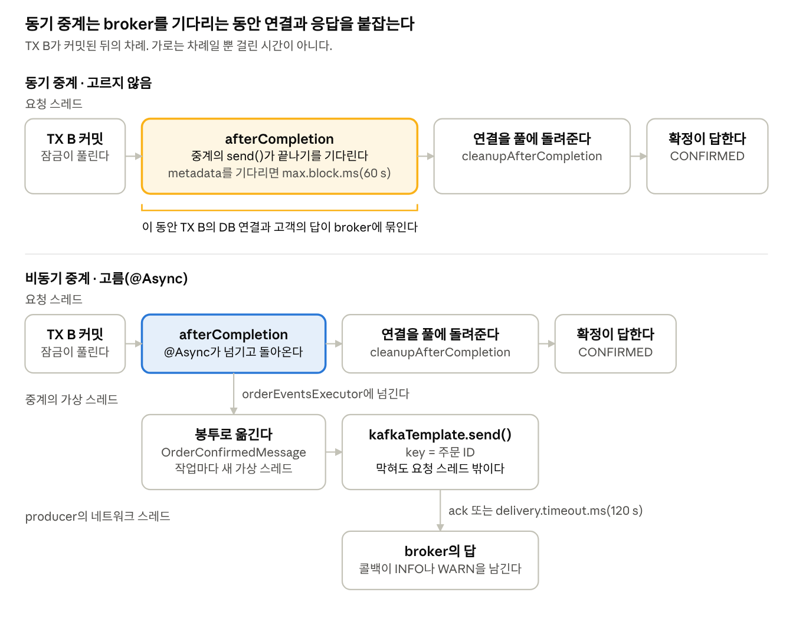

# 유실 없는 카프카 이벤트 발행 여정

이번 주에는 지난주에 PG로 확정한 주문을 commerce-api가 주문 확정 이벤트로 `order-events` 토픽에 발행하게 했다. commerce-streamer는 그 이벤트를 받아 구매 활동으로 기록한다.

`@Transactional` 메서드 끝에서 발행을 하면 아직 DB 커밋 전이기에 롤백이 일어나는 경우 이벤트가 잘못 발행될 수 있다. 물론 커밋 뒤에 발행해도 발행이 실패하거나 그사이에 프로세스가 멈추면 이벤트가 유실될 수 있다. 결국 DB와 broker를 한 트랜잭션으로 묶을 수 없어서이다. 이를 다음 주에 transactional outbox로 해결할 예정이다.

## 확정 하나가 Kafka에 닿기까지

주문이 CONFIRMED가 되는 곳은 `OrderPaymentSagaSteps.applyResult` 하나다. 생성 응답도 고객의 대사도 PG의 알림도 같은 TX B로 이 메서드에 온다. 발행도 여기서 한다.

```kotlin
val savedOrder = orderRepository.save(order)

if (result is ReconcileResult.Changed && result.to == PaymentStatus.SUCCESS) {
    orderEventPublisher.publish(OrderConfirmedEvent.from(savedOrder))
}
```

조건은 "주문이 CONFIRMED인가"가 아니라 "이번 반영이 결제를 SUCCESS로 바꿨는가"다. 늦게 온 생성 응답과 주문 잠금을 기다린 중복 알림도 TX B에 닿지만 끝난 결제를 읽어 `Unchanged`가 된다. 조건문을 현재 상태(`order.status`나 `payment.status`)로 물으면 여기서 중복된 이벤트가 나간다.

그 뒤는 이렇게 흐른다. 참고로 프로젝트에서는 헥사고날 아키텍처를 사용하고 있어서 헥사곤 내부의 응용 서비스는 포트만 부르고, Spring 이벤트 발행부터 Kafka 메시지 발행까지는 헥사곤 외부의 Kafka 어댑터가 맡는다.

1. 응용 서비스가 포트 `OrderEventPublisher`를 부른다.
2. Kafka 어댑터에 있는 포트 구현이 같은 트랜잭션 안에서 `ApplicationEventPublisher.publishEvent`를 부른다.
3. 받는 쪽이 `@TransactionalEventListener`라서 Spring은 리스너를 바로 부르지 않고 TX B가 커밋된 후에 부른다.
4. TX B가 커밋되면 Spring이 `afterCompletion`에서 중계 `OrderConfirmedKafkaRelay.relay`를 부른다. 롤백됐다면 이벤트는 버려진다.
5. `@Async`가 호출을 전용 실행기의 가상 스레드로 넘기고 바로 돌아온다. 요청 스레드는 DB 커넥션을 반납하고 응답한다.
6. 가상 스레드에서 중계가 이벤트를 봉투로 옮기고 주문 ID를 key로 `kafkaTemplate.send`를 부른다.
7. broker가 받으면 INFO 한 줄에 topic, partition, offset을 남기고 실패하면 WARN 한 줄을 남긴다.

포트 구현은 짧다.

```kotlin
override fun publish(event: OrderConfirmedEvent) {
    applicationEventPublisher.publishEvent(event)
}
```

다음 주의 transactional outbox도 같은 Spring 이벤트에 `BEFORE_COMMIT` 리스너 하나를 더하면 될 것이라 생각된다. 이런 구조는 [트랜잭셔널 아웃박스 패턴의 실제 구현 사례 (29CM)](https://medium.com/greglee-lab/%ED%8A%B8%EB%9E%9C%EC%9E%AD%EC%85%94%EB%84%90-%EC%95%84%EC%9B%83%EB%B0%95%EC%8A%A4-%ED%8C%A8%ED%84%B4%EC%9D%98-%EC%8B%A4%EC%A0%9C-%EA%B5%AC%ED%98%84-%EC%82%AC%EB%A1%80-29cm-0f822fc23edb)를 읽고 참고했다.

## 중계는 왜 비동기여야 했나

이 부분이 새롭게 알게 된 내용이다.

```kotlin
@Async(OrderEventsKafkaConfig.ORDER_EVENTS_EXECUTOR)
@TransactionalEventListener(phase = TransactionPhase.AFTER_COMMIT)
fun relay(event: OrderConfirmedEvent) {
    val message = OrderConfirmedMessage.from(event)

    try {
        kafkaTemplate.send(properties.topic, event.orderId.toString(), message)
            .whenComplete { result, exception -> /* one INFO line on success, one WARN line on failure */ }
    } catch (e: Exception) {
        logFailure(event, e)
    }
}
```



위는 `@Async`를 `@TransactionalEventListener`와 함께 사용하지 않았을 경우이고, 아래는 `@Async`를 적절히 사용한 경우이다. `@Async`를 사용해서 별도의 스레드에서 브로커 relay 로직이 동작하지 않는 경우 `send()`가 타임아웃이 날 때까지 커넥션을 점유한다.

AFTER_COMMIT 리스너는 커밋한 요청 스레드에서 돈다. Spring은 커밋 뒤 `afterCompletion`에서 리스너를 부르고 그다음에야 `cleanupAfterCompletion`에서 TX B의 DB 연결을 풀에 돌려준다. 동기로 발행하면 broker를 기다리는 내내 그 연결을 쥔다. broker에 닿지 못한 `send()`는 토픽 metadata를 `max.block.ms`(기본 60 s)까지 기다린다. 그동안 이미 커밋된 주문 확정 응답도 묶인다. `@Async`는 호출을 넘기고 바로 돌아오므로 연결도 응답도 broker와 상관없어진다.

실행기는 `Executors.newVirtualThreadPerTaskExecutor()`를 감싼 빈이다. 스레드 풀이었다면 broker가 오래 멈췄을 때 작업이 thread-pool executor의 큐에 쌓인다. 큐가 차면 넘김이 거절되고 그 이벤트는 발행되지 않는다. 작업마다 가상 스레드를 하나씩 쓰면 큐 자체가 없다. Tomcat이 사용하는 스레드까지 바꾸는 `spring.threads.virtual.enabled` 옵션은 선택하지 않았다.

중계는 발행 결과를 기다리지도 않는다. CompletableFuture는 broker가 ack하거나 producer가 포기할 때 끝나고, 포기는 늦어도 `delivery.timeout.ms`(기본 120 s)에 온다. 처음 생각한 3 s에서 끊어 봐야 실패가 아니라 "아직 시도 중"일 뿐이다.

대가도 있다. 커밋과 발행 사이의 틈이 넘김 한 번만큼 넓어진다. MDC와 추적 컨텍스트도 가상 스레드로 따라가지 않아서 로그에 eventId와 orderId를 직접 적는다.
