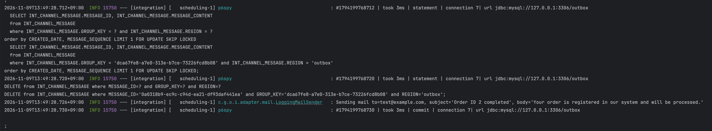
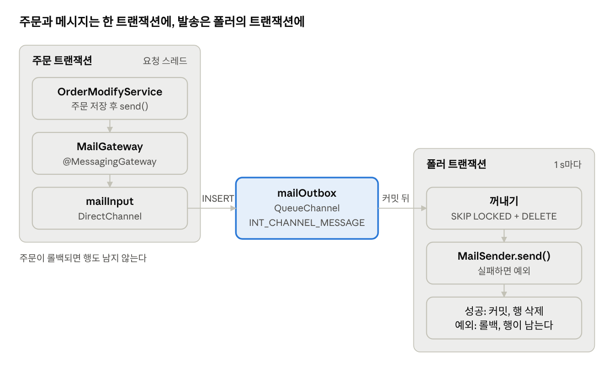
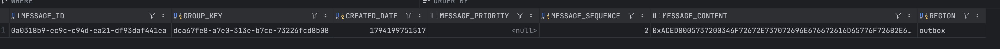

# 스프링 프레임워크 생태계의 라이브러리를 활용한 Transactional Outbox 패턴 구현

## 들어가며

이번 주에는 주문 확정 이벤트 발행에 트랜잭셔널 아웃박스를 적용했다. DB 테이블, 가져가기, 리스, 재시도 간격, 이벤트 직렬화·역직렬화, 막힌 이벤트 처리까지 모두 스프링 프레임워크가 제공하는 기본 기능들을 조합해서 만들었다. 구현하면서 정해야 했던 파라미터와 설계 분기점들이 있었다. 스프링 생태계에서 널리 쓰이는 라이브러리들은 이 결정들을 어떻게 내렸을까?

그래서 따로 [transactional-outbox-implementations](https://github.com/giwankim/transactional-outbox-implementations) 저장소를 만들어 Spring Integration으로 같은 패턴을 구현해 보며 그 라이브러리가 채택한 모범 사례와 패턴을 살펴보았다. 같은 저장소에 Spring Modulith를 적용해보았고 Namastack Outbox 공식 문서를 읽어 보았지만, 이 글은 Spring Integration만 다룬다. 사실 Namastack의 설정값과 구현을 살펴봤다면 이번 과제를 더 깊이 고민해 볼 수 있었을 텐데, 낯선 Spring Integration 구현을 고민하다가 다음 기회로 미루게 되어 아쉽다.

결론부터 말하자면 Spring Integration과 Spring Modulith는 라이브러리가 요구하는 아키텍처 제약과 추가로 학습해야 하는 패턴(enterprise integration patterns)이 아웃박스 하나를 구현하기에는 부담이 될 수 있다. 반면 Namastack Outbox는 도입을 고려해 볼 만하다고 느꼈다.

## Spring Integration으로 보는 아웃박스

Spring Integration에서 아웃박스는 따로 만드는 것이 아니다. DB 테이블을 저장소로 쓰는 큐 채널이 아웃박스다.

`QueueChannel`은 보통 메모리 큐지만, `JdbcChannelMessageStore`를 주면 큐가 [`INT_CHANNEL_MESSAGE` 테이블](https://github.com/spring-projects/spring-integration/blob/main/spring-integration-jdbc/src/main/resources/org/springframework/integration/jdbc/schema-mysql.sql)이 된다. 채널에 메시지를 넣는 일은 부르는 쪽 트랜잭션 안의 `INSERT`다. 채널에서 꺼내는 일은 폴러 트랜잭션 안의 `SELECT … FOR UPDATE SKIP LOCKED`와 `DELETE`다. 핸들러는 그 트랜잭션 안에서 돈다. 그래서 핸들러가 끝나면 커밋되어 행이 사라지고, 예외를 던지면 롤백되어 행이 돌아온다. 성공과 재시도를 트랜잭션이 대신 표현하는 셈이다.





왼쪽 트랜잭션이 커밋되어야 폴러가 행을 볼 수 있고, 오른쪽 트랜잭션의 커밋이 곧 발송 성공이다.

| 아웃박스의 역할 | Spring Integration | 이 저장소의 빈 |
| --- | --- | --- |
| 입구 | `@MessagingGateway` | `MailGateway` |
| 아웃박스 | `JdbcChannelMessageStore` 위의 `QueueChannel` | `mailOutbox`, `INT_CHANNEL_MESSAGE` |
| 읽는 작업 | 폴러가 붙은 핸들러 | `mailFlow`의 `handle` |
| 실제로 보내는 곳 | 핸들러가 부르는 대상 | `MailSender` (`LoggingMailSender`) |

예제는 Kafka가 아니라 메일을 보낸다. 가짜 `LoggingMailSender`는 기본 30% 확률로 예외를 던져 브로커 장애나 네트워크 오류를 흉내 낸다. 핸들러만 바꾸면 보내는 곳이 Kafka로 바뀐다.

### 전송 메시지를 남기는 쪽: 게이트웨이 호출

응용 서비스는 주문을 저장하고 게이트웨이를 부른다.

```kotlin
@Service
@Transactional
class OrderModifyService(
    private val orderRepository: OrderRepository,
    private val mailGateway: MailGateway,
) : OrderCompleter {
    override fun complete(completeRequest: CompleteOrderRequest) {
        val order = orderRepository.save(Order(completeRequest.amount, completeRequest.email))

        val message =
            MailMessage(
                subject = "Order ID ${order.id} completed",
                body = "Your order is registered in our system and will be processed.",
                to = order.customerEmail,
            )
        mailGateway.send(message)
    }
}
```

`MailGateway`는 구현이 없는 인터페이스다. Spring Integration이 실행 시점에 프록시를 만들고, 호출을 메시지로 바꿔 `mailInput` 채널에 넣는다.

```kotlin
@MessagingGateway(defaultRequestChannel = "mailInput")
interface MailGateway {
    fun send(message: MailMessage)
}
```

저장되는 것은 `MailMessage`가 아니라 그것을 payload로 담은 `Message` 전체다. 헤더까지 Java 직렬화로 `BLOB` 열에 들어간다. 그래서 payload는 `Serializable`이어야 한다.

```kotlin
data class MailMessage(
    val subject: String,
    val body: String,
    val to: String,
) : Serializable {
    companion object {
        @Serial
        private const val serialVersionUID: Long = 1L
    }
}
```

다음에 볼 수 있듯이 `message_content` 열에 payload가 직렬화되어 들어간다.



### 아웃박스 설정

```kotlin
@Configuration
class MailConfiguration {
    @Bean
    fun outboxMessageStore(dataSource: DataSource): JdbcChannelMessageStore {
        return JdbcChannelMessageStore(dataSource).apply {
            setChannelMessageStoreQueryProvider(MySqlChannelMessageStoreQueryProvider())
            region = "outbox"
        }
    }

    @Bean
    fun mailInput(): DirectChannel {
        return DirectChannel()
    }

    @Bean
    fun mailOutbox(outboxMessageStore: JdbcChannelMessageStore): QueueChannel {
        return MessageChannels.queue(outboxMessageStore, "mail-outbox").`object`
    }

    @Bean
    fun mailFlow(
        mailInput: DirectChannel,
        mailOutbox: QueueChannel,
        mailSender: MailSender,
    ): IntegrationFlow {
        return IntegrationFlow
            .from(mailInput)
            .channel(mailOutbox)
            .handle(
                MailMessage::class.java,
                { payload, _ ->
                    mailSender.send(payload)
                    null
                },
            ) {
                // receiveTimeout(0): a blocking receive would wait with the poll transaction open, holding an
                // InnoDB gap lock that blocks outbox INSERTs while they hold the queue's storeLock.
                it.poller(
                    Pollers
                        .fixedDelay(Duration.ofSeconds(1))
                        .receiveTimeout(0)
                        .transactional(),
                )
            }.get()
    }
}
```

`mailInput`은 `DirectChannel`이라 게이트웨이를 부른 스레드에서 곧바로 `mailOutbox`까지 간다. `mailOutbox`에 넣는 일은 `JdbcTemplate`의 `INSERT`다. 같은 `DataSource`를 쓰므로 `JpaTransactionManager`가 묶어 둔 연결을 그대로 쓰고, 주문의 `INSERT`와 한 트랜잭션에 든다. 주문이 롤백되면 메시지 행도 없다.

`handle`에 붙은 폴러가 읽는 쪽이다. 1초마다 깨어나 큐가 빌 때까지 메시지를 하나씩 꺼낸다. `maxMessagesPerPoll`의 기본값이 -1(제한 없음)이기 때문이다. `.transactional()`은 꺼내기부터 핸들러까지를 메시지마다 트랜잭션 하나로 감싼다. 이 한 줄이 없으면 행은 꺼내는 즉시 지워지고, 핸들러가 실패하면 메시지도 사라진다.

MySQL의 기본 격리 수준을 활용할 경우 폴링 옵션에 `.receiveTimeout(0)`을 설정하지 않으면 이 구성은 데드락에 빠질 수 있다. 기본값 1초로 두면 폴러는 트랜잭션을 연 채 메시지를 기다린다. `REPEATABLE READ`의 `FOR UPDATE`는 읽은 행이 없어도 갭 락을 잡고(`SKIP LOCKED`가 건너뛰는 것은 행 락뿐이다), 이 락이 아웃박스 `INSERT`를 막는다. 그런데 `INSERT`는 큐의 JVM 락(`storeLock`)을 쥔 채 기다리고, 대기를 마친 폴러는 커밋하기 전에 그 `storeLock`을 되찾아야 한다. 서로를 기다리지만 락 중 하나가 JVM 안에 있어 InnoDB는 데드락을 감지하지 못한다. 주문 요청은 `innodb_lock_wait_timeout`(기본 50초)을 다 기다린 뒤 실패하고, 주문도 함께 롤백된다. 타임아웃이 0이면 폴러는 한 번 조회하고 바로 끝나므로 `storeLock`을 되찾을 일이 없다. 조회 주기는 `fixedDelay`가 정하니 잃는 것도 없다.

## 직접 만든 아웃박스와 나란히 놓기

라이브러리에 위임한 것은 아웃박스에 기록을 남기는 쪽 전부와 남긴 메시지를 읽어 전송하는 쪽의 뼈대다. 테이블, 엔티티, 저장소, 스케줄러, 트랜잭션 경계를 위한 코드를 직접 구현하지 않았다. 남은 것은 메시지를 읽는 쪽의 설정들인데, 이 설정들은 라이브러리의 기본값들로 정해졌다.

7주차에 직접 만든 중계와 나란히 놓으면 그 설정값들이 보인다.

| | Spring Integration | 7주차 직접 구현 |
| --- | --- | --- |
| 남기기 | 게이트웨이 호출 하나 | 사가 단계가 엔티티를 저장 |
| 저장 형태 | `Message` 전체를 Java 직렬화한 `BLOB` | 식별·유형·key 열과 본문 JSON `TEXT` |
| 가져가기 | 한 번에 1행, `FOR UPDATE SKIP LOCKED` | 한 번에 20행, `FOR UPDATE SKIP LOCKED` |
| 보내는 동안 | 행 락과 DB 연결을 쥔다 | 락을 풀고 60초 리스로 지킨다 |
| 성공하면 | 행을 지운다 | `PUBLISHED`로 남긴다 |
| 실패하면 | 롤백, 1초 뒤 같은 행부터 다시 | 시도 수를 올리고 5초부터 두 배씩, 최대 5분 |
| 포기 | 없다 | 20번째 실패에서 `BLOCKED`, SQL로 재개 |

세 줄이 눈에 띈다.

**보내는 동안 락을 쥔다.** 핸들러가 폴러의 트랜잭션 안에서 도니 메일 서버나 브로커를 기다리는 내내 행 락과 DB 연결이 묶인다. 커밋이 곧 성공이라는 단순함의 대가다. Kafka라면 `delivery.timeout.ms`의 기본값이 120초라, 보내기 하나가 락을 최대 2분까지 쥘 수 있다. 직접 만든 중계는 가져가는 트랜잭션을 먼저 커밋하고 `next_attempt_at`을 60초 뒤로 미루는 리스로 행을 지킨다. 쓰기가 하나 늘지만 보내는 동안 아무것도 쥐지 않는다.

**기본 설정에는 실패의 간격도 한도도 없다.** 롤백된 행은 다음 폴링에서 가장 오래된 행으로 다시 맨 앞에 선다. 덕분에 순서가 지켜진다. 같은 성질의 뒷면도 있다. 어떤 메시지가 영원히 실패하면 그 뒤의 메시지가 모두 멈추고, 그 행은 1초마다 다시 실패한다. 주문마다 이벤트가 하나뿐인 주문 확정 이벤트에는 지킬 차례가 없어서, 직접 만든 중계는 행마다 결과를 따로 남기는 쪽을 골랐다.

**보낸 행이 남지 않는다.** `INT_CHANNEL_MESSAGE`는 큐라서 꺼낸 행을 지운다. 7주차 용어집은 아웃박스를 "보낸 뒤에도 지우지 않는" 기록으로 정의한다. 누락 복구가 이미 있는 행과 내용을 대조하기 때문이다. Java 직렬화한 `BLOB`은 SQL로 읽을 수도 없고, 클래스가 바뀌면 오래된 행을 역직렬화하지 못할 수 있다. 테이블 구조나 직렬화는 `ChannelMessageStorePreparedStatementSetter`로 바꿀 수 있다.

두 방식 모두 보장은 at-least-once다. 보내기는 성공했는데 커밋이 실패하면 같은 메시지가 다시 나간다. 받는 쪽의 멱등성은 어느 쪽을 골라도 따로 필요하다.

## 마치며

Spring Integration은 아웃박스의 "남기기"를 쉽게 해 준다. 게이트웨이 하나와 설정 클래스 하나면 주문과 같은 트랜잭션에 메시지가 남고, 폴러가 커밋 뒤에 그것을 꺼내 보낸다. 메시지 종류가 적고, 보낸 기록이 필요 없고, 장애가 짧게 끝나는 경우에는 이것으로 충분하다.

주문 확정 이벤트처럼 보낸 기록, 재시도 간격, 포기와 재개, 누락 복구가 필요한 일에는 이야기가 달라진다. 직렬화는 `ChannelMessageStorePreparedStatementSetter`로, 재시도는 advice나 error channel로 하나씩 바꿔 끼워야 한다. 바꿔 끼울수록 직접 만든 중계와 같은 결정을 다른 API로 내리게 된다. 라이브러리가 줄여 주는 것은 결정의 수가 아니라 코드의 양이다. 그리고 라이브러리가 그 결정을 기본값으로 이미 내려 두었다는 점을 알고 써야 한다.
