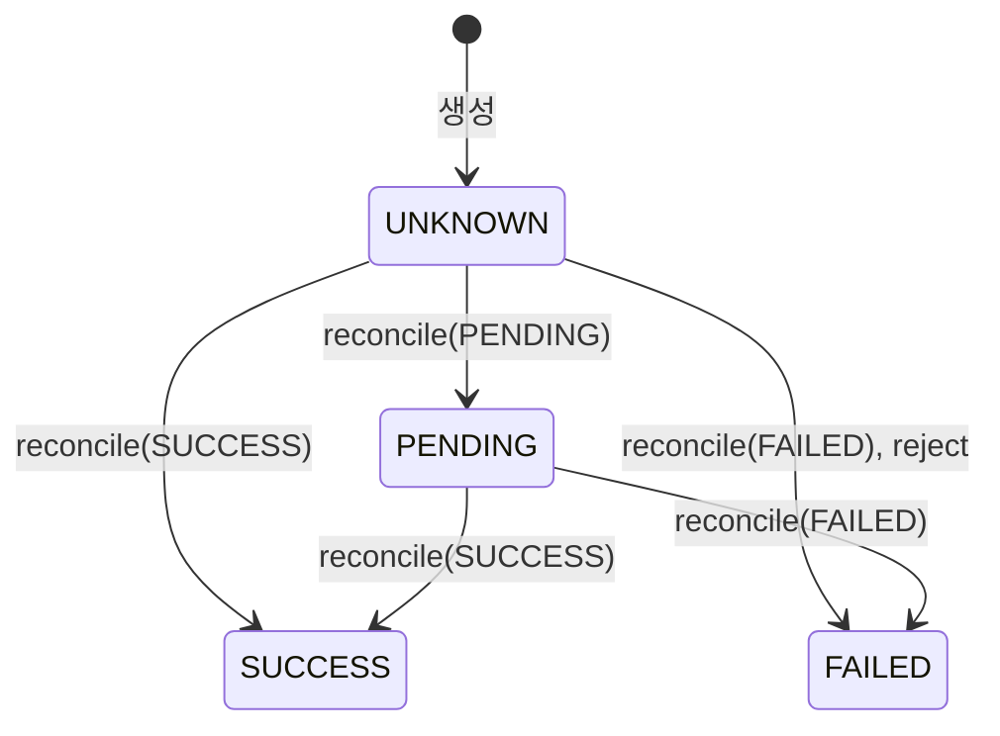
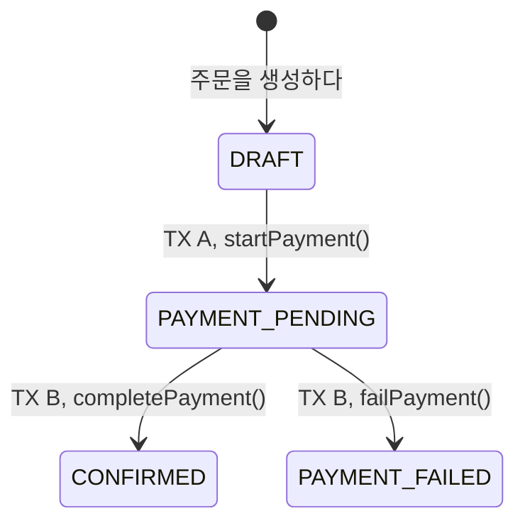

# 결제 설계 — 결제 애그리거트, PG 어댑터, PG로 결제하는 주문 확정

5주차 과제의 설계 문서다. 용어는 [`CONTEXT.md`](../../CONTEXT.md)의 `### 결제`와 대사하다를 따른다. 결정은 두 ADR에 있다. (2026-10-23: 1단계의 결정이다. 2단계의 결정 여섯은 9절에, 3단계의 결정 둘은 18절에 있다.)

- [ADR 0021](../adr/0021-payment-is-its-own-aggregate-and-slice.md): 결제는 주문과 다른 애그리거트이고, PG 포트는 결제 슬라이스가 가진다.
- [ADR 0022](../adr/0022-only-the-pre-create-rejection-proves-no-pg-transaction.md): PG 거래가 없다는 증거는 정확한 생성 전 거절뿐이고, 생성 요청은 다시 보내지 않는다.

상태: 2026-10-20 1단계([명세 138](https://github.com/giwankim/loop-pack-be-l2-vol5-kotlin/issues/138))를 마치고 썼다. 2·3단계가 절을 더해 이어 쓴다. 2026-10-23 2단계([명세 147](https://github.com/giwankim/loop-pack-be-l2-vol5-kotlin/issues/147))를 마치고 9–17절을 더했다. 같은 날 3단계([명세 159](https://github.com/giwankim/loop-pack-be-l2-vol5-kotlin/issues/159))를 마치고 18–23절을 더했다.

## 1. 근거와 범위

- 과제: [5주차 실습 · 결제 결과 미확인을 독립 상태로 다루기](https://app.notion.com/p/5-3fb5f76d265480c2864ff1161078265f). 1단계의 근거는 네 절이다.
  - 2절: 로컬 PG 계약, 422 생성 전 거절, 실제 HTTP 계약 테스트.
  - 3절: 발송을 기록한 뒤 생성 재전송 금지, 숨은 재시도 끄기, 카드 번호 비저장.
  - 4절: PG의 답과 내부 결제의 표.
  - 6절: 127.0.0.1, 별도 PG 프로세스 없음.
- 조사: [RestClient 시간 한도와 숨은 재시도](../research/rest-client-timeouts-and-http-fixtures.md), [wiremock-spring-boot 탐침](../research/wiremock-spring-boot-spike.md), 3단계를 위한 [Boot 4의 회복 라이브러리](../research/resilience-on-boot4.md).
- 구현 기록: 티켓마다의 닫는 댓글을 옮긴 [5주차 PG 어댑터 글감](../research/week5-pg-adapter-writing-material.md).

### 1.1 세 단계

| 단계 | 하는 것 | 상태 |
| --- | --- | --- |
| 1 | 결제 애그리거트, PG 어댑터, 테스트 PG | 끝남(2026-10-20, `feat/pg-adapter`) |
| 2 | 주문의 새 상태(과제의 `PAYMENT_PENDING`, `PAYMENT_FAILED`), 결제수단, 재고 예약, 과제의 TX A(PG를 부르기 전에 결제와 예약을 저장하는 트랜잭션)와 TX B(PG의 결과를 반영하는 트랜잭션), 확정·조회·대사 엔드포인트, 결과를 반영하는 응용 서비스. [ADR 0005](../adr/0005-no-request-idempotency-until-a-retrying-caller.md)와 [ADR 0003](../adr/0003-confirm-order-in-one-transaction.md)을 다시 연다. | 끝남(2026-10-23, `feat/order-payment`, 9절) |
| 3 | 알림(callback), 조회의 서킷 브레이커와 제한된 재조회 | 끝남(2026-10-23, `feat/reconcile`, 18절) |

### 1.2 1단계가 만든 것

| 티켓 | 만든 것 |
| --- | --- |
| [139](https://github.com/giwankim/loop-pack-be-l2-vol5-kotlin/issues/139) | `Payment`를 결과 미확인으로 만들고 주문마다, 멱등 키마다 하나씩 저장한다. `PaymentRepository`. |
| [140](https://github.com/giwankim/loop-pack-be-l2-vol5-kotlin/issues/140) | 받아들여진 생성이 `PaymentGateway`를 지나 테스트 PG까지 간다. 의존성, `adapter.integration.pg`, `@EnableTestPg`, `TestPg`. |
| [141](https://github.com/giwankim/loop-pack-be-l2-vol5-kotlin/issues/141) | `Payment.reconcile`과 `Payment.reject`, `ReconcileResult`, 충돌의 기록. |
| [142](https://github.com/giwankim/loop-pack-be-l2-vol5-kotlin/issues/142) | 정확한 생성 전 거절만 거절이고, 그 밖의 생성 응답과 답 없음은 모두 결과 미확인이다. 숨은 재전송과 풀 대기. |
| [143](https://github.com/giwankim/loop-pack-be-l2-vol5-kotlin/issues/143) | 거래 키 조회와 PG 주문 번호 목록 조회. |

운영 코드에서 결제와 게이트웨이를 부르는 곳은 아직 없다. 주문, 재고, 엔드포인트는 바뀌지 않았다. 2단계가 연결한다. (2026-10-23: 2단계가 확정, 주문 조회, 대사에 연결했다. 9절.)

## 2. 결제 모델

결제(`Payment`)는 주문과 다른 애그리거트이고 `domain.payment`와 `application.payment` 슬라이스를 가진다(ADR 0021). 커머스의 기록과 PG의 기록은 과제가 시험하는 바로 그 장면에서 갈린다. 생성 응답을 잃으면 커머스는 결과를 모르지만 PG 거래는 이미 성공했을 수 있다. 주문의 자식으로 두면 거래 키, PG 상태, 카드가 주문 슬라이스로 새고, 결제는 PG가 답할 때마다 바뀌는데 주문은 고객이 움직일 때 바뀐다. 결제는 주문을 식별자로만 가리킨다.

### 2.1 결제가 담는 것

| 필드 | 열 | 정해지는 때 | 규칙 |
| --- | --- | --- | --- |
| `orderId` | `order_id` | 생성 | 주문마다 하나(`UK_PAYMENT_ON_ORDER_ID`). 물리 외래 키 `FK_PAYMENT_ON_ORDER_ID` → `orders.id`. |
| `idempotencyKey` | `idempotency_key` | 생성 | 공백뿐이지 않고 64자 이하. 유일(`UK_PAYMENT_ON_IDEMPOTENCY_KEY`). (2026-10-22: 공백 없는 보이는 ASCII 1–64자다. 열은 `utf8mb4_bin`이라 대소문자만 다른 두 키가 따로 저장된다([ADR 0025](../adr/0025-confirm-requires-an-idempotency-key-and-replays-stored-state.md) 규칙 2, [issue 150](https://github.com/giwankim/loop-pack-be-l2-vol5-kotlin/issues/150)).) |
| `pgOrderId` | `pg_order_id` | 생성 | `LP-ORD-` 뒤에 주문 식별자를 10자리로 0 채움. 10자리는 최소 폭이라 더 긴 식별자도 자르지 않는다. (2026-10-22: 결제를 시작할 때 `PgOrderIdGenerator`가 새로 만들고, 주문 식별자에서 만들지 않는다. 운영 구현은 UUID 문자열(36자)이다. 유일(`UK_PAYMENT_ON_PG_ORDER_ID`). [ADR 0029](../adr/0029-pg-order-id-is-minted-per-payment.md), [issue 150](https://github.com/giwankim/loop-pack-be-l2-vol5-kotlin/issues/150).) |
| `amount` | `amount` | 생성 | 1원 이상의 `Money`. |
| `status` | `status` | `reconcile`, `reject` | 결과 미확인으로 시작해 앞으로만 간다(2.2). |
| `transactionKey` | `transaction_key` | 처음 맞은 PG 거래 | 모르면 null. 생성 전 거절로 실패한 결제는 PG 거래가 없으므로 끝까지 null이다. |

- 앞의 넷은 생성 뒤에 바뀌지 않는다(`updatable = false`). 생성의 규칙을 어기면 `InvalidPaymentException`이다. (2026-10-22: 결제는 `Payment.start(orderId, idempotencyKey, amount, pgOrderIdGenerator)`로만 만든다. 생성자는 private이라 호출자가 PG 주문 번호를 고를 수 없다(ADR 0029 규칙 2). fixture는 정해 둔 값을 돌려주는 생성기를 넣는다.)
- 카드는 담지 않는다. PG에 넘기기만 한다. `PaymentRepositoryTest`가 `information_schema.columns`로 열 목록 전체를 본다. 이름에 "card"가 든 열만 찾으면 `@Embedded CreditCard`가 만들 `type`, `number`를 놓치기 때문이다.
- PG 주문 번호는 `String.format`을 쓰지 않는다. `%d`는 JVM 기본 로캘의 숫자를 따라 `th-TH-u-nu-thai`에서 `LP-ORD-๐๐๐๐๐๐๐๐๔๒`가 됐다. `padStart`로 만들고, 테스트가 그 로캘에서 ASCII 숫자를 확인한다. (2026-10-22: [ADR 0029](../adr/0029-pg-order-id-is-minted-per-payment.md)가 파생 형식을 없애, `padStart`와 그 로캘 테스트도 함께 지웠다. 운영 생성기가 만드는 UUID 문자열은 `String.format`을 거치지 않는다. 생성기의 테스트가 값이 6자 이상의 ASCII이고 서로 다른지 본다.)
- 표는 `payment`다. 이 저장소는 예약어를 피할 때만 표 이름을 적는다. `BaseEntity`를 상속하고, 애그리거트 루트라 `@SQLRestriction("deleted_at is null")`로 논리 삭제한다([ADR 0016](../adr/0016-every-entity-extends-base-entity-and-roots-soft-delete.md)). 지우는 기능은 없다.
- `payment`는 가리키는 `orders`보다 이름 차례가 뒤라, 스키마를 다시 만들 때 `scalar-foreign-keys-drop.sql`이 그 외래 키를 먼저 지운다([포인트·주문 설계](./points-orders.md) 8.2의 2026-10-19 메모). migration 도구는 [issue 145](https://github.com/giwankim/loop-pack-be-l2-vol5-kotlin/issues/145)에서 다시 본다.
- `PaymentRepository`는 저장, 주문 식별자로 찾기, 멱등 키로 찾기만 가진다. 없으면 null이다. 거래 키나 PG 주문 번호로 찾는 것과 그 인덱스는 그것을 쓰는 단계가 더한다. (2026-10-22: PG 주문 번호의 인덱스는 2단계가 유일 키 `UK_PAYMENT_ON_PG_ORDER_ID`로 먼저 더했다. PG 주문 번호가 주문 식별자에서 오지 않으므로 유일성이 주문마다 하나에서 따라 나오지 않는다(ADR 0029 규칙 3). 그것으로 찾는 메서드는 3단계의 알림이 더한다.) (2026-10-23: 3단계가 `PaymentRepository.findByPgOrderId`와 `PaymentFinder.findByPgOrderId`를 더했다(19.3). 거래 키로는 찾지 않아 `transaction_key`에는 인덱스를 두지 않았다(ADR 0031 규칙 4).)

### 2.2 결제 상태



| 상태 | 뜻 |
| --- | --- |
| `UNKNOWN` 결과 미확인 | PG에서 어떻게 되었는지 모른다. 결제는 여기서 시작한다. 실패가 아니며, 이 상태만으로 결제를 끝내지 않는다. |
| `PENDING` 처리 중 | PG 거래가 있고 거래 키를 알지만 PG 상태가 끝나지 않았다. 결과 미확인으로 돌아가지 않는다. |
| `SUCCESS` 성공 | 맞는 PG 거래의 성공을 대사로 확인했다. 끝난 상태다. |
| `FAILED` 실패 | 맞는 PG 거래의 실패를 대사로 확인했거나, 맞는 생성 전 거절을 받았다. 끝난 상태다. |

PG 상태(`PgStatus`)는 `PENDING`, `SUCCESS`, `FAILED` 셋이고 결과 미확인이 없다. 그래서 어느 길로도 결과 미확인으로 돌아가지 않는다. PG가 생성을 받아들인 것은 성공이 아니다. 받아들여진 생성도 그 PG 거래의 PG 상태로 대사한다.

### 2.3 대사(`reconcile`)

알림, 대사 API, 받아들여진 생성 응답이 모두 `reconcile(transactions: List<PgTransaction>)`을 부른다. 위에서부터 처음 맞는 줄을 따른다. (2026-10-22: `reconcile`은 PG 거래 하나를 받는다(`reconcile(transaction: PgTransaction)`, [ADR 0028](../adr/0028-order-slice-orchestrates-the-payment.md)). 아래 표의 0건과 2건 이상의 줄은 없어졌고, 나머지 줄은 "1건"을 빼면 그대로다. 0건은 PG 주문 번호 조회의 `null`이라 대사를 부르지 않고, 2건 이상은 그 조회의 `MultiplePgTransactionsException`이다(3.2, 3.3). 둘 다 결제의 상태가 아니라 PG의 답에만 달린 판단이라 도메인을 떠났다.)

| 받은 것 | 결과 |
| --- | --- |
| 0건 | `Unchanged` |
| 2건 이상 | `Conflicted(MULTIPLE_TRANSACTIONS)` |
| 1건, PG 주문 번호가 다름 | `Conflicted(PG_ORDER_ID_MISMATCH)` |
| 1건, 금액이 다름 | `Conflicted(AMOUNT_MISMATCH)` |
| 1건, 이미 아는 거래 키와 다름 | `Conflicted(TRANSACTION_KEY_MISMATCH)` |
| 1건, 생성 전 거절로 실패한 결제(거래 키 없음) | `Conflicted(TRANSACTION_AFTER_REJECTION)` |
| 1건, 끝난 결제에 반대의 최종 상태 | `Conflicted(RESULT_MISMATCH)` |
| 1건, 끝난 결제에 같은 최종 상태나 `PENDING` | `Unchanged` |
| 1건, `UNKNOWN` 결제에 `PENDING` | 거래 키를 받고 `Changed(UNKNOWN, PENDING)` |
| 1건, `PENDING` 결제에 `PENDING` | `Unchanged` |
| 1건, 끝나지 않은 결제에 `SUCCESS`나 `FAILED` | 거래 키를 받고 `Changed(이전, 그 상태)` |

- 줄의 차례가 규칙이다. 한 `SUCCESS` 결제가 여러 규칙을 함께 어긴 `SUCCESS`를 들으면 가장 위의 까닭을 말한다. 아래 줄에서는 같은 답이 `Unchanged`이므로, 검사의 차례가 바뀌면 충돌이 소리 없이 사라진다. `PaymentTest`의 한 테스트가 그 차례를 지킨다. 줄마다의 테스트도 `PaymentTest`에 있다.
- 0건은 결과 미확인과 처리 중을 포함한 네 상태 모두에서 `Unchanged`다(5.4). (2026-10-22: 0건은 이제 대사에 오지 않는다. 위의 메모.)
- 거절로 실패한 결제의 줄은 2026-10-20 명세 리뷰에서 더했다. 맞는 생성 전 거절은 PG 거래가 없다는 증거이므로(ADR 0022 규칙 2), 그 뒤에 맞는 PG 거래가 오면 PG 상태가 무엇이든 모순이다. 그 전에는 `SUCCESS`만 `RESULT_MISMATCH`였고 `PENDING`과 `FAILED`는 아래의 "같은 최종 상태나 `PENDING`" 줄을 따라 소리 없이 `Unchanged`였다. 대사는 결제를 끝내기 전에 거래 키를 받으므로, 거래 키 없이 실패한 결제가 곧 거절로 실패한 결제다.

### 2.4 생성 전 거절(`reject`)

`reject(rejection: PgRejection)`은 생성 전 거절만 받는다.

| 받은 것 | 결과 |
| --- | --- |
| PG 주문 번호가 다름 | `Conflicted(PG_ORDER_ID_MISMATCH)` |
| 금액이 다름 | `Conflicted(AMOUNT_MISMATCH)` |
| 맞고, `UNKNOWN` 결제 | `Changed(UNKNOWN, FAILED)`. 거래 키는 null 그대로다. |
| 맞고, `FAILED` 결제 | `Unchanged` |
| 맞고, `PENDING`이나 `SUCCESS` 결제 | `Conflicted(RESULT_MISMATCH)` |

- 과제 3절은 "요청의 `orderId`·`amount`와 같은지"를 어댑터에 맡겼다. 여기서는 결제가 본다(ADR 0021 규칙 2). 어댑터는 HTTP를 값으로 옮길 뿐 커머스의 기록과 견주지 않는다.
- `reconcile`과 `reject`는 PG 주문 번호와 금액을 같은 private 검사로 본다. 그래서 두 길이 같은 차례로 같은 충돌을 말한다. 둘 다 다르면 PG 주문 번호다.
- 거절이 거래 키를 꾸며 넣지 않는다. PG 거래가 없기 때문이다.

### 2.5 결과와 충돌

`reconcile`과 `reject`는 `ReconcileResult`를 돌려준다.

| 결과 | 뜻 |
| --- | --- |
| `Changed(from, to)` | 결제 상태가 앞으로 갔다. |
| `Unchanged` | 아는 것이 늘지 않았거나 같은 답을 다시 들었다. |
| `Conflicted(reason)` | 결제와 맞지 않는 답이다. 상태와 거래 키는 그대로다. |

- 2단계는 `is Changed`가 아니라 `to.isFinished`에서만 주문과 예약을 바꾼다. `Changed(UNKNOWN, PENDING)`도 `Changed`다. (2026-10-23: TX B의 `OrderPaymentSagaSteps`가 그렇게 한다. 10.2.)
- `Conflicted`는 충돌 까닭(`ConflictReason`, 여섯 값)을 돌려주고 결제를 바꾸지 않는다. 까닭과 시각을 결제에 저장하지 않는다. 원래는 재시작 뒤에도 마지막 충돌을 보려고 두 열을 뒀지만, 이를 읽는 업무 규칙이나 복구 절차가 없어 2026-10-21에 제거했다([ADR 0021 규칙 1의 날짜 메모](../adr/0021-payment-is-its-own-aggregate-and-slice.md)). 결제 행만으로 마지막 충돌을 조회할 수는 없다. (2026-10-22: `MULTIPLE_TRANSACTIONS`가 빠져 `ConflictReason`은 다섯 값이다(2.3).)
- 엔티티는 로그를 쓰지 않는다. 충돌의 WARN 로그는 결과를 반영하는 응용 서비스(2단계)가 쓴다. (2026-10-23: `PaymentModifyService`의 `reconcile`과 `reject`가 쓴다. 11.4.)
- PG에게서 답을 얻지 못한 것(`PgOutcomeUnknownException`, `PgUnavailableException`)은 결제에 들어오지 않는다. 응용 계층이 거기서 멈추고 저장된 상태를 돌려준다. 그래서 결제에는 정확한 메서드 둘이면 되고, "답 없음"까지 받는 포괄 타입이 없다(ADR 0021의 고르지 않은 것). (2026-10-23: 저장된 상태는 답하는 때에 다시 읽는다. 13.3.) (2026-10-23: 3단계의 알림은 `PgUnavailableException`에 저장된 상태가 아니라 503 `PG_UNAVAILABLE`로 답한다. 그 예외가 결제에 들어오지 않는 것은 같다(19.2, 20.4).)

## 3. PG 계약과 결과

### 3.1 PG 계약

모든 요청은 `X-USER-ID: 135135`를 싣는다. 경로와 JSON의 이름은 과제가 적은 그대로다. JSON의 `orderId`는 PG 주문 번호(`pgOrderId`)이고 주문의 식별자가 아니다.

| 호출 | 요청 | 계약의 응답 |
| --- | --- | --- |
| 생성 | `POST /api/v1/payments`, 본문 `{orderId, cardType, cardNo, amount, callbackUrl}`. `amount`는 JSON 숫자다. | 202 `{transactionKey, orderId, amount, status}` |
| 생성 전 거절 | 위와 같다 | 422 `{"code":"TEST_PG_REJECTED_BEFORE_CREATE","orderId":…,"amount":…,"transactionCreated":false}` |
| 거래 키 조회 | `GET /api/v1/payments/{transactionKey}` | 200 PG 거래 하나, PG가 모르는 키면 404 |
| PG 주문 번호 목록 | `GET /api/v1/payments?orderId={pgOrderId}` | 200 PG 거래의 배열 |

- base URL과 알림 주소(`callbackUrl`)는 설정에서만 온다. 고객의 요청이 PG가 결과를 알릴 주소를 정하지 못한다.
- 거래 키는 경로 변수로, PG 주문 번호는 URI 템플릿의 query 변수로 넣는다. URI builder가 `+`와 `&`까지 인코딩한다. 값을 그대로 `queryParam`에 넣으면 둘이 인코딩되지 않고 나간다. [issue 143](https://github.com/giwankim/loop-pack-be-l2-vol5-kotlin/issues/143)의 변이 실행(코드의 한 곳을 일부러 되돌리고 테스트가 실패하는지 본 실행)에서 그 테스트가 실패했다.

### 3.2 포트

`application.payment.required.PaymentGateway`는 결제 슬라이스의 required 포트다. 구현은 `adapter.integration.pg.LocalPgGateway`다.

| 메서드 | 돌려주는 것 | 던지는 것 |
| --- | --- | --- |
| `createTransaction(request: PgTransactionCreateRequest)` | 받아들여진 생성의 `PgTransaction`. 성공이 아니다. | `ConstraintViolationException`, `PgRejectedException(rejection)`, `PgOutcomeUnknownException` |
| `retrieveTransaction(transactionKey)` | `PgTransaction?`. PG가 모르는 키(404)면 `null`. | `PgUnavailableException` |
| `listTransactions(pgOrderId)` | `List<PgTransaction>`. 비어 있을 수 있다. | `PgUnavailableException` |

- PG 주문 번호의 조회는 `retrieveTransactionByPgOrderId(pgOrderId)`다(2026-10-22, `listTransactions`에서 바꿨다. [ADR 0028](../adr/0028-order-slice-orchestrates-the-payment.md)). `PgTransaction?`을 돌려준다. PG 거래가 없으면 `null`이고, 둘 이상이면 `MultiplePgTransactionsException`을 던진다. 이 예외도 `RuntimeException`을 바로 넓혀, 공통 상위 타입이 없는 PG 예외는 넷이다. 넷은 결제 슬라이스의 provided 포트(2단계)가 주문 슬라이스로 그대로 던지게 되므로, 그 포트보다 먼저 `application.payment.provided`로 옮겼다(ADR 0028 규칙 3). 표의 마지막 줄과 아래의 "세 예외"는 그 전의 원문이다.
- 생성 입력은 포트와 같은 패키지의 `PgTransactionCreateRequest`다(2026-10-21). `pgOrderId`, `cardType`, `cardNumber`는 `@NotBlank`, `Long`인 `amount`는 `@Positive`로 검증한다. 카드 번호는 Hibernate Validator의 `@CreditCardNumber(ignoreNonDigitCharacters = true)`로 Luhn 검사를 하고, 하이픈 같은 숫자 아닌 문자는 무시한다. 카드가 발급되었거나 카드 종류와 맞는지는 이 검사로 알 수 없다. 포트 파라미터에 `@Valid`, 어댑터에 `@Validated`를 두어 잘못된 입력은 HTTP 요청 전에 `ConstraintViolationException`으로 거절한다. 이 예외는 PG의 답이 아니므로 PG 예외로 바꾸지 않는다. 트랜잭션을 더하지 않도록 `@ValidatedApplicationService`는 쓰지 않는다. 어댑터의 HTTP 본문 타입과 설정에서 오는 알림 주소는 그대로 어댑터에 둔다.
- 생성의 이름은 `createTransaction`이다(2026-10-20, `requestPayment`에서 바꿨다). 이 호출이 PG 거래를 만들고, 거래 키는 그 응답에서 처음 생긴다. Stripe의 PaymentIntent와 Toss의 결제 승인에서 `confirm`은 PG가 먼저 만든 객체를 그 키로 승인하는 일이다. 그 두 단계는 생성과 승인 사이에 고객이 인증하는 단계가 있어서 생긴다. 테스트 PG에는 그 단계가 없어 한 번의 호출로 거래를 만든다. Toss의 키인 결제(`POST /v1/payments/key-in`), Square의 `POST /v2/payments`와 같은 모양이다. `confirm`은 고객의 요청인 주문을 확정하다의 이름으로 남긴다.
- 포트는 PG가 말한 PG 거래만 돌려주고, 나머지 결과는 결과마다 다른 예외로 던진다(ADR 0023, 2026-10-20). 그 전에는 결과를 값(`Accepted`, `Rejected`, `Unknown`과 `Found`, `Unavailable`)으로 돌려주었다(ADR 0022 규칙 4). 3단계가 조회에 씌울 브레이커와 재시도가 예외를 중심으로 돌기 때문에 바꿨다. (2026-10-23: 3단계가 씌웠다. 브레이커와 재시도가 `PgUnavailableException`을 실패로 세고 다시 시도한다(20.2).)
- 세 예외에는 공통 상위 타입이 없다. catch 하나로 거절과 결과 미확인을 함께 잡지 못하게 하려는 것이다. 요청을 직렬화하지 못한 것 같은 프로그래밍 오류는 그 밖의 예외로 그대로 던진다. Jackson의 실패는 `HttpMessageConversionException`이고 `RestClientException`이 아니어서 어댑터의 catch를 지난다.
- 컨버터 설정이 잘못된 것은 그대로 던지지 않는다(2026-10-21 Spring 7.0.9의 소스로 확인). 요청을 쓸 컨버터가 없으면 Spring이 `RestClientException`을 던지므로, 아무것도 보내지 않았는데도 생성은 결과 미확인이 된다. 응답을 읽을 컨버터가 없으면 `UnknownContentTypeException`이라 생성은 결과 미확인, 조회는 조회 불가가 된다. 그렇게 깨진 설정은 계약 테스트의 받아들여진 생성 장면이 모두 실패하므로 그대로 나가지 않는다. 그 전에는 "설정 누락"도 그대로 던진다고 적었지만, `pg.*` 설정이 빠지면 호출이 아니라 시작할 때 바인딩이 실패한다.
- 예외의 메시지는 HTTP 상태(`HTTP 503`)나 실패의 종류(`SocketTimeoutException`)다. 로그와 테스트의 단언에만 쓴다. 원인 예외는 잇지 않는다(3.5). 호출자는 모든 결과 미확인과 모든 조회 불가를 각각 같게 다룬다. (2026-10-23: 3단계부터 열린 브레이커가 거절한 조회의 메시지는 `circuit open`이다(20.1).)
- 호출자는 PG 호출을 트랜잭션 안에 두지 않고, `Exception`이나 `RuntimeException`을 잡는 catch로 감싸지 않는다. 결과 미확인의 예외가 결제를 저장한 트랜잭션을 지나면 그 저장이 되돌아간다(ADR 0023 규칙 4).
- 포트 하나가 생성과 조회를 함께 가진다. 그래서 대사가 생성을 부르지 않는다는 것을 타입이 막지 않고, ADR 0022 규칙 6·7의 테스트가 PG가 받은 생성 수로 지킨다.

### 3.3 응답에서 결과로

아래 표의 "잘 짜인 PG 거래"는 이렇다. 본문은 JSON(`Content-Type: application/json`)이다(4.3). 네 필드가 모두 있다. `transactionKey`는 공백뿐이지 않다. 그 키로는 PG 거래를 다시 조회할 수 없기 때문이다. `amount`는 0 이상의 JSON 정수다(문자열도 소수도 아니다). `status`는 `PENDING`, `SUCCESS`, `FAILED` 중 하나다. 모르는 속성은 무시한다.

| 호출 | 응답 | 결과 |
| --- | --- | --- |
| 생성 | 202, 잘 짜인 PG 거래. PG 상태가 무엇이든 그렇다. | 그 PG 거래를 돌려준다 |
| 생성 | 422, 정확한 `code`, `transactionCreated`가 JSON `false`, `orderId`·`amount` 있음 | `PgRejectedException(PgRejection(되돌려 받은 PG 주문 번호, 금액))` |
| 생성 | 정확하지 않은 422: 본문 없음, 다른 `code`, `transactionCreated`가 `true`·`"false"`·`null`·빠짐, `code`·`orderId`·`amount` 빠짐, 문자열 금액, 잘린 JSON | `PgOutcomeUnknownException` |
| 생성 | 202가 아닌 2xx(200, 201. 잘 짜인 PG 거래를 실어도), 다른 4xx, 5xx | `PgOutcomeUnknownException("HTTP <상태>")` |
| 생성 | 잘 짜이지 않은 202, 연결 끊김, 연결 시간 초과, 응답 시간 초과, 풀 대기 초과 | `PgOutcomeUnknownException` |
| 거래 키 조회 | 200, 잘 짜인 PG 거래 | 그 PG 거래를 돌려준다 |
| 거래 키 조회 | 404 | `null`을 돌려준다 |
| 목록 조회 | 200, 잘 짜인 PG 거래의 배열 | 그 PG 거래들을 돌려준다. 0건도, 2건 이상도 PG의 차례 그대로다. |
| 두 조회 | 그 밖의 모든 상태(목록 조회의 404 포함), 잘 짜이지 않은 본문, 연결 끊김, 연결 시간 초과, 응답 시간 초과 | `PgUnavailableException` |

- **목록:** JSON 배열만 받는다. 객체 하나, `null`, `null` 원소는 잘 짜이지 않은 본문이다.
- **404:** PG 계약이 404를 말하는 곳은 거래 키 조회뿐이다. 목록의 "없음"은 빈 배열이다. 그래서 목록 조회의 404는 조회 불가다.
- **하나까지(2026-10-22):** 목록 조회는 이제 `retrieveTransactionByPgOrderId`이고 PG 거래를 하나까지 돌려준다([ADR 0028](../adr/0028-order-slice-orchestrates-the-payment.md)). 잘 짜인 PG 거래의 배열에서 빈 배열은 `null`, 원소 하나는 그 PG 거래, 둘 이상은 `MultiplePgTransactionsException`이다. 원소를 모두 읽은 뒤에 세므로, 둘 이상이어도 읽을 수 없는 원소가 있으면 `PgUnavailableException`이다. 위 표의 목록 조회 줄은 그 전의 원문이다.
- **다시 시도(2026-10-23):** 표의 결과는 HTTP 시도 하나의 것이다. 3단계부터 `PgUnavailableException`인 조회는 100 ms 뒤 한 번 더 보내고, 브레이커가 열려 있으면 HTTP를 보내지 않고 `PgUnavailableException`이다. 생성은 그대로 한 번이다(20.2).

### 3.4 왜 정확한 422만 거절인가

결과 미확인을 실패로 바꾸는 길은 코드 곳곳의 작은 분기에 있다. 예외 하나를 실패로 옮기는 catch, 기본값으로 켜진 클라이언트의 재전송, 0건을 "없음"으로 읽는 조회가 모두 이중 결제가 된다(ADR 0022).

- **증거는 하나다.** PG가 "만들지 않았고 앞으로도 만들지 않는다"고 명시하는 것은 생성 전 거절뿐이다. 422, 정확한 `code`, boolean `false`를 모두 확인할 때만 거절(`PgRejectedException`)이다. `transactionCreated` 검사를 뺀 변이 실행에서는 `true` 본문이 거절로 나왔다(그때의 이름은 값 `Rejected`였다).
- **시간 초과와 5xx는 실패가 아니다.** PG가 저장한 뒤 응답을 잃은 PG 거래가 나중에 성공하면, 예약을 돌려준 주문에서 돈이 빠져나간다. 고객이 다시 결제하면 두 번 낸다.
- **생성은 다시 보내지 않는다.** 테스트 PG는 같은 PG 주문 번호의 생성을 하나로 합친다고 약속하지 않고, 과제도 금한다. 결과는 조회와 대사로만 알아낸다.
- **풀을 얻지 못한 생성도 결과 미확인이다.** 보내지 않은 것은 확실하다. 그러나 그 증거는 HttpClient의 예외 타입과 Spring이 그것을 감싸는 방식에 달려 있어, 라이브러리를 올리면 조용히 틀어질 수 있다. 증거에 두 번째 길을 들이지 않는다. PG가 TCP 연결을 받지 않아 연결 한도 500 ms가 지난 생성도 같은 까닭으로 결과 미확인이다(2026-10-21, `ConnectTimeoutPaymentGatewayTest`).
- **조회의 0건은 PG 거래가 없다는 증거가 아니다**(5.4).

### 3.5 로그와 관측

게이트웨이는 로그를 쓰지 않는다(2026-10-21). 그 전에는 호출마다 한 줄을 썼다. 메서드, 경로 템플릿, 결과와 HTTP 상태나 실패의 종류, 걸린 시간, PG 주문 번호, 거래 키를 담고 본문과 카드 번호는 담지 않았다. 결과 미확인과 조회 불가는 WARN이었다. 어댑터를 줄이려고 지웠고, 나중에 다시 둘 수 있다. 지우기 전의 모양은 [76bd60e의 `LocalPgGateway`](https://github.com/giwankim/loop-pack-be-l2-vol5-kotlin/blob/76bd60e9af4bf69d8766ed9bc044416431b5bac3/apps/commerce-api/src/main/kotlin/com/loopers/adapter/integration/pg/LocalPgGateway.kt)와 그 줄을 보던 [`PaymentGatewayTest`](https://github.com/giwankim/loop-pack-be-l2-vol5-kotlin/blob/76bd60e9af4bf69d8766ed9bc044416431b5bac3/apps/commerce-api/src/test/kotlin/com/loopers/application/payment/required/PaymentGatewayTest.kt)에 있다. (2026-10-23: 3단계부터 게이트웨이의 설정 클래스가 조회 브레이커의 상태가 바뀔 때마다 WARN 한 줄을 남긴다. 게이트웨이 클래스는 그대로 로그를 쓰지 않는다(20.5).)

- 포트의 예외 메시지에는 Spring 예외의 메시지를 쓰지 않는다. 응답 본문의 일부를 담을 수 있기 때문이다. 실패의 종류는 예외 사슬의 맨 안쪽 타입 이름이다. 같은 까닭으로 포트의 예외는 그 원인 예외를 잇지 않는다(ADR 0023).
- 카드 번호를 가리는 일은 지금 다루지 않는다(2026-10-20). `CreditCard`는 data class의 기본 문자열 형태를 쓴다.
- observation registry가 있으면 다른 HTTP client 호출처럼 PG 호출도 기록한다. Boot의 `RestClientObservationAutoConfiguration`이 게이트웨이가 받는 `RestClient.Builder`에 registry를 단다(2026-10-20, 그 전에는 설정이 `ObjectProvider`로 직접 달았다). 어댑터만 담은 테스트 컨텍스트에는 registry가 없다. `ObservedPaymentGatewayTest`가 registry와 그 자동 설정을 더해, 생성과 거래 키 조회가 `http.client.requests`로 기록되고 측정값의 `uri`에 거래 키 대신 템플릿 `/api/v1/payments/{transactionKey}`가 남는 것을 본다(2026-10-20 명세 리뷰).
- 포트의 예외는 `exchange` 안에서도 던지므로 observation의 `exception`에 그 이름이 남는다. 422의 생성 전 거절, 202가 아닌 생성 응답, 200·404가 아닌 조회 응답이 그렇다. 받아들여진 생성과 찾은 조회(404 포함)만 오류가 없다(ADR 0023의 대가). 테스트는 이 값을 보지 않는다.

## 4. 클라이언트 설정

### 4.1 값

| 설정(`pg.*`) | 값 | 까닭 |
| --- | --- | --- |
| `base-url` | dev·qa·prd는 `${PG_BASE_URL}`, local과 test는 `http://127.0.0.1:8082` | 테스트에서는 테스트 PG가 자기 주소로 덮는다. 로컬에는 PG가 떠 있지 않다. |
| `callback-url` | dev·qa·prd는 `${PG_CALLBACK_URL}`, local과 test는 `http://127.0.0.1:8080/api/v1/payments/callback` | 설정에서만 온다(3.1). |
| `user-id` | `135135` | PG 계약이 정한 합성 계정. 기본 헤더 `X-USER-ID`다. |
| `max-connections` | 20 | 느린 PG에 요청이 쌓이지 않게 한다. PG의 경로는 하나라 전체와 경로당이 같다. HttpClient의 기본값은 25/5다. |
| `connection-request-timeout` | 200 ms | 풀 대기. 풀이 다 차면 오래 기다리지 않고 결과 미확인으로 끝낸다. 기본값은 3분이다. |
| `connect-timeout` | 500 ms | 기본값은 3분이다. |
| `response-timeout` | 1 s, test 프로필은 200 ms | 읽기마다의 한도다(5.1). 시간 초과 장면이 오래 걸리지 않게 test 프로필에서 줄이고, 게이트웨이의 계약 테스트만 1 s로 돈다(6.3). |

dev·qa·prd에서 환경 변수가 빠지면 시작이 아니라 첫 호출에서 실패한다. `redis.yml`과 같은 모양이다.

### 4.2 Apache HttpClient 5와 Boot의 `RestClient.Builder`

- **숨은 재전송을 모두 끈다.** HttpClient 5의 기본값은 429·503에 POST를 1초 뒤 한 번 더 보내고, 307·308에는 본문까지 복사해 따라가고, `IOException`에 GET을 한 번 더 보낸다. Spring의 Jackson 본문은 다시 쓸 수 있는 본문이라 막히지 않는다. `disableAutomaticRetries()`와 `disableRedirectHandling()`을 켠다(ADR 0022 규칙 5). 변이 실행에서 둘을 하나씩 빼면 429·503에 POST가 2번, 끊긴 GET이 2번 갔고, 307은 따라갔다.
- **HttpClient 5인 까닭.** 조사([RestClient 시간 한도와 숨은 재시도](../research/rest-client-timeouts-and-http-fixtures.md) §7)는 JDK client를 먼저 꼽았다. 그러나 JDK client에는 풀 크기와 풀 대기의 한도가 없고, 응답 전에 닫힌 연결에 GET을 다시 보내는 것을 끌 스위치가 없으며, 재시도 플래그는 JVM 전체의 시스템 속성이다. HttpClient 5는 풀, 풀 대기, 재전송의 스위치를 클라이언트마다 가진다. 대가는 기본값이 재전송한다는 것이고, 위의 두 스위치와 계약 테스트의 요청 수가 그것을 막는다.
- **시간 한도는 실제 request factory가 쓰는 HttpClient에 둔다.** 연결 한도는 연결 풀의 `ConnectionConfig`가, 풀 대기와 응답 한도는 `RequestConfig`가 맡는다. factory에는 한도를 주지 않으므로 HttpClient의 설정이 그대로 쓰인다. factory는 빈이라 컨텍스트가 닫힐 때 HttpClient와 풀도 닫힌다.
- **Boot의 `RestClient.Builder`에 request factory를 직접 준다.** `spring-boot-starter-restclient`를 들여, 게이트웨이가 Boot가 미리 설정한 `RestClient.Builder`(prototype)를 받는다(2026-10-20, 그 전에는 스타터 없이 `RestClient.builder()`로 만들었다). observation과 `RestClientCustomizer`가 그 builder로 온다. Boot의 HTTP client 설정(`spring.http.clients.*`)은 재시도와 풀 대기를 다루지 않으므로 쓰지 않고, builder의 request factory를 `pgRequestFactory`로 바꾼다. factory를 바꾸지 않으면 클래스 경로에 따라 client가 바뀐다. 테스트 클래스 경로에는 WireMock이 HttpClient 5와 Jetty client를 들이므로, 운영과 테스트가 다른 client로 돌 수 있었다(탐침 §7의 2). Boot는 builder를 줄 때마다 자기 request factory를 먼저 만들어 두므로, 쓰이지 않는 HttpClient가 하나 생긴다. 그것으로는 연결을 열지 않는다. HTTP Service Clients는 들이지 않았다([ADR 0008](../adr/0008-upgrade-to-spring-boot-4-1-ahead-of-the-template.md)의 2026-10-19 메모).
- **게이트웨이는 컴포넌트 스캔으로 등록한다.** `LocalPgGateway`는 `@Component`이고, Boot의 `RestClient.Builder`, `pgRequestFactory`, `PgProperties`를 받아 `RestClient`를 스스로 만든다. `LocalPgGatewayConfig`에는 request factory 빈과 `PgProperties`의 등록만 남는다. builder를 받아 컴포넌트가 만드는 것은 [Boot 문서](https://docs.spring.io/spring-boot/reference/io/rest-client.html#io.rest-client.restclient)의 모양이고, `adapter.persistence`의 구현처럼 어댑터 클래스가 스스로 등록된다. kotlin-spring 플러그인은 `@Component` 클래스를 열고 `@Bean`으로만 등록한 클래스는 `final`로 두므로, 3단계가 이 빈에 프록시를 씌우게 되어도 막히지 않는다([Boot 4의 회복 라이브러리](../research/resilience-on-boot4.md)). (2026-10-20, 그 전에는 설정의 `@Bean` 메서드가 게이트웨이를, 이어서 `RestClient`를 만들었다.) (2026-10-23: 3단계가 씌웠다. Resilience4j의 aspect는 `@Validated`가 이미 만든 CGLIB 프록시에 함께 걸린다(20.1).)
- **`retrieve()`가 아니라 `exchange`로 받는다.** 상태 코드가 결과를 정하므로 상태 코드를 값으로 읽는다. `retrieve()`는 2xx를 성공으로, 4xx·5xx를 한 가지 오류로 본다. PG 계약은 그 전제와 세 군데에서 어긋나고, Spring의 기본 예외는 3.5의 규칙과 맞지 않는다. 포트의 예외는 `onStatus` 처리기 안에서도 그대로 던질 수 있어 `retrieve()`로도 만들 수는 있다. 그러나 상태의 규칙이 처리기의 술어, Spring의 기본 처리기, catch, `body()` 뒤의 null 검사 네 군데로 흩어진다. `exchange`에서는 호출마다 응답을 읽는 함수 하나가 3.3의 표를 위에서 아래로 따른다. 호출마다 `catch (RestClientException)` 하나가 전송 예외(`ResourceAccessException`), Jackson의 해석 오류, 어댑터의 `UnreadablePgResponseException`을 결과 미확인이나 조회 불가로 옮긴다. (2026-10-21, 그 전에는 `retrieve()`의 상태 처리기 때문에 catch 하나가 결과 미확인을 실패로 바꾸기 쉽다는 까닭을 들었다. 포트가 결과를 값으로 돌려주던 ADR 0022 규칙 4의 까닭이다. ADR 0023이 포트를 예외로 바꾼 뒤 다시 견주었고, 결정은 그대로다. 아래는 Spring Framework 7.0.9의 소스로 확인했다.)
  - **성공은 202 하나다.** 기본 처리기는 4xx·5xx에만 던진다. 200·201·307의 생성 응답은 본문을 읽어 성공이 된다. 막으려면 "202가 아니면" 처리기를 다는데, `exchange`의 상태 검사를 술어로 옮긴 것일 뿐이다.
  - **거래 키 조회의 404는 결과다.** 처리기는 값을 돌려주지 못하고, 던지지 않으면 Spring이 본문을 읽는다. 그래서 404의 `null`은 `HttpClientErrorException.NotFound`를 잡는 catch가 된다. 예외의 타입이 결과를 정하는 catch이고, ADR 0022 규칙 4가 없애려던 모양이다. 기본 처리기는 404의 본문도 끝까지 읽는다. 지금의 어댑터는 읽지 않는다.
  - **422의 본문은 엄격한 컨버터가 읽어야 한다.** 처리기는 감싸지 않은 `ClientHttpResponse`를 받아 `bodyTo`를 쓸 수 없다. 엄격한 매퍼로 직접 읽으면, Jackson 3의 `JacksonException`은 `RuntimeException`이라 catch를 지나 포트 밖으로 샌다. 4.3의 YAML 컨버터와 같은 종류의 구멍이다. 기본 예외의 `getResponseBodyAs`로 읽으면 catch 안에 try가 다시 생긴다.
  - **기본 예외의 메시지는 본문을 담는다.** `422 Unprocessable Content: {본문}`의 모양이라 3.5의 규칙과 어긋난다. 포트의 메시지도 `HTTP 500`이 아니라 `InternalServerError` 같은 하위 클래스의 이름이 된다. 빈 본문에 `requiredBody()`를 쓰면 `IllegalStateException`이 포트 밖으로 샌다.

### 4.3 엄격한 JSON 매퍼

어댑터는 PG의 JSON만 읽고 쓰는 `JsonMapper`를 따로 가진다.

- 단일 값을 배열로 읽지 않는다(`ACCEPT_SINGLE_VALUE_AS_ARRAY` 끔).
- 빈 문자열을 null로 읽지 않는다(`ACCEPT_EMPTY_STRING_AS_NULL_OBJECT` 끔).
- 스칼라를 바꿔 읽지 않는다(`ALLOW_COERCION_OF_SCALARS` 끔). `"7000"`은 숫자가, `"false"`는 boolean이 아니다.
- 소수를 정수로 읽지 않는다(`ACCEPT_FLOAT_AS_INT` 끔). 금액은 원화 정수라 `7000.9`가 7000이 되면 안 된다.
- 원시 타입의 null과 빠진 값을 거절한다(`FAIL_ON_NULL_FOR_PRIMITIVES` 켬). null이 될 수 없는 Kotlin 타입은 Kotlin 모듈이 거절한다.
- 모르는 속성은 무시한다(`FAIL_ON_UNKNOWN_PROPERTIES` 끔). PG가 필드를 더해도 계약의 필드만 읽는다.

**Boot의 매퍼와 따로 둔 까닭.** Boot의 매퍼(`supports/jackson`)는 우리 API를 부르는 클라이언트를 너그럽게 받으려고 `ACCEPT_SINGLE_VALUE_AS_ARRAY`와 `ACCEPT_EMPTY_STRING_AS_NULL_OBJECT`를 켠다. 그 너그러움이 남의 계약을 읽는 데 새면, 계약에 없는 JSON을 조용히 읽는다. `"transactionCreated": "false"`를 `false`로 읽으면 증거가 아닌 422가 거절이 된다. Boot의 매퍼와 `supports/jackson`은 바꾸지 않았다.

**PG의 본문을 읽는 컨버터는 이 매퍼의 것 하나다.** Boot의 컨버터 설정은 builder에 `registerDefaults()`와 Boot의 매퍼를 단 JSON 컨버터를 넣어 둔다. 게이트웨이의 설정은 그 뒤에 돌아, `disableDefaults()`로 클래스 경로에서 찾는 컨버터를 끄고 한 자리인 JSON 컨버터를 이 매퍼의 것으로 바꾼다. 남는 것은 Boot의 String 컨버터, form 컨버터와 이 JSON 컨버터이고, PG의 본문 타입을 읽고 쓰는 것은 이 JSON 컨버터뿐이다(2026-10-20 전체 컨텍스트에서 확인).

- `disableDefaults()`가 없으면 클래스 경로의 Jackson 2 YAML 컨버터와 JAXB 컨버터가 들어온다. JSON 문서는 YAML 문서이기도 해서, `Content-Type: application/yaml`의 202는 YAML 컨버터가 맡았다. 그 컨버터는 PG 거래를 만들지 못해 `HttpMessageConversionException`을 던졌고, 그 예외는 `RestClientException`이 아니라서 포트 밖으로 샜다. `PaymentGatewayTest`가 이 장면을 지킨다.
- Boot의 컨버터 설정은 `HttpMessageConverter` 빈을 모두 맞춤 컨버터로 넣고, 맞춤 컨버터는 JSON 컨버터보다 앞선다. `disableDefaults()`는 그것을 막지 않는다. 지금 그런 빈은 없다. JSON을 읽는 컨버터 빈을 더하면 PG의 응답도 그것이 먼저 읽는다.
- 게이트웨이 테스트의 컨텍스트에는 Boot의 매퍼, 컨버터 설정, `JacksonConfig`를 운영처럼 둔다(6.1). 엄격한 매퍼를 빼는 변이 실행에서 JSON 해석의 테스트 9개가 실패했다.

매퍼가 보지 못하는 것은 어댑터가 본다. 공백뿐인 거래 키, 모르는 PG 상태, 음수 금액, 배열의 `null` 원소다. 마지막은 Kotlin 모듈의 null 검사가 생성자 파라미터에만 걸리고 최상위 `ParameterizedTypeReference`의 타입 인자는 보지 못해서다. [issue 143](https://github.com/giwankim/loop-pack-be-l2-vol5-kotlin/issues/143)에서 고치기 전에는 `[null]`이 `NullPointerException`으로 포트 밖에 나갔다.

## 5. 받아들인 한계

### 5.1 응답 한도 1 s는 읽기마다의 한도다

HttpClient의 응답 한도는 다음 바이트를 기다리는 시간이고, 호출 전체의 기한이 아니다. 1초가 되기 전마다 조금씩 보내는 PG는 호출을 더 오래 붙잡을 수 있다. 호출 전체의 기한은 두지 않았다. 설정(`application.yml`, `PgProperties`)의 주석에도 적었다.

### 5.2 풀에서 연결을 얻지 못한 생성도 결과 미확인이다

풀 대기 200 ms가 지나면 생성은 `PgOutcomeUnknownException`이다. PG는 그 생성을 받지 못했다(`ExhaustedPoolPaymentGatewayTest`에서 생성 수 1 그대로). 그래도 실패로 보지 않는 까닭은 3.4에 있다. 그 결제는 다음 5.3의 처지가 된다.

### 5.3 PG가 받지 못한 결제는 사람이 끝낼 때까지 결과 미확인이다

생성이 PG에 닿지 않았거나 PG가 잃은 결제는 결과 미확인에서 끝나지 않는다. 대사가 0건을 받아도 그대로이므로, 2단계가 들일 재고 예약도 남는다. 과제는 조회 한도를 다 쓴 것도 새 결제의 근거가 아니라고 한다. 이 결제를 끝내는 것은 사람의 몫이고, PR에 남은 한계로 적는다(ADR 0022의 대가). (2026-10-23: 2단계의 예약도 그렇게 남는다. 15.1.)

### 5.4 0건은 PG 거래가 없다는 증거가 아니다

거래 키 조회의 404는 `null`, 목록의 빈 배열은 빈 목록이고, 대사에서 `Unchanged`다. PG 거래가 아직 보이지 않거나 생성 요청이 아직 오는 중일 수 있다. 잘못된 base URL이나 PG 앞의 무엇이 돌려준 404도 거래 키 조회에서는 `null`로 읽힌다. 대사가 0건에 아무것도 바꾸지 않으므로 받아들인다(ADR 0022 규칙 3). (2026-10-22: 목록의 빈 배열도 이제 `null`이다. `reconcile`이 PG 거래 하나를 받으므로 `null`이면 대사를 부르지 않고 저장된 상태로 답한다(2.3).)

조회도 다시 보내지 않는다. 끊긴 GET은 PG에 한 번만 간다. 제한된 재조회는 3단계가 조회에만 씌운다(ADR 0022 규칙 7). (2026-10-23: 3단계가 씌웠다. 조회할 수 없는 조회는 100 ms 뒤 한 번 더 가서 PG가 받는 GET은 2다. HttpClient의 숨은 재전송은 여전히 꺼져 있어 시도마다 GET은 한 번이고, Resilience4j가 없는 게이트웨이의 계약 테스트는 끊긴 GET 1번을 그대로 본다(20.2, 20.6).)

## 6. 테스트 PG

### 6.1 모양

- **wiremock-spring-boot 4.4.3**을 버전 카탈로그에 고정해 `testImplementation`으로 들였다. Spring 테스트 컨텍스트마다 WireMock 서버 하나를 테스트 JVM 안에 띄우고, refresh 전에 그 주소를 `pg.base-url`에 넣는다. 서버는 컨텍스트와 함께 살고 죽는다. 별도의 PG 앱은 없다(과제 6절).
- **`@EnableTestPg`**가 `@EnableWireMock(ConfigureWireMock(name = "pg", baseUrlProperties = ["pg.base-url"], configurationCustomizers = [TestPgConfigurationCustomizer::class]))`를 감싼다. customizer는 서버를 `127.0.0.1`에 묶고 h2c를 끈다. WireMock의 기본값은 `0.0.0.0`에 묶고 h2c를 알린다. PG를 쓰는 테스트는 모두 이 애노테이션을 달아, 같은 설정끼리 컨텍스트와 서버를 나눠 쓴다.
- 서버는 `@InjectWireMock("pg") lateinit var` 필드로 받아 `TestPg`로 감싼다. 생성자 주입의 하나뿐인 예외다. `spring.test.constructor.autowire.mode=all`이면 생성자 파라미터를 `SpringExtension`과 WireMock의 resolver가 함께 맡으려다 실패한다.
- 스텁과 요청 기록은 테스트 메서드마다 지워진다(라이브러리 기본값).
- 1단계의 네 게이트웨이 테스트(`PaymentGatewayTest`, `ExhaustedPoolPaymentGatewayTest`, `ObservedPaymentGatewayTest`, `ConnectTimeoutPaymentGatewayTest`)는 운영의 `LocalPgGatewayConfig`, `LocalPgGateway`와 `supports/jackson`의 `JacksonConfig`를 그대로 읽는다. `ConnectTimeoutPaymentGatewayTest`만 테스트 PG 없이 `pg.base-url`을 라우팅되지 않는 TEST-NET-1(`192.0.2.1`, RFC 5737)로 둔다. 그 주소가 SYN을 조용히 버리지 않는 네트워크(기본 경로가 없는 오프라인 등)에서는 `@BeforeAll`의 가정이 클래스를 건너뛴다. Boot의 자동 설정은 `@ImportAutoConfiguration`으로 게이트웨이의 builder를 만드는 것만 고른다. Jackson, 컨버터, `RestClient.Builder`이고, `ObservedPaymentGatewayTest`는 RestClient의 observation을 더한다. 테스트만의 설정 클래스는 `ObservedPaymentGatewayTest`의 registry 하나이고 `@TestConfiguration`이다. PG 테스트에 설정 클래스를 더하면 그렇게 둔다. 테스트 소스의 평범한 `@Configuration`은 모든 `@SpringBootTest`에 끼어든다. 탐침의 설정 클래스가 그래서 기존 테스트 368개를 깨뜨렸다. (2026-10-23: 고른 자동 설정에 Resilience4j가 없으므로 3단계의 조회 애노테이션은 이 컨텍스트에서 걸리지 않는다. 네 테스트는 HTTP 요청 하나의 계약을 보고, 수도 3단계 전과 같다(20.6). `@EnableTestPg`가 가져오는 `TestPgLookupBreakerConfig`도 `@TestConfiguration`이고, 여기서는 읽는 곳이 없어 아무것도 하지 않는다.)
- **Jetty 판.** wiremock-spring-boot는 Jetty EE10을 12.1.6에 묶고, Boot는 Jetty core 12.1.12를 관리한다. 카탈로그가 `jettyEe10 = "12.1.12"`를 고정해 EE10 BOM을 가져오고, 설정 시점의 검사가 Boot의 `jetty.version`과 다르면 빌드를 멈춘다. Boot의 판을 읽어 쓰지 못한 것은 dependency-management 플러그인의 가져온 속성을 읽으면 그 뒤의 가져오기가 조용히 무시되기 때문이다([issue 140](https://github.com/giwankim/loop-pack-be-l2-vol5-kotlin/issues/140)).

### 6.2 장면(`TestPg`)

| 장면 | 메서드 | PG가 하는 것 |
| --- | --- | --- |
| 생성 수락 | `acceptsCreate(pgOrderId, amount, card, transactionKey, pgStatus)` | 202와 PG 거래. PG 상태의 기본값은 `PENDING`이다. |
| 생성 전 거절 | `rejectsBeforeCreate(pgOrderId, amount, card)` | 정확한 422. 받은 PG 주문 번호와 금액을 되돌려 준다. |
| 저장 뒤 응답 유실 | `losesCreateResponse(pgOrderId, amount, card)` | 본문을 다 읽은 뒤 응답 없이 끊는다(`Fault.EMPTY_RESPONSE`). |
| 멈춤 | `stallsCreate(pgOrderId, amount, card, transactionKey)` | 1.5 s 고정 지연 뒤 202. 운영의 응답 한도 1 s를 넘는다. |
| 리다이렉트 | `redirectsCreate(pgOrderId, amount, card)` | 307로 `/api/v1/payments/redirected`를 가리킨다. |
| 그 밖의 생성 응답 | `answersCreate(…, httpStatus, body, contentType)` | 주어진 상태와 본문. 본문 형식의 기본값은 JSON이다. |
| PG 거래 하나 | `hasTransaction(transaction)` | 그 거래 키의 조회에 200과 PG 거래 |
| PG 거래 목록 | `hasTransactions(pgOrderId, vararg transactions)` | 목록 조회에 200과 배열. PG 거래가 없으면 빈 배열이다. |
| 그 밖의 조회 응답 | `answersRetrieve(…)`, `answersList(…)` | 주어진 상태와 본문 |
| 조회 멈춤 | `stallsLookup()` | 모든 조회에 1.5 s 뒤 본문 없는 503 |
| 조회 응답 유실 | `losesLookupResponse()` | 모든 조회를 받은 뒤 응답 없이 끊는다. |

- 수: `createCount()`(생성), `lookupCount()`(두 조회를 함께), `requestCount()`(스텁과 맞지 않은 것까지 모든 요청), `unmatchedRequests()`(스텁과 맞지 않은 요청). (2026-10-23: 3단계가 `createCount(pgOrderId)`(본문의 `orderId`가 그 PG 주문 번호인 생성)와 장면 `losesFirstLookupResponses(times)`(처음 `times`번의 조회만 응답 없이 끊는다)를 더했다(20.6, 21.2).)
- 모든 스텁은 `X-USER-ID`를 맞춘다. 생성은 정확한 JSON 본문을(`equalToJson`, 금액은 JSON 숫자), 거래 키 조회는 경로의 키를, 목록 조회는 query의 `orderId`를 정확히 맞춘다. 틀린 요청은 스텁을 찾지 못해 WireMock의 404를 받는다.
- 생성은 그 404에 `PgOutcomeUnknownException`을 던지므로 테스트가 실패한다. 조회는 그렇지 않다. 거래 키 조회는 404를 `null`로 읽어, 기대한 결과와 같을 수 있다. 그래서 조회를 쓰는 테스트는 `unmatchedRequests()`가 비었는지 본다([`CODING_STANDARDS.md`](../../CODING_STANDARDS.md)의 단언). `PaymentGatewayTest`는 `@AfterEach`에서 본다.
- `stallsLookup`이 404가 아니라 503인 것도 같은 까닭이다. 한도가 1.5 s보다 긴 클라이언트에게 늦은 404는 "없음"이라는 사실로 읽힌다.
- JSON은 손으로 적는다. 필드 이름과 JSON 타입까지 PG 계약이기 때문이다. 무작위 지연은 쓰지 않는다.
- 2·3단계의 업무 테스트가 같은 장면을 쓴다. 3단계의 재시작 장면은 같은 컨텍스트 안에서 서비스와 클라이언트를 다시 만든다. 컨텍스트 자체를 다시 띄워야 하면 그때 `wiremock-standalone`으로 바꾼다(탐침 §5). (2026-10-23: 재시작 장면은 컨텍스트를 다시 띄웠지만 `wiremock-standalone`은 들이지 않았다. 두 번째 컨텍스트는 테스트 안에서 띄우고 닫으므로 그동안 첫 컨텍스트의 테스트 PG가 살아 있다. 두 번째 컨텍스트의 `pg.base-url`을 그 서버로 두면 스텁과 요청 기록이 그대로 남는다(21.2).)

### 6.3 계약 테스트가 운영의 시간 한도로 도는 까닭

`PaymentGatewayTest`는 어댑터와 그 builder를 만드는 자동 설정만 담은 가벼운 컨텍스트(6.1, MySQL과 Redis 없음)에 `@EnableTestPg`를 단다. `application.yml`을 test 프로필로 읽고 둘만 바꾼다. 응답 한도를 운영의 1 s로, 알림 주소를 test 프로필과 다른 값으로 둔다. 다른 알림 주소가 정확한 본문의 스텁에 맞으면, 어댑터가 그 주소를 설정에서 읽은 것이다.

응답 한도를 1 s로 두는 것은 재전송을 지키는 테스트가 헛돌지 않게 하기 위해서다. HttpClient 5는 응답 한도가 재시도 간격 1초보다 짧으면 상태 코드의 재시도를 스스로 건너뛴다. 탐침의 대조군에서, 재시도를 켠 client가 503에 응답 한도 200 ms에서는 POST를 1번, 2 s에서는 1025 ms 뒤 2번 보냈다. test 프로필의 200 ms에서는 `disableAutomaticRetries()`를 지워도 "503에 POST 1번"이 통과한다(ADR 0022 규칙 6).

풀 대기의 장면(`ExhaustedPoolPaymentGatewayTest`, 풀의 연결 1개)도 1 s가 필요하다. 200 ms라면 멈춘 생성이 연결을 놓는 때와 둘째 생성의 풀 대기가 끝나는 때가 겹친다. 이 장면만 풀의 설정이 달라 컨텍스트를 하나 더 띄우므로 클래스를 나눴다.

대가는 느린 장면 셋이다. 생성의 시간 초과, 풀 대기, 조회의 시간 초과가 각각 응답 한도 1 s를 기다린다(ADR 0022의 대가).

## 7. 이름과 명령

### 7.1 과제의 이름과 이 저장소의 이름

과제의 낱말을 그대로 따르지 않았다. 결제 쪽 이름은 Stripe(PaymentIntent, Payment Records, `Idempotency-Key`)와 Toss Payments(Payment, Transaction, `Idempotency-Key`)에 맞췄다. PG의 경로, 헤더, JSON 이름은 계약이라 그대로다.

| 과제 | 이 저장소 | 까닭 |
| --- | --- | --- |
| 결제 시도 `PaymentAttempt` | 결제 `Payment` | 주문마다 하나이고, 실패해도 새 결제를 만들지 않으므로 시도가 여럿일 일이 없다. 다시 결제하는 것을 허용하면 결제 아래에 시도를 자식으로 둔다(ADR 0021의 다시 볼 조건). |
| PG 관찰(observation) | 대사하다 `reconcile` | 결제를 PG 거래와 견주어 맞으면 옮기고 아니면 충돌로 남기는 일이다. `CONTEXT.md`는 관찰하다를 피한다. |
| `paymentAttemptKey` | 멱등 키 `idempotencyKey` | 같은 키의 재요청이 같은 결제를 가리킨다. Stripe와 Toss의 `Idempotency-Key`다. |
| `providerOrderId` | PG 주문 번호 `pgOrderId` | 이 맥락은 "제공자"가 아니라 PG라고 부른다. |
| `REJECTED_NO_EFFECT` | 생성 전 거절 `PgRejection`, 예외 `PgRejectedException` | `CONTEXT.md`의 생성 전 거절이 피하는 이름이다. |
| `*PaymentProviderContractTest` | `PaymentGatewayTest` | 시험하는 포트(`PaymentGateway`)의 이름이고, 그 포트의 패키지 `application.payment.required`에 있다. |

### 7.2 1단계의 명령

```bash
# PaymentGatewayTest(84), ExhaustedPoolPaymentGatewayTest(1), ObservedPaymentGatewayTest(2), ConnectTimeoutPaymentGatewayTest(2). 필터가 넷 다 맞는다.
./gradlew :apps:commerce-api:test --tests '*PaymentGatewayTest'

# PaymentTest(49)와 PaymentRepositoryTest(9). 저장소 테스트는 Docker의 MySQL을 쓴다.
./gradlew :apps:commerce-api:test --tests '*PaymentTest' --tests '*PaymentRepositoryTest'

# 끝의 전체 확인
./gradlew :apps:commerce-api:ktlintCheck :apps:commerce-api:check
```

괄호의 수는 2026-10-21의 것이다. `PaymentGatewayTest`는 그날 로그 줄의 테스트 6개를 지워 90에서 84가 되었다. `--tests`로 거른 실행은 언제나 `HexagonalArchitectureTest`의 7개 규칙도 함께 돌고, 위의 수는 그것을 뺀 것이다.

**과제의 명령은 게이트웨이를 시험하지 않는다.** 과제가 적은 `--tests '*PaymentProviderContractTest'`에 맞는 클래스는 없다. [명세 138](https://github.com/giwankim/loop-pack-be-l2-vol5-kotlin/issues/138)은 Gradle이 "No tests found"로 실패하리라 적었지만, 2026-10-20에 돌려 보니 실패하지 않는다. `HexagonalArchitectureTest`의 7개만 돌고 `BUILD SUCCESSFUL`로 끝난다. 아무 이름에도 맞지 않는 필터(`--tests '*NoSuchClassAnywhere'`)도 같다. 까닭은 확인하지 않았다. ArchUnit의 JUnit 엔진이 규칙을 메서드가 아니라 필드로 알려, Gradle의 이름 필터가 거르지 못하는 것으로 보인다. 그 명령의 초록은 게이트웨이에 대해 아무것도 말하지 않는다. 위의 명령을 쓰고, 돈 테스트의 수를 확인한다.

## 8. 다음 단계로 넘기는 것

- **멱등 키의 비교.** `idempotency_key`는 서버의 정렬 규칙 `utf8mb4_general_ci`를 따라, `abc`, `ABC`, `abc `가 한 키다. 유일 키와 `findByIdempotencyKey`가 모두 그렇다. 고객이 키를 보내는 모양과 함께 2단계가 정한다(ADR 0005를 다시 연다). 2026-10-22 2단계([issue 150](https://github.com/giwankim/loop-pack-be-l2-vol5-kotlin/issues/150))가 열을 `utf8mb4_bin`으로 바꾸고 키를 공백 없는 보이는 ASCII로 좁혔다([이행 SQL](../migrations/2026-10-22-order-payment.sql)). 이제 `abc`와 `ABC`는 다른 키이고, `abc `로는 결제가 만들어지지 않는다. `utf8mb4_bin`은 PAD SPACE라 열만으로는 끝 공백을 가르지 않는다([ADR 0025](../adr/0025-confirm-requires-an-idempotency-key-and-replays-stored-state.md) 규칙 2의 날짜 메모).
- **주문의 결제액.** `orders.paid_amount`는 확정이 `paidAmount = totalAmount`로 만든 사본이다. 품목은 생성 뒤 바뀌지 않으므로 상태와 총액에서 늘 계산되고, 운영 코드에서 읽는 곳은 주문 응답 DTO 둘뿐이다. 응답의 `paidAmount`는 과제가 요구하므로 남는다([포인트·주문 설계](./points-orders.md) 2절). 열을 남길지는 2단계가 결제수단과 함께 정한다. PG로 결제한 주문은 `Payment.amount`가 청구한 금액을 이미 기록하고, 포인트로 결제한 주문은 주문의 결제액과 확정 시각이 결제의 기록이다(ADR 0006, ADR 0021). 남기면 결제수단마다 무엇을 뜻하는지 적는다. 지우면 응답이 상태와 총액에서 계산하고, `CK_ORDERS_ON_PAID_AMOUNT_POSITIVE`와 결제 상태 CHECK의 `paid_amount` 조건이 함께 빠진다. 2026-10-22 사용자의 결정으로 그때까지 그대로 둔다. 2026-10-22 2단계([issue 149](https://github.com/giwankim/loop-pack-be-l2-vol5-kotlin/issues/149))가 열을 지웠다. 결제액은 확정된 주문이면 주문 금액, 아니면 없는 계산 속성이고, 주문은 결제수단을 따로 적는다([이행 SQL](../migrations/2026-10-22-order-payment.sql)).
- **결과를 반영하는 응용 서비스(2단계)**가 지킬 것은 2.5(`to.isFinished`, 충돌의 WARN 로그)와 3.2에 있다. 모든 결과 미확인과 조회 불가를 각각 같게 다루고, PG 호출을 트랜잭션 밖에 두며, PG 예외를 넓은 catch로 잡지 않는다. 생성이 결과 미확인일 때 결제가 결과 미확인으로 남는지를 호출자마다 장면 테스트로 본다(ADR 0023 규칙 4). 2026-10-23 2단계가 지켰다. 트랜잭션 밖의 호출과 `NEVER`는 11.3에, 타입마다의 catch는 11.4와 13.2에, 생성이 결과 미확인인 장면은 14절(장면 4, 8)에 있다.
- **인덱스.** `pg_order_id`와 `transaction_key`에는 인덱스가 없다(2.1). 그것으로 결제를 찾는 단계가 더한다. 2026-10-22 `pg_order_id`에는 유일 키 `UK_PAYMENT_ON_PG_ORDER_ID`가 생겼다([issue 150](https://github.com/giwankim/loop-pack-be-l2-vol5-kotlin/issues/150), ADR 0029 규칙 3). `transaction_key`는 그대로다. 2026-10-23 거래 키의 인덱스는 3단계로 넘겼다(17절). 2026-10-23 3단계는 거래 키로 결제를 찾지도 PG에 조회하지도 않아 그 인덱스를 두지 않았다(ADR 0031 규칙 4, 19.4).
- **조회의 재시도(3단계).** 지금의 "끊긴 GET 1번"이 재시도 없는 기준선이다. `lookupCount()`는 두 조회를 함께 센다. 조회마다 세야 하면 나눈다. `stallsLookup`과 `losesLookupResponse`는 모든 조회에 걸린다. 응답 시간 초과는 목록 조회로, 끊김과 연결 시간 초과는 거래 키 조회로만 시험했다. 두 조회는 같은 catch를 지난다. 2026-10-23 2단계의 장면이 더한 기준선은 17절에 있다. 2026-10-23 3단계가 조회마다 한 번 다시 시도한다. 조회할 수 없는 조회의 기준선은 2가 됐고, 찾음, 0건, 여럿은 1 그대로다(20.2). `lookupCount()`는 나누지 않았다. 두 조회를 따로 세야 하는 장면이 없었다.

## 9. 2단계 — PG로 결제하는 주문 확정

2026-10-23 2단계([명세 147](https://github.com/giwankim/loop-pack-be-l2-vol5-kotlin/issues/147))를 마치고 썼다. 1단계의 결제와 게이트웨이를 주문 확정에 연결했다. 확정은 포인트 대신 PG로 결제하면서 재고를 예약하고, 같은 키의 재요청과 대사로 결과를 되찾는다. 결정은 여섯 ADR에 있다.

- [ADR 0024](../adr/0024-confirm-calls-the-pg-between-two-transactions.md): 확정은 PG 호출을 두 트랜잭션 사이에 두고, 앞 트랜잭션의 커밋을 발송 기록으로 삼는다.
- [ADR 0025](../adr/0025-confirm-requires-an-idempotency-key-and-replays-stored-state.md): 결제를 시작하는 확정은 `Idempotency-Key`를 요구하고, 같은 키의 재요청에는 저장된 상태로 답한다.
- [ADR 0026](../adr/0026-stock-reservation-is-the-pending-orders-line-items.md): 재고 예약은 결제 중인 주문의 품목이고, 예약을 따로 기록하지 않는다.
- [ADR 0027](../adr/0027-point-payment-path-is-deleted.md): 포인트로 결제하는 길을 지운다.
- [ADR 0028](../adr/0028-order-slice-orchestrates-the-payment.md): 주문 슬라이스가 결제를 조율하고, 조율은 트랜잭션 밖에서 PG의 예외를 타입마다 잡는다.
- [ADR 0029](../adr/0029-pg-order-id-is-minted-per-payment.md): PG 주문 번호는 결제마다 새로 만들고, 주문 식별자에서 만들지 않는다.

### 9.1 근거와 범위

- 과제의 3절(확정 API, `paymentAttemptKey`와 합성 카드, 이전 POINT 주문), 4절(PG의 답과 주문·재고의 표, TX A·PG 호출·TX B), 5절(조회와 회복), 6절(장면 표, 명령)과 체크리스트다.
- 2단계의 장면은 1–9와 11, 그리고 장면 6 가운데 대사끼리, 대사와 확정의 TX B가 같은 답을 함께 반영하는 절반이다. 장면 6의 알림 쪽 절반과 장면 10(시간 한도, 서킷 브레이커, 제한된 재조회)은 3단계다(17절). (2026-10-23: 21절.)
- 조사: [결제와 재고 예약](../research/stock-reservation-with-payments.md), [멘토 질문](../research/week5-mentor-questions.md).
- 구현 기록: 티켓마다의 닫는 댓글을 옮긴 [5주차 주문 결제 글감](../research/week5-order-payment-writing-material.md).
- 이행 SQL: Hibernate가 표를 다시 만들지 않는 프로필을 위한 [`2026-10-22-order-payment.sql`](../migrations/2026-10-22-order-payment.sql). local과 test는 표를 다시 만든다.

### 9.2 2단계가 만든 것

| 티켓 | 만든 것 |
| --- | --- |
| [148](https://github.com/giwankim/loop-pack-be-l2-vol5-kotlin/issues/148) | PG 주문 번호의 조회가 PG 거래를 하나까지 돌려준다(`retrieveTransactionByPgOrderId`, `MultiplePgTransactionsException`). `Payment.reconcile`은 PG 거래 하나를 받는다. PG 예외 넷을 `application.payment.provided`로 옮겼다. |
| [149](https://github.com/giwankim/loop-pack-be-l2-vol5-kotlin/issues/149) | 주문의 네 상태, 결제수단(`PaymentMethod`), 세 전이, 계산되는 결제액, 새 `CK_ORDERS_ON_PAYMENT_STATE`. `orders.paid_amount`를 지웠다. |
| [150](https://github.com/giwankim/loop-pack-be-l2-vol5-kotlin/issues/150) | `PgOrderIdGenerator`와 `Payment.start`, 멱등 키의 규칙과 `utf8mb4_bin` 열, `UK_PAYMENT_ON_PG_ORDER_ID`. |
| [151](https://github.com/giwankim/loop-pack-be-l2-vol5-kotlin/issues/151) | 확정이 PG로 결제한다. 조율하는 `OrderPaymentService`, TX A와 TX B의 `OrderPaymentSteps`, 결제 슬라이스의 provided 포트, `OrderInfo`, `Idempotency-Key` 헤더, 202와 200. (2026-10-23: 조율하는 빈은 `OrderPaymentSaga`로 이름을 바꿨다. 11.1.) |
| [152](https://github.com/giwankim/loop-pack-be-l2-vol5-kotlin/issues/152) | 결제가 실패하면 예약을 한 번 돌려준다(`StockRestorer`). 생성 전 거절을 TX B가 반영한다. (2026-10-23: 명세 147의 검토 뒤 `StockDeductor`와 `StockRestorer`를 `StockReserver` 하나로 합쳤다. 11.1.) |
| [153](https://github.com/giwankim/loop-pack-be-l2-vol5-kotlin/issues/153) | 고객 목록과 관리자 상세·목록이 결제 상태를 싣는다. 목록은 한 조각의 결제를 한 번에 읽는다. |
| [154](https://github.com/giwankim/loop-pack-be-l2-vol5-kotlin/issues/154) | 포인트로 결제하는 길을 지웠다. 충전끼리의 경쟁 테스트를 더했다. |
| [155](https://github.com/giwankim/loop-pack-be-l2-vol5-kotlin/issues/155) | 같은 키의 재요청, `IDEMPOTENCY_KEY_MISMATCH`, `IDEMPOTENCY_KEY_IN_USE`(`PaymentValidator`), 같은 키로 겨룬 삽입의 처리. |
| [156](https://github.com/giwankim/loop-pack-be-l2-vol5-kotlin/issues/156) | 대사 API(`OrderPaymentReconciler`, `PgTransactionRetriever`)와 `PAYMENT_NOT_STARTED`. 저장된 상태를 답하는 때에 다시 읽는다. (2026-10-23: 명세 147의 검토에서 PG 조회와 생성의 포트를 `PgTransactionClient` 하나로 합쳤다. 그 뒤 `OrderPaymentReconciler`도 `OrderConfirmer`의 `reconcile`이 됐다. 11.1.) (2026-10-23: 3단계가 `OrderPaymentReconciler`라는 이름을 PG가 부르는 대사 포트에 다시 썼다. 19.3.) |

## 10. 주문과 결제의 상태

주문은 고객의 확정과 PG의 답에 따라 네 상태를 지나고, 결제는 2.2의 네 결제 상태를 지난다. 둘은 다른 표에 있고, 둘을 함께 바꾸는 것은 TX A와 TX B뿐이다(11절).

### 10.1 조합

| 주문 상태 | 결제수단 | 결제 상태 | 재고 | 결제액 | 뜻 |
| --- | --- | --- | --- | --- | --- |
| `DRAFT` 확정 전 | 없음 | 결제 없음 | 그대로 | 없음 | 결제를 시작하지 않았다. PG를 부르기 전에 거절된 확정도 이 상태를 남기고, 같은 키로 다시 확정할 수 있다. |
| `PAYMENT_PENDING` 결제 중 | `PG` | `UNKNOWN` | 예약 | 없음 | TX A가 커밋했고 PG의 답을 모른다. 생성이 오가는 중이거나, 응답을 잃었거나, 보내기 전에 멈췄거나, 대사가 반영할 PG 거래를 얻지 못했다. |
| `PAYMENT_PENDING` 결제 중 | `PG` | `PENDING` | 예약 | 없음 | PG 거래가 있고 거래 키를 알지만 PG 상태가 끝나지 않았다. |
| `CONFIRMED` 확정 | `PG` | `SUCCESS` | 예약 소비 | 주문 금액 | 결제와 맞는 PG 거래의 성공을 반영했다. |
| `PAYMENT_FAILED` 결제 실패 | `PG` | `FAILED` | 돌려줌 | 없음 | 맞는 PG 거래의 실패(거래 키 있음)나 맞는 생성 전 거절(거래 키 없음)을 반영했다. 끝난 상태다. |
| `CONFIRMED` 확정 | `POINT` | 결제 없음 | 차감됨 | 주문 금액 | 2단계 전에 포인트로 확정된 주문이다. 이 조합에 이르는 전이는 없다(ADR 0027 규칙 3). |

- 표에 없는 조합은 생기지 않는다. 결제를 만들고 주문을 결제 중으로 바꾸는 것은 같은 TX A다. 결제를 끝내고 주문을 바꾸는 것은 같은 TX B이고, TX B는 결제가 끝난 상태로 바뀔 때만 주문을 바꾼다(10.2). 그래서 결제 중인 주문의 결제는 끝나지 않았고, 결제수단이 PG인 끝난 주문의 결제는 그 끝과 같은 결과다.
- DB가 지키는 것은 주문 한 행의 조합이다. `CK_ORDERS_ON_PAYMENT_STATE`가 상태, 결제수단, 확정 시각을 함께 보고, `OrderRepositoryTest`가 맞지 않는 11행이 MySQL 3819로 거절되는 것을 본다. 주문마다 결제가 하나까지인 것은 `UK_PAYMENT_ON_ORDER_ID`가 지킨다. 주문 상태와 결제 상태의 짝은 표를 건너므로 응용 서비스가 지킨다(ADR 0024의 대가).
- 결제수단이 PG인데 결제가 없으면 데이터 불일치라 500 `PAYMENT_MISSING`이다. 상세도 목록도 그렇다(ADR 0028 규칙 1의 날짜 메모, 15.4).
- 응답의 `paymentStatus`는 결제수단이 PG인 주문에만, `paidAmount`는 확정된 주문에만 있다. null인 필드는 응답에서 빠진다.

### 10.2 전이



| 전이 | 자리 | 언제 | 주문 | 결제 | 재고 |
| --- | --- | --- | --- | --- | --- |
| 결제를 시작한다 | TX A | 확정 전 주문이 검사를 모두 지난다(12.1) | `startPayment()`: 결제 중, 결제수단 PG | `Payment.start`: 결과 미확인으로 새로 만든다 | 품목 수량만큼 뺀다(예약) |
| PG 거래를 알게 된다 | TX B | `Changed(UNKNOWN, PENDING)` | 그대로 | 처리 중, 거래 키 | 그대로 |
| 성공 | TX B | `Changed(_, SUCCESS)` | `completePayment()`: 확정, 확정 시각 | 성공, 거래 키 | 그대로. 예약을 소비한다. |
| 실패 | TX B | `Changed(_, FAILED)` | `failPayment()`: 결제 실패 | 실패. 거래 키는 PG 거래가 있을 때만 있다. | `StockReserver.release`가 품목 수량을 한 번 더한다 |
| 바뀌지 않음, 충돌 | TX B | `Unchanged`, `Conflicted` | 그대로 | 그대로. 충돌은 WARN을 남긴다. | 그대로 |

- 주문은 `Changed`의 `to`가 성공이나 실패일 때만 바뀐다(`OrderPaymentSagaSteps.applyResult`, 2.5). `Changed(UNKNOWN, PENDING)`도 `Changed`이지만 주문을 바꾸지 않는다.
- 확정된 주문과 결제에 실패한 주문은 끝난 상태다. 결제에 실패한 주문을 다시 결제하지 않으며, 다시 사려면 주문을 새로 만든다(`CONTEXT.md`의 결제에 실패한 주문).
- 예약을 돌려주는 것은 실패로 바뀌는 그 한 번뿐이다. 주문 잠금 아래에서 결제 중인 주문이 결제에 실패한 주문으로 가는 것은 한 번이고, 끝난 결제는 같은 답에 `Unchanged`다(ADR 0026 규칙 3). 장면 6의 테스트가 반환이 두 번이면 재고가 7이 되는 자리에서 5를 본다.
- 돌려주기는 상품을 id 차례로 잠가 읽고, 없거나 삭제된 상품은 건너뛴다(ADR 0026 규칙 4). `Product.restoreStock`은 `Math.addExact`로 더해 `Int.MAX_VALUE`를 넘으면 `ArithmeticException`을 던지고, TX B가 되돌아가 주문은 결제 중으로 남는다(`ProductTest`).
- 관리자의 재고 수정은 팔 수 있는 수량을 맞추고 예약에 손대지 않는다. 5에서 2를 예약해 3일 때 10으로 맞추면, 결제가 실패한 뒤 12다(ADR 0026 규칙 5).
- 반환으로 품절이 풀리면 상품 목록 revision을 올린다. 상품 목록을 바꾸는 아홉째 쓰기다(ADR 0026 규칙 6, [ADR 0020](../adr/0020-product-list-cache-keyed-by-a-db-revision-locked-last.md)의 날짜 메모).
- 가드는 둘이다. `startPayment()`의 `ensureDraft()`는 확정된 주문을 `OrderAlreadyConfirmedException`(409 `ORDER_ALREADY_CONFIRMED`)으로, 결제를 시작한 주문을 `OrderStatusConflictException`으로 거절한다. `completePayment()`와 `failPayment()`의 `ensurePaymentPending()`은 결제 중이 아닌 주문을 `OrderStatusConflictException`으로 거절한다(`OrderTest`). `OrderStatusConflictException`에는 HTTP 매핑이 없어 범용 400이 되지만, 운영 코드에서 닿는 길은 없다. TX A는 결제수단을 먼저 보아 결제가 있는 주문을 재요청이나 키 불일치로 보내고(12.1), TX B는 결제가 끝나지 않았을 때만 `Changed`를 얻는데 그 주문은 결제 중이다.

## 11. TX A, PG 호출, TX B

### 11.1 세 단계

| 단계 | 자리 | 트랜잭션 | 잠그는 것 | 쓰는 것 | 실패하면 |
| --- | --- | --- | --- | --- | --- |
| TX A | `OrderPaymentSagaSteps.startPayment` | 새 트랜잭션 | 주문 → 상품(id 오름차순) → 상품 목록 revision(품절이 되면) | 상품 재고, 주문의 상태와 결제수단, 결제(새 행), revision | 모두 되돌아간다. 주문은 확정 전, 재고는 그대로이고 결제가 없어 키도 쓰이지 않았다. PG에는 아무것도 가지 않는다. |
| PG 호출 | `PgTransactionClient.create` | 없음(`NEVER`) | 없음 | PG에 생성 한 번 | 예외의 타입마다 갈린다(11.4). |
| TX B | `OrderPaymentSagaSteps.applyTransaction`, `applyRejection` | 새 트랜잭션 | 주문 → 상품(실패일 때만, id 오름차순) → revision(품절이 풀리면) | 결제의 상태와 거래 키, 주문의 상태와 확정 시각, 실패면 상품 재고와 revision | 모두 되돌아간다. 결제와 주문은 TX A가 남긴 그대로이고, 대사가 같은 PG 거래로 다시 반영한다(장면 7). |

- TX A의 커밋이 발송 기록이다. 결과 미확인 결제를 커밋한 요청만 생성을 보내고, "보냈다"는 따로 적지 않는다(ADR 0024 규칙 2).
- PG 호출 동안 요청은 트랜잭션도 행 잠금도 쥐지 않는다(ADR 0024 규칙 1). 대사(13절)에는 TX A가 없고, PG 조회와 같은 TX B만 있다.
- TX A와 TX B는 조율하는 서비스와 다른 빈의 메서드다. 프록시를 지나므로 선언한 트랜잭션이 걸리고, 장면 테스트가 TX B만 실패시킬 수 있다(ADR 0028 규칙 2, 장면 7의 spy).

포트와 트랜잭션의 자리는 이렇다. 이름은 명세 147의 자리표시를 구현에서 정한 것이다. (2026-10-23: 3단계가 포트 셋을 더했다. PG가 부르는 `OrderPaymentReconciler.reconcile`(`OrderPaymentSaga`, `NEVER`, `PaymentApi`), `OrderFinder.findForPg`, `PaymentFinder.findByPgOrderId`다. 19.3.)

| 포트 | 구현 | 트랜잭션 | 부르는 곳 |
| --- | --- | --- | --- |
| `OrderConfirmer.confirm`, `reconcile` | `OrderPaymentSaga` | `NEVER` | `OrderApi` |
| 포트 없음: `startPayment`, `applyTransaction`, `applyRejection` | `OrderPaymentSagaSteps` | 새 트랜잭션 | `OrderPaymentSaga` |
| `PaymentValidator.validateForStart` | `PaymentValidationService` | 읽기 전용. TX A에 참여하고, 경합 뒤에는 자기 트랜잭션 | TX A, 키 경합 뒤의 `OrderPaymentSaga`(12.1의 10) |
| `PaymentRecorder.start`, `reconcile`, `reject` | `PaymentModifyService` | TX A, TX B에 참여 | TX A, TX B |
| `PaymentFinder.findByOrder`, `findAllByOrders` | `PaymentQueryService` | 읽기 전용 | TX A, TX B, 대사, 주문 조회 |
| `PgTransactionClient.create`, `retrieve` | `PgTransactionService` | `NEVER` | `OrderPaymentSaga` |
| `StockReserver.reserve`, `release` | `ProductModifyService` | TX A, TX B에 참여 | TX A, TX B |

- 주문 슬라이스는 PG에 닿는 required 포트 `PaymentGateway`를 바로 부르지 않고 `PgTransactionClient`를 부른다. 다른 슬라이스의 required 포트는 쓰지 않고([ADR 0013](../adr/0013-commerce-api-follows-splearn-hexagonal-structure.md)), 그 구현 `PgTransactionService`가 `NEVER`로 트랜잭션 안의 호출을 PG에 보내기 전에 거절하며(ADR 0028 규칙 2), 결제의 PG 주문 번호와 금액을 PG 요청으로 옮기는 일이 결제 슬라이스에 남는다(ADR 0028 규칙 5). 생성과 조회는 유스케이스가 다르지만 구현, 부르는 쪽, 트랜잭션 조건이 같아 포트 하나다. (2026-10-23: 명세 147의 검토에서 `PgTransactionCreator`와 `PgTransactionRetriever`를 합쳤다. ADR 0013의 "부르는 쪽의 유스케이스마다 포트 하나"에서 벗어나는 자리다.)
- `PaymentRecorder`, `StockReserver`, 고객의 `OrderConfirmer`(`confirm`, `reconcile`)도 같은 까닭으로 포트 하나다. 쓰기 포트는 구현하는 Service와 부르는 쪽의 짝마다 하나다([ADR 0013](../adr/0013-commerce-api-follows-splearn-hexagonal-structure.md)의 2026-10-23 메모). `PaymentRecorder`는 결제의 기록을 쓰고 PG를 부르지 않는다. PG에 닿는 것은 `PgTransactionClient`다. (2026-10-23: 명세 147의 검토 뒤 `PaymentStarter`와 `PaymentReconciler`, `StockDeductor`와 `StockRestorer`를 합치고, `OrderPaymentReconciler`를 `OrderConfirmer`에 합쳤다. 바로 위 메모의 "벗어나는 자리"는 그 메모가 규칙으로 바꿨다.)
- 조율하는 구현은 `Service`가 아니라 `Saga`로 끝난다. 같은 접두어의 `OrderPaymentSagaSteps`보다 위에서 트랜잭션 밖에 머물며 TX A, PG 호출, TX B를 차례로 부르는 빈임을 이름이 드러낸다. 사가 구현들이 조율자를 절차의 이름에 `Saga`를 붙여 부르고 그 조각을 step이라 부르는 관례를 따른다(2026-10-23의 `Orchestrator`·`Steps`를 2026-10-26에 바꿨다, [ADR 0013](../adr/0013-commerce-api-follows-splearn-hexagonal-structure.md)의 메모).

### 11.2 잠금

| 경로 | 잠그는 차례 | 잠그지 않고 읽는 것 |
| --- | --- | --- |
| 확정의 TX A | 주문 → 상품(id 오름차순) → revision(품절이 되면) | 결제(재요청과 키의 판단) |
| 같은 키의 재요청 | 주문 | 결제 |
| PG 호출(생성, 조회) | 없음 | 없음 |
| 대사의 첫 읽기 | 없음 | 주문, 결제(2026-10-23: 3단계의 알림도 같다. 어댑터가 결제를 PG 주문 번호로, PG의 대사 포트가 주문과 결제를 읽고, 잠그는 것은 같은 TX B뿐이다. 19.3) |
| 확정과 대사의 TX B | 주문 → 상품(실패일 때만, id 오름차순) → revision(품절이 풀리면) | 결제 |

- [ADR 0018](../adr/0018-pessimistic-row-locks-in-one-global-order.md)의 전역 차례 맨 앞에 주문을 둔 것이다([ADR 0019](../adr/0019-order-and-point-account-rows-locked-on-first-read.md), ADR 0028 규칙 4). 상품을 바꾸는 다른 쓰기(관리자의 수정·재고 수정·삭제, 브랜드 삭제)와는 상품 행에서 차례를 지킨다. 행 잠금을 3초 안에 얻지 못하면 409 `CONCURRENT_REQUEST`이고 아무것도 바뀌지 않는다(`LockFailureApiTest`).
- 결제 행은 잠그지 않는다. 결제를 바꾸는 트랜잭션(TX A의 INSERT, TX B의 UPDATE)이 모두 주문을 먼저 잠그므로, 주문 잠금 뒤의 일반 읽기가 가장 최근에 커밋된 결제를 본다(ADR 0028 규칙 4). 그래서 TX B는 TX A가 읽은 결제를 합치지 않고, 주문 식별자로 결제를 다시 읽어 반영한다(`PaymentRecorder`).- 포인트 계정은 확정도 대사도 읽지 않는다. 계정을 잠그는 것은 충전뿐이다(ADR 0027, `PointChargerConcurrencyTest`).
- 테스트가 붙드는 것:
  - 같은 주문의 확정은 주문 행에서 기다린다(`OrderConfirmerConcurrencyTest`의 `confirming an order held by another confirmation waits, then is rejected as a key mismatch and reserves nothing`).
  - 같은 답을 반영하는 두 TX B도 주문 행에서 기다린다. 앞선 TX B를 결제에 반영하기 직전에 멈추면 다른 TX B가 끝나지 않는다(장면 6). TX B의 주문 읽기에서 `FOR UPDATE`를 뺀 변이 실행에서는 장면 6의 네 경우가 모두 실패했다([issue 156](https://github.com/giwankim/loop-pack-be-l2-vol5-kotlin/issues/156)).
  - revision의 upsert는 TX A가 잠그는 마지막 문장이고, 실패한 TX B의 마지막 문장이다(`ProductCacheTest`).

### 11.3 조율하는 서비스의 `NEVER`

- `OrderPaymentSaga`는 `@ValidatedApplicationService(propagation = Propagation.NEVER)`이고, PG를 부르는 `PgTransactionService`는 `@ApplicationService(propagation = Propagation.NEVER)`다. 두 스테레오타입에 `@Transactional`의 `propagation` 별칭을 더했다(ADR 0028 규칙 2).
- 트랜잭션 안에서 부르면 Spring이 메서드에 들어가기 전에 `IllegalTransactionStateException`으로 거절한다. 예약도 생성도 조회도 하지 않는다(`confirming inside a transaction is refused before anything is reserved or sent`, `reconciling inside a transaction is refused before anything is looked up`).
- PG 호출이 트랜잭션에 들면 PG가 늦는 동안 주문과 상품의 잠금을 쥐고, 결과 미확인의 예외가 그 트랜잭션을 되돌려 결제의 기록까지 지운다(ADR 0023 규칙 4, ADR 0024의 고르지 않은 것). `NEVER`는 이 실수를 KDoc이 아니라 실행이 막게 한다. `NOT_SUPPORTED`로는 막지 못한다. 부르는 쪽의 트랜잭션을 멈춰 둘 뿐이라 그 트랜잭션의 잠금이 PG 호출 동안 그대로 남는다.
- 대가: 테스트를 트랜잭션으로 감싸는 `BaseApplicationServiceTest`와 `BaseWebApiAdapterTest`에서는 확정과 대사를 부를 수 없다. 응용 계층의 장면은 커밋하는 기반(`BaseCommittingApplicationServiceTest`)을, HTTP 테스트는 클래스의 `@Transactional(propagation = NOT_SUPPORTED)`를 쓴다(ADR 0028의 대가).

### 11.4 생성의 답

조율하는 서비스가 트랜잭션 밖에서 예외를 정확한 타입으로 잡는다(ADR 0028 규칙 3). `Exception`이나 `RuntimeException`을 잡는 catch는 없다(3.2).

| 생성의 결과 | 조율하는 서비스 | 끝 |
| --- | --- | --- |
| `PgTransaction` | TX B의 PG 거래 입구 `applyTransaction` | PG 상태가 성공이면 확정, 실패면 결제 실패와 반환, 처리 중이면 결제 중이다. 받아들여진 생성은 성공이 아니다. |
| `PgRejectedException` | TX B의 거절 입구 `applyRejection` | 결제와 맞으면 결제 실패와 반환이고 거래 키는 없다. PG가 되돌려 준 PG 주문 번호나 금액이 다르면 충돌이라 결제 중이고 예약도 그대로다. |
| `PgOutcomeUnknownException` | WARN 한 줄, 저장된 상태를 다시 읽어 답한다(13.3) | 대개 결제 중과 결과 미확인이다. 생성은 다시 보내지 않는다. |
| 그 밖의 예외 | 잡지 않는다 | 예외가 그대로 나간다. 결제는 결과 미확인, 예약은 그대로 남고 결과는 대사가 안다(장면 7, 8). |

- 결과 미확인의 WARN은 주문 식별자와 실패의 종류(`HTTP 503`, `SocketTimeoutException` 같은 것)를 싣는다. 그런 결제를 찾을 지표가 없어 남긴다([issue 151](https://github.com/giwankim/loop-pack-be-l2-vol5-kotlin/issues/151)). 장면 4의 테스트가 그 한 줄을 본다.
- 충돌의 WARN은 결제의 반영(`PaymentModifyService`)이 남긴다. 결제 식별자, 충돌 까닭, PG가 말한 PG 주문 번호와 거래 키(있으면)를 싣고 카드 번호는 싣지 않는다(2.5). 장면 9의 테스트가 그 메시지를 본다.
- 카드는 확정 요청(`OrderConfirmRequest`)이 포트와 같은 제약(`@NotBlank`, `@CreditCardNumber(ignoreNonDigitCharacters = true)`)으로 먼저 본다. 포트의 검사가 TX A 뒤에 처음 실패하면 보내지 않을 결제가 결과 미확인으로 남아 예약을 영영 쥐기 때문이다(ADR 0024 규칙 1). PG가 받지 못하는 금액을 TX A 안에서 거절하는 것도 같은 까닭이다(15.3).

## 12. 확정의 검사 차례와 재요청

`POST /api/v1/orders/{orderId}/confirm`은 `Idempotency-Key` 헤더와 본문 `{cardType, cardNo}`를 받는다. 금액은 저장된 주문에서 정한다(ADR 0025 규칙 1).

### 12.1 검사 차례

| 차례 | 자리 | 검사 | 거절 |
| --- | --- | --- | --- |
| 1 | 웹 경계 `@RequesterId` | 요청자 헤더와 사용자의 존재 | 401 |
| 2 | 웹 경계 `@IdempotencyKey` | 헤더가 있는지, 1자에서 64자까지의 공백 없는 보이는 ASCII인지(`Payment.checkIdempotencyKey`) | 400 |
| 3 | 웹 경계 `@Valid` | 카드 종류, 카드 번호(Luhn) | 400 |
| 4 | TX A | 주문을 잠가 읽는다. 없거나 남의 주문 | 404 `ORDER_NOT_FOUND` |
| 5 | TX A | 결제수단이 PG(`Order.paysThroughPg`). 결제를 시작한 키면 재요청(12.2), 다른 키면 거절 | 409 `IDEMPOTENCY_KEY_MISMATCH` |
| 6 | TX A | 그 밖의 주문이 확정 전인지(`Order.ensureDraft`). 결제수단이 POINT인 주문은 확정된 주문이다 | 409 `ORDER_ALREADY_CONFIRMED` |
| 7 | TX A | 확정 전 주문에 다른 결제가 쓴 키(`PaymentValidator.validateForStart`) | 409 `IDEMPOTENCY_KEY_IN_USE` |
| 8 | TX A | 재고 예약(`StockReserver.reserve`). 주문할 수 없는 상품이 재고 부족보다 앞선다. | 404 `ORDER_PRODUCT_NOT_AVAILABLE`, 409 `INSUFFICIENT_STOCK` |
| 9 | TX A | 결제 시작(`PaymentRecorder.start`). PG가 받는 64비트를 넘는 금액 | 400 |
| 10 | TX A의 결제 저장 | 같은 키로 겨룬 다른 확정 전 주문이 먼저 커밋해, 결제 삽입이 `UK_PAYMENT_ON_IDEMPOTENCY_KEY`에 걸린다 | 409 `IDEMPOTENCY_KEY_IN_USE` |

- 1–3은 주문을 읽기 전이다. 형식이 틀린 키는 없는 주문에도 같은 400이다(`confirming with a malformed Idempotency-Key returns 400 naming the broken rule before anything is reserved or sent`). 헤더 없음은 `MissingRequestHeaderException`이고 400으로 옮긴다.
- 2의 형식은 조율하는 서비스(`OrderPaymentSaga.confirm`)도 TX A를 열기 전에 본다. 이 포트는 웹을 거치지 않고도 불린다(카탈로그 설계 5.25). `utf8mb4_bin`은 PAD SPACE라서 형식을 보지 않은 키는 뒤 공백만 다른 키의 결제를 찾아 7의 `IDEMPOTENCY_KEY_IN_USE`가 된다(`a key with a trailing space is rejected as malformed before it can find the payment of the key without it`). (2026-10-23: 명세 147의 검토에서 더했다.)
- 4–7은 상품을 읽기 전이다. 404는 재요청보다 앞서, 남의 주문에 그 주인의 키를 보내도 404다(`requester and ownership checks precede both the first confirmation and a replay of its key`).
- 6은 `ensureDraft()`를 7보다 먼저 부른다. 8 뒤의 `startPayment()` 안에서만 돌면 상품이 삭제된, 포인트로 확정된 주문이 `ORDER_PRODUCT_NOT_AVAILABLE`로 답한다([issue 155](https://github.com/giwankim/loop-pack-be-l2-vol5-kotlin/issues/155)). 5와 6의 주문은 겹치지 않으므로 둘의 차례는 답을 바꾸지 않는다. (2026-10-23: 명세 147의 검토에서 결제수단을 두 번 견주던 TX A를 `Order.paysThroughPg`와 `ensureDraft()`로 바꾸며 5와 6의 차례를 바꿨다. 전에는 POINT를 먼저 보았다.)
- 7은 8보다 앞서야 한다. 재고가 모자란 주문에 남이 쓴 키를 보내도 `IDEMPOTENCY_KEY_IN_USE`다. 사전 조건을 예약 뒤로 옮긴 변이 실행에서는 `INSUFFICIENT_STOCK`이 나왔다(issue 155, `confirming a draft with a key another user's order used returns 409 IDEMPOTENCY_KEY_IN_USE before reserving`의 재고 1 경우).
- 8–10의 거절은 TX A를 되돌린다. 주문은 `updatedAt`까지 확정 전 그대로, 재고도 그대로다. 결제가 없으니 키도 쓰이지 않아 같은 키로 다시 확정할 수 있다(`a later item shortage rolls back every reservation and sends nothing, and the same key confirms after replenishment`). TX A의 쓰기가 DB에 나간 뒤에 실패해도 같다(`OrderConfirmerRollbackTest`, `OrderConfirmationApiTest`의 `a failure on TX A's last write at commit undoes its reservations and payment, sends nothing and permits retry`).
- 10은 7을 함께 지난 두 확정 전 주문의 경합이다. 늦은 쪽의 결제 삽입이 `UK_PAYMENT_ON_IDEMPOTENCY_KEY`에 걸려 TX A가 예약과 함께 되돌아간다. 결제의 식별자는 `IDENTITY`라 삽입은 커밋이 아니라 `PaymentRecorder.start`의 저장에서 나간다. 조율하는 서비스가 `DataIntegrityViolationException`을 트랜잭션 밖에서 잡아 `validateForStart`를 다시 부른다. MySQL은 앞선 쪽이 커밋한 뒤에야 위반을 알리므로 앞선 쪽의 결제가 보이고, 7과 같은 409가 된다. 키가 여전히 비어 있으면 다른 제약의 위반이라 그대로 던진다(ADR 0025 규칙 3, `two drafts racing with one key make one payment and the loser is rejected as in use with its stock untouched`).
  - 위반에서 제약의 이름을 읽지 않는다. 그 이름은 Hibernate의 예외와 MySQL의 메시지 꼴에 기댄다.
  - 대가가 하나 있다. 다른 제약의 위반과 같은 키의 커밋이 겹치면 그 위반도 `IDEMPOTENCY_KEY_IN_USE`가 된다. 그 키는 이미 쓰였으므로 틀린 답은 아니다.
- 9는 2단계에서 더한 거절이다(15.3).

### 12.2 재요청 계약

같은 키의 재요청은 업무 기록, 곧 결제와 주문으로 답한다. 응답을 따로 저장하지 않는다(ADR 0025 규칙 3, [ADR 0004](../adr/0004-replay-success-from-business-records.md)).

| 요청 | 답 | PG에 가는 것 |
| --- | --- | --- |
| 결제 중인 주문에 같은 키 | 202, `Location: /api/v1/orders/{orderId}`, 지금의 결제 상태 | 없음 |
| 결제가 끝난 주문에 같은 키 | 200, 지금의 상태. 첫 요청이 202였어도 그렇다. | 없음 |
| 결제가 있는 주문에 다른 키 | 409 `IDEMPOTENCY_KEY_MISMATCH`. 바뀌는 것이 없다. | 없음 |
| 다른 주문(다른 사용자의 것도)이 쓴 키 | 409 `IDEMPOTENCY_KEY_IN_USE`. 예약하지 않는다. | 없음 |
| 포인트로 확정된 이전 주문 | 409 `ORDER_ALREADY_CONFIRMED` | 없음 |
| PG를 부르기 전에 거절된 뒤의 같은 키 | 다시 확정한다. 키가 쓰이지 않았다. | 생성 한 번 |

- 재요청은 첫 응답이 아니라 지금 저장된 상태다. TX A가 주문을 잠근 뒤 읽으므로, 다른 TX A나 TX B가 그 주문을 쥐고 있으면 그 커밋을 기다린 뒤의 상태다. PG 호출 동안에는 잠금이 없어 기다리지 않고 결제 중으로 답한다(`confirming again with the same key answers the stored state, pending before the first create and confirmed after it`).
- PG의 답을 새로 알려면 대사를 부른다. 202를 받은 주문을 대사가 끝내면 같은 키의 재요청이 200이다(`a reconcile that finds the pending payment finished returns 200, and a same-key replay then returns the same body`).
- 카드는 저장하지 않으므로 견주지 않는다. 결제 중인 주문에 다른 카드로 같은 키를 보내도 202와 첫 본문이다(`confirming again with the same key while the payment is pending replays 202 with the location and sends nothing`).
- 같은 주문을 같은 키로 함께 확정하면 주문 잠금을 먼저 얻은 하나만 예약하고 결제를 만들어 생성을 보낸다. 나머지는 잠금을 기다린 뒤 결제가 있는 주문을 읽어 재요청으로 답한다(장면 5). 다른 키로 함께 확정하면 나머지는 키 불일치다(`OrderConfirmerConcurrencyTest`).
- 키는 그대로 견준다. 비교는 결제가 하고(`Payment.isStartedWith`), 주문 슬라이스는 결제의 값 가운데 결제 상태만 읽는다(ADR 0028 규칙 5). 열은 `utf8mb4_bin`이라 대소문자만 다른 두 키는 다른 키다(`keys that differ only in case are different keys, so two orders each confirm with one of them`). 열을 `utf8mb4_0900_ai_ci`로 바꾼 변이 실행에서 이 테스트가 실패했다. `utf8mb4_bin`은 PAD SPACE라 끝 공백을 가르지 않지만, 키의 규칙이 공백을 거절해 그런 키는 저장되지 않는다(ADR 0025 규칙 2의 날짜 메모).
- 키는 사라지지 않는다. 결제 행이 남는 동안 같은 키를 다른 주문에 쓰지 못하고, 409가 그 키가 쓰였다는 것을 드러낸다(ADR 0025의 대가).

### 12.3 응답

- 확정, 대사, `GET /api/v1/orders/{orderId}`가 같은 `OrderResponse`를 돌려준다. 결제 중인 주문이면 202와 `Location: /api/v1/orders/{orderId}`, 확정·결제 실패·포인트로 확정된 주문이면 200이다(`OrderApi`의 `paymentResponse`). `Location`의 상세 조회가 같은 본문을 돌려준다.
- 새 필드는 `paymentMethod`와 `paymentStatus`다. `paidAmount`는 확정된 주문에만 있다. 거래 키, PG 주문 번호, 카드 번호(하이픈이 있든 없든)는 어느 응답에도 없다(`no confirmation or detail response carries the transaction key, the PG order ID or the card`).
- 고객 목록과 관리자 상세·목록도 두 필드를 싣는다. 목록은 한 조각의 결제를 한 문장(`… where p1_0.order_id in (?,?,?)`)으로 읽고, 결제수단이 PG인 주문이 없는 조각은 결제를 읽지 않는다(`OrderApiTest`의 `captureSql`, [issue 153](https://github.com/giwankim/loop-pack-be-l2-vol5-kotlin/issues/153)). 조회는 PG를 부르지 않는다.

## 13. 대사

`POST /api/v1/orders/{orderId}/payment/reconcile`은 본문이 없다. 고객이 끝나지 않은 결제의 결과를 PG에 다시 확인하게 한다. 응답은 확정과 같다(12.3). 포트는 확정과 같은 `OrderConfirmer`의 `reconcile(userId, orderId)`이고, `OrderPaymentSaga`가 구현하므로 `NEVER`다.

### 13.1 차례

| 차례 | 검사 | 답 |
| --- | --- | --- |
| 1 | 요청자 | 401 |
| 2 | 주문을 잠그지 않고 읽는다(`OrderFinder.find`). 없거나 남의 주문 | 404 `ORDER_NOT_FOUND` |
| 3 | 확정 전 주문 | 409 `PAYMENT_NOT_STARTED` |
| 4 | 확정된 주문(PG든 포인트든), 결제에 실패한 주문 | 200, 저장된 상태. PG를 부르지 않는다. |
| 5 | 결제 중인 주문 | 결제를 찾아(없으면 500 `PAYMENT_MISSING`) PG 주문 번호로 조회한다(`PgTransactionClient.retrieve`, `NEVER`). |

- 1–4는 PG에 아무것도 보내지 않는다(`reconciling without a requester, a missing order or another user's order is rejected before any lookup`, `reconciling a draft returns 409 PAYMENT_NOT_STARTED and sends nothing to the PG`, `reconciling a finished or point-paid order returns 200 with the stored state and sends no lookup`).
- 첫 읽기는 잠그지 않고, 잠그는 것은 TX B뿐이다(명세 147). 두 대사가 함께 오면 둘 다 조회하고, 뒤진 TX B가 주문 잠금을 기다린 뒤 끝난 결제를 읽어 아무것도 바꾸지 않는다. 첫 읽기를 잠갔다면 뒤진 대사는 끝난 주문을 보고 조회하지 않았을 것이다. 장면 6의 조회 수 2가 이것을 붙든다.

### 13.2 조회의 답

| 조회의 결과 | 조율하는 서비스 | 답 |
| --- | --- | --- |
| `PgTransaction` | 확정과 같은 TX B의 PG 거래 입구 `applyTransaction` | 맞고 끝났으면 확정이나 결제 실패(200), 처리 중이면 결제 중(202)이다. 맞지 않으면 TX B 안의 `Conflicted`가 WARN을 남기고 결제 중(202)이다. |
| `null` | 반영하지 않는다 | 저장된 상태. WARN은 없다. 0건은 PG 거래가 없다는 증거가 아니다(ADR 0022 규칙 3). |
| `PgUnavailableException` | 반영하지 않는다 | 저장된 상태(2026-10-23: 3단계부터 이 예외는 한 번 다시 시도한 뒤의 것이고, 열린 브레이커의 거절도 같은 예외다. 고객의 대사는 그대로 저장된 상태로 답하고, PG의 대사인 알림만 503이다. 20.4) |
| `MultiplePgTransactionsException` | 어느 것도 고르지 않고 WARN 한 줄 | 저장된 상태 |

- 대사는 생성을 보내지 않는다. 어느 줄도 결제를 실패로 끝내지 않는다. 기한이 없으므로 몇 번을 물어도 결과 미확인은 결과 미확인이다(ADR 0024 규칙 3, 4).
- PG 거래 여럿의 WARN은 주문 식별자와 예외의 메시지(`PG 주문 번호 하나에 PG 거래가 2개다.`)만 싣는다. PG 주문 번호는 결제의 값이라 주문 슬라이스가 읽지 않는다(ADR 0028 규칙 5).
- TX B는 다시 해도 된다. 확정의 TX B가 DB 오류로 되돌아가도 결제와 예약이 그대로 남고, 대사가 같은 PG 거래로 한 번 확정한다(ADR 0024 규칙 5, 장면 7).

### 13.3 저장된 상태는 답하는 때에 읽는다

"저장된 상태로 답한다"의 상태는 PG를 부르기 전에 읽은 것이 아니라 답하는 때에 다시 읽은 주문과 결제 상태다(`OrderFinder.findInfo`). 확정의 `PgOutcomeUnknownException`, 대사의 `null`, `PgUnavailableException`, `MultiplePgTransactionsException`이 모두 그렇다(ADR 0028 규칙 3의 2026-10-23 메모).

- 대사가 생기자 PG 호출 동안 다른 대사가 결제를 끝낼 수 있게 됐다. TX A의 사본으로 답하면 확정된 주문을 202로 알린다. 지금은 응답을 잃은 확정의 PG 호출 동안 대사가 결제를 끝내면 그 확정이 확정된 주문으로 답한다(`an unknown create answers the state stored when it answers, confirmed if a reconcile finished the payment meanwhile`).
- 대가는 읽기 두 문장이고, PG의 답이 주문을 바꾸지 못한 길에만 든다. TX A 뒤에 SQL이 없다고 보던 `ProductCacheTest`의 장면은 "revision의 upsert가 TX A가 잠그는 마지막 문장이고 그 뒤에는 잠그지 않는 SELECT뿐이다"로 바뀌었다. 그 장면이 지키는 잠금 차례는 그대로다.
- 같은 키의 재요청은 다시 읽지 않는다. TX A가 주문을 잠근 뒤 읽은 것이 그때의 가장 최근 상태다.

## 14. 장면과 테스트

장면 번호는 과제 6절의 표를 따르고, "과제가 보는 것"은 명세 147의 이음매 1이 과제에서 옮긴 것이다. 따로 적지 않은 테스트는 [`OrderPaymentIntegrationTest`](../../apps/commerce-api/src/test/kotlin/com/loopers/application/order/provided/OrderPaymentIntegrationTest.kt)의 것이다. 이 클래스는 커밋하는 기반과 `@EnableTestPg`를 써서 TX A와 TX B가 정말 커밋하고, 실제 어댑터가 HTTP로 테스트 PG에 닿는다. 장면마다 PG가 받은 생성 수와 조회 수를 세고, 주문·결제·재고를 새 트랜잭션에서 다시 읽는다. "실행"은 그 테스트가 도는 수다. 2026-10-23의 실행이다. 끝의 열은 주문 상태, 결제 상태, 재고 차례다.

| 장면 | 과제가 보는 것 | 테스트 | 실행 | PG가 받은 것 | 끝의 주문·결제·재고 |
| --- | --- | --- | --- | --- | --- |
| 1 정상 | 생성 1, 주문 확정, 재고 5 → 3, 잔액 그대로 | `confirming pays once through the PG, confirms the order on a successful transaction and keeps the reserved stock` | 1 | 생성 1 | `CONFIRMED`, `SUCCESS`, 재고 3. 잔액 10,000 그대로 |
| 2 생성 수락 PENDING | 결제 중, 재고 유지. 대사가 성공을 찾은 뒤에만 확정 | `a create accepted as pending leaves the order payment pending until a reconcile finds the transaction succeeded` | 1 | 생성 1, 조회 1 | `PAYMENT_PENDING`, `PENDING`, 재고 3 → 대사 뒤 `CONFIRMED`, `SUCCESS`, 재고 3 |
| 3 생성 전 거절 | 결제는 실패, 주문은 결제에 실패한 주문, 재고를 한 번 돌려줌, 거래 키 없음 | `a create rejected before creating fails the payment and the order and returns the reserved stock once` | 1 | 생성 1 | `PAYMENT_FAILED`, `FAILED`, 거래 키 없음. 재고 5 → 3(PG 호출 동안) → 5 |
| 4 생성 뒤 응답 유실 | 결과 미확인, 생성 1. 대사가 같은 PG 거래로 끝내고 생성은 1 그대로 | `a lost create response leaves the payment unknown until a reconcile finds the transaction, without another create` | 1 | 생성 1, 조회 1 | `PAYMENT_PENDING`, `UNKNOWN`, 재고 3, WARN 한 줄 → 대사 뒤 `CONFIRMED`, `SUCCESS`, 재고 3 |
| 5 같은 주문·같은 키의 동시 확정 | 결제 1, 예약 1, 생성 1 | `five concurrent confirmations of one draft with one key reserve once, send one create and replay the rest` | 1 | 생성 1, 조회 0 | 다섯 모두 성공(넷은 재요청). `CONFIRMED`, 재고 10 → 8 |
| 5 | 다른 키는 `IDEMPOTENCY_KEY_MISMATCH`, 효과 없음 | `confirming an order that has a payment with another key is rejected as a key mismatch and changes nothing` | 1 | 생성 1, 조회 0 | `PAYMENT_PENDING`, `PENDING`, 재고 3 그대로 |
| 5 | 다른 주문의 키는 `IDEMPOTENCY_KEY_IN_USE`, 효과 없음 | `confirming a draft with a key another user's order used is rejected as in use and reserves nothing` | 1 | 생성 1(앞선 주문의 것) | 거절된 주문은 `DRAFT`, 재고 5 그대로 |
| 5 | 다른 두 주문이 같은 키로 겨룸 | `two drafts racing with one key make one payment and the loser is rejected as in use with its stock untouched` | 1 | 생성 1 | 진 쪽은 `DRAFT`, 재고 5. 이긴 쪽은 `CONFIRMED`, 재고 3 |
| 6 동시 반영 | 대사 둘이 같은 답을 반영해도 확정 한 번, 반환 한 번 | `two reconciles applying the same answer change the order and the stock once` | 2(SUCCESS, FAILED) | 생성 1, 조회 2 | 확정 시각 하나. 재고 3, 실패면 5 |
| 6 | 대사와 확정의 TX B가 같은 답을 반영 | `a reconcile racing the confirmation's TX B with the same answer changes the order and the stock once` | 2(SUCCESS, FAILED) | 생성 1, 조회 1 | 확정 시각 하나. 재고 3, 실패면 5 |
| 7 외부 성공 뒤 내부 저장 실패 | TX B를 한 번 실패시킨다. 결제 중, 결과 미확인. 대사가 한 번 확정하고 생성은 1 그대로 | `a TX B that fails after the PG succeeded leaves the payment unknown until a reconcile confirms it once` | 1 | 생성 1, 조회 1 | `PAYMENT_PENDING`, `UNKNOWN`, 거래 키 없음, 재고 3 → 대사 뒤 `CONFIRMED`, `SUCCESS`, 재고 3 |
| 8 발송 기록 뒤 재시작 | 보내기 전에 멈춘다. 결과 미확인과 예약, 생성 0. 같은 키 재요청과 0건 대사 뒤에도 그대로 | `a restart before the create left keeps the payment unknown through a replay and an empty reconcile, without a create` | 1 | 생성 0, 조회 1 | `PAYMENT_PENDING`, `UNKNOWN`, 재고 3. WARN 없음 |
| 9 조회 2건, 다른 PG 주문 번호, 다른 금액 | 결제와 예약 그대로, 생성 0 | `a reconcile that finds several or mismatched transactions applies none and logs a warning` | 3 | 생성 0, 조회 1 | `PAYMENT_PENDING`, `UNKNOWN`, 재고 3. WARN 한 줄씩 |
| 11 기존 기능 | 포인트로 확정된 주문의 조회와 재확정 409 | `OrderConfirmationApiTest`의 `an old point-paid order reads back without a payment status and re-confirming it is rejected without a create` | 1 | 생성 0 | 결제수단 POINT, 결제 상태 없음 |
| 11 | 재고 부족에서 확정 전 유지, PG 0 | `a shortage rejects the confirmation before the PG with the draft and the stock unchanged` | 1 | 생성 0 | `DRAFT`, 재고 1 그대로 |
| 11 | 삭제된 상품에서 확정 전 유지, PG 0 | `a deleted product rejects the confirmation before the PG with the draft and the other stock unchanged` | 1 | 생성 0 | `DRAFT`, 남은 상품의 재고 5 |
| 11 | 결제 실패의 반환이 삭제된 상품을 건너뜀 | `a failed payment skips a product deleted while it was pending, which stays deleted, and returns the other's units` | 1 | 생성 1 | 남은 상품 5. 삭제된 상품은 삭제 그대로, 재고 3 |

- 장면 9의 0건은 장면 8의 대사다. PG 거래가 없는 대사는 WARN을 남기지 않는다.
- 장면 6의 알림 쪽 절반과 장면 10은 3단계다(17절). (2026-10-23: 21.1, 21.3. 재시작은 21.2가 컨텍스트를 다시 띄워 더 강하게 본다. 위의 장면 8은 같은 컨텍스트의 재요청으로 남는다.)

명세 147이 더한 장면과 그 밖의 경계다.

| 무엇 | 테스트 | 실행 | 결과 |
| --- | --- | --- | --- |
| 예약 중 관리자의 재고 수정 | `an admin stock update while the payment is pending sets the buyable stock and a failure adds the reservation on top` | 1 | 3 → 10 → 실패 뒤 12 |
| 반환으로 품절이 풀림 | `a product sold out by a reservation is buyable in the customer list again after the payment fails` | 1 | 목록에서 다시 팔 수 있다. revision이 2 오른다(TX A, TX B). |
| 실패한 PG 거래를 말하는 받아들여진 생성 | `an accepted create whose transaction failed fails the order, keeps the transaction key and returns the stock once` | 1 | `PAYMENT_FAILED`, `FAILED`, 거래 키 있음, 재고 5 |
| 다른 금액을 되돌려 준 거절 | `a rejection echoing another amount conflicts and leaves the payment unknown and the stock reserved` | 1 | 충돌. `PAYMENT_PENDING`, `UNKNOWN`, 재고 3 |
| 조회 불가(503, 응답 한도를 넘긴 멈춤) | `a reconcile whose lookup is unavailable answers the stored state and changes nothing` | 2 | 생성 1, 조회 1(2026-10-23: 3단계부터 조회 2. 21.3). `PAYMENT_PENDING`, `PENDING`, 재고 3 그대로 |
| 답을 모르는 확정의 다시 읽기 | `an unknown create answers the state stored when it answers, confirmed if a reconcile finished the payment meanwhile` | 1 | 생성 1, 조회 1. `CONFIRMED`, `SUCCESS`로 답한다. |
| 같은 키의 재요청 | `confirming again with the same key answers the stored state, pending before the first create and confirmed after it` | 1 | 생성 1, 조회 0. PG 호출 동안 `PAYMENT_PENDING`, `UNKNOWN`, 그 뒤 `CONFIRMED`, `SUCCESS` |
| 대소문자만 다른 키 | `keys that differ only in case are different keys, so two orders each confirm with one of them` | 1 | 생성 2 |
| 끝 공백만 다른 키 | `a key with a trailing space is rejected as malformed before it can find the payment of the key without it` | 1 | 형식 오류로 거절(400). 생성 1(앞선 주문의 것). 거절된 주문은 `updatedAt`까지 `DRAFT` 그대로, 재고 5 그대로 |
| 트랜잭션 안의 확정과 대사 | `confirming inside a transaction is refused before anything is reserved or sent`, `reconciling inside a transaction is refused before anything is looked up` | 2 | 확정은 생성 0, 대사는 조회 0 |
| 다섯 재고를 여덟 확정이 겨룸 | `OrderConfirmerConcurrencyTest`의 `eight concurrent confirmations for five units confirm five orders through five creates and leave three drafts` | 1 | 확정 5, `INSUFFICIENT_STOCK` 3, 생성 5 |
| TX A의 저장 실패 | `OrderConfirmerRollbackTest`의 `a confirmation failing at the order's save in TX A rolls back the reservations and the payment and sends nothing` | 1 | 생성 0. 예약과 결제가 함께 되돌아간다. |
| PG가 받지 못하는 금액 | `OrderConfirmationApiTest`의 `confirming an order above Long MAX_VALUE is rejected with 400 before the PG and keeps the draft and the stock` | 1 | 400, 생성 0 |
| 충전끼리의 경쟁 | `PointChargerConcurrencyTest`의 `two charges released together on one account both succeed and both reach the balance` | 1 | 10,000 + 2,000 + 3,000 = 15,000 |

- `OrderPaymentIntegrationTest`의 32개는 모두 위 두 표에 있다. (2026-10-23: 3단계 뒤 62개다. 더한 30개는 21.1–21.4의 표에 있다.)
- HTTP 계약은 [`OrderConfirmationApiTest`](../../apps/commerce-api/src/test/kotlin/com/loopers/adapter/webapi/v1/order/OrderConfirmationApiTest.kt)(45)가 본다. 키가 없거나 형식이 틀린 400, 잘못된 카드의 400, 200·202와 `Location`, 응답의 결제 필드와 실리지 않는 비밀, 재요청의 202와 200, 409 셋, 포인트로 확정된 주문, 대사의 202·200·409·401·404, 금액 한도의 400, TX A의 늦은 실패다. 잘못된 키와 카드도 확정 전 주문, 재고, 생성 수 0을 함께 본다. (2026-10-23: 3단계 뒤에도 45다. `reconciling while the PG lookup is unavailable returns 202 with the location and changes nothing`의 조회 수만 1에서 2가 됐다.)
- 목록과 관리자 조회의 결제 상태는 `OrderApiTest`(55), `OrderAdminApiTest`(12), `OrderFinderTest`(10)가 본다. 확정 전, 포인트로 확정, 결제 중, PG로 확정된 네 주문이 섞인 목록과, 결제수단이 PG인데 결제가 없는 주문의 500이다.
- 수는 16.2의 명령이 낸 것이다.

## 15. 2단계의 받아들인 한계

### 15.1 보내지 않았거나 답을 얻지 못한 결제는 결과 미확인으로, 재고는 예약된 채로 남는다

다음 결제는 끝나지 않는다. 결제는 결과 미확인이나 처리 중, 주문은 결제 중인 주문으로 남고 예약도 그대로다.

- TX A가 커밋한 뒤 생성을 보내기 전에 프로세스가 멈춘 결제. PG에는 생성이 가지 않았다(장면 8, 생성 0).
- 생성이 PG에 닿지 않았거나 PG가 잃은 결제(5.2, 5.3).
- 조회가 계속 0건이거나, 조회할 수 없거나, 충돌만 얻는 결제(장면 8의 대사, 조회 불가의 장면, 장면 9).

커밋 뒤 POST 전에 멈춘 것과 응답을 잃은 것은 DB로 가를 수 없으므로 어느 길도 생성을 다시 보내지 않는다(ADR 0024 규칙 2, 3). 재요청과 대사는 저장된 상태로 답할 뿐이다. 그런 결제를 찾는 지표나 화면, 손으로 끝내는 절차는 없다(ADR 0024의 대가와 다시 볼 조건). 남는 흔적은 생성의 결과 미확인과 충돌의 WARN뿐이다(11.4, 장면 4와 9의 테스트). PR에 알려진 한계로 적는다. (2026-10-23: 3단계 뒤에도 그대로다. 22.4.)

### 15.2 기한도 스케줄러도 없다

- 결과 미확인과 처리 중에는 기한이 없다. 시간이 지나도, 재시작해도, 조회가 0건이어도 예약을 돌려주지 않는다(ADR 0024 규칙 4, 과제 체크리스트).
- 대사는 고객이 부를 때만 돈다. 끝나지 않은 결제를 주기적으로 대사하는 스케줄러는 없다(명세 147의 Out of Scope). 3단계의 알림은 대사할 까닭을 하나 더할 뿐 기한을 두지 않는다. (2026-10-23: 그렇게 됐다. 3단계도 스케줄러를 두지 않았다(22.5).)
- 조사한 상거래 시스템의 예약은 모두 기한이 있다. 그 시스템들은 늦게 온 성공을 자동 취소나 환불로 되돌릴 길을 가진다. 테스트 PG에는 그 길이 없어, 돌려준 뒤에 성공이 오면 재고 없이 돈을 받은 주문이 된다(ADR 0024의 고르지 않은 것, [조사](../research/stock-reservation-with-payments.md)).
- 기한을 두려면 예약을 따로 기록해야 한다. 지금의 예약은 결제 중인 주문의 품목이라 기한을 걸 곳이 없다(ADR 0026의 대가).

### 15.3 PG가 받지 못하는 금액은 TX A에서 400이다

과제에 없는 거절이다. PG는 금액을 64비트 정수로 받는데 주문 합계는 그보다 클 수 있고, 결제의 금액 열은 `DECIMAL(65,0)`이다. 한도가 없으면 TX A가 커밋한 뒤 PG 요청을 만들다(`longValueExact`) 실패해, 보내지 않을 결제가 결과 미확인으로 남아 예약을 영영 쥔다. 그래서 `PaymentModifyService.start`가 TX A 안에서 9,223,372,036,854,775,807원을 넘는 금액을 `InvalidPaymentException`(400)으로 거절하고 예약은 함께 되돌아간다(ADR 0024 규칙 1의 날짜 메모). 처음에는 `Payment`에 두었다. 그러나 `PaymentRepositoryTest`가 65자리 금액의 왕복을 붙들고 있고 한도는 PG의 것이라, PG 요청을 만드는 결제 슬라이스의 서비스로 옮겼다([issue 151](https://github.com/giwankim/loop-pack-be-l2-vol5-kotlin/issues/151)).

### 15.4 결제수단이 PG인데 결제가 없는 주문이 하나라도 있으면 목록 전체가 500이다

목록의 한 조각에 결제수단이 PG인데 결제가 없는 주문이 있으면 그 조각의 응답은 500 `PAYMENT_MISSING`이다. 그 주문만 빼면 결제수단이 PG인데 결제 상태가 없는 주문을 실어 불일치를 감춘다(ADR 0028 규칙 1의 날짜 메모). 운영 코드로는 그런 주문을 만들 수 없고, 테스트는 주문만 저장하는 우회(`startPaymentWithoutPayment`)로 만든다.

## 16. 2단계의 이름과 명령

### 16.1 과제의 이름과 이 저장소의 이름

7.1의 줄은 그대로다. 2단계가 더한 것이다.

| 과제 | 이 저장소 | 까닭 |
| --- | --- | --- |
| 본문의 `paymentAttemptKey` | 헤더 `Idempotency-Key`, 결제의 `idempotencyKey` | IETF 초안(`draft-ietf-httpapi-idempotency-key-header`)과 Stripe, Toss가 헤더로 받는다. 본문에는 카드만 남아 결제의 입력과 재요청의 열쇠가 섞이지 않는다(ADR 0025 규칙 1). |
| `providerOrderId`, 주문 42면 `LP-ORD-0000000042` | `pgOrderId`, 결제마다 `PgOrderIdGenerator`가 만드는 UUID 문자열 | 주문 식별자에서 만든 번호는 DB를 비우거나 되살리면 다시 생겨, 이전 생애의 PG 거래가 새 주문을 확정할 수 있다(ADR 0029). |
| TX A, TX B | `OrderPaymentSagaSteps.startPayment`, `applyTransaction`과 `applyRejection` | 문서와 KDoc은 과제의 이름을 그대로 쓰고, 메서드는 하는 일로 지었다. TX B의 입구는 PG 거래와 생성 전 거절 둘이다(ADR 0028 규칙 3). |
| `PAYMENT_PENDING`, `CONFIRMED`, `PAYMENT_FAILED` | `OrderStatus`의 같은 값 | 그대로다. `CONTEXT.md`는 결제 중인 주문, 확정된 주문, 결제에 실패한 주문이라 부른다. |
| 이전 `POINT` 주문 | 결제수단 `PaymentMethod.POINT` | 결제수단 열이 포인트로 확정된 주문과 PG로 결제한 주문을 가른다. |
| 가용 재고, 주문별 수량과 상태 | 팔 수 있는 재고 `Product.stock`, 결제 중인 주문의 품목 수량 | 예약 표도 예약 수량 열도 두지 않는다. 주문의 상태가 곧 예약의 상태다(ADR 0026). |
| `POST /orders/{id}/payment/reconcile` | `POST /api/v1/orders/{orderId}/payment/reconcile`, 포트 `OrderConfirmer.reconcile` | 경로는 이 저장소의 `/api/v1` 아래에 그대로 두었다. PG 조회는 `PgTransactionClient.retrieve`이고 Finder가 아니다. PG 조회의 `null`은 "없음"이 아니기 때문이다. |
| `*PaymentIntegrationTest` | `OrderPaymentIntegrationTest` | 주문 슬라이스의 provided 포트를 시험한다. 과제의 필터가 이 클래스를 찾는다. |

### 16.2 2단계의 명령

```bash
# 장면 1–9, 11(포인트로 확정된 주문의 장면은 OrderConfirmationApiTest)과 명세 147이 더한 장면: OrderPaymentIntegrationTest(32). 과제의 필터가 이 클래스를 찾는다.
./gradlew :apps:commerce-api:test --tests '*PaymentIntegrationTest'

# HTTP 계약: OrderConfirmationApiTest(45)
./gradlew :apps:commerce-api:test --tests '*OrderConfirmationApiTest'

# 확정의 경쟁과 TX A의 되돌림: OrderConfirmerConcurrencyTest(7), OrderConfirmerRollbackTest(1)
./gradlew :apps:commerce-api:test --tests '*OrderConfirmer*Test'

# 목록과 관리자 조회의 결제 상태: OrderApiTest(55), OrderAdminApiTest(12), OrderFinderTest(10)
./gradlew :apps:commerce-api:test --tests '*OrderApiTest' --tests '*OrderAdminApiTest' --tests '*OrderFinderTest'

# 도메인과 저장소: OrderTest(26), PaymentTest(55), OrderRepositoryTest(24), PaymentRepositoryTest(14)
./gradlew :apps:commerce-api:test --tests '*.OrderTest' --tests '*.PaymentTest' --tests '*OrderRepositoryTest' --tests '*PaymentRepositoryTest'

# 게이트웨이와 PG 주문 번호의 조회: PaymentGatewayTest(96), ExhaustedPoolPaymentGatewayTest(1), ObservedPaymentGatewayTest(2), ConnectTimeoutPaymentGatewayTest(2)
./gradlew :apps:commerce-api:test --tests '*PaymentGatewayTest'

# revision의 잠금 차례와 충전끼리의 경쟁: ProductCacheTest(16), PointChargerConcurrencyTest(1)
./gradlew :apps:commerce-api:test --tests '*.ProductCacheTest' --tests '*PointChargerConcurrencyTest'

# 끝의 전체 확인
./gradlew :apps:commerce-api:ktlintCheck :apps:commerce-api:check
```

- 괄호의 수는 2026-10-23에 이 명령들을 돌려 JUnit XML 보고서에서 읽은 것이다. (2026-10-23: 명세 147의 검토 뒤 `32f6d8f`의 전체 확인에서 다시 셌다. 검토가 `OrderPaymentIntegrationTest`에 하나, `OrderTest`에 다섯을 더했다.) 모두 실패 0, 건너뜀 0이다. `ConnectTimeoutPaymentGatewayTest`도 건너뛰지 않고 돌았다. `--tests`로 거른 실행은 언제나 `HexagonalArchitectureTest`의 7개 규칙도 함께 돌고, 위의 수는 그것을 뺀 것이다(7.2). (2026-10-23: 3단계 뒤 첫 명령의 `OrderPaymentIntegrationTest`는 62다. 다른 명령의 수는 그대로다(23.2).)
- 필터가 아무것도 찾지 못해도 Gradle은 실패하지 않는다(7.2). 그래서 수를 확인한다. `'*ProductCacheTest'`는 `BrandProductCacheTest`와 `LikeProductCacheTest`도 찾으므로 점을 붙여 `'*.ProductCacheTest'`로 쓴다. `'*.OrderTest'`와 `'*.PaymentTest'`의 점도 이름이 그렇게 끝나는 다른 클래스를 막는다.
- 과제의 `--tests '*PaymentProviderContractTest'`는 여전히 아무것도 찾지 않는다(7.2). 게이트웨이는 위의 `'*PaymentGatewayTest'`로 돈다.
- 명세 147은 재고 경합 장면을 `OrderPaymentIntegrationTest`로 옮긴다고 적었지만 `OrderConfirmerConcurrencyTest`에 남았다. 과제의 필터는 그 장면을 돌리지 않으므로 셋째 명령을 둔다.
- `@EnableTestPg`는 컨텍스트마다 테스트 PG의 `/__admin/health`에 한 번 요청한다(`TestPgWarmUpConfig`, [`fda7f0b`](https://github.com/giwankim/loop-pack-be-l2-vol5-kotlin/commit/fda7f0b)). JVM의 첫 HTTP 교환은 차가운 Jetty와 WireMock 코드 때문에 부하가 높을 때 test 프로필의 응답 한도 200 ms를 넘었다. 그러면 200이어야 할 확정이 202로 끝났다.

## 17. 3단계로 넘기는 것

- **알림(callback).** 과제의 `POST /payments/callback`이다. 알림의 본문은 결과가 아니라 대사할 까닭이다(`CONTEXT.md`의 대사하다). 결제의 웹 어댑터가 PG 주문 번호로 결제를 찾아 그 주문의 대사 유스케이스를 부른다(ADR 0028 규칙 6). 그러려면 다음이 필요하다.
  - `PaymentRepository`에는 PG 주문 번호로 찾는 메서드가 없다. 인덱스는 `UK_PAYMENT_ON_PG_ORDER_ID`로 이미 있다(2.1, ADR 0029 규칙 3).
  - `OrderConfirmer.reconcile(userId, orderId)`는 고객의 요청을 받는다. 알림에는 요청자가 없으므로, 주문의 사용자를 읽어 넘길지 사용자 없는 입구를 둘지 정한다.
  - 알림 주소는 설정의 `pg.callback-url`에서 와 PG에 이미 보낸다(4.1). 받는 엔드포인트만 없다.
  - 알림도 대사와 같은 TX B로 반영하면 주문 잠금이 동시 반영을 한 번으로 만든다. 장면 6의 알림 쪽 절반은 알림과 대사, 알림과 확정의 TX B가 같은 답을 함께 반영하는 장면이다. 13.3의 다시 읽는 창도 알림으로 생긴다.
  - (2026-10-23, [issue 161](https://github.com/giwankim/loop-pack-be-l2-vol5-kotlin/issues/161): 엔드포인트는 `PaymentApi`이고, `PaymentRepository.findByPgOrderId`와 `PaymentFinder.findByPgOrderId`(없으면 404 `PAYMENT_NOT_FOUND`)가 생겼다. 요청자 문제는 사용자 없는 입구로 정했다. PG가 부르는 provided 포트 `OrderPaymentReconciler.reconcile(orderId)`가 주문의 사용자를 TX B에만 넘긴다([ADR 0031](../adr/0031-a-callback-is-reconciled-by-a-lookup-of-its-pg-order-id.md) 규칙 3). 그 대사는 답하는 때에 다시 읽지 않으므로 13.3의 창은 알림의 답에 생기지 않는다. 같은 TX B를 쓰는 것은 그대로다. 장면 6의 알림 쪽 절반은 아직 없다.)
  - (2026-10-23: [issue 163](https://github.com/giwankim/loop-pack-be-l2-vol5-kotlin/issues/163)이 장면 6의 알림 쪽 절반을 더했고 운영 코드는 바뀌지 않았다(21.1). 알림의 계약, 답, 차례는 19절에 있다. 열린 브레이커에서 알림이 503으로 답하는 것은 [issue 164](https://github.com/giwankim/loop-pack-be-l2-vol5-kotlin/issues/164)가 확인했다(20.4).)
- **거래 키의 인덱스.** `transaction_key`에는 인덱스가 없다(8절). PG의 거래 키 조회(`retrieveTransaction(transactionKey)`)도 부르는 곳이 없다. 알림이 거래 키로 결제를 찾거나 거래 키로 PG에 조회하게 되면 그때 인덱스를 더한다(명세 147의 Further Notes). 유일 키로 둘지도 그때 정한다. (2026-10-23, [issue 161](https://github.com/giwankim/loop-pack-be-l2-vol5-kotlin/issues/161): 알림은 거래 키를 읽지 않고 PG 주문 번호로 조회한다([ADR 0031](../adr/0031-a-callback-is-reconciled-by-a-lookup-of-its-pg-order-id.md) 규칙 4). 인덱스도 거래 키 조회도 더하지 않았다.) (2026-10-23: 3단계의 정리는 19.4에 있다. 이 항목은 닫혔고, 다시 볼 조건은 ADR 0031의 "PG가 거래 키로만 결제를 가리키게 되면"이다.)
- **서킷 브레이커와 제한된 재조회.**
  - 조회에만 씌운다. 어댑터 안에서 조회 메서드만 감싸고, 열린 브레이커가 거절한 조회도 포트 밖에서는 `PgUnavailableException`이다(ADR 0022 규칙 7, ADR 0023 규칙 5). 대사는 이미 그 예외에 저장된 상태로 답하므로(13.2) 대체 응답이 결과를 정하지 않는다.
  - 생성은 감싸지 않는다. 어댑터 안의 브레이커는 TX A 뒤에 돌아, 거절해도 결과 미확인인 결제가 예약을 쥔 채 남는다. 생성 앞에 브레이커를 두려면 TX A 앞에서 묻고, 그 거절은 결과 미확인과 다른 예외로 둔다(ADR 0023의 다시 볼 조건).
  - 재조회는 조회만 다시 보낸다. 생성은 어떤 길로도 다시 보내지 않는다(ADR 0024 규칙 3). 조회 수 1을 단언하는 장면(장면 2, 4, 7, 8, 9, 조회 불가)과 1단계의 "끊긴 GET 1번"이 재시도 없는 기준선이다. `lookupCount()`는 두 조회를 함께 세고, `stallsLookup`과 `losesLookupResponse`는 모든 조회에 걸린다(8절).
  - 시간 한도의 장면을 더할 때는 test 프로필의 응답 한도가 200 ms이고 게이트웨이의 계약 테스트만 1 s라는 것(4.1, 6.3), 컨텍스트마다의 준비 요청(16.2)을 함께 본다. 라이브러리는 [Boot 4의 회복 라이브러리](../research/resilience-on-boot4.md)에서 고른다.
  - (2026-10-23: [ADR 0030](../adr/0030-pg-lookups-retry-once-inside-an-annotated-circuit-breaker.md)이 Resilience4j의 Boot 4 모듈 애노테이션으로 정했고 [issue 160](https://github.com/giwankim/loop-pack-be-l2-vol5-kotlin/issues/160)이 들였다. 위의 기준선 가운데 조회 불가 장면의 조회 수는 1에서 2가 되었다. 찾음, 0건, 여럿의 장면은 다시 시도하지 않으므로 1 그대로다. 설정은 `application.yml`의 `resilience4j.*`에 있다. 3단계의 절은 설계 문서의 티켓이 더한다.)
  - (2026-10-23: 20절과 21.3이다. 생성은 감싸지 않았다(20.1). 시간 한도의 장면은 test 프로필의 200 ms에서 돌고, 걸린 시간이 아니라 PG가 받은 조회 수로 단언한다. 컨텍스트마다의 준비 요청은 게이트웨이를 지나지 않아 브레이커의 표본이 아니다(20.6).)
- **재시작 장면.** 2단계의 재시작은 같은 DB와 테스트 PG에 새 요청을 보내는 것이다(장면 8). 컨텍스트를 다시 띄워야 하면 `wiremock-standalone`으로 바꾼다(6.2). (2026-10-23, [issue 162](https://github.com/giwankim/loop-pack-be-l2-vol5-kotlin/issues/162): 같은 DB와 테스트 PG 위에 두 번째 실제 컨텍스트를 띄웠다. 첫 컨텍스트의 테스트 PG가 그동안 살아 있어 `wiremock-standalone`은 들이지 않았다(21.2). 운영 코드는 바뀌지 않았다. 2단계의 장면 8은 같은 컨텍스트의 재요청으로 남는다.)
- **오래 남은 결과 미확인.** 15.1의 결제를 찾는 지표와 손으로 끝내는 절차는 2단계에 두지 않았다. 사람이 다뤄야 하면 다시 본다(ADR 0024의 다시 볼 조건). (2026-10-23: 3단계에도 두지 않았다(명세 159의 Out of Scope). 15.1의 결제는 3단계 뒤에도 그대로 남는다(22.4).)

## 18. 3단계 — PG의 알림과 조회의 회복

2026-10-23 3단계([명세 159](https://github.com/giwankim/loop-pack-be-l2-vol5-kotlin/issues/159))를 마치고 썼다. 과제의 마지막 단계다. PG가 결과를 알릴 엔드포인트를 두고, PG 조회에 재시도와 서킷 브레이커를 씌우고, 재시작을 컨텍스트를 다시 띄워 확인했다. 결정은 두 ADR에 있다.

- [ADR 0030](../adr/0030-pg-lookups-retry-once-inside-an-annotated-circuit-breaker.md): PG 조회에만 재시도 한 번과 서킷 브레이커를 Resilience4j의 애노테이션으로 씌운다.
- [ADR 0031](../adr/0031-a-callback-is-reconciled-by-a-lookup-of-its-pg-order-id.md): 알림은 본문을 믿지 않고, 그 PG 주문 번호의 조회로 대사한다.

### 18.1 근거와 범위

- 과제의 3절(알림 엔드포인트), 5절(알림의 본문과 확인, 순서와 중복, 시간 한도와 대체 응답, 서킷 브레이커, 제한된 재조회), 6절(장면 6, 8, 10, 실제 컨트롤러를 거치는 알림, 재시작의 재생성)과 체크리스트다. 17절이 넘긴 항목을 받는다.
- 3단계의 장면은 장면 6의 알림 쪽 절반, 컨텍스트를 다시 띄우는 장면 8, 장면 10이다(21절). 2단계의 장면은 그대로 돌고, 바뀐 수는 조회할 수 없는 장면의 조회 수뿐이다(20.2).
- 조사: [Boot 4의 회복 라이브러리](../research/resilience-on-boot4.md). 그 §7은 코드로 감싸는 길을 권했고, ADR 0030은 Boot 모듈의 애노테이션을 골랐다.
- 구현 기록: 티켓마다의 닫는 댓글을 옮긴 [5주차 PG 회복 글감](../research/week5-pg-resilience-writing-material.md).
- 스키마는 바뀌지 않아 이행 SQL이 없다. 알림이 결제를 찾는 유일 키 `UK_PAYMENT_ON_PG_ORDER_ID`는 2단계에 생겼다(2.1).
- 하지 않은 것은 22.5에 있다.

### 18.2 3단계가 만든 것

| 티켓 | 만든 것 |
| --- | --- |
| [160](https://github.com/giwankim/loop-pack-be-l2-vol5-kotlin/issues/160) | `resilience4j-spring-boot4` 2.4.0과 `spring-boot-starter-aspectj`. 두 조회의 `@Retry`·`@CircuitBreaker`(`pg-lookup`)와 `@Retry`의 fallback, `application.yml`의 `resilience4j.*`. 테스트 시계(`TestClock`, `TestPgLookupBreakerConfig`), 기반 클래스의 브레이커 되돌리기, `TestPg.losesFirstLookupResponses`. 장면 10. |
| [161](https://github.com/giwankim/loop-pack-be-l2-vol5-kotlin/issues/161) | 알림 엔드포인트(`PaymentApi`, `PaymentCallbackRequest`), `PaymentFinder.findByPgOrderId`와 404 `PAYMENT_NOT_FOUND`, PG가 부르는 대사 포트 `OrderPaymentReconciler.reconcile(orderId)`와 503 `PG_UNAVAILABLE`, `OrderFinder.findForPg`. `PaymentApiTest`. |
| [162](https://github.com/giwankim/loop-pack-be-l2-vol5-kotlin/issues/162) | 두 번째 실제 컨텍스트로 보는 재시작(`restarted`), `TestPg.createCount(pgOrderId)`. 운영 코드는 바뀌지 않았다. |
| [163](https://github.com/giwankim/loop-pack-be-l2-vol5-kotlin/issues/163) | 장면 6의 알림 쪽 절반 네 장면(`afterTheCreateIsAnswered`). 운영 코드는 바뀌지 않았다. |
| [164](https://github.com/giwankim/loop-pack-be-l2-vol5-kotlin/issues/164) | 브레이커의 상태가 바뀔 때의 WARN, 헬스 지표와 헬스 그룹 `pg-lookup`, 열린 브레이커에서 알림의 503. |
| [165](https://github.com/giwankim/loop-pack-be-l2-vol5-kotlin/issues/165) | 이 문서의 18–23절과 앞 절들의 날짜 메모, [명세 159](https://github.com/giwankim/loop-pack-be-l2-vol5-kotlin/issues/159)의 날짜 메모. |

## 19. 알림

`POST /api/v1/payments/callback`은 PG가 PG 거래가 바뀌었다고 보내는 요청을 받는다(`CONTEXT.md`의 알림). 알림은 결과가 아니라 대사할 까닭이다. 알림이 주문을 바꾸는 길은 고객의 대사와 같은 PG 주문 번호 조회와 같은 TX B 하나다(ADR 0031).

### 19.1 계약

| 무엇 | 계약 |
| --- | --- |
| 경로 | `POST /api/v1/payments/callback`. 어댑터가 PG 거래를 만들 때마다 PG에 알리는 설정의 `pg.callback-url`이다(4.1). |
| 본문 | `{transactionKey, orderId, status}`. 이름은 PG의 것이라 `orderId`가 PG 주문 번호다(3.1). |
| 읽는 것 | `orderId`뿐이다. 없거나 `null`이거나 비었거나 공백뿐이면 400이다(`@NotBlank`). |
| 읽지 않는 것 | `transactionKey`와 `status`. 없어도, `null`이어도, 낯선 값이어도 받는다. PG 상태의 enum으로 읽지 않고, 모르는 필드도 받는다. |
| 헤더 | 요청자(`X-USER-ID`)도 멱등 키도 서명도 받지 않는다(ADR 0031 규칙 7). |
| 답의 본문 | 200은 `data`가 없는 `ApiResponse`이고 `meta.result`가 `SUCCESS`다. 오류는 기존 advice가 `ErrorType`으로 옮긴 본문이고 `meta.errorCode`가 그 코드다. |

- 요청 DTO `PaymentCallbackRequest`는 다른 요청과 달리 application이 아니라 웹 어댑터에 있다. 포트는 본문이 아니라 PG 주문 번호와 주문 식별자를 받고, 본문의 셋 가운데 둘은 읽지 않는다. 본문과 유스케이스의 입력이 갈리면 웹에 요청 DTO를 둔다는 것이 [카탈로그 설계](./catalog.md) 5.17의 대가다.
- 본문은 결과를 정하지 못한다. `SUCCESS`를 싣고 와도 PG 조회가 처리 중이라 하면 주문은 결제 중 그대로이고 예약도 그대로다. 본문의 거래 키가 PG의 것과 달라도 조회가 찾은 PG 거래로 반영되어, 결제는 PG의 거래 키로 끝난다.

### 19.2 답

PG에 답하는 것은 다시 보낼 값이 있는지다(ADR 0031 규칙 6).

| 경우 | 답 | PG가 받는 조회 | 까닭 |
| --- | --- | --- | --- |
| 본문의 형식이 틀렸다(`orderId` 없음·`null`·빔·공백, JSON 아님) | 400 | 0 | 고칠 것은 PG 쪽이다. 결제를 찾기 전이다. |
| 모르는 PG 주문 번호 | 404 `PAYMENT_NOT_FOUND` | 0 | DB를 한 번 읽을 뿐이다. PG 주문 번호는 UUID라 404가 알려 주는 것이 없다. |
| 조회할 수 없다 | 503 `PG_UNAVAILABLE` | 2(한 번 다시 시도한다). 열린 브레이커면 0 | 묻지 못했으니 다시 받으면 답이 바뀔 수 있다. |
| 찾은 PG 거래를 반영했다(성공, 실패) | 200 | 1 | 대사가 끝났다. |
| 반영할 것이 없었다(PG 상태가 처리 중, PG 거래 없음, 여럿, 맞지 않는 PG 거래) | 200 | 1 | 알림은 대사할 까닭이었고 대사는 끝났다. 다시 받아도 같은 답이다. 여럿과 충돌은 WARN을 남긴다. 고객의 대사와 같은 코드이고, 장면 9가 본다. |
| 결제가 끝난 주문 | 200 | 0 | 늦은 알림이 끝난 결제를 되돌리지 않는다. |

- 503의 메시지는 "PG에 결제를 조회할 수 없습니다. 잠시 뒤 다시 보내 주세요."다.
- 확정 전 주문이면 409 `PAYMENT_NOT_STARTED`이지만 웹으로는 닿지 않는다. 결제를 만드는 TX A가 주문을 결제 중으로 바꾸므로, PG 주문 번호로 결제를 찾은 주문은 확정 전 주문일 수 없다.
- Toss는 10초 안의 200만 받은 것으로 보고, 그렇지 않으면 1분부터 최대 7번 다시 보낸다. 조회 하나의 위 끝 3.5 s(20.3)는 그 10초 안이고, 열린 브레이커의 60 s는 첫 재전송보다 짧다(ADR 0031 규칙 6). 테스트 PG는 알림을 보내지도 다시 보내지도 않는다.

### 19.3 차례

| 차례 | 자리 | 하는 것 | 답 |
| --- | --- | --- | --- |
| 1 | 웹 경계 `@Valid` | 본문의 `orderId`를 본다. | 400 |
| 2 | `PaymentFinder.findByPgOrderId` | 결제를 PG 주문 번호로 잠그지 않고 찾는다. `UK_PAYMENT_ON_PG_ORDER_ID`를 탄다. | 없으면 404 `PAYMENT_NOT_FOUND` |
| 3 | `OrderPaymentReconciler.reconcile(orderId)` | 결제의 주문을 사용자 없이, 잠그지 않고 읽는다(`OrderFinder.findForPg`). | |
| 4 | 같은 자리 | 확정 전 주문은 409 `PAYMENT_NOT_STARTED`로 거절하고, 결제가 끝난 주문과 포인트로 확정된 주문은 PG에 묻지 않고 돌아간다. | 200 |
| 5 | `PgTransactionClient.retrieve` | 결제 중인 주문의 결제를 PG 주문 번호로 조회한다. 조회할 수 없으면(`PgUnavailableException`) 조율하는 서비스가 `CoreException(PG_UNAVAILABLE)`을 던진다. PG 거래가 여럿이면 조율하는 서비스가 WARN 한 줄을 남기고, 여럿과 `null`은 반영하지 않고 돌아간다. | 503, 200 |
| 6 | TX B `OrderPaymentSagaSteps.applyTransaction` | 고객의 대사, 확정과 같은 TX B다. 주문을 잠그고 결제를 다시 읽어 `Payment.reconcile`로 반영한다. | 200 |

- 1, 2, 4는 PG에 아무것도 보내지 않는다.
- 3–6은 `OrderPaymentSaga`가 구현하므로 `NEVER`다. 트랜잭션 안에서 부르면 들어가기 전에 거절된다(11.3).
- 사용자는 TX B에만 넘긴다. TX B의 잠그는 읽기(`findForUpdate`)가 사용자를 받기 때문이다. 웹 경계의 요청자가 아니라 주문 슬라이스가 자기 주문에서 읽은 값이다. 결제를 PG 주문 번호로 찾은 것이 소유 확인을 대신한다.
- 답하는 때에 다시 읽지 않는다. 포트가 `Unit`이라 PG에 돌려줄 주문 정보가 없다. 13.3의 다시 읽기는 확정과 고객의 대사에만 있다.

두 대사를 견주면 이렇다.

| | 고객의 대사 | PG의 대사 |
| --- | --- | --- |
| 포트 | `OrderConfirmer.reconcile(userId, orderId)` | `OrderPaymentReconciler.reconcile(orderId)` |
| 부르는 곳 | `OrderApi`, `POST /api/v1/orders/{orderId}/payment/reconcile` | `PaymentApi`, `POST /api/v1/payments/callback` |
| 주문 읽기 | `OrderFinder.find(userId, orderId)`. 남의 주문은 404 | `OrderFinder.findForPg(orderId)`. 소유를 보지 않는다 |
| 조회와 반영 | PG 주문 번호 조회, TX B | 같다 |
| 조회할 수 없을 때와 열린 브레이커 | 저장된 상태로 답한다(결제 중이면 202) | `PG_UNAVAILABLE`을 던진다(503) |
| 돌려주는 것 | 답하는 때에 다시 읽은 `OrderInfo` | 없음 |

- 두 대사는 private 단계 둘을 함께 쓴다. `checkLookupNeeded`가 주문 상태로 물을지 정하고(차례 4), `retrieveTransaction`이 결제를 찾아 조회하고 여럿을 WARN과 `null`로 바꾼다(차례 5). 다른 것은 조회할 수 없을 때의 답뿐이다(ADR 0031 규칙 6).
- 포트를 따로 둔 것은 부르는 쪽이 다르기 때문이다. 쓰기 포트는 구현하는 Service와 부르는 쪽의 짝마다 하나다(ADR 0013의 2026-10-23 메모). 주문의 사용자로 고객의 대사를 부르면 포트는 늘지 않지만 PG가 고객인 척하는 것이다(ADR 0031의 고르지 않은 것).
- `OrderPaymentReconciler`는 2단계에서 고객의 대사 포트의 이름이었고, 명세 147의 검토에서 `OrderConfirmer.reconcile`로 합쳤다(9.2). 3단계가 그 이름을 PG의 포트에 다시 썼다.

11.1의 포트 표에 더한 줄이다.

| 포트 | 구현 | 트랜잭션 | 부르는 곳 |
| --- | --- | --- | --- |
| `OrderPaymentReconciler.reconcile` | `OrderPaymentSaga` | `NEVER` | `PaymentApi` |
| `OrderFinder.findForPg` | `OrderQueryService` | 읽기 전용 | PG의 대사 |
| `PaymentFinder.findByPgOrderId` | `PaymentQueryService` | 읽기 전용 | `PaymentApi` |

- 저장소의 `PaymentRepository.findByPgOrderId`는 없으면 null이고, Finder가 404로 던진다.
- `PaymentApi`가 결제 슬라이스의 Finder와 주문 슬라이스의 포트를 함께 부르므로 두 슬라이스 사이에 고리가 생기지 않는다(ADR 0028 규칙 6).
- 결제를 두 번 읽는다. 어댑터가 PG 주문 번호로, 포트가 주문 식별자로 읽는다. `order_id`가 유일해 지금은 같은 행이다. 실패 뒤 다시 결제해 주문마다 결제가 여럿이 되면 옛 결제의 알림이 지금의 결제를 대사하게 되므로, 그때 포트의 입력을 다시 본다(ADR 0029 규칙 5).

### 19.4 꾸민 알림, 순서와 중복

- **꾸민 알림.** 본문의 거래 키와 PG 상태는 어느 판단에도 들지 않는다. 확인은 조회의 답으로 한다. 어댑터가 모든 조회에 PG 계약이 정한 계정 `X-USER-ID: 135135`를 싣고(4.1), `Payment.reconcile`이 찾은 PG 거래를 결제의 PG 주문 번호, 금액, 이미 아는 거래 키와 견준다(2.3). 다르면 충돌의 WARN만 남는다(ADR 0031 규칙 5). 그래서 꾸민 알림이 할 수 있는 것은 결제 중인 실제 결제 하나를 정직하게 한 번 조회하게 하는 것이다. 모르는 PG 주문 번호는 DB를 한 번 읽게 할 뿐이다.
- **순서와 중복.** 알림, 고객의 대사, 확정의 TX B는 모두 주문을 잠근 뒤 결제를 다시 읽고 앞으로만 간다(11.2, ADR 0031 규칙 8). 새 잠금도, 중복을 거르는 열쇠의 저장도 더하지 않았다.
  - 알림이 먼저 끝내면 확정의 늦은 생성 응답은 끝난 결제에 `Unchanged`다. 처리 중을 말하는 늦은 생성 응답도 결제를 되돌리지 않는다. 확정은 TX B가 다시 읽은 끝난 주문으로 답한다.
  - 고객의 대사가 먼저 끝내면 뒤의 알림은 결제가 끝난 주문을 보고 PG에 묻지 않는다.
  - 함께 오면 둘 다 결제 중인 주문을 보고 조회한다. 뒤진 TX B가 주문 잠금을 기다린 뒤 끝난 결제를 읽어 `Unchanged`다. 13.1의 두 대사와 같다.
  - 같은 알림이 두 번 오면 뒤의 것은 끝난 결제를 본다. 확정은 한 번이고, 예약을 돌려주는 것도 한 번이다.
- **응답을 잃은 결제.** 알림은 거래 키가 아니라 PG 주문 번호로 조회하므로, 거래 키를 모르는 결제에 온 알림도 PG 거래를 찾아 결제를 끝내고 그 거래 키를 기록한다. 생성은 다시 보내지 않는다(ADR 0031 규칙 4).
- **거래 키 조회.** 알림도 거래 키로 조회하지 않는다. 그래서 `PaymentGateway.retrieveTransaction(transactionKey)`는 여전히 부르는 곳이 없고 `transaction_key`에는 인덱스가 없다. 거래 키 조회는 같은 PG 주문 번호의 두 번째 PG 거래를 가린다. 길이 하나라 알림이 먼저든 조회가 먼저든 구조가 같다.

## 20. 조회의 회복

### 20.1 자리와 차례

- `LocalPgGateway`의 두 조회 `retrieveTransaction`과 `retrieveTransactionByPgOrderId`에 `@Retry(name = PG_LOOKUP, fallbackMethod = "rejectedByOpenBreaker")`와 `@CircuitBreaker(name = PG_LOOKUP)`를 단다. `PG_LOOKUP`은 `"pg-lookup"`이고, 테스트 설정과 기반 클래스도 이 상수를 쓴다. `application.yml`만 이름을 글자로 적는다. 생성 `createTransaction`에는 어느 것도 달지 않는다(ADR 0030 규칙 2, 9).
- 두 조회가 브레이커 하나를 나눠 쓴다. 같은 PG 호스트에 묻는 읽기라 함께 멈춘다. 운영 코드가 부르는 것은 PG 주문 번호 조회뿐이다(19.4).
- 재시도가 브레이커를 감싼다. Resilience4j의 기본 차례 `Retry(CircuitBreaker(조회))`이고, HTTP 시도 하나가 브레이커의 표본 하나다(ADR 0030 규칙 3).
- 열린 브레이커의 거절 `CallNotPermittedException`은 다시 시도하지 않고, `@Retry`의 fallback이 `PgUnavailableException("circuit open")`으로 바꾼다. fallback의 매개변수가 `CallNotPermittedException`이라 다른 예외에는 맞지 않고, 마지막 시도의 `PgUnavailableException`과 `MultiplePgTransactionsException`은 그대로 지나간다. `@CircuitBreaker`에는 fallback이 없다. 있으면 재시도 안에서 돌아, 바꾼 예외를 재시도가 열린 브레이커에 다시 시도한다(ADR 0030 규칙 5). 그래서 Resilience4j의 타입은 포트 밖으로 나가지 않는다(ADR 0023 규칙 5).
- fallback은 private 메서드 하나가 두 조회를 맡는다. Resilience4j는 이름, 원래 매개변수에 예외 하나를 더한 모양, 할당 가능성으로 fallback을 고르고, 2.4.0은 private 메서드도 열어 프록시가 아니라 대상에서 부른다.
- 의존성은 버전 카탈로그에 고정한 `resilience4j-spring-boot4` 2.4.0과 Boot BOM이 관리하는 `spring-boot-starter-aspectj`다. Boot 4.1의 BOM에는 Resilience4j가 없고, `resilience4j-bom` 2.4.0은 boot4 모듈을 빠뜨린다. AspectJ는 JPA를 거쳐서도 들어오지만, 없으면 애노테이션이 debug 로그 한 줄만 남기고 꺼지므로 commerce-api에 직접 선언했다(ADR 0030 규칙 1).
- 게이트웨이는 `@Validated`(3.2) 때문에 3단계 전부터 CGLIB 프록시였다. kotlin-spring 플러그인이 `@Component` 클래스를 열어 두므로(4.2) Resilience4j의 aspect가 같은 프록시에 걸린다. 같은 클래스 안에서 조회 메서드를 부르지 않는다. 자기 호출은 aspect를 건너뛴다.

### 20.2 실패의 조건

| 조회의 결과 | 브레이커 | 재시도 | 조율하는 서비스가 받는 것 |
| --- | --- | --- | --- |
| PG 거래 하나 | 성공 | 하지 않는다 | `PgTransaction` |
| `null`(거래 키 조회의 404, PG 주문 번호 조회의 빈 배열) | 성공 | 하지 않는다 | `null` |
| `MultiplePgTransactionsException` | 무시한다. 성공도 실패도 아니다. | 하지 않는다 | 그 예외 |
| `PgUnavailableException`(응답 시간 초과, 끊긴 연결, 연결 시간 초과, 풀 대기 초과, 예상하지 않은 상태 코드, 읽을 수 없는 본문) | 실패 | 100 ms 뒤 한 번 | 두 시도가 모두 실패하면 그 예외 |
| 열린 브레이커의 `CallNotPermittedException` | 표본이 아니다 | 하지 않는다 | fallback이 바꾼 `PgUnavailableException("circuit open")` |

- 설정의 `record-exceptions`, `ignore-exceptions`, `retry-exceptions`가 이 표다. 느린 호출의 규칙은 없다. 응답 한도가 느린 호출을 이미 조회 불가로 만든다(ADR 0030 규칙 4).
- PG의 400처럼 다시 해도 같은 답도 실패로 세고 다시 시도한다. 조회는 다시 해도 안전하고, 상태 코드를 가르는 것보다 단순하다.
- 조회할 수 없는 조회 하나에 PG가 받는 조회는 1에서 2가 됐다. 찾음, 0건, 여럿은 1 그대로이고, 열린 브레이커는 0이다.
- HttpClient의 숨은 재전송은 여전히 꺼져 있다(4.2). 시도마다 GET은 한 번이고, 다시 보내는 것은 Resilience4j의 재시도뿐이다. 생성은 어떤 길로도 다시 보내지 않는다(ADR 0024 규칙 3).

### 20.3 설정값과 예산

설정은 `application.yml`의 `resilience4j.*`에 모든 프로필 공통으로 둔다. test 프로필도 바꾸지 않는다. 까닭은 ADR 0030 규칙 6의 표에 있다.

| 설정 | 값 | 기본값 |
| --- | --- | --- |
| 브레이커 `sliding-window-type` | `COUNT_BASED` | 같다 |
| 브레이커 `sliding-window-size` | 10 | 100 |
| 브레이커 `minimum-number-of-calls` | 4 | 100 |
| 브레이커 `failure-rate-threshold` | 50 | 같다 |
| 브레이커 `wait-duration-in-open-state` | 60 s | 같다 |
| 브레이커 `permitted-number-of-calls-in-half-open-state` | 2 | 10 |
| 브레이커 `automatic-transition-from-open-to-half-open-enabled` | false | 같다 |
| 재시도 `max-attempts` | 2 | 3 |
| 재시도 `wait-duration` | 100 ms 고정 | 500 ms |

- 죽은 PG에 대사를 두 번 하면 시도 넷이 모두 실패해 브레이커가 열린다. 첫 대사의 시도 둘은 최소 호출 4에 못 미쳐 판정하지 않는다.
- 열린 동안은 PG에 묻지 않는다. 60 s가 지난 뒤의 첫 호출이 HALF_OPEN으로 옮긴다. 옮기는 스케줄러 스레드는 없다.
- HALF_OPEN의 탐색은 둘이고, 조회 하나가 시도 둘이다. 두 시도가 모두 실패한 조회 하나가 다시 열고, 성공한 조회 둘이 닫는다.

예산은 조회 하나가 요청 스레드를 쥐는 시간이다(ADR 0030 규칙 6).

| 경우 | 운영(응답 한도 1 s) | test 프로필(응답 한도 200 ms) |
| --- | --- | --- |
| PG가 연결을 받고 답하지 않는다 | 2 × 1 s + 100 ms = 2.1 s | 2 × 200 ms + 100 ms = 0.5 s |
| 위 끝. 시도마다 풀 대기 200 ms, 연결 500 ms, 응답 한도를 다 쓴다 | 2 × (200 ms + 500 ms + 1 s) + 100 ms = 3.5 s | 2 × (200 ms + 500 ms + 200 ms) + 100 ms = 1.9 s |
| 열린 브레이커 | PG에 묻지 않는다 | 같다 |

- 응답 한도는 읽기마다의 한도라, 조금씩 보내는 PG는 위 끝을 넘길 수 있다(5.1).
- 재시도의 대기는 테스트에서도 실제로 잔다. 조회할 수 없는 장면 하나에 0.5 s 남짓이다.
- 확정은 1단계의 시간 한도만 가진다. 생성 앞에는 브레이커가 없다(ADR 0030 규칙 9).

### 20.4 조회할 수 없을 때의 답

| 부르는 쪽 | 조회 불가(두 시도가 실패) | 열린 브레이커 | 결제와 예약 |
| --- | --- | --- | --- |
| 고객의 대사 | 저장된 상태(결제 중이면 202). 조회 2 | 저장된 상태. 조회 0 | 그대로 |
| 알림 | 503 `PG_UNAVAILABLE`. 조회 2 | 503 `PG_UNAVAILABLE`. 조회 0 | 그대로 |

- 어느 쪽도 결제를 실패로 끝내지 않고 예약을 돌려주지 않는다. 대체 응답이 결과를 정하지 않는다(과제 5절, ADR 0030 규칙 10).
- 고객의 대사 응답은 2단계 그대로다. 과제의 "확인 불가"는 응답의 구분이 아니라, 결제와 주문이 그대로라는 것과 브레이커의 WARN·상태로 나타난다(22.3).
- 알림만 503인 것은 PG가 다시 보낼 수 있기 때문이다(19.2).

### 20.5 로그, 헬스, 지표

- **WARN.** 브레이커의 상태가 바뀔 때마다 한 줄이다. `PG 조회의 서킷 브레이커 상태가 바뀌었다. name=pg-lookup, from=CLOSED, to=OPEN`의 모양이다. `LocalPgGatewayConfig`의 `RegistryEventConsumer<CircuitBreaker>` 빈이, registry가 설정으로 `pg-lookup`을 만들거나 바꿔 넣을 때 그 브레이커의 상태 전이를 구독한다. 상태를 바꾸지 않는 호출은 로그를 남기지 않는다. 게이트웨이 클래스는 그대로 로그를 쓰지 않는다(3.5).
- **헬스.** `register-health-indicator: true`와 `allow-health-indicator-to-fail: false`에 더해, 기여자를 켜는 `management.health.circuitbreakers.enabled: true`가 있다. 이 값에는 기본값이 없어, 없으면 기여자 빈이 생기지 않는다. 열린 브레이커는 DOWN이 아니라 `CIRCUIT_OPEN`을 알린다. Boot의 `SimpleStatusAggregator`가 자기 차례(DOWN, OUT_OF_SERVICE, UP, UNKNOWN)에 없는 상태를 빼므로 `circuitBreakers`는 UNKNOWN으로 모이고 전체 헬스는 UP이다. PG가 멈춰도 상품 조회, 주문 생성, 관리자 기능은 돈다(ADR 0030 규칙 7). 2.4.0에서는 `allow-health-indicator-to-fail`을 적지 않아도 실패하지 않았지만, ADR대로 적었다.
- **`/actuator/health/pg-lookup`.** 관리 포트(8081)의 `/actuator/health`는 전체 상태만 보인다. `monitoring.yml`에 `show-details`가 없고 Boot의 기본값은 `never`다. 그래서 commerce-api의 `application.yml`에 `circuitBreakers`만 담고 늘 자세히 보이는 헬스 그룹 `pg-lookup`을 둔다. DB와 Redis의 자세한 정보는 그대로 숨고, `supports/monitoring`은 바꾸지 않았다.
- **지표.** Boot 모듈이 들이는 `resilience4j-micrometer`가 브레이커의 지표를 낸다. 열려 있으면 `resilience4j.circuitbreaker.state{name=pg-lookup,state=open}`이 1, `state=closed`가 0이다. 지표를 볼 화면은 없다.

### 20.6 테스트 기반

- **실제 aspect.** 장면은 `BaseCommittingApplicationServiceTest`와 `@EnableTestPg`의 전체 컨텍스트에서, 알림의 HTTP 계약은 `BaseWebApiAdapterTest`의 MockMvc에서 돈다. 두 컨텍스트 모두 Resilience4j의 자동 설정과 aspect를 운영처럼 들인다.
- **되돌리기.** 브레이커는 컨텍스트의 빈이라 같은 컨텍스트를 쓰는 테스트끼리 상태가 이어진다. `BaseApplicationServiceTest`와 그것을 넓힌 두 기반이 `@BeforeEach`에서 시계를 되돌리고, registry로 `pg-lookup`을 CLOSED로 되돌린다. OPEN에서 되돌리면 OPEN → CLOSED의 WARN이 나가지만, JUnit이 상위 클래스의 `@BeforeEach`를 먼저 돌려 테스트 클래스가 붙이는 `ListAppender`보다 앞선다.
- **테스트 시계.** `@EnableTestPg`가 가져오는 `@TestConfiguration` `TestPgLookupBreakerConfig`가 `CircuitBreakerConfigCustomizer`로 `TestClock`을 `pg-lookup`에 넣는다. PG를 쓰는 테스트의 컨텍스트 설정이 하나로 남아 컨텍스트 캐시가 갈라지지 않는다. 테스트는 시계를 옮겨 OPEN의 60 s를 잠 없이 넘고, `transitionTo*`는 부르지 않는다(ADR 0030 규칙 8). `TestClock`은 시스템 시각에서 시작해 차이만 더한다. 운영 빈은 `Clock`을 받지 않아 주입이 모호해지지 않는다.
- **실제 실패로 연다.** `openPgLookupBreaker()`는 조회 응답을 잃는 테스트 PG에 대사를 두 번 한다. 준비하려고 포트를 부르지 않는다는 규칙의 예외로 `CODING_STANDARDS.md`에 적었다.
- **몇 번 실패한 뒤 답하는 PG.** `TestPg.losesFirstLookupResponses(times)`는 WireMock 시나리오로 처음 `times`번의 조회를 끊고, 그 뒤로는 장면의 조회 스텁이 답하게 한다. 복구 장면의 "PG가 살아났다"는, 우선순위가 같은 스텁 가운데 나중에 더한 것이 답한다는 WireMock의 규칙에 기댄다.
- **준비 요청은 표본이 아니다.** `@EnableTestPg`가 컨텍스트마다 보내는 준비 요청(16.2)은 `TestPgWarmUpConfig`가 JDK `HttpClient`로 `/__admin/health`에 보낸다. 게이트웨이를 지나지 않아 브레이커의 표본이 아니고, 관리 API의 요청이라 WireMock의 요청 기록에도 남지 않는다.
- **수로 본다.** 걸린 시간은 단언하지 않는다. PG가 받은 요청 수(`createCount()`, `lookupCount()`, `requestCount()`, `unmatchedRequests()`), 브레이커의 상태, WARN, 헬스를 본다.
- **프록시 검사만으로는 모자라다.** 게이트웨이는 `@Validated` 때문에 이미 프록시라, 애노테이션이 걸리지 않은 빨간 실행에서도 `AopUtils.isAopProxy`는 통과했다. 그때 조회는 1이고 결제는 처리 중으로 남았다. 꺼진 애노테이션을 잡는 것은 조회 수 2다. 테스트는 ADR 0030 규칙 8대로 둘을 함께 본다.
- **게이트웨이의 계약 테스트는 그대로다.** 6.1의 네 테스트는 `@ImportAutoConfiguration`으로 builder를 만드는 자동 설정만 골라 Resilience4j가 없다. 애노테이션은 걸리지 않고, 테스트는 HTTP 요청 하나의 계약을 본다(6.1의 날짜 메모).
- **헬스를 읽는 법.** `@SpringBootTest`의 기본인 모의 웹 환경에서는 관리 서버가 뜨지 않아, 헬스는 `HealthEndpoint` 빈으로 읽는다. 그 빈은 노출 설정과 상관없이 모든 구성 요소를 보이므로, 그룹이 무엇을 담고 자세히 보이는지는 `HealthEndpointGroups`로 따로 본다.

## 21. 3단계의 장면과 테스트

장면 번호는 과제 6절의 표를 따른다. 따로 적지 않은 테스트는 `OrderPaymentIntegrationTest`의 것이다(14절의 머리말). "실행"은 그 테스트가 도는 수이고, 2026-10-23의 실행이다. 알림의 장면은 PG의 대사 포트 `OrderPaymentReconciler.reconcile(orderId)`를 바로 부른다. `PaymentApi`가 결제를 찾은 뒤 부르는 그 포트이고, 포트가 돌아오면 알림의 200이다. HTTP로 옮기는 것은 `PaymentApiTest`가 본다(21.5). 조회가 있는 장면은 모두 `unmatchedRequests()`가 비었는지 본다.

### 21.1 장면 6의 알림 쪽 절반

| 장면 | 과제가 보는 것 | 테스트 | 실행 | PG가 받은 것 | 끝의 주문·결제·재고 |
| --- | --- | --- | --- | --- | --- |
| 알림이 먼저 | 확정의 생성이 오가는 동안 알림이 결제를 끝내고, 늦은 생성 응답은 되돌리지 않는다 | `a callback applied before the confirmation's TX B finishes the payment once and the late create answer changes nothing` | 4(조회 SUCCESS에 생성 응답 SUCCESS·PENDING, 조회 FAILED에 생성 응답 FAILED·PENDING) | 생성 1, 조회 1 | 확정의 답이 알림 뒤의 주문과 확정 시각까지 같다. 재고 5 → 3, 실패면 5 → 3 → 5 |
| 대사가 먼저 | 고객의 대사가 끝낸 뒤의 알림은 아무것도 바꾸지 않는다 | `a callback after the customer's reconcile finished the payment sends no lookup and changes nothing` | 2(SUCCESS, FAILED) | 생성 1, 조회 1(대사의 것) | 확정 시각과 `updatedAt`이 대사가 남긴 그대로. 재고 3, 실패면 5 |
| 함께 | 한쪽의 TX B를 잠금 안에서 멈추고 다른 쪽의 잠금 대기를 본다 | `a callback and the customer's reconcile applying the same answer together change the order and the stock once` | 4(잠금을 쥔 쪽 알림·대사 × SUCCESS·FAILED) | 생성 1, 조회 2 | 확정 시각 하나. 재고 3, 실패면 5. 두 번 돌려주면 7이다 |
| 응답을 잃은 결제의 알림 | 거래 키를 모르는 결제를 같은 PG 거래로 끝내고 생성은 1 그대로 | `a callback records the PG's transaction key on a payment whose create response was lost, without another create` | 2(SUCCESS, FAILED) | 생성 1, 조회 1 | 확정 또는 결제 실패, 거래 키 기록. 재고 3, 실패면 5 |

- 알림이 먼저인 장면은 PG 호출의 spy가 생성의 답을 받은 뒤, 확정의 TX B 앞에서 알림을 넣는다(`afterTheCreateIsAnswered`). TX B의 빈을 spy하면 stub이 프록시가 연 TX B 안에서 돌아, `NEVER`인 PG의 대사 포트를 부를 수 없다(명세 159의 날짜 메모). 생성 응답이 처리 중을 말하는 두 줄이 명세 159의 "늦은 생성 응답은 결제를 되돌리지 않는다"다.
- 함께인 장면은 2단계의 장면 6처럼 먼저 PG 거래를 반영하는 TX B를 주문을 잠근 채 멈추고, 다른 쪽이 `LOCK_WAIT_PROBE` 안에 끝나지 않는 것을 본다. 알림이 쥐고 대사가 기다리는 경우와 그 반대를 모두 돈다.
- 변이 실행. 모두 되돌렸다.
  - TX B의 주문 읽기에서 `FOR UPDATE`를 빼면 함께인 장면의 네 줄이 모두 잠금 대기의 탐침에서 실패했다. 탐침의 단언까지 빼면 넷 중 셋이 끝 상태에서 실패했다. 실패의 두 줄은 재고 7(두 번 돌려줌)이었고, 알림이 잠금을 쥔 성공 줄은 확정 시각이 덮어쓰였다. 대사가 잠금을 쥔 성공 줄은 탐침만이 지킨다.
  - `Payment.reconcile`에서 `status.isFinished ||`를 빼면 알림이 먼저인 장면의 늦은 PENDING 두 줄이 실패했다. 결제가 처리 중으로 돌아갔다.
  - `checkLookupNeeded`가 끝난 주문도 조회하게 하면 대사가 먼저인 장면의 두 줄이 조회 수 2에서 실패했다. 끝 상태는 TX B의 `Unchanged`가 지켰다.
  - `Payment.reconcile`이 거래 키를 기록하지 않게 하면 응답을 잃은 결제의 두 줄이 실패했다.
- 2단계의 장면 6(대사끼리, 대사와 확정의 TX B)은 14절 그대로다.

### 21.2 장면 8, 다시 만든 서비스와 클라이언트

| 장면 | 과제가 보는 것 | 테스트 | 실행 | PG가 받은 것 | 끝의 주문·결제·재고 |
| --- | --- | --- | --- | --- | --- |
| 8 재시작 | 서비스와 클라이언트를 다시 만들되 같은 DB와 PG 거래를 쓴다. 시작이 생성을 보내지 않고, 결제와 예약이 그대로이며, 새 컨텍스트의 대사가 같은 PG 거래로 결제를 끝낸다 | `a restarted context sends nothing on start and its reconcile finishes the payment whose create response was lost` | 1 | 시작하며 0. 생성은 보내지 못한 결제 0, 응답을 잃은 결제 1. 조회 2(새 컨텍스트의 대사 둘) | 응답을 잃은 결제는 `CONFIRMED`, `SUCCESS`, 거래 키 기록, 재고 3. 보내지 못한 결제는 `PAYMENT_PENDING`, `UNKNOWN`, 재고 3 |

- 첫 컨텍스트에 결제 중인 주문 둘을 남긴다. 하나는 TX A가 커밋한 뒤 생성을 보내기 전에 멈췄고, 하나는 생성의 응답을 잃었다.
- `restarted`가 `SpringApplicationBuilder`로 운영의 애플리케이션 클래스와 테스트의 Testcontainers 설정을 띄우고, 장면이 끝나면 닫는다. DB, Redis, 테스트 PG는 첫 컨텍스트의 것이다. 테스트 PG의 스텁과 요청 기록이 남으므로 서버를 따로 띄우지 않는다(6.2의 날짜 메모).
- 명령줄 인자로 넷을 덮는다. builder의 `properties(…)`는 가장 낮은 기본값이라 프로필의 yml에 지기 때문이다.
  - `spring.jpa.hibernate.ddl-auto=none`. 없으면 test 프로필의 `create`가 공유 DB의 표를 다시 만든다. 빨간 실행에서 "주문의 결제가 없습니다"로 실패했다. 운영의 재시작도 스키마를 다시 만들지 않는다.
  - `pg.base-url`은 첫 컨텍스트의 테스트 PG다.
  - `server.port`와 `management.server.port`는 0이다. 두 번째 컨텍스트는 실제 Tomcat을 띄운다.
- `LoggingApplicationListener`를 뺀다. 로깅은 JVM에 하나이고 첫 컨텍스트가 가진다. 두면 두 번째 컨텍스트를 닫을 때 공유 logback의 초기화 표지가 지워진다.
- 새 컨텍스트의 `OrderConfirmer`와 `PaymentGateway`가 첫 컨텍스트의 것과 다른 인스턴스임을 `AopTestUtils.getUltimateTargetObject`로 프록시의 대상끼리 견준다.
- 2단계의 장면 8(같은 컨텍스트의 재요청과 0건 대사)은 14절 그대로다.

### 21.3 장면 10, 시간 한도·회로 OPEN·복구

| 장면 | 과제가 보는 것 | 테스트 | 실행 | PG가 받은 조회 | 브레이커와 끝 |
| --- | --- | --- | --- | --- | --- |
| 제한된 재조회 | 조회 불가 한 번 뒤의 성공이 같은 대사에서 결제를 끝낸다. 게이트웨이는 AOP 프록시 | `one unavailable lookup is retried once and the retry's answer finishes the payment within the same reconcile` | 1 | 2 | `CONFIRMED`, `SUCCESS`, 재고 3, 생성 1 (2026-10-23, 명세 159의 검토: 재시도의 이벤트가 하나이고 그 대기가 100 ms인 것도 본다. 시간을 재지 않고 이벤트에서 읽는다.) |
| 시간 초과 | 응답 한도를 넘긴 조회도 한 번 다시 시도하고 저장된 상태로 답한다 | `a reconcile whose lookup is unavailable answers the stored state and changes nothing` | 2(503, 응답 한도를 넘긴 멈춤) | 2(2단계에는 1) | 브레이커의 상태는 보지 않는다. 표본 둘이 열지 않는 것은 21.4의 WARN 장면의 첫 대사가 본다. `PAYMENT_PENDING`, `PENDING`, 재고 3 |
| 회로 OPEN | 죽은 PG에 대사 둘이면 열리고, 셋째는 PG에 묻지 않는다 | `two reconciles against a dead PG open the lookup breaker and a third answers the stored state without a lookup` | 2(응답 유실, 503) | 4, 셋째 뒤에도 4 | OPEN. 세 대사 모두 `PAYMENT_PENDING`, `PENDING`. 재고 3 |
| 재차단 | 60 s 안에는 묻지 않고, 넘긴 뒤 여전히 죽은 PG에 탐색 둘이 실패해 다시 연다 | `the open breaker sends no lookup within its 60 s wait and a probe against a still dead PG opens it again` | 1 | 4 → 59 s 뒤 4 → 61 s 뒤 6 | OPEN. `PAYMENT_PENDING`, `PENDING`, 재고 3 |
| 복구 | 넘긴 뒤 살아난 PG에 탐색한 대사가 결제를 끝내고, 성공한 조회가 둘이면 닫힌다 | `after the wait a probe finishes its payment once the PG is back and a second successful lookup closes the breaker` | 1 | 6(연 대사 둘의 4, 탐색 둘) | HALF_OPEN → CLOSED. 결제 중인 두 주문이 모두 `CONFIRMED`. 생성 2 |
| 실패의 조건 | PG 거래 없음과 여럿은 다시 시도하지 않고 브레이커를 열지 않는다 | `lookups that find no transaction or several are not retried and never open the breaker` | 2(없음, 여럿) | 대사마다 1, 다섯 대사에 5 | CLOSED. `PAYMENT_PENDING`, `PENDING`, 재고 3 |

- 어느 장면에서도 결제는 실패로 끝나지 않고 예약도 그대로다. 장면마다 주문, 결제, 재고를 새 트랜잭션에서 다시 읽는다.
- 죽은 PG는 `losesLookupResponse()`(응답 유실)나 `answersList(…, httpStatus = 503)`이고, 시간 초과는 응답 한도 200 ms를 넘기는 `stallsLookup()`이다. 시계는 59 s와 2 s, 또는 61 s를 옮긴다.
- 실패의 조건은 대사마다 조회 수를 본다. 다섯 번째 대사가 최소 호출 4를 넘기고도 PG에 닿는 것이 "열리지 않았다"의 증거다.
- 변이 실행. 모두 되돌렸다.
  - `@CircuitBreaker` 둘을 지우면 넷이 실패했다. 죽은 PG의 두 경우, 재차단, 복구다.
  - `fallbackMethod`를 빼면 셋이 `CallNotPermittedException`이 포트 밖으로 새어 실패했다.
  - 실패의 조건 장면은 두 변이에서 모두 통과한다. 그 장면은 브레이커가 있는지가 아니라 실패의 분류를 지킨다.
  - 애노테이션이 걸리지 않으면 제한된 재조회의 장면이 조회 1과 처리 중인 결제로 실패한다. 프록시 검사는 통과한다(20.6).

### 21.4 PG의 대사 포트, 로그와 헬스

| 무엇 | 테스트 | 실행 | 결과 |
| --- | --- | --- | --- |
| PG의 대사가 찾은 PG 거래로 끝낸다 | `the PG's reconcile finishes a pending payment with the transaction its lookup finds` | 2(SUCCESS, FAILED) | 생성 1, 조회 1. 재고 3, 실패면 5 |
| 조회할 수 없으면 PG의 대사는 던지고 고객의 대사는 저장된 상태로 답한다 | `the PG's reconcile throws PG_UNAVAILABLE on an unavailable lookup while the customer's answers the stored state` | 2(503, 멈춤) | `PG_UNAVAILABLE`과 `PAYMENT_PENDING`, `PENDING`. 조회 4(대사마다 2). 결제와 재고 그대로 |
| 열린 브레이커도 같다 | `the PG's reconcile throws PG_UNAVAILABLE on an open breaker without a lookup, the customer's answers stored state` | 1 | 연 대사 둘의 조회 4에서 늘지 않는다. 결제와 재고 그대로 |
| 끝난 결제 | `the PG's reconcile of a finished payment sends no lookup and changes nothing` | 2(SUCCESS, FAILED) | 두 번 불러도 조회 0. 재고 3, 실패면 5 |
| 확정 전 주문 | `the PG's reconcile of a draft is rejected as payment not started without a lookup` | 1 | `PAYMENT_NOT_STARTED`, PG가 받은 요청 0 |
| 상태가 바뀔 때마다 WARN 한 줄 | `every state change of the lookup breaker logs one warning and a reconcile that changes no state logs none` | 1 | CLOSED → OPEN, OPEN → HALF_OPEN, HALF_OPEN → OPEN, OPEN → HALF_OPEN, HALF_OPEN → CLOSED의 다섯 줄. 첫 대사와 열린 동안의 대사는 남기지 않는다. 조회 8 |
| 열려도 헬스는 UP | `an open lookup breaker shows in the health endpoint and the state gauge while the overall health stays UP` | 1 | 전체 UP. 그룹 `pg-lookup`의 `circuitBreakers`에 `pg-lookup`이 `CIRCUIT_OPEN`, `state: OPEN`. 그룹은 `db`를 담지 않고 자세히 보인다. 게이지는 open 1, closed 0 |

- WARN의 장면은 결제 중인 주문 둘로 한 바퀴를 돈다. 닫으려면 PG가 살아난 뒤 성공한 조회가 둘 필요하기 때문이다. 어댑터 패키지의 로거에 붙인 `ListAppender`의 WARN 전체를 차례대로 견주므로, 상태를 바꾸지 않은 대사의 "없음"까지 본다.

### 21.5 알림의 HTTP 계약

[`PaymentApiTest`](../../apps/commerce-api/src/test/kotlin/com/loopers/adapter/webapi/v1/payment/PaymentApiTest.kt)(23)가 MockMvc, 클래스의 `@Transactional(propagation = NOT_SUPPORTED)`, `@EnableTestPg`로 실제 컨트롤러에 알림을 보낸다(11.3의 대가). 알림을 받을 결제는 실제 확정 요청으로 만든다. 상품 하나(1,000원, 재고 10)를 2개 주문한다.

| 무엇 | 테스트 | 실행 | 결과 |
| --- | --- | --- | --- |
| 형식이 틀린 본문 | `a callback without a PG order ID or with a body that isn't JSON answers 400 without a lookup` | 5(`orderId` 없음, `null`, 빔, 공백, JSON 아님) | 400, PG가 받은 요청 0 |
| 모르는 PG 주문 번호 | `a callback for an unknown PG order ID answers 404 PAYMENT_NOT_FOUND without a lookup` | 1 | 404, 조회 0. 다른 결제의 상세가 그대로 |
| 조회할 수 없다 | `a callback whose lookup is unavailable answers 503 PG_UNAVAILABLE and leaves the payment unchanged` | 2(503, 응답 유실) | 503, 조회 2. 주문 상세가 바이트까지 그대로, 재고 8 |
| 열린 브레이커 | `a callback while the lookup breaker is open answers 503 without a lookup and finishes the payment after the wait` | 1 | 알림 둘이 연다(조회 4). 셋째는 503이고 조회 4 그대로, 재고 8. 61 s 뒤 같은 알림이 200, `CONFIRMED`, 조회 5 |
| 반영 | `a callback confirms a pending payment the PG's lookup reports successful and answers 200 without a requester` | 1 | 요청자 헤더 없이 200, `data` 없음. `CONFIRMED`, 재고 8 |
| 중복 | `two identical callbacks change the order and the stock once` | 2(SUCCESS, FAILED) | 둘째 알림 뒤의 상세가 첫 알림 뒤와 같다. 조회 1. 실패면 재고 10이고, 두 번 돌려주면 12다 |
| 본문의 PG 상태 | `a callback saying SUCCESS while the PG's lookup says PENDING leaves the order payment pending and the stock reserved` | 1 | 200, `PAYMENT_PENDING`, 재고 8 |
| 본문의 거래 키 | `a callback naming another transaction key applies the transaction the PG's lookup finds` | 1 | 200, `CONFIRMED`. 결제는 PG의 거래 키 |
| 읽지 않는 필드 | `a callback whose transaction key or status is missing, null, unknown or joined by extra fields still reconciles` | 4 | 200, `CONFIRMED` |
| 반영할 것 없음 | `a callback whose lookup finds no, several or a mismatched transaction answers 200 and changes nothing` | 3(없음, 여럿, 다른 금액) | 200, `PAYMENT_PENDING`, 재고 8 |
| 끝난 결제 | `a callback for a finished payment answers 200 without a lookup and changes nothing` | 2(SUCCESS, FAILED) | 200, 조회 0. 상세가 그대로 |

- `OrderPaymentIntegrationTest`의 62개는 14절의 32개와 3단계가 더한 30개다. 30개는 21.1–21.4의 표에 있고, 21.3의 시간 초과 줄(2)은 14절의 조회 불가 장면을 다시 적은 것이다. `PaymentApiTest`의 23개는 모두 위 표에 있다.
- 알림을 받을 결제는 기반의 `confirmOrder`가 아니라 확정 요청으로 만든다. 알림의 본문과 조회 스텁에 결제의 PG 주문 번호와 거래 키가 들어가야 하는데, `confirmOrder`는 거래 키를 매번 새로 뽑고 PG 주문 번호를 돌려주지 않는다.

## 22. 3단계의 받아들인 한계

PR에 알려진 한계로 적는다.

### 22.1 알림 엔드포인트에 닿는 누구나 실제 결제의 조회를 부르게 할 수 있다

알림은 인증하지 않는다(ADR 0031 규칙 7). 계약에 서명이 없고, `135135`는 커머스가 PG를 부를 때의 계정이다. 결제 중인 실제 결제의 PG 주문 번호를 아는 누구나 그 결제를 PG에 조회하게 할 수 있다. 결과는 바꾸지 못한다. 확인은 조회의 답으로만 하기 때문이다(19.4). 결제가 끝난 주문은 조회하지 않고, 모르는 PG 주문 번호는 DB를 한 번 읽을 뿐이다. 죽은 PG에 조회를 쏟게 하는 것은 브레이커가 묶는다. PG가 서명을 붙이면 서명을 먼저 확인한다(ADR 0031의 다시 볼 조건).

### 22.2 조회 하나가 요청 스레드를 최대 3.5 s 쥔다

알림과 고객의 대사가 그렇다(20.3). 조회는 트랜잭션도 행 잠금도 쥐지 않는다(11.2). 조금씩 보내는 PG는 이를 넘길 수 있다(5.1). TimeLimiter와 Bulkhead는 들이지 않았다.

### 22.3 고객의 대사는 조회 불가와 PG 거래 없음을 가르지 않는다

둘 다 저장된 상태로 답한다(결제 중이면 202). 과제의 "확인 불가"와 다른 점이다(ADR 0030 규칙 10). 고객이 할 일은 어느 쪽이든 나중에 다시 묻는 것이고, 조회 불가는 WARN과 헬스로 드러난다(20.5). 알림은 둘을 가른다(503과 200). 그러나 조회가 0건인 알림은 200이라, 다시 보내는 PG도 그 알림을 다시 보내지 않는다. 그 결제는 고객의 대사나 다음 알림을 기다린다(ADR 0031의 대가).

### 22.4 2단계의 결과 미확인은 그대로 남는다

15.1의 결제는 3단계 뒤에도 결과 미확인이나 처리 중으로, 예약을 쥔 채 남는다. 보내지 않았거나, PG가 받지 못했거나, 조회가 계속 0건이거나 불가이거나 충돌만 얻는 결제다. 알림은 대사할 까닭을 하나 더할 뿐 기한을 두지 않고, 재시도는 조회만 다시 보내며, 재시작은 아무것도 보내지 않는다(21.2). 그런 결제를 찾는 지표와 손으로 끝내는 절차는 여전히 없다(ADR 0024의 다시 볼 조건).

### 22.5 하지 않은 것

명세 159의 Out of Scope다.

- 생성 앞의 브레이커. TX A 앞에서 묻고, 그 거절을 결과 미확인과 다른 예외로 두어야 한다(ADR 0023의 다시 볼 조건, ADR 0030 규칙 9).
- 끝나지 않은 결제를 주기적으로 대사하는 스케줄러. 과제가 선택으로 두었다. 고객의 대사와 알림이 복구의 길이다.
- 알림의 서명·비밀 값·인증, 그리고 거래 키 조회와 `transaction_key`의 인덱스(ADR 0031 규칙 4, 7).
- TimeLimiter, Bulkhead, RateLimiter.
- 실패 뒤 다시 결제, 환불, 정산, 사용자 취소, 카드 저장. 과제가 뺐다.
- 알림을 보내거나 다시 보내는 테스트 PG. 테스트는 컨트롤러에 알림을 직접 보내고, 다시 보내기는 시험하지 않는다.

## 23. 3단계의 이름과 명령

### 23.1 과제의 이름과 이 저장소의 이름

7.1과 16.1의 줄은 그대로다. `paymentAttemptKey`도 16.1대로 헤더 `Idempotency-Key`와 결제의 `idempotencyKey`이고, 알림은 멱등 키를 받지 않는다. 3단계가 더한 것이다.

| 과제 | 이 저장소 | 까닭 |
| --- | --- | --- |
| `POST /payments/callback` | `POST /api/v1/payments/callback`, `PaymentApi.callback` | 경로는 이 저장소의 `/api/v1` 아래에 그대로 두었다. |
| 알림 본문의 `providerOrderId` | 본문의 `orderId`, 결제의 `pgOrderId` | `providerOrderId`는 개념의 이름이다. PG와 주고받는 본문은 PG의 다른 메시지처럼 `orderId`라 부르고(ADR 0031 규칙 1), 코드와 문서는 16.1대로 PG 주문 번호 `pgOrderId`라 부른다. |
| 알림 본문의 `transactionKey`, `status` | `PaymentCallbackRequest`의 읽지 않는 두 필드 | 결과는 조회로만 안다. 필드가 바뀌어도 알림을 잃지 않도록 enum이 아니라 문자열로 받는다. |
| 해당 거래의 권위 조회 | PG 주문 번호 조회 `PgTransactionClient.retrieve`, 게이트웨이의 `retrieveTransactionByPgOrderId` | 거래 키 조회가 아니다(ADR 0031 규칙 4). |
| 같은 결과 적용 경계 | TX B `OrderPaymentSagaSteps.applyTransaction` | 확정, 고객의 대사, 알림이 같은 입구를 쓴다. |
| 제공자 계정의 확인 | 모든 조회의 `X-USER-ID: 135135` | 어댑터가 싣는다(3.1). |
| 알림이 결제를 찾는 것 | `PaymentFinder.findByPgOrderId`, 없으면 `PAYMENT_NOT_FOUND` | |
| 알림의 대사 | `OrderPaymentReconciler.reconcile(orderId)` | 고객의 `OrderConfirmer.reconcile`과 부르는 쪽이 달라 포트를 따로 둔다(19.3). |
| PG 조회 한 경로의 서킷 브레이커 | `pg-lookup`(`LocalPgGateway.PG_LOOKUP`) | 두 조회가 나눠 쓴다(20.1). |
| 제한된 재조회 | `@Retry(name = "pg-lookup")`, 시도 2번 | 재시도의 이름은 브레이커와 같다. |
| 확인 불가 | 고객의 대사는 저장된 상태(202), 알림은 503 `PG_UNAVAILABLE` | 고객의 응답은 바꾸지 않았다(22.3). |
| 서비스와 클라이언트를 다시 만드는 재시작 | 두 번째 `ApplicationContext`(`OrderPaymentIntegrationTest`의 `restarted`) | |
| 실제 컨트롤러를 거치는 알림 | `PaymentApiTest` | 웹 어댑터 `PaymentApi`의 HTTP 테스트라 이 저장소의 이름 규칙을 따른다. |

### 23.2 3단계의 명령

```bash
# 장면 6의 알림 쪽 절반, 장면 8의 재시작, 장면 10, PG의 대사 포트, 로그와 헬스, 2단계의 장면: OrderPaymentIntegrationTest(62). 과제의 필터가 이 클래스를 찾는다.
./gradlew :apps:commerce-api:test --tests '*PaymentIntegrationTest'

# 알림의 HTTP 계약: PaymentApiTest(23)
./gradlew :apps:commerce-api:test --tests '*PaymentApiTest'

# 확정과 고객의 대사의 HTTP 계약. 조회할 수 없는 대사의 조회가 2다: OrderConfirmationApiTest(45)
./gradlew :apps:commerce-api:test --tests '*OrderConfirmationApiTest'

# 게이트웨이의 HTTP 계약. Resilience4j가 없는 컨텍스트라 3단계 전과 같다: PaymentGatewayTest(96), ExhaustedPoolPaymentGatewayTest(1), ObservedPaymentGatewayTest(2), ConnectTimeoutPaymentGatewayTest(2)
./gradlew :apps:commerce-api:test --tests '*PaymentGatewayTest'

# 끝의 전체 확인. 수는 cleanTest부터 돈 실행에서 읽는다.
./gradlew :apps:commerce-api:cleanTest :apps:commerce-api:ktlintCheck :apps:commerce-api:check
```

- 괄호의 수는 2026-10-23 `9119ce7`의 트리에서 끝의 명령을 돌려 JUnit XML 보고서에서 읽은 것이다. 73개 클래스, 917개 테스트, 실패 0, 건너뜀 0이다. `ConnectTimeoutPaymentGatewayTest`도 건너뛰지 않았다.
- 첫 두 필터는 함께 돌려 `OrderPaymentIntegrationTest`(62), `PaymentApiTest`(23)와 `HexagonalArchitectureTest`(7)만 도는 것을 확인했다. `--tests`로 거른 실행은 언제나 `HexagonalArchitectureTest`의 7개도 함께 돌고, 위의 수는 그것을 뺀 것이다(7.2).
- 3단계가 더한 테스트는 53개다. `OrderPaymentIntegrationTest`에 30개, 새 `PaymentApiTest`에 23개이고, 다른 클래스의 수는 바뀌지 않았다. 16.2의 수도 첫 명령(32 → 62)만 바뀌었다.
- 과제의 `--tests '*PaymentProviderContractTest'`는 여전히 아무것도 찾지 않는다(7.2). 게이트웨이는 위의 `'*PaymentGatewayTest'`로 돈다.
