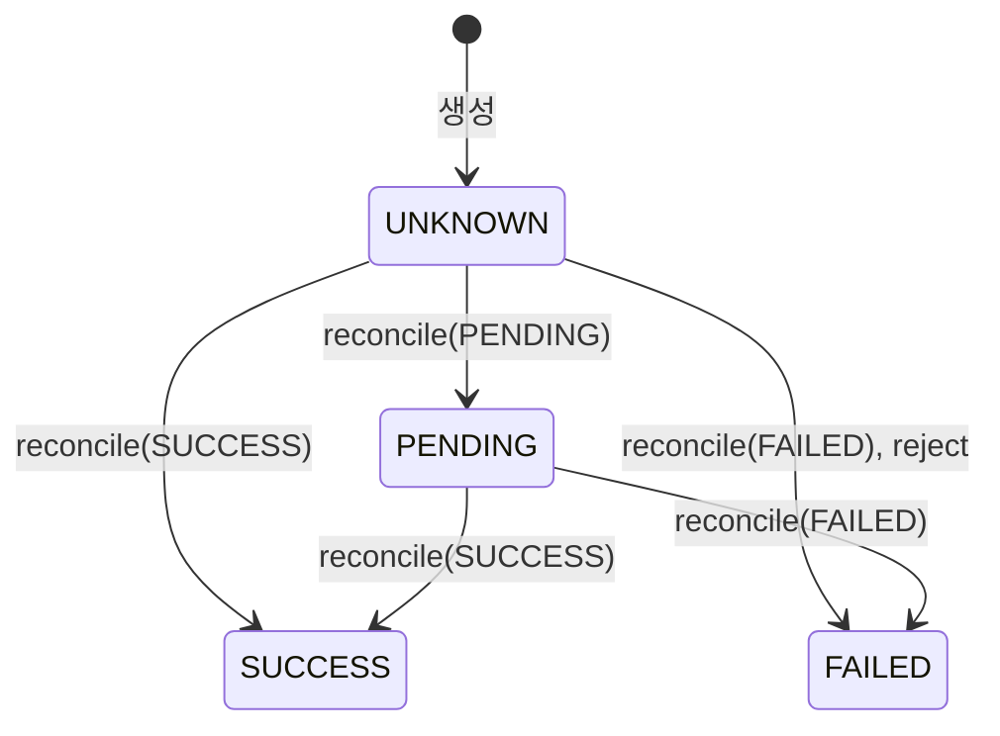

# 결제 설계 — 결제 애그리거트와 PG 어댑터

5주차 과제의 설계 문서다. 용어는 [`CONTEXT.md`](../../CONTEXT.md)의 `### 결제`와 대사하다를 따른다. 결정은 두 ADR에 있다.

- [ADR 0021](../adr/0021-payment-is-its-own-aggregate-and-slice.md): 결제는 주문과 다른 애그리거트이고, PG 포트는 결제 슬라이스가 가진다.
- [ADR 0022](../adr/0022-only-the-pre-create-rejection-proves-no-pg-transaction.md): PG 거래가 없다는 증거는 정확한 생성 전 거절뿐이고, 생성 요청은 다시 보내지 않는다.

상태: 2026-10-20 1단계([명세 138](https://github.com/giwankim/loop-pack-be-l2-vol5-kotlin/issues/138))를 마치고 썼다. 2·3단계가 절을 더해 이어 쓴다.

## 1. 근거와 범위

- 과제: [5주차 실습 · 결제 결과 미확인을 독립 상태로 다루기](https://app.notion.com/p/5-3fb5f76d265480c2864ff1161078265f). 1단계의 근거는 네 절이다.
  - 2절: 로컬 PG 계약, 422 생성 전 거절, 실제 HTTP 계약 테스트.
  - 3절: 발송을 기록한 뒤 생성 재전송 금지, 숨은 재시도 끄기, 카드 번호 비저장.
  - 4절: PG의 답과 내부 결제의 표.
  - 6절: 127.0.0.1, 별도 PG 프로세스 없음.
- 조사: [RestClient 시간 한도와 숨은 재시도](../research/rest-client-timeouts-and-http-fixtures.md), [wiremock-spring-boot 탐침](../research/wiremock-spring-boot-spike.md), 3단계를 위한 [Boot 4의 회복 라이브러리](../research/resilience-on-boot4.md).
- 구현 기록: 티켓마다의 닫는 댓글을 옮긴 [5주차 PG 어댑터 글감](../research/week5-pg-adapter-writing-material.md).

### 1.1 세 단계

| 단계 | 하는 것 | 상태 |
| --- | --- | --- |
| 1 | 결제 애그리거트, PG 어댑터, 테스트 PG | 끝남(2026-10-20, `feat/pg-adapter`) |
| 2 | 주문의 새 상태(과제의 `PAYMENT_PENDING`, `PAYMENT_FAILED`), 결제수단, 재고 예약, 과제의 TX A(PG를 부르기 전에 결제와 예약을 저장하는 트랜잭션)와 TX B(PG의 결과를 반영하는 트랜잭션), 확정·조회·대사 엔드포인트, 결과를 반영하는 응용 서비스. [ADR 0005](../adr/0005-no-request-idempotency-until-a-retrying-caller.md)와 [ADR 0003](../adr/0003-confirm-order-in-one-transaction.md)을 다시 연다. | 아직 |
| 3 | 알림(callback), 조회의 서킷 브레이커와 제한된 재조회 | 아직 |

### 1.2 1단계가 만든 것

| 티켓 | 만든 것 |
| --- | --- |
| [139](https://github.com/giwankim/loop-pack-be-l2-vol5-kotlin/issues/139) | `Payment`를 결과 미확인으로 만들고 주문마다, 멱등 키마다 하나씩 저장한다. `PaymentRepository`. |
| [140](https://github.com/giwankim/loop-pack-be-l2-vol5-kotlin/issues/140) | 받아들여진 생성이 `PaymentGateway`를 지나 테스트 PG까지 간다. 의존성, `adapter.integration.pg`, `@EnableTestPg`, `TestPg`. |
| [141](https://github.com/giwankim/loop-pack-be-l2-vol5-kotlin/issues/141) | `Payment.reconcile`과 `Payment.reject`, `ReconcileResult`, 충돌의 기록. |
| [142](https://github.com/giwankim/loop-pack-be-l2-vol5-kotlin/issues/142) | 정확한 생성 전 거절만 거절이고, 그 밖의 생성 응답과 답 없음은 모두 결과 미확인이다. 숨은 재전송과 풀 대기. |
| [143](https://github.com/giwankim/loop-pack-be-l2-vol5-kotlin/issues/143) | 거래 키 조회와 PG 주문 번호 목록 조회. |

운영 코드에서 결제와 게이트웨이를 부르는 곳은 아직 없다. 주문, 재고, 엔드포인트는 바뀌지 않았다. 2단계가 연결한다.

## 2. 결제 모델

결제(`Payment`)는 주문과 다른 애그리거트이고 `domain.payment`와 `application.payment` 슬라이스를 가진다(ADR 0021). 커머스의 기록과 PG의 기록은 과제가 시험하는 바로 그 장면에서 갈린다. 생성 응답을 잃으면 커머스는 결과를 모르지만 PG 거래는 이미 성공했을 수 있다. 주문의 자식으로 두면 거래 키, PG 상태, 카드가 주문 슬라이스로 새고, 결제는 PG가 답할 때마다 바뀌는데 주문은 고객이 움직일 때 바뀐다. 결제는 주문을 식별자로만 가리킨다.

### 2.1 결제가 담는 것

| 필드 | 열 | 정해지는 때 | 규칙 |
| --- | --- | --- | --- |
| `orderId` | `order_id` | 생성 | 주문마다 하나(`UK_PAYMENT_ON_ORDER_ID`). 물리 외래 키 `FK_PAYMENT_ON_ORDER_ID` → `orders.id`. |
| `idempotencyKey` | `idempotency_key` | 생성 | 공백뿐이지 않고 64자 이하. 유일(`UK_PAYMENT_ON_IDEMPOTENCY_KEY`). |
| `pgOrderId` | `pg_order_id` | 생성 | `LP-ORD-` 뒤에 주문 식별자를 10자리로 0 채움. 10자리는 최소 폭이라 더 긴 식별자도 자르지 않는다. |
| `amount` | `amount` | 생성 | 1원 이상의 `Money`. |
| `status` | `status` | `reconcile`, `reject` | 결과 미확인으로 시작해 앞으로만 간다(2.2). |
| `transactionKey` | `transaction_key` | 처음 맞은 PG 거래 | 모르면 null. 생성 전 거절로 실패한 결제는 PG 거래가 없으므로 끝까지 null이다. |
| `conflictReason`, `conflictedAt` | `conflict_reason`, `conflicted_at` | 충돌 | 마지막 충돌만 남는다(2.5). 시각은 마이크로초로 자른다. |

- 앞의 넷은 생성 뒤에 바뀌지 않는다(`updatable = false`). 생성의 규칙을 어기면 `InvalidPaymentException`이다.
- 카드는 담지 않는다. PG에 넘기기만 한다. `PaymentRepositoryTest`가 `information_schema.columns`로 열 목록 전체를 본다. 이름에 "card"가 든 열만 찾으면 `@Embedded CreditCard`가 만들 `type`, `number`를 놓치기 때문이다.
- PG 주문 번호는 `String.format`을 쓰지 않는다. `%d`는 JVM 기본 로캘의 숫자를 따라 `th-TH-u-nu-thai`에서 `LP-ORD-๐๐๐๐๐๐๐๐๔๒`가 됐다. `padStart`로 만들고, 테스트가 그 로캘에서 ASCII 숫자를 확인한다.
- 표는 `payment`다. 이 저장소는 예약어를 피할 때만 표 이름을 적는다. `BaseEntity`를 상속하고, 애그리거트 루트라 `@SQLRestriction("deleted_at is null")`로 논리 삭제한다([ADR 0016](../adr/0016-every-entity-extends-base-entity-and-roots-soft-delete.md)). 지우는 기능은 없다.
- `payment`는 가리키는 `orders`보다 이름 차례가 뒤라, 스키마를 다시 만들 때 `scalar-foreign-keys-drop.sql`이 그 외래 키를 먼저 지운다([포인트·주문 설계](./points-orders.md) 8.2의 2026-10-19 메모). migration 도구는 [issue 145](https://github.com/giwankim/loop-pack-be-l2-vol5-kotlin/issues/145)에서 다시 본다.
- `PaymentRepository`는 저장, 주문 식별자로 찾기, 멱등 키로 찾기만 가진다. 없으면 null이다. 거래 키나 PG 주문 번호로 찾는 것과 그 인덱스는 그것을 쓰는 단계가 더한다.

### 2.2 결제 상태



| 상태 | 뜻 |
| --- | --- |
| `UNKNOWN` 결과 미확인 | PG에서 어떻게 되었는지 모른다. 결제는 여기서 시작한다. 실패가 아니며, 이 상태만으로 결제를 끝내지 않는다. |
| `PENDING` 처리 중 | PG 거래가 있고 거래 키를 알지만 PG 상태가 끝나지 않았다. 결과 미확인으로 돌아가지 않는다. |
| `SUCCESS` 성공 | 맞는 PG 거래의 성공을 대사로 확인했다. 끝난 상태다. |
| `FAILED` 실패 | 맞는 PG 거래의 실패를 대사로 확인했거나, 맞는 생성 전 거절을 받았다. 끝난 상태다. |

PG 상태(`PgStatus`)는 `PENDING`, `SUCCESS`, `FAILED` 셋이고 결과 미확인이 없다. 그래서 어느 길로도 결과 미확인으로 돌아가지 않는다. PG가 생성을 받아들인 것은 성공이 아니다. 받아들여진 생성도 그 PG 거래의 PG 상태로 대사한다.

### 2.3 대사(`reconcile`)

알림, 대사 API, 받아들여진 생성 응답이 모두 `reconcile(transactions: List<PgTransaction>)`을 부른다. 위에서부터 처음 맞는 줄을 따른다.

| 받은 것 | 결과 |
| --- | --- |
| 0건 | `Unchanged` |
| 2건 이상 | `Conflicted(MULTIPLE_TRANSACTIONS)` |
| 1건, PG 주문 번호가 다름 | `Conflicted(PG_ORDER_ID_MISMATCH)` |
| 1건, 금액이 다름 | `Conflicted(AMOUNT_MISMATCH)` |
| 1건, 이미 아는 거래 키와 다름 | `Conflicted(TRANSACTION_KEY_MISMATCH)` |
| 1건, 생성 전 거절로 실패한 결제(거래 키 없음) | `Conflicted(TRANSACTION_AFTER_REJECTION)` |
| 1건, 끝난 결제에 반대의 최종 상태 | `Conflicted(RESULT_MISMATCH)` |
| 1건, 끝난 결제에 같은 최종 상태나 `PENDING` | `Unchanged` |
| 1건, `UNKNOWN` 결제에 `PENDING` | 거래 키를 받고 `Changed(UNKNOWN, PENDING)` |
| 1건, `PENDING` 결제에 `PENDING` | `Unchanged` |
| 1건, 끝나지 않은 결제에 `SUCCESS`나 `FAILED` | 거래 키를 받고 `Changed(이전, 그 상태)` |

- 줄의 차례가 규칙이다. 한 `SUCCESS` 결제가 여러 규칙을 함께 어긴 `SUCCESS`를 들으면 가장 위의 까닭을 말한다. 아래 줄에서는 같은 답이 `Unchanged`이므로, 검사의 차례가 바뀌면 충돌이 소리 없이 사라진다. `PaymentTest`의 한 테스트가 그 차례를 지킨다. 줄마다의 테스트도 `PaymentTest`에 있다.
- 0건은 결과 미확인과 처리 중을 포함한 네 상태 모두에서 `Unchanged`다(5.4).
- 거절로 실패한 결제의 줄은 2026-10-20 명세 리뷰에서 더했다. 맞는 생성 전 거절은 PG 거래가 없다는 증거이므로(ADR 0022 규칙 2), 그 뒤에 맞는 PG 거래가 오면 PG 상태가 무엇이든 모순이다. 그 전에는 `SUCCESS`만 `RESULT_MISMATCH`였고 `PENDING`과 `FAILED`는 아래의 "같은 최종 상태나 `PENDING`" 줄을 따라 소리 없이 `Unchanged`였다. 대사는 결제를 끝내기 전에 거래 키를 받으므로, 거래 키 없이 실패한 결제가 곧 거절로 실패한 결제다.

### 2.4 생성 전 거절(`reject`)

`reject(rejection: PgRejection)`은 생성 전 거절만 받는다.

| 받은 것 | 결과 |
| --- | --- |
| PG 주문 번호가 다름 | `Conflicted(PG_ORDER_ID_MISMATCH)` |
| 금액이 다름 | `Conflicted(AMOUNT_MISMATCH)` |
| 맞고, `UNKNOWN` 결제 | `Changed(UNKNOWN, FAILED)`. 거래 키는 null 그대로다. |
| 맞고, `FAILED` 결제 | `Unchanged` |
| 맞고, `PENDING`이나 `SUCCESS` 결제 | `Conflicted(RESULT_MISMATCH)` |

- 과제 3절은 "요청의 `orderId`·`amount`와 같은지"를 어댑터에 맡겼다. 여기서는 결제가 본다(ADR 0021 규칙 2). 어댑터는 HTTP를 값으로 옮길 뿐 커머스의 기록과 견주지 않는다.
- `reconcile`과 `reject`는 PG 주문 번호와 금액을 같은 private 검사로 본다. 그래서 두 길이 같은 차례로 같은 충돌을 말한다. 둘 다 다르면 PG 주문 번호다.
- 거절이 거래 키를 꾸며 넣지 않는다. PG 거래가 없기 때문이다.

### 2.5 결과와 충돌

`reconcile`과 `reject`는 `ReconcileResult`를 돌려준다.

| 결과 | 뜻 |
| --- | --- |
| `Changed(from, to)` | 결제 상태가 앞으로 갔다. |
| `Unchanged` | 아는 것이 늘지 않았거나 같은 답을 다시 들었다. |
| `Conflicted(reason)` | 결제와 맞지 않는 답이다. 상태와 거래 키는 그대로다. |

- 2단계는 `is Changed`가 아니라 `to.isFinished`에서만 주문과 예약을 바꾼다. `Changed(UNKNOWN, PENDING)`도 `Changed`다.
- `Conflicted`는 결제의 마지막 충돌 까닭(`ConflictReason`, 여섯 값)과 시각을 덮어쓴다. 과제의 "충돌을 남긴다"가 재시작 뒤에도 보이게 하기 위해서다. 뒤에 맞는 답이 와도 지우지 않는다. 지우면 PG가 한때 결제와 어긋났다는 것을 사람이 볼 수 없다.
- 엔티티는 로그를 쓰지 않는다. 충돌의 WARN 로그는 결과를 반영하는 응용 서비스(2단계)가 쓴다.
- PG에게서 답을 얻지 못한 것(`PgOutcomeUnknownException`, `PgUnavailableException`)은 결제에 들어오지 않는다. 응용 계층이 거기서 멈추고 저장된 상태를 돌려준다. 그래서 결제에는 정확한 메서드 둘이면 되고, "답 없음"까지 받는 포괄 타입이 없다(ADR 0021의 고르지 않은 것).

## 3. PG 계약과 결과

### 3.1 PG 계약

모든 요청은 `X-USER-ID: 135135`를 싣는다. 경로와 JSON의 이름은 과제가 적은 그대로다. JSON의 `orderId`는 PG 주문 번호(`pgOrderId`)이고 주문의 식별자가 아니다.

| 호출 | 요청 | 계약의 응답 |
| --- | --- | --- |
| 생성 | `POST /api/v1/payments`, 본문 `{orderId, cardType, cardNo, amount, callbackUrl}`. `amount`는 JSON 숫자다. | 202 `{transactionKey, orderId, amount, status}` |
| 생성 전 거절 | 위와 같다 | 422 `{"code":"TEST_PG_REJECTED_BEFORE_CREATE","orderId":…,"amount":…,"transactionCreated":false}` |
| 거래 키 조회 | `GET /api/v1/payments/{transactionKey}` | 200 PG 거래 하나, PG가 모르는 키면 404 |
| PG 주문 번호 목록 | `GET /api/v1/payments?orderId={pgOrderId}` | 200 PG 거래의 배열 |

- base URL과 알림 주소(`callbackUrl`)는 설정에서만 온다. 고객의 요청이 PG가 결과를 알릴 주소를 정하지 못한다.
- 거래 키는 경로 변수로, PG 주문 번호는 URI 템플릿의 query 변수로 넣는다. URI builder가 `+`와 `&`까지 인코딩한다. 값을 그대로 `queryParam`에 넣으면 둘이 인코딩되지 않고 나간다. [issue 143](https://github.com/giwankim/loop-pack-be-l2-vol5-kotlin/issues/143)의 변이 실행(코드의 한 곳을 일부러 되돌리고 테스트가 실패하는지 본 실행)에서 그 테스트가 실패했다.

### 3.2 포트

`application.payment.required.PaymentGateway`는 결제 슬라이스의 required 포트다. 구현은 `adapter.integration.pg.LocalPgGateway`다.

| 메서드 | 돌려주는 것 | 던지는 것 |
| --- | --- | --- |
| `createTransaction(pgOrderId, amount, card)` | 받아들여진 생성의 `PgTransaction`. 성공이 아니다. | `PgRejectedException(rejection)`, `PgOutcomeUnknownException` |
| `retrieveTransaction(transactionKey)` | `PgTransaction?`. PG가 모르는 키(404)면 `null`. | `PgUnavailableException` |
| `listTransactions(pgOrderId)` | `List<PgTransaction>`. 비어 있을 수 있다. | `PgUnavailableException` |

- 생성의 이름은 `createTransaction`이다(2026-10-20, `requestPayment`에서 바꿨다). 이 호출이 PG 거래를 만들고, 거래 키는 그 응답에서 처음 생긴다. Stripe의 PaymentIntent와 Toss의 결제 승인에서 `confirm`은 PG가 먼저 만든 객체를 그 키로 승인하는 일이다. 그 두 단계는 생성과 승인 사이에 고객이 인증하는 단계가 있어서 생긴다. 테스트 PG에는 그 단계가 없어 한 번의 호출로 거래를 만든다. Toss의 키인 결제(`POST /v1/payments/key-in`), Square의 `POST /v2/payments`와 같은 모양이다. `confirm`은 고객의 요청인 주문을 확정하다의 이름으로 남긴다.
- 포트는 PG가 말한 PG 거래만 돌려주고, 나머지 결과는 결과마다 다른 예외로 던진다(ADR 0023, 2026-10-20). 그 전에는 결과를 값(`Accepted`, `Rejected`, `Unknown`과 `Found`, `Unavailable`)으로 돌려주었다(ADR 0022 규칙 4). 3단계가 조회에 씌울 브레이커와 재시도가 예외를 중심으로 돌기 때문에 바꿨다.
- 세 예외에는 공통 상위 타입이 없다. catch 하나로 거절과 결과 미확인을 함께 잡지 못하게 하려는 것이다. 설정 누락이나 요청을 직렬화하지 못한 것 같은 프로그래밍 오류는 그 밖의 예외로 그대로 던진다.
- 예외의 메시지는 HTTP 상태(`HTTP 503`)나 실패의 종류(`SocketTimeoutException`)다. 로그와 테스트의 단언에만 쓴다. 원인 예외는 잇지 않는다(3.5). 호출자는 모든 결과 미확인과 모든 조회 불가를 각각 같게 다룬다.
- 호출자는 PG 호출을 트랜잭션 안에 두지 않고, `Exception`이나 `RuntimeException`을 잡는 catch로 감싸지 않는다. 결과 미확인의 예외가 결제를 저장한 트랜잭션을 지나면 그 저장이 되돌아간다(ADR 0023 규칙 4).
- 포트 하나가 생성과 조회를 함께 가진다. 그래서 대사가 생성을 부르지 않는다는 것을 타입이 막지 않고, ADR 0022 규칙 6·7의 테스트가 PG가 받은 생성 수로 지킨다.

### 3.3 응답에서 결과로

아래 표의 "잘 짜인 PG 거래"는 이렇다. 본문은 JSON(`Content-Type: application/json`)이다(4.3). 네 필드가 모두 있다. `transactionKey`는 공백뿐이지 않다. 그 키로는 PG 거래를 다시 조회할 수 없기 때문이다. `amount`는 0 이상의 JSON 정수다(문자열도 소수도 아니다). `status`는 `PENDING`, `SUCCESS`, `FAILED` 중 하나다. 모르는 속성은 무시한다.

| 호출 | 응답 | 결과 |
| --- | --- | --- |
| 생성 | 202, 잘 짜인 PG 거래. PG 상태가 무엇이든 그렇다. | 그 PG 거래를 돌려준다 |
| 생성 | 422, 정확한 `code`, `transactionCreated`가 JSON `false`, `orderId`·`amount` 있음 | `PgRejectedException(PgRejection(되돌려 받은 PG 주문 번호, 금액))` |
| 생성 | 정확하지 않은 422: 본문 없음, 다른 `code`, `transactionCreated`가 `true`·`"false"`·`null`·빠짐, `code`·`orderId`·`amount` 빠짐, 문자열 금액, 잘린 JSON | `PgOutcomeUnknownException` |
| 생성 | 202가 아닌 2xx(200, 201. 잘 짜인 PG 거래를 실어도), 다른 4xx, 5xx | `PgOutcomeUnknownException("HTTP <상태>")` |
| 생성 | 잘 짜이지 않은 202, 연결 끊김, 응답 시간 초과, 풀 대기 초과 | `PgOutcomeUnknownException` |
| 거래 키 조회 | 200, 잘 짜인 PG 거래 | 그 PG 거래를 돌려준다 |
| 거래 키 조회 | 404 | `null`을 돌려준다 |
| 목록 조회 | 200, 잘 짜인 PG 거래의 배열 | 그 PG 거래들을 돌려준다. 0건도, 2건 이상도 PG의 차례 그대로다. |
| 두 조회 | 그 밖의 모든 상태(목록 조회의 404 포함), 잘 짜이지 않은 본문, 연결 끊김, 응답 시간 초과 | `PgUnavailableException` |

- **목록:** JSON 배열만 받는다. 객체 하나, `null`, `null` 원소는 잘 짜이지 않은 본문이다.
- **404:** PG 계약이 404를 말하는 곳은 거래 키 조회뿐이다. 목록의 "없음"은 빈 배열이다. 그래서 목록 조회의 404는 조회 불가다.

### 3.4 왜 정확한 422만 거절인가

결과 미확인을 실패로 바꾸는 길은 코드 곳곳의 작은 분기에 있다. 예외 하나를 실패로 옮기는 catch, 기본값으로 켜진 클라이언트의 재전송, 0건을 "없음"으로 읽는 조회가 모두 이중 결제가 된다(ADR 0022).

- **증거는 하나다.** PG가 "만들지 않았고 앞으로도 만들지 않는다"고 명시하는 것은 생성 전 거절뿐이다. 422, 정확한 `code`, boolean `false`를 모두 확인할 때만 거절(`PgRejectedException`)이다. `transactionCreated` 검사를 뺀 변이 실행에서는 `true` 본문이 거절로 나왔다(그때의 이름은 값 `Rejected`였다).
- **시간 초과와 5xx는 실패가 아니다.** PG가 저장한 뒤 응답을 잃은 PG 거래가 나중에 성공하면, 예약을 돌려준 주문에서 돈이 빠져나간다. 고객이 다시 결제하면 두 번 낸다.
- **생성은 다시 보내지 않는다.** 테스트 PG는 같은 PG 주문 번호의 생성을 하나로 합친다고 약속하지 않고, 과제도 금한다. 결과는 조회와 대사로만 알아낸다.
- **풀을 얻지 못한 생성도 결과 미확인이다.** 보내지 않은 것은 확실하다. 그러나 그 증거는 HttpClient의 예외 타입과 Spring이 그것을 감싸는 방식에 달려 있어, 라이브러리를 올리면 조용히 틀어질 수 있다. 증거에 두 번째 길을 들이지 않는다.
- **조회의 0건은 PG 거래가 없다는 증거가 아니다**(5.4).

### 3.5 로그와 관측

호출마다 로그 한 줄을 쓴다. 메서드, 경로 템플릿, 결과와 HTTP 상태나 실패의 종류, 걸린 시간, PG 주문 번호, 거래 키다. 본문과 카드 번호는 쓰지 않는다. 결과 미확인과 조회 불가는 WARN이다. 결과의 낱말(`Accepted`, `Rejected`, `Unknown`, `Found n`, `Unavailable`)은 결과를 값으로 돌려주던 때의 이름을 그대로 쓴다.

```text
PG POST /api/v1/payments Accepted (HTTP 202) in 43 ms, pgOrderId=LP-ORD-0000000042, transactionKey=TEST-TX-0042
PG GET /api/v1/payments/{transactionKey} Found 1 (HTTP 200) in 1 ms, pgOrderId=LP-ORD-0000000042, transactionKey=TEST-TX-0042
PG GET /api/v1/payments?orderId={pgOrderId} Found 2 (HTTP 200) in 1 ms, pgOrderId=LP-ORD-0000000042, transactionKeys=[TEST-TX-0041, TEST-TX-0042]
```

- 예외 메시지는 쓰지 않는다. 응답 본문의 조각을 담을 수 있기 때문이다. 실패의 종류는 예외 사슬의 맨 안쪽 타입 이름이다. 같은 까닭으로 포트의 예외는 그 원인 예외를 잇지 않는다(ADR 0023).
- 카드 번호를 가리는 일은 지금 다루지 않는다(2026-10-20). `CreditCard`는 data class의 기본 문자열 형태를 쓴다.
- observation registry가 있으면 다른 HTTP client 호출처럼 PG 호출도 기록한다. Boot의 `RestClientObservationAutoConfiguration`이 게이트웨이가 받는 `RestClient.Builder`에 registry를 단다(2026-10-20, 그 전에는 설정이 `ObjectProvider`로 직접 달았다). 어댑터만 담은 테스트 컨텍스트에는 registry가 없다. `ObservedPaymentGatewayTest`가 registry와 그 자동 설정을 더해, 생성과 거래 키 조회가 `http.client.requests`로 기록되고 측정값의 `uri`에 거래 키 대신 템플릿 `/api/v1/payments/{transactionKey}`가 남는 것을 본다(2026-10-20 명세 리뷰).
- 포트의 예외는 `exchange` 안에서도 던지므로 observation의 `exception`에 그 이름이 남는다. 422의 생성 전 거절, 202가 아닌 생성 응답, 200·404가 아닌 조회 응답이 그렇다. 받아들여진 생성과 찾은 조회(404 포함)만 오류가 없다(ADR 0023의 대가). 테스트는 이 값을 보지 않는다.

## 4. 클라이언트 설정

### 4.1 값

| 설정(`pg.*`) | 값 | 까닭 |
| --- | --- | --- |
| `base-url` | dev·qa·prd는 `${PG_BASE_URL}`, local과 test는 `http://127.0.0.1:8082` | 테스트에서는 테스트 PG가 자기 주소로 덮는다. 로컬에는 PG가 떠 있지 않다. |
| `callback-url` | dev·qa·prd는 `${PG_CALLBACK_URL}`, local과 test는 `http://127.0.0.1:8080/api/v1/payments/callback` | 설정에서만 온다(3.1). |
| `user-id` | `135135` | PG 계약이 정한 합성 계정. 기본 헤더 `X-USER-ID`다. |
| `max-connections` | 20 | 느린 PG에 요청이 쌓이지 않게 한다. PG의 경로는 하나라 전체와 경로당이 같다. HttpClient의 기본값은 25/5다. |
| `connection-request-timeout` | 200 ms | 풀 대기. 풀이 다 차면 오래 기다리지 않고 결과 미확인으로 끝낸다. 기본값은 3분이다. |
| `connect-timeout` | 500 ms | 기본값은 3분이다. |
| `response-timeout` | 1 s, test 프로필은 200 ms | 읽기마다의 한도다(5.1). 시간 초과 장면이 오래 걸리지 않게 test 프로필에서 줄이고, 게이트웨이의 계약 테스트만 1 s로 돈다(6.3). |

dev·qa·prd에서 환경 변수가 빠지면 시작이 아니라 첫 호출에서 실패한다. `redis.yml`과 같은 모양이다.

### 4.2 Apache HttpClient 5와 Boot의 `RestClient.Builder`

- **숨은 재전송을 모두 끈다.** HttpClient 5의 기본값은 429·503에 POST를 1초 뒤 한 번 더 보내고, 307·308에는 본문까지 복사해 따라가고, `IOException`에 GET을 한 번 더 보낸다. Spring의 Jackson 본문은 다시 쓸 수 있는 본문이라 막히지 않는다. `disableAutomaticRetries()`와 `disableRedirectHandling()`을 켠다(ADR 0022 규칙 5). 변이 실행에서 둘을 하나씩 빼면 429·503에 POST가 2번, 끊긴 GET이 2번 갔고, 307은 따라갔다.
- **HttpClient 5인 까닭.** 조사([RestClient 시간 한도와 숨은 재시도](../research/rest-client-timeouts-and-http-fixtures.md) §7)는 JDK client를 먼저 꼽았다. 그러나 JDK client에는 풀 크기와 풀 대기의 한도가 없고, 응답 전에 닫힌 연결에 GET을 다시 보내는 것을 끌 스위치가 없으며, 재시도 플래그는 JVM 전체의 시스템 속성이다. HttpClient 5는 풀, 풀 대기, 재전송의 스위치를 클라이언트마다 가진다. 대가는 기본값이 재전송한다는 것이고, 위의 두 스위치와 계약 테스트의 요청 수가 그것을 막는다.
- **시간 한도는 실제 request factory가 쓰는 HttpClient에 둔다.** 연결 한도는 연결 풀의 `ConnectionConfig`가, 풀 대기와 응답 한도는 `RequestConfig`가 맡는다. factory에는 한도를 주지 않으므로 HttpClient의 설정이 그대로 쓰인다. factory는 빈이라 컨텍스트가 닫힐 때 HttpClient와 풀도 닫힌다.
- **Boot의 `RestClient.Builder`에 request factory를 직접 준다.** `spring-boot-starter-restclient`를 들여, 게이트웨이가 Boot가 미리 설정한 `RestClient.Builder`(prototype)를 받는다(2026-10-20, 그 전에는 스타터 없이 `RestClient.builder()`로 만들었다). observation과 `RestClientCustomizer`가 그 builder로 온다. Boot의 HTTP client 설정(`spring.http.clients.*`)은 재시도와 풀 대기를 다루지 않으므로 쓰지 않고, builder의 request factory를 `pgRequestFactory`로 바꾼다. factory를 바꾸지 않으면 클래스 경로에 따라 client가 바뀐다. 테스트 클래스 경로에는 WireMock이 HttpClient 5와 Jetty client를 들이므로, 운영과 테스트가 다른 client로 돌 수 있었다(탐침 §7의 2). Boot는 builder를 줄 때마다 자기 request factory를 먼저 만들어 두므로, 쓰이지 않는 HttpClient가 하나 생긴다. 그것으로는 연결을 열지 않는다. HTTP Service Clients는 들이지 않았다([ADR 0008](../adr/0008-upgrade-to-spring-boot-4-1-ahead-of-the-template.md)의 2026-10-19 메모).
- **게이트웨이는 컴포넌트 스캔으로 등록한다.** `LocalPgGateway`는 `@Component`이고, Boot의 `RestClient.Builder`, `pgRequestFactory`, `PgProperties`를 받아 `RestClient`를 스스로 만든다. `LocalPgGatewayConfig`에는 request factory 빈과 `PgProperties`의 등록만 남는다. builder를 받아 컴포넌트가 만드는 것은 [Boot 문서](https://docs.spring.io/spring-boot/reference/io/rest-client.html#io.rest-client.restclient)의 모양이고, `adapter.persistence`의 구현처럼 어댑터 클래스가 스스로 등록된다. kotlin-spring 플러그인은 `@Component` 클래스를 열고 `@Bean`으로만 등록한 클래스는 `final`로 두므로, 3단계가 이 빈에 프록시를 씌우게 되어도 막히지 않는다([Boot 4의 회복 라이브러리](../research/resilience-on-boot4.md)). (2026-10-20, 그 전에는 설정의 `@Bean` 메서드가 게이트웨이를, 이어서 `RestClient`를 만들었다.)
- **`retrieve()`가 아니라 `exchange`로 받는다.** `retrieve()`는 4xx·5xx에 던지는 상태 처리기를 더하므로, catch 하나가 결과 미확인을 실패로 바꾸기 쉽다. `exchange`는 상태 처리기를 거치지 않아 상태 코드를 값으로 다룬다. 호출마다 `catch (RestClientException)` 하나가 전송 예외(`ResourceAccessException`), Jackson의 해석 오류, 어댑터의 `UnreadablePgResponseException`을 결과 미확인이나 조회 불가로 옮긴다.

### 4.3 엄격한 JSON 매퍼

어댑터는 PG의 JSON만 읽고 쓰는 `JsonMapper`를 따로 가진다.

- 단일 값을 배열로 읽지 않는다(`ACCEPT_SINGLE_VALUE_AS_ARRAY` 끔).
- 빈 문자열을 null로 읽지 않는다(`ACCEPT_EMPTY_STRING_AS_NULL_OBJECT` 끔).
- 스칼라를 바꿔 읽지 않는다(`ALLOW_COERCION_OF_SCALARS` 끔). `"7000"`은 숫자가, `"false"`는 boolean이 아니다.
- 소수를 정수로 읽지 않는다(`ACCEPT_FLOAT_AS_INT` 끔). 금액은 원화 정수라 `7000.9`가 7000이 되면 안 된다.
- 원시 타입의 null과 빠진 값을 거절한다(`FAIL_ON_NULL_FOR_PRIMITIVES` 켬). null이 될 수 없는 Kotlin 타입은 Kotlin 모듈이 거절한다.
- 모르는 속성은 무시한다(`FAIL_ON_UNKNOWN_PROPERTIES` 끔). PG가 필드를 더해도 계약의 필드만 읽는다.

**Boot의 매퍼와 따로 둔 까닭.** Boot의 매퍼(`supports/jackson`)는 우리 API를 부르는 클라이언트를 너그럽게 받으려고 `ACCEPT_SINGLE_VALUE_AS_ARRAY`와 `ACCEPT_EMPTY_STRING_AS_NULL_OBJECT`를 켠다. 그 너그러움이 남의 계약을 읽는 데 새면, 계약에 없는 JSON을 조용히 읽는다. `"transactionCreated": "false"`를 `false`로 읽으면 증거가 아닌 422가 거절이 된다. Boot의 매퍼와 `supports/jackson`은 바꾸지 않았다.

**PG의 본문을 읽는 컨버터는 이 매퍼의 것 하나다.** Boot의 컨버터 설정은 builder에 `registerDefaults()`와 Boot의 매퍼를 단 JSON 컨버터를 넣어 둔다. 게이트웨이의 설정은 그 뒤에 돌아, `disableDefaults()`로 클래스 경로에서 찾는 컨버터를 끄고 한 자리인 JSON 컨버터를 이 매퍼의 것으로 바꾼다. 남는 것은 Boot의 String 컨버터, form 컨버터와 이 JSON 컨버터이고, PG의 본문 타입을 읽고 쓰는 것은 이 JSON 컨버터뿐이다(2026-10-20 전체 컨텍스트에서 확인).

- `disableDefaults()`가 없으면 클래스 경로의 Jackson 2 YAML 컨버터와 JAXB 컨버터가 들어온다. JSON 문서는 YAML 문서이기도 해서, `Content-Type: application/yaml`의 202는 YAML 컨버터가 맡았다. 그 컨버터는 PG 거래를 만들지 못해 `HttpMessageConversionException`을 던졌고, 그 예외는 `RestClientException`이 아니라서 포트 밖으로 샜다. `PaymentGatewayTest`가 이 장면을 지킨다.
- Boot의 컨버터 설정은 `HttpMessageConverter` 빈을 모두 맞춤 컨버터로 넣고, 맞춤 컨버터는 JSON 컨버터보다 앞선다. `disableDefaults()`는 그것을 막지 않는다. 지금 그런 빈은 없다. JSON을 읽는 컨버터 빈을 더하면 PG의 응답도 그것이 먼저 읽는다.
- 게이트웨이 테스트의 컨텍스트에는 Boot의 매퍼, 컨버터 설정, `JacksonConfig`를 운영처럼 둔다(6.1). 엄격한 매퍼를 빼는 변이 실행에서 JSON 해석의 테스트 9개가 실패했다.

매퍼가 보지 못하는 것은 어댑터가 본다. 공백뿐인 거래 키, 모르는 PG 상태, 음수 금액, 배열의 `null` 원소다. 마지막은 Kotlin 모듈의 null 검사가 생성자 파라미터에만 걸리고 최상위 `ParameterizedTypeReference`의 타입 인자는 보지 못해서다. [issue 143](https://github.com/giwankim/loop-pack-be-l2-vol5-kotlin/issues/143)에서 고치기 전에는 `[null]`이 `NullPointerException`으로 포트 밖에 나갔다.

## 5. 받아들인 한계

### 5.1 응답 한도 1 s는 읽기마다의 한도다

HttpClient의 응답 한도는 다음 바이트를 기다리는 시간이고, 호출 전체의 기한이 아니다. 1초가 되기 전마다 조금씩 보내는 PG는 호출을 더 오래 붙잡을 수 있다. 호출 전체의 기한은 두지 않았다. 설정(`application.yml`, `PgProperties`)의 주석에도 적었다.

### 5.2 풀에서 연결을 얻지 못한 생성도 결과 미확인이다

풀 대기 200 ms가 지나면 생성은 `PgOutcomeUnknownException`이다. PG는 그 생성을 받지 못했다(`ExhaustedPoolPaymentGatewayTest`에서 생성 수 1 그대로). 그래도 실패로 보지 않는 까닭은 3.4에 있다. 그 결제는 다음 5.3의 처지가 된다.

### 5.3 PG가 받지 못한 결제는 사람이 끝낼 때까지 결과 미확인이다

생성이 PG에 닿지 않았거나 PG가 잃은 결제는 결과 미확인에서 끝나지 않는다. 대사가 0건을 받아도 그대로이므로, 2단계가 들일 재고 예약도 남는다. 과제는 조회 한도를 다 쓴 것도 새 결제의 근거가 아니라고 한다. 이 결제를 끝내는 것은 사람의 몫이고, PR에 남은 한계로 적는다(ADR 0022의 대가).

### 5.4 0건은 PG 거래가 없다는 증거가 아니다

거래 키 조회의 404는 `null`, 목록의 빈 배열은 빈 목록이고, 대사에서 `Unchanged`다. PG 거래가 아직 보이지 않거나 생성 요청이 아직 오는 중일 수 있다. 잘못된 base URL이나 PG 앞의 무엇이 돌려준 404도 거래 키 조회에서는 `null`로 읽힌다. 대사가 0건에 아무것도 바꾸지 않으므로 받아들인다(ADR 0022 규칙 3).

조회도 다시 보내지 않는다. 끊긴 GET은 PG에 한 번만 간다. 제한된 재조회는 3단계가 조회에만 씌운다(ADR 0022 규칙 7).

## 6. 테스트 PG

### 6.1 모양

- **wiremock-spring-boot 4.4.3**을 버전 카탈로그에 고정해 `testImplementation`으로 들였다. Spring 테스트 컨텍스트마다 WireMock 서버 하나를 테스트 JVM 안에 띄우고, refresh 전에 그 주소를 `pg.base-url`에 넣는다. 서버는 컨텍스트와 함께 살고 죽는다. 별도의 PG 앱은 없다(과제 6절).
- **`@EnableTestPg`**가 `@EnableWireMock(ConfigureWireMock(name = "pg", baseUrlProperties = ["pg.base-url"], configurationCustomizers = [TestPgConfigurationCustomizer::class]))`를 감싼다. customizer는 서버를 `127.0.0.1`에 묶고 h2c를 끈다. WireMock의 기본값은 `0.0.0.0`에 묶고 h2c를 알린다. PG를 쓰는 테스트는 모두 이 애노테이션을 달아, 같은 설정끼리 컨텍스트와 서버를 나눠 쓴다.
- 서버는 `@InjectWireMock("pg") lateinit var` 필드로 받아 `TestPg`로 감싼다. 생성자 주입의 하나뿐인 예외다. `spring.test.constructor.autowire.mode=all`이면 생성자 파라미터를 `SpringExtension`과 WireMock의 resolver가 함께 맡으려다 실패한다.
- 스텁과 요청 기록은 테스트 메서드마다 지워진다(라이브러리 기본값).
- 1단계의 세 게이트웨이 테스트(`PaymentGatewayTest`, `ExhaustedPoolPaymentGatewayTest`, `ObservedPaymentGatewayTest`)는 운영의 `LocalPgGatewayConfig`, `LocalPgGateway`와 `supports/jackson`의 `JacksonConfig`를 그대로 읽는다. Boot의 자동 설정은 `@ImportAutoConfiguration`으로 게이트웨이의 builder를 만드는 것만 고른다. Jackson, 컨버터, `RestClient.Builder`이고, `ObservedPaymentGatewayTest`는 RestClient의 observation을 더한다. 테스트만의 설정 클래스는 `ObservedPaymentGatewayTest`의 registry 하나이고 `@TestConfiguration`이다. PG 테스트에 설정 클래스를 더하면 그렇게 둔다. 테스트 소스의 평범한 `@Configuration`은 모든 `@SpringBootTest`에 끼어든다. 탐침의 설정 클래스가 그래서 기존 테스트 368개를 깨뜨렸다.
- **Jetty 판.** wiremock-spring-boot는 Jetty EE10을 12.1.6에 묶고, Boot는 Jetty core 12.1.12를 관리한다. 카탈로그가 `jettyEe10 = "12.1.12"`를 고정해 EE10 BOM을 가져오고, 설정 시점의 검사가 Boot의 `jetty.version`과 다르면 빌드를 멈춘다. Boot의 판을 읽어 쓰지 못한 것은 dependency-management 플러그인의 가져온 속성을 읽으면 그 뒤의 가져오기가 조용히 무시되기 때문이다([issue 140](https://github.com/giwankim/loop-pack-be-l2-vol5-kotlin/issues/140)).

### 6.2 장면(`TestPg`)

| 장면 | 메서드 | PG가 하는 것 |
| --- | --- | --- |
| 생성 수락 | `acceptsCreate(pgOrderId, amount, card, transactionKey, pgStatus)` | 202와 PG 거래. PG 상태의 기본값은 `PENDING`이다. |
| 생성 전 거절 | `rejectsBeforeCreate(pgOrderId, amount, card)` | 정확한 422. 받은 PG 주문 번호와 금액을 되돌려 준다. |
| 저장 뒤 응답 유실 | `losesCreateResponse(pgOrderId, amount, card)` | 본문을 다 읽은 뒤 응답 없이 끊는다(`Fault.EMPTY_RESPONSE`). |
| 멈춤 | `stallsCreate(pgOrderId, amount, card, transactionKey)` | 1.5 s 고정 지연 뒤 202. 운영의 응답 한도 1 s를 넘는다. |
| 리다이렉트 | `redirectsCreate(pgOrderId, amount, card)` | 307로 `/api/v1/payments/redirected`를 가리킨다. |
| 그 밖의 생성 응답 | `answersCreate(…, httpStatus, body, contentType)` | 주어진 상태와 본문. 본문 형식의 기본값은 JSON이다. |
| PG 거래 하나 | `hasTransaction(transaction)` | 그 거래 키의 조회에 200과 PG 거래 |
| PG 거래 목록 | `hasTransactions(pgOrderId, vararg transactions)` | 목록 조회에 200과 배열. PG 거래가 없으면 빈 배열이다. |
| 그 밖의 조회 응답 | `answersRetrieve(…)`, `answersList(…)` | 주어진 상태와 본문 |
| 조회 멈춤 | `stallsLookup()` | 모든 조회에 1.5 s 뒤 본문 없는 503 |
| 조회 응답 유실 | `losesLookupResponse()` | 모든 조회를 받은 뒤 응답 없이 끊는다. |

- 수: `createCount()`(생성), `lookupCount()`(두 조회를 함께), `requestCount()`(스텁과 맞지 않은 것까지 모든 요청), `unmatchedRequests()`(스텁과 맞지 않은 요청).
- 모든 스텁은 `X-USER-ID`를 맞춘다. 생성은 정확한 JSON 본문을(`equalToJson`, 금액은 JSON 숫자), 거래 키 조회는 경로의 키를, 목록 조회는 query의 `orderId`를 정확히 맞춘다. 틀린 요청은 스텁을 찾지 못해 WireMock의 404를 받는다.
- 생성은 그 404에 `PgOutcomeUnknownException`을 던지므로 테스트가 실패한다. 조회는 그렇지 않다. 거래 키 조회는 404를 `null`로 읽어, 기대한 결과와 같을 수 있다. 그래서 조회를 쓰는 테스트는 `unmatchedRequests()`가 비었는지 본다([`CODING_STANDARDS.md`](../../CODING_STANDARDS.md)의 단언). `PaymentGatewayTest`는 `@AfterEach`에서 본다.
- `stallsLookup`이 404가 아니라 503인 것도 같은 까닭이다. 한도가 1.5 s보다 긴 클라이언트에게 늦은 404는 "없음"이라는 사실로 읽힌다.
- JSON은 손으로 적는다. 필드 이름과 JSON 타입까지 PG 계약이기 때문이다. 무작위 지연은 쓰지 않는다.
- 2·3단계의 업무 테스트가 같은 장면을 쓴다. 3단계의 재시작 장면은 같은 컨텍스트 안에서 서비스와 클라이언트를 다시 만든다. 컨텍스트 자체를 다시 띄워야 하면 그때 `wiremock-standalone`으로 바꾼다(탐침 §5).

### 6.3 계약 테스트가 운영의 시간 한도로 도는 까닭

`PaymentGatewayTest`는 어댑터와 그 builder를 만드는 자동 설정만 담은 가벼운 컨텍스트(6.1, MySQL과 Redis 없음)에 `@EnableTestPg`를 단다. `application.yml`을 test 프로필로 읽고 둘만 바꾼다. 응답 한도를 운영의 1 s로, 알림 주소를 test 프로필과 다른 값으로 둔다. 다른 알림 주소가 정확한 본문의 스텁에 맞으면, 어댑터가 그 주소를 설정에서 읽은 것이다.

응답 한도를 1 s로 두는 것은 재전송을 지키는 테스트가 헛돌지 않게 하기 위해서다. HttpClient 5는 응답 한도가 재시도 간격 1초보다 짧으면 상태 코드의 재시도를 스스로 건너뛴다. 탐침의 대조군에서, 재시도를 켠 client가 503에 응답 한도 200 ms에서는 POST를 1번, 2 s에서는 1025 ms 뒤 2번 보냈다. test 프로필의 200 ms에서는 `disableAutomaticRetries()`를 지워도 "503에 POST 1번"이 통과한다(ADR 0022 규칙 6).

풀 대기의 장면(`ExhaustedPoolPaymentGatewayTest`, 풀의 연결 1개)도 1 s가 필요하다. 200 ms라면 멈춘 생성이 연결을 놓는 때와 둘째 생성의 풀 대기가 끝나는 때가 겹친다. 이 장면만 풀의 설정이 달라 컨텍스트를 하나 더 띄우므로 클래스를 나눴다.

대가는 느린 장면 셋이다. 생성의 시간 초과, 풀 대기, 조회의 시간 초과가 각각 응답 한도 1 s를 기다린다(ADR 0022의 대가).

## 7. 이름과 명령

### 7.1 과제의 이름과 이 저장소의 이름

과제의 낱말을 그대로 따르지 않았다. 결제 쪽 이름은 Stripe(PaymentIntent, Payment Records, `Idempotency-Key`)와 Toss Payments(Payment, Transaction, `Idempotency-Key`)에 맞췄다. PG의 경로, 헤더, JSON 이름은 계약이라 그대로다.

| 과제 | 이 저장소 | 까닭 |
| --- | --- | --- |
| 결제 시도 `PaymentAttempt` | 결제 `Payment` | 주문마다 하나이고, 실패해도 새 결제를 만들지 않으므로 시도가 여럿일 일이 없다. 다시 결제하는 것을 허용하면 결제 아래에 시도를 자식으로 둔다(ADR 0021의 다시 볼 조건). |
| PG 관찰(observation) | 대사하다 `reconcile` | 결제를 PG 거래와 견주어 맞으면 옮기고 아니면 충돌로 남기는 일이다. `CONTEXT.md`는 관찰하다를 피한다. |
| `paymentAttemptKey` | 멱등 키 `idempotencyKey` | 같은 키의 재요청이 같은 결제를 가리킨다. Stripe와 Toss의 `Idempotency-Key`다. |
| `providerOrderId` | PG 주문 번호 `pgOrderId` | 이 맥락은 "제공자"가 아니라 PG라고 부른다. |
| `REJECTED_NO_EFFECT` | 생성 전 거절 `PgRejection`, 예외 `PgRejectedException` | `CONTEXT.md`의 생성 전 거절이 피하는 이름이다. |
| `*PaymentProviderContractTest` | `PaymentGatewayTest` | 시험하는 포트(`PaymentGateway`)의 이름이고, 그 포트의 패키지 `application.payment.required`에 있다. |

### 7.2 1단계의 명령

```bash
# PaymentGatewayTest(90), ExhaustedPoolPaymentGatewayTest(1), ObservedPaymentGatewayTest(2). 필터가 셋 다 맞는다.
./gradlew :apps:commerce-api:test --tests '*PaymentGatewayTest'

# PaymentTest(50)와 PaymentRepositoryTest(9). 저장소 테스트는 Docker의 MySQL을 쓴다.
./gradlew :apps:commerce-api:test --tests '*PaymentTest' --tests '*PaymentRepositoryTest'

# 끝의 전체 확인
./gradlew :apps:commerce-api:ktlintCheck :apps:commerce-api:check
```

괄호의 수는 2026-10-20의 것이다. `--tests`로 거른 실행은 언제나 `HexagonalArchitectureTest`의 7개 규칙도 함께 돌고, 위의 수는 그것을 뺀 것이다.

**과제의 명령은 게이트웨이를 시험하지 않는다.** 과제가 적은 `--tests '*PaymentProviderContractTest'`에 맞는 클래스는 없다. [명세 138](https://github.com/giwankim/loop-pack-be-l2-vol5-kotlin/issues/138)은 Gradle이 "No tests found"로 실패하리라 적었지만, 2026-10-20에 돌려 보니 실패하지 않는다. `HexagonalArchitectureTest`의 7개만 돌고 `BUILD SUCCESSFUL`로 끝난다. 아무 이름에도 맞지 않는 필터(`--tests '*NoSuchClassAnywhere'`)도 같다. 까닭은 확인하지 않았다. ArchUnit의 JUnit 엔진이 규칙을 메서드가 아니라 필드로 알려, Gradle의 이름 필터가 거르지 못하는 것으로 보인다. 그 명령의 초록은 게이트웨이에 대해 아무것도 말하지 않는다. 위의 명령을 쓰고, 돈 테스트의 수를 확인한다.

## 8. 다음 단계로 넘기는 것

- **멱등 키의 비교.** `idempotency_key`는 서버의 정렬 규칙 `utf8mb4_general_ci`를 따라, `abc`, `ABC`, `abc `가 한 키다. 유일 키와 `findByIdempotencyKey`가 모두 그렇다. 고객이 키를 보내는 모양과 함께 2단계가 정한다(ADR 0005를 다시 연다).
- **결과를 반영하는 응용 서비스(2단계)**가 지킬 것은 2.5(`to.isFinished`, 충돌의 WARN 로그)와 3.2에 있다. 모든 결과 미확인과 조회 불가를 각각 같게 다루고, PG 호출을 트랜잭션 밖에 두며, PG 예외를 넓은 catch로 잡지 않는다. 생성이 결과 미확인일 때 결제가 결과 미확인으로 남는지를 호출자마다 장면 테스트로 본다(ADR 0023 규칙 4).
- **인덱스.** `pg_order_id`와 `transaction_key`에는 인덱스가 없다(2.1). 그것으로 결제를 찾는 단계가 더한다.
- **조회의 재시도(3단계).** 지금의 "끊긴 GET 1번"이 재시도 없는 기준선이다. `lookupCount()`는 두 조회를 함께 센다. 조회마다 세야 하면 나눈다. `stallsLookup`과 `losesLookupResponse`는 모든 조회에 걸린다. 시간 초과는 목록 조회로, 끊김은 거래 키 조회로만 시험했다. 둘은 같은 catch를 지난다.
