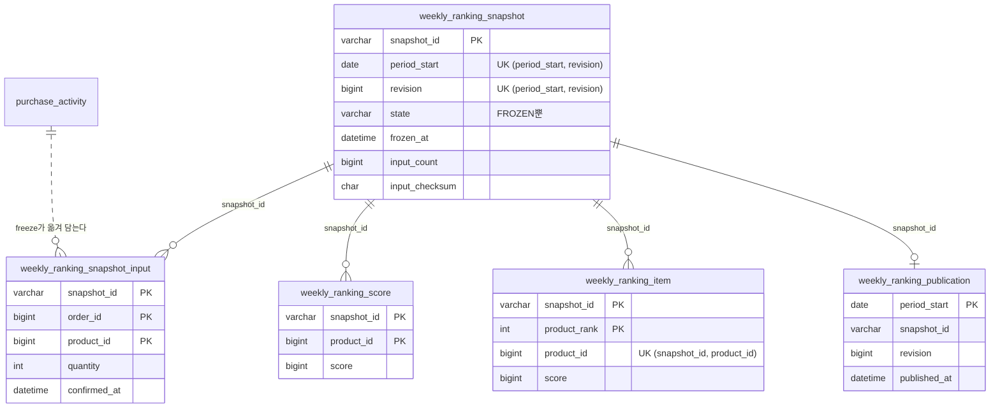

# 주간 랭킹 설계 — 랭킹 기간의 입력을 고정하고, 중단된 배치를 이어서 같은 랭킹을 만든다

9주차 과제의 설계 문서다. 용어는 주간 랭킹의 [`CONTEXT.md`](../../apps/commerce-batch/CONTEXT.md)("랭킹 기간", "스냅샷", "스냅샷 입력", "차수", "체크섬", "충돌", "고정하다", "게시하다")와, 구매 활동의 [`CONTEXT.md`](../../apps/commerce-streamer/CONTEXT.md)를 따른다. 결정의 출처는 1단계가 [명세 237](https://github.com/giwankim/loop-pack-be-l2-vol5-kotlin/issues/237)이다. 1단계는 [ADR 0038](../adr/0038-weekly-ranking-tables-are-not-entities.md)을 둔다. READ COMMITTED와 인덱스는 ADR이 아니라 이 문서의 5.2절이 적는다. (2026-11-18 2단계: 결정의 출처는 [명세 246](https://github.com/giwankim/loop-pack-be-l2-vol5-kotlin/issues/246)이고, "점수"를 용어집에 더했다. ADR은 더하지 않았다. 12절.) (2026-11-19 3단계: 결정의 출처는 [명세 252](https://github.com/giwankim/loop-pack-be-l2-vol5-kotlin/issues/252)이고, "순위"와 "게시"를 용어집에 더했다. [ADR 0039](../adr/0039-what-a-ranking-period-shows-is-decided-by-a-publication-row-that-only-a-later-revision-replaces.md)를 둔다. 13절.) (2026-11-19 4단계: 결정의 출처는 [명세 259](https://github.com/giwankim/loop-pack-be-l2-vol5-kotlin/issues/259)이고, "늦은 구매"를 용어집에 더했다. ADR은 더하지 않았다. 14절.)

상태: 2026-11-17 1단계(`feat/weekly-ranking-input`)를 인터뷰하고, 같은 날 그 일곱 티켓을 구현한 뒤 이 문서를 썼다. (2026-11-18 2단계(`feat/weekly-ranking-scores`)를 인터뷰하고, 같은 날 그 네 티켓을 구현한 뒤 12절을 더했다.) (2026-11-19 3단계(`feat/weekly-ranking-publish`)를 인터뷰하고, 같은 날 그 다섯 티켓을 구현한 뒤 13절을 더했다.) (2026-11-19 4단계(`feat/weekly-ranking-late-purchase`)를 인터뷰하고, 같은 날 그 네 티켓을 구현한 뒤 14절을 더했다.)

## 1. 근거와 범위

- 과제: 9주차 실습 "중단된 배치를 이어서 같은 랭킹 만들기". 1단계의 몫은 과제 2절(입력 고정)과 과제 3절(job의 배선과 재시작 probe)이다.
- 6주차와 7주차로 확정된 주문의 구매 활동이 `purchase_activity`에 쌓인다. 주간 랭킹은 그것을 읽어 commerce-batch에서 만든다. 주문, 결제, 아웃박스, 구매 활동의 기록은 바뀌지 않는다. 스트리머에서 바뀐 것은 인덱스 한 줄이다(2절).
- 데모 job(`DemoJobConfig`, `DemoTasklet`, `DemoJobE2ETest`)은 그대로 둔다. `spring.batch.job.name=demoJob`일 때만 올라오므로 `weeklyRanking`의 실행에는 없다. 지우는 일은 [issue 236](https://github.com/giwankim/loop-pack-be-l2-vol5-kotlin/issues/236)이다.

### 1.1 네 단계

| 단계 | 하는 것 | 과제 | 브랜치 | 상태 |
| --- | --- | --- | --- | --- |
| 1 | `weeklyRanking` job과 그 첫 step `freeze`. 한 랭킹 기간의 구매 활동을 스냅샷으로 고정하고 개수와 체크섬을 남긴다. Batch 6에서의 재시작을 probe로 확인한다. | 2절, 3절 | `feat/weekly-ranking-input` | 인터뷰 끝남(2026-11-17). 구현 끝남(2026-11-17, 1.2절). [명세 237](https://github.com/giwankim/loop-pack-be-l2-vol5-kotlin/issues/237) |
| 2 | 상품별 점수의 chunk step. 6절의 일곱 단계 가운데 실패와 재시작까지. | 4절, 6절 | `feat/weekly-ranking-scores` | 인터뷰 끝남(2026-11-18). 구현 끝남(2026-11-18, 1.3절, 12절). [명세 246](https://github.com/giwankim/loop-pack-be-l2-vol5-kotlin/issues/246) |
| 3 | 게시, 게시 포인터, 차수 사이의 순서, `GET /api/v1/rankings/weekly`. | 5절, 1절, 6절의 마지막 단계 | `feat/weekly-ranking-publish` | 인터뷰 끝남(2026-11-19). 구현 끝남(2026-11-19, 1.4절, 13절). [명세 252](https://github.com/giwankim/loop-pack-be-l2-vol5-kotlin/issues/252) |
| 4 | 늦은 구매의 새 차수, PG에서 API까지의 연결 테스트. | 7절, 8절 | `feat/weekly-ranking-late-purchase` | 인터뷰 끝남(2026-11-19). 구현 끝남(2026-11-19, 14절). [명세 259](https://github.com/giwankim/loop-pack-be-l2-vol5-kotlin/issues/259) |

넷은 모두 `week9`로 PR한다.

### 1.2 1단계가 만든 것

| 티켓 | 만든 것 |
| --- | --- |
| [238](https://github.com/giwankim/loop-pack-be-l2-vol5-kotlin/issues/238) | 셋째 맥락의 용어집과 `CONTEXT-MAP.md`의 계약. 재시작 probe(`BatchRestartProbeJobConfig`, `BatchRestartProbeTest`)와 job 테스트의 기반 `BaseBatchJobTest`. 운영 코드는 없다. |
| [239](https://github.com/giwankim/loop-pack-be-l2-vol5-kotlin/issues/239) | `WeeklyRankingJobConfig`(job `weeklyRanking`, step `freeze`), `FreezeTasklet`, `WeeklyRankingSnapshotStore`, `SnapshotInputDigest`, `JdbcUtcTimes`, `ClockConfig`, `sql/weekly-ranking-schema.sql`. |
| [240](https://github.com/giwankim/loop-pack-be-l2-vol5-kotlin/issues/240) | 랭킹 기간의 경계와 soft-delete된 구매 활동의 장면. 스트리머의 `IDX_PURCHASE_ACTIVITY_ON_CONFIRMED_AT`과 그 테스트. 배치의 운영 코드는 바뀌지 않았다. |
| [241](https://github.com/giwankim/loop-pack-be-l2-vol5-kotlin/issues/241) | `WeeklyRankingJobParametersValidator`와 그 장면 아홉. |
| [242](https://github.com/giwankim/loop-pack-be-l2-vol5-kotlin/issues/242) | 충돌을 먼저 거절하는 `findConflicting`, `SnapshotKey`, `SnapshotConflictException`. |
| [243](https://github.com/giwankim/loop-pack-be-l2-vol5-kotlin/issues/243) | 실패한 고정과 고정 도중의 늦은 구매 활동의 장면. 운영 코드는 바뀌지 않았다. |
| [244](https://github.com/giwankim/loop-pack-be-l2-vol5-kotlin/issues/244) | ADR 0038, 이 문서, `CONTEXT-MAP.md`의 셋째 줄, 끝의 확인(9.3절). |

티켓마다 구현 중에 정한 것은 [글감](../research/week9-weekly-ranking-input-writing-material.md)에 있다.

### 1.3 2단계가 만든 것

| 티켓 | 만든 것 |
| --- | --- |
| [247](https://github.com/giwankim/loop-pack-be-l2-vol5-kotlin/issues/247) | `WeeklyRankingJobConfig`의 둘째 step `score`, `ScoreProductReader`, `ScoreProcessor`, `ScoreWriter`, `WeeklyRankingScoreStore`, `WeeklyRankingScoreProperties`. 스키마 스크립트의 `weekly_ranking_score`와 스냅샷 입력의 보조 인덱스. `WeeklyRankingScoreTest`와 랭킹 테스트의 도우미 `WeeklyRankingJobs`. 앞선 두 커밋이 용어집의 "점수"와 `CODING_STANDARDS.md`의 긴 인덱스 이름 규칙(12.2절)을 더했다. |
| [248](https://github.com/giwankim/loop-pack-be-l2-vol5-kotlin/issues/248) | 틀린 점수의 장면이 점수를 읽기 전에 실행의 `COMPLETED`를 단언한다. 장면과 그 붉은 확인은 247의 커밋에 이미 있었다. 운영 코드는 바뀌지 않았다. |
| [249](https://github.com/giwankim/loop-pack-be-l2-vol5-kotlin/issues/249) | `WeeklyRankingJobRestartTest`와 그 장면 여섯. 운영 코드는 바뀌지 않았다. |
| [250](https://github.com/giwankim/loop-pack-be-l2-vol5-kotlin/issues/250) | 이 문서의 12절, 1단계의 절에 붙인 2단계의 메모, 끝의 확인(12.8절). |

티켓마다 구현 중에 정한 것은 [2단계의 글감](../research/week9-weekly-ranking-scores-writing-material.md)에 있다.

### 1.4 3단계가 만든 것

| 티켓 | 만든 것 |
| --- | --- |
| [253](https://github.com/giwankim/loop-pack-be-l2-vol5-kotlin/issues/253) | `WeeklyRankingJobConfig`의 셋째 step `publish`, `PublishTasklet`, `WeeklyRankingPublishStore`. 스키마 스크립트의 `weekly_ranking_item`과 `weekly_ranking_publication`. `WeeklyRankingPublishTest`. 앞선 커밋이 용어집의 "순위"와 "게시"를 더했다. |
| [254](https://github.com/giwankim/loop-pack-be-l2-vol5-kotlin/issues/254) | 게시를 쓴 뒤 다시 읽어 돌려주는 `publish`와 `Publication`, 옮기지 않은 게시를 말하는 로그와 exit description, 이미 순위를 매긴 스냅샷을 건너뛰는 확인. 그 장면 넷. |
| [255](https://github.com/giwankim/loop-pack-be-l2-vol5-kotlin/issues/255) | `WeeklyRankingJobRestartTest`의 게시 장면 여섯과 테스트 지원의 결과 체크섬. 운영 코드는 바뀌지 않았다. |
| [256](https://github.com/giwankim/loop-pack-be-l2-vol5-kotlin/issues/256) | commerce-api의 `ranking` 조각과 `GET /api/v1/rankings/weekly`, `ProductFinder.findAllSummaries`, `CONTEXT-MAP.md`의 셋째 계약, `WeeklyRankingApiTest`와 `WeeklyRankingFinderTest`. |
| [257](https://github.com/giwankim/loop-pack-be-l2-vol5-kotlin/issues/257) | ADR 0039, 이 문서의 13절, 앞선 절에 붙인 3단계의 메모, 끝의 확인(13.9절). |

티켓마다 구현 중에 정한 것은 [3단계의 글감](../research/week9-weekly-ranking-publish-writing-material.md)에 있다.

## 2. 맥락과 계약

주간 랭킹은 셋째 맥락이다. 앱은 commerce-batch이고 용어집은 [`apps/commerce-batch/CONTEXT.md`](../../apps/commerce-batch/CONTEXT.md)다. 랭킹의 publish는 "게시하다"다. "발행하다"는 주문 확정 이벤트에만 쓴다.

구매 활동과는 `purchase_activity` 표로만 이어진다([`CONTEXT-MAP.md`](../../CONTEXT-MAP.md)).

- 구매 활동이 쓰고, 주간 랭킹은 고정할 때만 읽는다.
- 읽는 것은 `order_id`, `product_id`, `quantity`, `confirmed_at`과 `deleted_at is null`이다.
- `confirmed_at`의 인덱스도 계약에 든다. 스트리머의 `PurchaseActivity`가 `IDX_PURCHASE_ACTIVITY_ON_CONFIRMED_AT`을 이름 붙여 선언하고, `PurchaseActivityRepositoryTest`가 `information_schema.statistics`에서 그 하나를 읽는다. 1단계가 다른 맥락의 코드에서 바꾼 것은 이 한 줄과 그 import, 그리고 그 테스트뿐이다.
- commerce-batch는 commerce-streamer에 의존하지 않고 그 클래스를 쓰지 않는다(ADR 0038).

(2026-11-19 3단계: 주간 랭킹과 커머스 사이의 계약이 생겼다. 주간 랭킹이 쓰는 세 표를 커머스가 읽기만 한다. 13.4절.)

## 3. 표

| 표 | 컬럼 | 키 |
| --- | --- | --- |
| `weekly_ranking_snapshot` | `snapshot_id`(`VARCHAR(100)`), `period_start`(`DATE`), `revision`(`BIGINT`), `state`, `frozen_at`(`DATETIME(6)`), `input_count`, `input_checksum`(`CHAR(64)`) | 기본 키 `snapshot_id`, 유일 키 `UK_WEEKLY_RANKING_SNAPSHOT_ON_PERIOD_START_AND_REVISION (period_start, revision)` |
| `weekly_ranking_snapshot_input` | `snapshot_id`, `order_id`, `product_id`, `quantity`, `confirmed_at`(`DATETIME(6)`) | 기본 키 `(snapshot_id, order_id, product_id)` |

- 자연 키다. 대리 키와 `created_at`·`updated_at`·`deleted_at`이 없다. 스냅샷은 고정한 뒤 바뀌지 않고 지우지 않는다. 엔티티가 아닌 까닭은 ADR 0038에 있다.
- 랭킹 기간의 끝은 저장하지 않는다. 시작에서 이레 뒤다.
- 저장하는 상태는 `FROZEN` 하나다. 진행 중이나 실패를 뜻하는 행은 쓰지 않는다. 뒤의 단계가 제 상태를 더한다. (2026-11-18 2단계: 점수의 단계는 상태를 더하지 않았다. 12.3절.) (2026-11-19 3단계: 게시도 상태를 더하지 않았다. 게시한 뒤에도 `FROZEN`이다. 13.1절.)
- 두 표는 `sql/weekly-ranking-schema.sql`이 `CREATE TABLE IF NOT EXISTS`로 만든다. `spring.sql.init`이 `local, test` 블록에서 시작할 때마다 실행한다. 다른 프로필에서는 손으로 적용한다(8절). (2026-11-18 2단계: 같은 스크립트가 점수 표 `weekly_ranking_score`를 만들고, 스냅샷 입력에 보조 인덱스를 둔다. 12.2절.) (2026-11-19 3단계: 같은 스크립트가 `weekly_ranking_item`과 `weekly_ranking_publication`을 만든다. 13.2절.)

### 3.1 다섯 표의 관계

(2026-11-20) 표는 단계마다 하나둘씩 더해져 이 절, 12.2절, 13.2절에 나뉘어 있다. 아래는 네 단계가 끝난 뒤의 다섯 표를 한 그림에 모은 것이다. 컬럼과 키의 정본은 `sql/weekly-ranking-schema.sql`이다.



- 선은 선언한 외래 키가 아니다. 스키마 스크립트에 `FOREIGN KEY`가 없고, 표는 `snapshot_id`의 값으로만 이어진다. `order_id`와 `product_id`도 커머스의 표를 식별자로만 가리킨다(2절, ADR 0038).
- 점선은 표 사이의 관계가 아니라 복사다. `freeze`가 `purchase_activity`의 행을 스냅샷 입력으로 옮겨 담고(5.1절), 그 뒤로 job은 `purchase_activity`를 읽지 않는다.
- 게시는 랭킹 기간마다 한 행이고 그 랭킹 기간의 스냅샷 하나를 든다. 그래서 한 스냅샷에서 보면 게시는 없거나 하나다(13.2절, ADR 0039).
- commerce-api가 읽는 것은 `weekly_ranking_publication`, `weekly_ranking_snapshot`, `weekly_ranking_item`의 셋이다(13.3절, [`CONTEXT-MAP.md`](../../CONTEXT-MAP.md)).

## 4. job과 매개변수

- job은 `weeklyRanking`, 1단계의 step은 `freeze` 하나다. job 설정(`WeeklyRankingJobConfig`)과 그 빈들은 템플릿의 데모 job처럼 `spring.batch.job.name=weeklyRanking`일 때만 올라온다. (2026-11-18 2단계: job은 `freeze` 다음에 `score`를 실행한다. 매개변수와 검증기는 이 절 그대로다. 12.1절.) (2026-11-19 3단계: `score` 다음에 `publish`를 실행한다. 매개변수와 검증기는 여전히 이 절 그대로다. 13.1절.)
- 식별 매개변수는 셋이고 모두 사람이 준다: `periodStart`(`LocalDate`), `snapshotId`(`String`), `revision`(`Long`). `RunIdIncrementer`, run ID, 현재 시각은 매개변수에 없다. 그래서 같은 세 값으로 다시 실행하면 같은 `JobInstance`다.
- 실행은 템플릿의 방식이다. `--job.name`과 세 매개변수를 명령줄로 준다. 형을 적지 않은 매개변수는 `String`이므로 `periodStart`와 `revision`에는 형을 붙인다.

  ```
  java -jar <commerce-batch의 bootJar> --job.name=weeklyRanking \
    periodStart=2026-08-17,java.time.LocalDate snapshotId=2026-08-17-r1 revision=1,java.lang.Long
  ```

- `WeeklyRankingJobParametersValidator`가 실행이 생기기 전에 거절한다. 빠진 매개변수, 형이 다른 매개변수, 월요일이 아닌 `periodStart`, 빈 `snapshotId`, 1보다 작은 `revision`이다. (2026-11-17 명세 237의 닫는 검토: 100자를 넘는 `snapshotId`도 거절한다. 전에는 검증을 지나 옮겨 담기가 `VARCHAR(100)`에서 실패해, 거절이 아니라 `FAILED` 실행을 남겼다.) 거절은 `JobExecution`도 랭킹의 행도 남기지 않는다. 다만 Batch 6.0.6에서는 실행 없는 `JobInstance`가 남는다(8절).
- 형은 엄격하게 본다. 매개변수의 형은 job 인스턴스를 식별하는 값의 일부여서, `String`으로 받은 날짜를 너그럽게 읽으면 같은 주가 다른 `JobInstance`가 된다. 운영자가 저지를 실수는 `,java.time.LocalDate`를 빠뜨리는 것이라, 거절하는 말에 바른 꼴을 적는다: `periodStart must be a LocalDate, but was a String. Give it as periodStart=2026-08-17,java.time.LocalDate`.
- 랭킹 기간이 끝났는지는 보지 않는다. 시계를 읽는 검사가 되고, 끝나기 전에 고정한 것은 뒤 차수로 바로잡는다. 앞날의 `periodStart`는 빈 스냅샷으로 고정된다.
- step은 애플리케이션의 트랜잭션 매니저(JPA의 것)를 쓴다. step의 쓰기와 그 메타데이터가 함께 커밋된다. `ResourcelessTransactionManager`는 랭킹 job의 어디에도 없다(데모 job에만 있다).
- `FreezeTasklet`은 `@StepScope`이고 세 매개변수를 `jobParameters`에서 받는다.

## 5. 고정

### 5.1 차례

tasklet step 하나, 트랜잭션 하나다. 그 트랜잭션의 격리 수준은 READ COMMITTED다(5.2절).

1. **충돌을 확인한다.** `findConflicting`이 같은 `snapshot_id`, 또는 같은 `(period_start, revision)`의 스냅샷을 잠그지 않고 읽는다. 있으면 `SnapshotConflictException`으로 실패하고 아무것도 쓰지 않는다. 그 말이 step의 exit description에 남는다: `Freeze of snapshot <id> (period …, revision …) conflicts with snapshot <id> (period …, revision …)`. 이 확인을 함께 지나친 두 고정은 뒤진 쪽이 스냅샷을 쓸 때 키가 거절하고, 옮겨 담은 입력도 함께 되돌아간다.
2. **고정 시각을 읽는다.** 주입한 `Clock`에서 한 번 읽고 마이크로초로 자른다.
3. **옮겨 담는다.** `copyInputs`가 `INSERT … SELECT` 한 문장으로 `confirmed_at >= 시작 AND confirmed_at < 끝 AND deleted_at IS NULL`인 구매 활동을 스냅샷 입력에 넣는다. 시작은 `periodStart`의 UTC 0시, 끝은 그 이레 뒤다. 한 문장이라 모든 입력이 한 번의 읽기에서 오고, 본 가장 큰 `id`에 기대는 것이 없다. 한 주문이 여러 상품을 샀으면 상품마다 하나씩 든다.
4. **개수와 체크섬을 구한다.** `digestInputs`가 옮겨 담은 입력을 `order_id`, `product_id` 순으로 흘려 읽으며 `SnapshotInputDigest`에 하나씩 더한다. 목록으로 모으지 않는다. `withFetchSize(Int.MIN_VALUE)`는 Connector/J가 결과를 통째로 받지 않고 행마다 흘려 주게 하는 스위치다. 콜백만으로는 드라이버가 결과 전체를 먼저 받는다.
5. **스냅샷을 쓴다.** `insertFrozenSnapshot`이 `FROZEN` 행을 쓴다.

실패한 고정은 트랜잭션이 되돌려져 두 표에 아무것도 남지 않는다. 그래서 스냅샷이 있다는 것이 곧 입력이 고정됐다는 뜻이다. 다시 실행하면 같은 `JobInstance`로 처음부터 한다. 구매 활동이 없는 랭킹 기간은 개수 0과 빈 입력의 체크섬으로 고정된다.

### 5.2 READ COMMITTED와 인덱스

옮겨 담기는 `purchase_activity`를 읽는 `INSERT … SELECT`다. MySQL은 REPEATABLE READ에서 이 문장이 읽는 행에 공유 next-key 잠금을 건다. 명세 237의 "확인한 사실" 1이 MySQL 8.4의 일회용 컨테이너에서 같은 꼴의 표로 잰 결과다. 옮겨 담는 트랜잭션을 열어 둔 채, 다른 연결이 잠금 대기 1초로 한 줄을 넣었다.

| `confirmed_at` 인덱스 | 격리 수준 | 읽는 표의 잠금 | 그 랭킹 기간의 늦은 행 넣기 | 다음 주의 행 넣기 |
| --- | --- | --- | --- | --- |
| 없음 | REPEATABLE READ | 기본 키의 모든 행에 S next-key | 막힘 | 막힘 |
| 없음 | READ COMMITTED | 없음 | 됨 | 됨 |
| 있음 | REPEATABLE READ | 인덱스의 그 범위에 S next-key | 막힘 | 됨 |
| 있음 | READ COMMITTED | 없음 | 됨 | 됨 |

스트리머의 연결은 행 잠금을 3초 기다리고(`jpa.yml`의 `innodb_lock_wait_timeout=3`), 구매 활동을 기록하지 못하면 이벤트 읽기를 멈춘다([ADR 0033](../adr/0033-purchase-activity-is-recorded-by-reading-first-and-an-unprocessable-event-stops-the-consumer.md)). 한 주를 옮겨 담는 동안 그 주의 늦은 구매가 들어오면, REPEATABLE READ에서는 스트리머가 멈출 수 있다. 그래서 step의 트랜잭션은 READ COMMITTED다(`WeeklyRankingJobConfig`의 `transactionAttribute`).

READ COMMITTED에서도 한 문장은 한 번의 일관된 읽기다. 문장이 시작된 뒤에 커밋된 구매 활동은 그 스냅샷에 들지 않는다. 고정한 뒤에 들어온 구매 활동이 그 스냅샷에 들지 않는 것은 "고정하다"의 뜻 그대로다.

인덱스는 잠금이 아니라 읽는 범위를 위해 둔다. 인덱스가 없으면 한 주를 고정하려고 구매 활동의 역사 전체를 훑는다.

### 5.3 시각의 변환

commerce-batch의 JVM 기본 시간대는 Asia/Seoul이다. 명세 237의 "확인한 사실" 2는 Connector/J 9.7.0과 앱과 같은 URL로 `2026-08-17T00:00:00Z`를 넣어 본 결과다.

| JDBC에 묶은 값 | 저장된 `DATETIME(6)` |
| --- | --- |
| `Timestamp`, `Instant`, `OffsetDateTime` | `2026-08-17 09:00:00`. Hibernate가 UTC로 쓴 행과 아홉 시간 어긋난다 |
| UTC의 `LocalDateTime` | `2026-08-17 00:00:00`. 그대로 읽힌다 |

Hibernate의 `jdbc.time_zone: UTC`는 `JdbcClient`에 닿지 않는다. 그래서 모든 시각은 UTC의 `LocalDateTime`으로 JDBC를 지나고, 변환은 `JdbcUtcTimes` 한 곳에 있다. 랭킹 기간의 경계 장면(9.1절)이 JVM 시간대가 Asia/Seoul임을 먼저 단언하고, 두 방향의 어긋남을 모두 잡는다(9.2절).

### 5.4 체크섬

- 과제 6절의 정규 텍스트의 SHA-256, 소문자 16진수 64자다.
- 행은 `orderId`, `productId` 순이다. 필드는 `orderId`, `productId`, `quantity`, `confirmedAt`이고 TAB으로 잇는다. 모든 행 뒤에, 마지막 행 뒤에도 LF를 둔다. 인코딩은 UTF-8이다.
- `confirmedAt`은 UTC이고 소수 여섯 자리를 늘 적는다: `2026-08-17T00:00:00.000000Z`. 한 순간에 한 표기다.
- 빈 입력의 체크섬은 빈 문자열의 SHA-256(`e3b0c442…b855`)이다.
- `SnapshotInputDigest`는 SQL과 떨어진 순수한 코드다. DB 없이 값으로 확인한다(`SnapshotInputDigestTest`).

과제 6절의 네 입력은 확정 시각을 주지 않는다. 테스트는 이 값을 골랐다: 주문 42는 `2026-08-17T00:00:00Z`(두 상품), 주문 43은 `2026-08-19T13:45:30.123456Z`, 주문 44는 `2026-08-23T23:59:59.999999Z`. 소수가 없는 시각, 마이크로초가 있는 시각, 랭킹 기간의 마지막 마이크로초다. 그 체크섬은 `d07eff39…4720b`이고, 코드와 떨어져 `printf … | shasum -a 256`으로 구했다.

## 6. 재시작 probe

과제 3절의 probe 예시는 Boot 3.4.4와 Batch 5.2.2로 쓰였다. 이 저장소는 Boot 4.1.2와 Batch 6.0.6이다. 그래서 같은 장면을 테스트 소스에만 있는 job(`BatchRestartProbeJobConfig`, job `batchRestartProbe`)으로 옮겨 실제로 확인했다.

- `batch_restart_probe`의 상품 7, 8, 9를 `JdbcCursorItemReaderBuilder`의 리더(이름 `purchaseProductProbe`)로 `chunk(2)`씩 읽고, 처리한 상품을 쓴 실행과 함께 `batch_restart_probe_written`에 쓴다. 리더의 매개변수 `minProductId`는 step scope로 묶는다. step은 애플리케이션의 트랜잭션 매니저를 쓴다.
- 첫 실행은 상품 9 앞에서 실패한다. `FAILED`이고, 쓴 표에 7과 8이 있으며, DB에서 다시 읽은 step `ExecutionContext`의 `purchaseProductProbe.read.count`가 2다.
- 메타데이터를 지우지 않고 같은 매개변수로 다시 실행한다. 같은 `JobInstance`, 새 `JobExecution`, `COMPLETED`다. 쓴 표에는 7, 8, 9가 한 번씩 있고, 7과 8은 첫 실행이, 9는 재시작이 썼다.
- 리더에 `.saveState(false)`를 주면 두 장면이 모두 실패한다. 첫 장면은 저장된 개수를 찾지 못하고, 재시작은 7과 8을 다시 쓴다.

Batch 6.0.6에서 확인한 이름: `StepBuilder.chunk(int)`는 Batch 6의 `ChunkOrientedStepBuilder`를 돌려주고, 리더의 저장 키는 `<이름>.read.count`다. 이것이 뒤의 단계가 기대는 네 사실(같은 인스턴스, 새 실행, 저장된 읽은 수, 남은 항목만 처리)이다.

## 7. 고르지 않은 것

엔티티와 `ddl-auto`의 재정의, Flyway, 스트리머의 엔티티에 대한 의존은 ADR 0038이 적는다. 나머지는 이렇다.

- **REPEATABLE READ로 옮겨 담기.** 5.2절. 그 랭킹 기간의 늦은 구매가 막히고, 스트리머는 3초 뒤 이벤트 읽기를 멈춘다.
- **구매 활동을 메모리로 읽어 한 번에 쓰기.** 한 주의 구매 활동을 모두 메모리에 든다. 실제 규모에서는 비싸다. 개수와 체크섬도 흘려 읽으며 구한다.
- **`max(id)`까지 나누어 옮겨 담기.** 과제가 금한다. 커밋 순서와 `id`의 순서가 같지 않아, 본 가장 큰 `id` 아래에 늦게 커밋된 행이 남을 수 있다.
- **충돌을 잠그는 읽기로 확인하기.** 유일 키에 gap 잠금이 더해진다. 키가 이미 해결하는 경쟁을 위한 잠금이다.
- **랭킹 기간이 끝났는지의 검사.** 4절.
- **거절된 매개변수의 `JobInstance`를 막기.** `JobOperator.start`를 감싸 검증을 먼저 하는 것, 거절한 뒤 인스턴스를 지우는 것, Boot 4.2.0-RC2로 먼저 올리는 것. 앞의 둘은 Batch를 올릴 때까지만 있을 코드이고, 셋째는 Initializr의 기본을 앞지른다([명세 237](https://github.com/giwankim/loop-pack-be-l2-vol5-kotlin/issues/237)의 두 번째 인터뷰).
- **probe를 `JobOperator.restart(JobExecution)`로 다시 시작하기.** 명세의 "확인한 사실" 4는 이 메서드를 적는다. 그러나 랭킹 job은 템플릿대로 `--job.name`과 같은 매개변수로 다시 실행되고, 그것은 시작이다. 그래서 probe는 같은 매개변수의 두 번째 `startJob`으로 그 길을 증명한다. `restart(…)`는 쓰지 않았다.

## 8. 한계

- **옮겨 담기는 한 문장이고 한 트랜잭션이다.** 한 주의 구매 활동이 클수록 그 트랜잭션이 길다. 나누어 옮기지 않는다. READ COMMITTED라 스트리머를 막지는 않는다(5.2절).
- **랭킹의 표는 `local`, `test` 밖에서 손으로 적용한다.** Batch 메타데이터와 같다(ADR 0038).
- **"끝난 고정은 다시 실행되지 않는다"는 이 단계에서 증명하지 않는다.** 고정 뒤에 실패할 step이 없기 때문이다. 이 단계의 job은 `freeze`로 끝나고, 끝난 실행을 같은 값으로 다시 실행하면 `JobInstanceAlreadyCompleteException`이다. 2단계(`feat/weekly-ranking-scores`)의 과제 6절 장면이 증명한다. (2026-11-18 2단계: 증명했다. `score`에서 실패한 실행을 다시 실행하면 그 인스턴스의 `freeze` step 실행은 하나뿐이고, 스냅샷과 그 입력은 시계를 옮기고 구매 활동을 더한 뒤에도 첫 실행의 것 그대로다. 12.3절, 12.6절.)
- **이 단계에서 끝난 `JobInstance`는 step이 더해진 뒤에 이어 실행할 수 없다.** 이미 `COMPLETED`라서다. 메타데이터를 단계 사이에 보존하는 환경이 없으므로 받아들인다. 같은 랭킹 기간은 새 `snapshotId`와 차수로 다시 고정한다. (2026-11-18 2단계: 2단계에서 끝난 인스턴스도 `publish`가 더해진 뒤에 같다. 12.5절.) (2026-11-19 3단계: 13.6절.)
- **거절된 매개변수는 Batch 6.0.6에서 실행 없는 `JobInstance`를 남긴다.** `TaskExecutorJobLauncher.createJobExecution`이 `createJobInstance`를 제 트랜잭션으로 커밋한 뒤에 검증기를 부르기 때문이다. 같은 나쁜 매개변수로 다시 실행하면 검증기의 말이 아니라 `IllegalStateException`("Cannot find any job execution for job instance")이 난다. 이런 인스턴스는 언제나 거절될 매개변수에만 생기므로 바른 실행을 막지 않는다. [Spring Batch issue 5562](https://github.com/spring-projects/spring-batch/issues/5562)이고, 커밋 `4dcf68f7b`가 6.1.0-RC1에서 고쳤다. Boot 4.2와 함께 오면 사라지고, 그때 이 저장소에서 지울 코드는 없다. 테스트는 이 인스턴스를 고정하지 않는다.
- **처리량은 재지 않았고 주장하지 않는다.** 테스트의 입력은 몇 줄이다. (2026-11-18 2단계: `score`의 chunk 크기 100도 재지 않은 값이다. 2단계의 한계는 12.5절.) (2026-11-19 3단계: 조회의 처리량도 재지 않았다. 3단계의 한계는 13.6절.)

## 9. 검증

job 테스트는 `BaseBatchJobTest`([ADR 0012](../adr/0012-tests-inherit-setup-from-abstract-base-classes.md))를 상속한다. `@SpringBootTest`에 `spring.batch.job.enabled=false`, `@SpringBatchTest`, MySQL과 Redis의 Testcontainers다. `JobOperatorTestUtils`로 실행하고, 남은 것을 읽는다: 스냅샷과 스냅샷 입력의 행, Batch 메타데이터의 실행 상태와 `ExecutionContext`. DB를 mock으로 대신하지 않는다. `purchase_activity`는 테스트 전용 `sql/purchase-activity.sql`이 만든다(ADR 0038의 대가). 테스트 사이에 랭킹의 두 표와 `purchase_activity`를 비운다.

### 9.1 장면

| 이음매 | 클래스 | 장면 |
| --- | --- | --- |
| 체크섬(DB 없음) | `SnapshotInputDigestTest` | 과제 6절의 네 입력의 정규 텍스트와 체크섬, 빈 입력, 소수 여섯 자리. 3개 |
| `weeklyRanking` job | `WeeklyRankingFreezeTest` | 25개. 아래 |
| 재시작 probe | `BatchRestartProbeTest` | 첫 실행의 실패와 저장된 읽은 수, 같은 인스턴스의 재시작. 2개 |
| 스트리머의 인덱스 | `PurchaseActivityRepositoryTest` | `confirmed_at`의 단일 컬럼 인덱스가 이름대로 있다. 1개 |

`WeeklyRankingFreezeTest`의 장면은 이렇다.

- **고정(239):** 과제의 주를 고정하면 `COMPLETED`이고 주문과 상품마다 입력 하나다. 스냅샷은 `FROZEN`, 개수 4, DB 없는 테스트와 같은 체크섬, 준 랭킹 기간과 차수, 테스트 시계의 시각(`2026-08-24T01:02:03.123456789Z`가 `2026-08-24 01:02:03.123456`으로 저장된다). 구매 활동이 없는 랭킹 기간은 개수 0과 빈 입력의 체크섬이다. 스키마 스크립트를 다시 실행해도 실패하지 않고 행이 남는다.
- **경계(240):** 월요일 0시 UTC의 구매 활동은 들고, 그보다 1마이크로초 앞선 것과 다음 월요일 0시의 것은 들지 않는다. JVM 시간대가 Asia/Seoul인 채로 돌린다. soft-delete된 구매 활동은 입력에도 개수와 체크섬에도 없다.
- **실패와 늦은 구매(243):** 이음매는 `WeeklyRankingSnapshotStore.digestInputs`다. 옮겨 담기와 스냅샷 쓰기 사이의 하나뿐인 호출이고, springmockk의 `@MockkSpyBean`이 그 자리에서 실패시키거나 다른 연결의 넣기를 실행한다.
  - 입력을 쓴 뒤 실패한 고정은 `FAILED`이고 두 표에 그 `snapshotId`의 행이 없다. 같은 매개변수로 다시 실행하면 같은 `JobInstance`, 새 실행으로 `COMPLETED`다.
  - 고정 도중 다른 연결이 잠금 대기 1초로 그 랭킹 기간의 구매 활동(주문 45)을 넣는다. 넣기는 성공하고, 그 행은 스냅샷 입력에 없으며 개수 4와 과제의 체크섬은 그대로다.
- **충돌(242):** 같은 `snapshotId`와 다른 랭킹 기간, 같은 `snapshotId`와 같은 랭킹 기간의 다른 차수, 같은 랭킹 기간·차수와 다른 `snapshotId`. 셋 다 `FAILED`이고, exit description이 충돌을 말하며, 있던 스냅샷과 그 입력이 그대로이고 새 행이 없다. 새 `snapshotId`의 새 차수는 그대로 고정된다. SQL로 같은 `(period_start, revision)`의 둘째 행을 넣으면 DB가 그 유일 키의 이름으로 거절한다. (2026-11-17 명세 237의 닫는 검토: 같은 `snapshot_id`의 둘째 행을 기본 키가 거절하는 장면을 더했다. 이야기 21의 두 키가 모두 테스트에 있다.)
- **매개변수(241):** 화요일의 `periodStart`, 빈 `snapshotId`, `revision` 0, 빠진 매개변수 셋, `String`으로 준 `periodStart`(2026-11-17 닫는 검토 뒤로는 100자를 넘는 `snapshotId`도)는 `InvalidJobParametersException`이고 `JobExecution`과 두 표의 행이 없다. 앞날의 `periodStart`는 받아들인다. 끝난 실행을 같은 세 값으로 다시 실행하면 `JobInstanceAlreadyCompleteException`이고 두 표는 그대로다.

### 9.2 붉은 확인

커밋하지 않은 로컬 수정으로 돌리고 되돌렸다(2026-11-17). 티켓마다의 기록은 글감에 있다.

| 수정 | 붉어진 장면 |
| --- | --- |
| 리더에 `.saveState(false)` | probe의 두 장면. 저장된 읽은 수가 없고, 재시작이 7과 8을 다시 쓴다 |
| step의 격리 수준을 `ISOLATION_REPEATABLE_READ`로 | 늦은 구매 장면 하나. 1초 뒤 `MySQLTransactionRollbackException: Lock wait timeout exceeded`(5.2절의 셋째 줄) |
| step을 `ResourcelessTransactionManager`로 | 실패한 고정의 두 장면. 실패한 실행이 입력 넷을 남기고, 재시작도 `FAILED`다 |
| 랭킹 기간의 `Instant`를 JDBC에 그대로 묶기 | 경계 장면. 입력이 주문 61이 아니라 62다. 아홉 시간의 어긋남이다 |
| `confirmed_at`을 `getTimestamp(…).toInstant()`로 읽기 | 경계 장면. 체크섬이 `b75aefc5…`가 된다 |
| `deleted_at IS NULL`을 지우기 | soft-delete 장면. 주문 45가 입력에 든다 |
| 스트리머의 인덱스 선언을 지우기(엔티티를 고치기 전) | `PurchaseActivityRepositoryTest`의 인덱스 장면 |

충돌의 확인(242)은 상태가 아니라 exit description으로 붉었다. 확인이 없을 때도 두 충돌은 `FAILED`였다. 옮겨 담은 뒤 스냅샷의 기본 키나 유일 키가 거절했기 때문이다. 키는 이미 뒤의 방어로 일했고, 이 확인이 더한 것은 쓰기 전의 거절과 무엇이 길을 막는지 말하는 거절이다.

### 9.3 끝의 확인

```
scripts/final-check --app commerce-batch --app commerce-streamer
```

- 2026-11-17 `bfc0e186`의 깨끗한 트리에서 돌렸다(12:53:59Z 시작). 셸에 `BOOTSTRAP_SERVERS`는 없었다. ktlint가 통과했다(4 s).
- commerce-batch는 5개 클래스, 31개 테스트, 실패 0, 오류 0, 건너뜀 0이다(25 s). 템플릿은 2개 클래스, 3개 테스트(`CommerceBatchApplicationTest`, `DemoJobE2ETest`)였으므로 이 단계가 3개 클래스와 28개 테스트를 더했다.
- commerce-streamer는 18개 클래스, 68개 테스트, 실패 0, 오류 0, 건너뜀 0이다(53 s). 이 단계가 인덱스 장면 1개를 더했다.
- `bfc0e186`의 코드는 `25c38bd7`의 것이고, 그 뒤로는 문서만 바뀌었다.
- (2026-11-17 명세 237의 닫는 검토) 검토의 고침(`a0da8f4e`)이 운영 코드를 바꿨으므로 그 깨끗한 트리에서 다시 돌렸다(13:39:41Z 시작, `BOOTSTRAP_SERVERS` 없음). ktlint가 통과했다(1 s). commerce-batch는 5개 클래스, 33개 테스트, 실패 0, 오류 0, 건너뜀 0이다(18 s). 위의 31개에 100자를 넘는 `snapshotId`의 거절과 `snapshot_id` 기본 키의 장면이 더해졌다. commerce-streamer는 18개 클래스, 68개 테스트, 실패 0, 오류 0, 건너뜀 0이다(49 s). 이것이 1단계의 끝의 확인이다. 위의 `bfc0e186`의 실행은 앞의 확인이다. `a0da8f4e` 뒤로는 문서만 바뀌었다.

## 10. 명세와 다른 것

2026-11-17 구현을 마치고 명세 237과 견준 것이다.

| 명세 | 구현 | 어디서 |
| --- | --- | --- |
| `performance_schema.data_locks`로 잠금이 없음을 확인한다(인터뷰) | 고정 도중 다른 연결의 늦은 넣기가 성공하는 것으로 본다. Testcontainers의 일반 사용자는 그 표를 읽지 못한다. 명세의 "확인한 사실" 5가 이미 적었다 | 명세 작성 |
| 거절된 매개변수는 `JobInstance`가 생기기 전에 거절한다(인터뷰) | `JobExecution`과 랭킹의 행이 생기기 전에 거절한다. 실행 없는 `JobInstance`는 남는다(8절). 명세의 "확인한 사실" 6과 이야기 2를 두 번째 인터뷰가 고쳤다 | 241 |
| probe는 `JobOperator.restart(JobExecution)`을 쓴다("확인한 사실" 4) | 같은 매개변수의 두 번째 `startJob`(7절) | 238 |
| 실패와 늦은 구매의 이음매는 구현에서 정한다 | `WeeklyRankingSnapshotStore.digestInputs` | 239, 243 |
| 같은 세 값의 스냅샷은 이 단계의 job에서 일어나지 않는다 | Batch가 먼저 거절한다. `findConflicting`은 그것도 충돌로 보고, 예외를 두지 않는다 | 242 |
| `CONTEXT-MAP.md`의 셋째 줄 | 238의 커밋은 셋째 맥락의 문단만 더하고 표의 줄을 빠뜨렸다. 244가 더했다 | 244 |
| 테스트 컨텍스트를 같은 DB에 두 번 띄워도 스키마 스크립트가 실패하지 않는다(티켓 239) | 둘째 컨텍스트를 띄우지 않고, 시작 때 `spring.sql.init`이 부르는 빈 `ApplicationDataSourceScriptDatabaseInitializer`의 `initializeDatabase()`를 고정 뒤에 다시 부른다. 같은 스크립트가 같은 길로 돈다(2026-11-17 닫는 검토에서 이 표에 더했다) | 239 |
| 빈 `snapshotId`와 1보다 작은 `revision`을 거절한다(이야기 3) | 100자를 넘는 `snapshotId`도 거절한다(4절의 메모) | 2026-11-17 닫는 검토 |

## 11. 2단계로 넘기는 것

- 점수 step의 리더가 쓸 `(snapshot_id, product_id)` 인덱스. 이 단계의 스냅샷 입력에는 기본 키뿐이다. (2026-11-18 2단계: 닫았다. 보조 인덱스 `(snapshot_id, product_id, quantity)`다. 12.2절.)
- "끝난 고정은 다시 실행되지 않는다"의 증명(8절). 점수 step이 실패한 뒤 다시 시작해도 `freeze`의 입력이 다시 담기지 않고 체크섬이 같은지를 본다. (2026-11-18 2단계: 닫았다. 12.3절, 12.6절.)
- 스냅샷의 새 상태. 이 단계는 `FROZEN`만 쓴다. (2026-11-18 2단계: 더하지 않기로 했다. 상태는 `FROZEN` 그대로다. 12.3절.)
- probe가 확인한 네 사실(6절)은 점수 step의 chunk와 리더가 기댄다. 리더의 이름과 `<이름>.read.count`, `chunk(int)`가 돌려주는 빌더가 그대로인지 그 단계에서 다시 본다. (2026-11-18 2단계: 진짜 job에서 다시 봤다. 12.3절.)

(2026-11-18 2단계: 3단계로 넘기는 것은 12.10절에 있다.) (2026-11-19 3단계: 4단계로 넘기는 것은 13.12절에 있다.)

## 12. 점수 (2단계)

결정의 출처는 [명세 246](https://github.com/giwankim/loop-pack-be-l2-vol5-kotlin/issues/246)이다(2026-11-18 인터뷰, 질문 13개). 과제의 몫은 4절(chunk step)과, 6절의 일곱 단계 가운데 여섯째까지다. ADR은 더하지 않았다. 리더의 종류, chunk 크기, 인덱스는 모두 한 곳만 고치면 되돌릴 수 있다. 용어집은 "점수"를 더했다: 한 스냅샷의 스냅샷 입력에서 한 상품의 수량을 모두 더한 값이고, 스냅샷과 상품 한 쌍에 하나다. 과제의 "score stage"에서 "stage"는 용어집에도 표 이름에도 옮기지 않았다.

### 12.1 job과 `score` step

- `weeklyRanking`은 `freeze` 다음에 `score`를 실행하고, 이 브랜치에서는 `score`로 끝난다. 식별 매개변수 셋과 검증기는 4절 그대로다.
- `score`는 chunk step이다. `StepBuilder.chunk<Long, ProductScore>(chunkSize)`가 돌려주는 `ChunkOrientedStepBuilder`에 애플리케이션의 트랜잭션 매니저를 준다. probe가 Batch 6.0.6에서 확인한 꼴(6절)이다. (2026-11-18 명세 246의 닫는 검토: chunk의 항목 `ProductScore`는 프로세서·라이터·job 설정이 함께 쓰므로 `SnapshotInput`처럼 제 파일 `ProductScore.kt`에 둔다. 전에는 `WeeklyRankingScoreStore.kt`의 끝에 있었다.)
- 격리 수준은 따로 주지 않는다. `freeze`가 READ COMMITTED인 것은 `purchase_activity`를 읽기 때문이었고(5.2절), `score`는 고정된 스냅샷 입력과 제 점수 표만 읽고 쓴다.
- skip과 retry를 두지 않는다. 어떤 실패든 step이 `FAILED`가 되고, 실행도 `FAILED`로 끝난다.
- 한 chunk의 점수와 리더의 읽은 수는 한 트랜잭션에 커밋된다. 그래서 저장된 읽은 수는 점수가 없는 상품을 지났다고 말하지 않고, 점수가 있는 상품을 빠뜨리지도 않는다.

| 부분 | 클래스 | 하는 것 |
| --- | --- | --- |
| 리더 | `ScoreProductReader` | `JdbcCursorItemReader<Long>`를 상속한 `@StepScope` 빈. `SELECT DISTINCT product_id … WHERE snapshot_id = ? ORDER BY product_id`로 그 스냅샷의 상품을 상품 ID 순으로 한 번씩 읽는다. 한 항목이 한 상품이다. `snapshotId`는 `jobParameters`에서 받는다. 이름은 `scoreProductReader`이고, 상태를 저장한다 |
| 프로세서 | `ScoreProcessor` | 상품마다 `WeeklyRankingScoreStore.sumQuantity(snapshotId, productId)`를 한 번 부른다. 그 스냅샷 입력의 `quantity`를 더하는 질의 하나다. `purchase_activity`는 읽지 않는다 |
| 라이터 | `ScoreWriter` | chunk를 `WeeklyRankingScoreStore.saveScores`에 넘긴다. chunk마다 한 문장이고, 상품마다 한 행이다. `INSERT … VALUES (?, ?, ?), (?, ?, ?), … AS computed ON DUPLICATE KEY UPDATE score = computed.score`. 저장된 점수에 더하지 않고 구한 값으로 덮는다 |
| chunk 크기 | `WeeklyRankingScoreProperties` | 속성 `weekly-ranking.score.chunk-size`. `application.yml`이 100으로 둔다. 1보다 작으면 시작할 때 거절한다. 라이터의 한 문장에 드는 행의 수이기도 하다 |

- 라이터의 행 별칭(`AS computed`)은 `VALUES(score)`를 대신한다. 그 함수는 MySQL 8.0.20부터 deprecated이고, 테스트의 컨테이너는 MySQL 8.4다.
- (2026-11-20 issue 265) 라이터는 chunk를 한 문장으로 보낸다. 전에는 `saveScores`가 chunk를 돌며 상품마다 한 문장을 실행했다. chunk는 한 트랜잭션이었지만 점수 100개가 MySQL과의 왕복 100번이었다. 2단계는 프로세서의 질의만 한계로 적고(12.5절) 이것은 적지 않았다. 메서드와 그 시그니처는 그대로여서 `ScoreWriter`와 재시작 테스트의 spy(12.6절)는 바뀌지 않았다. 티켓이 먼저 확인하라고 한 것은 둘이다. `JdbcClient.params(List)`는 펼친 목록을 차례대로 묶는다. 한 문장으로 쓴 점수 5, 1, 5가 그것을 보인다(12.6절). 행 별칭은 여러 행의 `VALUES`에서도 그 행의 값을 가리킨다. MySQL 8.4에서 세 행이 모두 키가 겹치는 문장으로 봤다(12.7절).
- JDBC 배치나 `JdbcBatchItemWriter`를 고르지 않았다. 배치는 Connector/J가 고쳐 써야 왕복이 준다. `jpa.yml`에 `rewriteBatchedStatements: true`가 있으나, 그것이 `AS computed`가 붙은 문장을 고쳐 쓰는지는 확인하지 않았다. 여러 행의 문장은 그 자체로 한 문장이다.
- 리더는 운영 코드의 컴포넌트이고 job 설정의 빌더 `@Bean`이 아니다. Batch 6.0.6의 `JdbcCursorItemReader`에 `(DataSource, sql, RowMapper)` 생성자가 있어, 프로세서·라이터와 함께 `step` 아래에 둔다.
- 리더는 드라이버의 fetch size를 기본값으로 둔다. Connector/J는 첫 읽기 전에 한 스냅샷의 상품 ID를 모두 받는다. 그 목록은 상품의 수로 묶인다. 모든 입력을 흘려 읽는 고정의 체크섬(5.1절)과 다르다.
- 다시 시작하면 리더는 같은 질의를 다시 실행하고, 저장된 `scoreProductReader.read.count`만큼 건너뛴다. 스냅샷 입력은 고정한 뒤 바뀌지 않으므로 같은 자리다.
- 빈 스냅샷은 읽은 수 0, 쓴 수 0으로 `COMPLETED`다.

### 12.2 점수 표와 인덱스

| 표 | 컬럼 | 키 |
| --- | --- | --- |
| `weekly_ranking_score`(새 표) | `snapshot_id`(`VARCHAR(100)`), `product_id`(`BIGINT`), `score`(`BIGINT`) | 기본 키 `(snapshot_id, product_id)` |
| `weekly_ranking_snapshot_input`(인덱스 추가) | 그대로 | 보조 인덱스 `IDX_SNAPSHOT_INPUT_ON_SNAPSHOT_ID_AND_PRODUCT_ID_AND_QUANTITY (snapshot_id, product_id, quantity)` |

- 점수는 스냅샷과 상품 한 쌍에 하나다. 기본 키가 그것을 지켜, 둘째 쓰기는 덮고 겹치지 않는다. 점수 표도 자연 키이고 엔티티가 아니다(ADR 0038). 어느 실행이 썼는지의 컬럼은 없다. 재시작이 무엇을 처리했는지는 Batch 메타데이터와 테스트의 spy가 보인다(12.6절).
- 보조 인덱스는 리더의 읽기와 프로세서의 더하기에 인덱스만으로 답하려고 둔다. 기본 키 `(snapshot_id, order_id, product_id)`로는 둘 다 그 스냅샷의 입력을 모두 훑는다. 이것은 명세의 판단이고 `EXPLAIN`으로 확인하지 않았다(12.5절). 테스트는 인덱스가 이름대로, 세 컬럼의 순서대로 있는지를 `information_schema.statistics`에서 읽는다.
- `CODING_STANDARDS.md`대로 이름을 지으면 `IDX_WEEKLY_RANKING_SNAPSHOT_INPUT_ON_SNAPSHOT_ID_AND_PRODUCT_ID_AND_QUANTITY`, 76자로 MySQL의 64자를 넘는다. 그래서 이 단계가 표준에 규칙을 더했다. 이름이 64자를 넘을 때만 표의 부분을 용어집의 짧은 이름(스냅샷 입력 → `SNAPSHOT_INPUT`)으로 줄이고, 컬럼은 줄이지 않는다.
- 인덱스는 스키마 스크립트의 `CREATE TABLE` 안에 적는다. `CREATE TABLE IF NOT EXISTS`는 이미 있는 표에 인덱스를 더하지 않고, MySQL에는 `CREATE INDEX IF NOT EXISTS`가 없다. 그래서 1단계의 표가 남은 로컬 DB에서는 그 표를 손으로 지우고 다시 띄운다. 랭킹의 데이터를 보존하는 환경이 아직 없으므로, ADR 0038이 Flyway를 들일 때로 적은 "보존해야 할 데이터가 든 표의 첫 `ALTER`"는 아직 아니다.

### 12.3 스냅샷의 상태와 재시작

- 스냅샷의 상태는 `FROZEN` 그대로다. `SCORED` 같은 상태를 쓰지 않는다. 그 쓰기는 chunk의 커밋 밖에 놓여, 점수와 상태가 서로 다른 것을 말하는 틈이 생긴다. step이 끝났다는 것은 Batch 메타데이터가 남기고, 다음 브랜치의 게시가 점수의 개수를 그 스냅샷의 상품의 개수와 견준다. (2026-11-19 3단계: `publish`가 그렇게 견준다. 13.1절.)
- `score`에서 실패한 실행을 같은 세 값으로 다시 실행하면 같은 `JobInstance`의 새 `JobExecution`이다. Batch는 `COMPLETED`인 `freeze`를 건너뛴다. `freeze`에 `allowStartIfComplete`를 주지 않는다. 그래서 스냅샷과 그 입력, 개수, 체크섬, 고정 시각은 첫 실행의 것 그대로이고, 두 실행 사이에 기록된 구매 활동은 점수에 들지 않는다. 1단계가 열어 둔 "끝난 고정은 다시 실행되지 않는다"(8절)를 이것으로 닫는다.
- 다시 실행한 `score`는 저장된 읽은 수 뒤의 상품만 처리한다. 커밋하지 않은 chunk의 점수는 그 chunk의 읽은 수와 함께 되돌아간다.
- probe의 네 사실(6절)을 진짜 job에서 다시 봤다. `chunk(int)`는 그대로 `ChunkOrientedStepBuilder`를 돌려주고, 리더 `scoreProductReader`의 저장 키는 `scoreProductReader.read.count`다. 같은 인스턴스, 새 실행, 저장된 읽은 수, 남은 상품만 처리가 모두 그대로다. probe와 그 job은 바꾸지 않았다. 과제 3절의 증거로 그대로 남는다.

### 12.4 고르지 않은 것

- **keyset paging 리더.** probe가 Batch 6에서 확인한 것이 cursor 리더이고, 과제의 확인도 `read.count`다. 스냅샷 입력이 바뀌지 않으므로 cursor의 건너뛰기도 같은 자리에 닿는다.
- **`GROUP BY` 리더.** 리더가 상품과 더한 값을 함께 읽으면 상품마다의 질의가 없어진다. 그러나 프로세서가 비고 과제 4절의 꼴에서 벗어난다.
- **`SCORED` 상태.** 12.3절.
- **어느 실행이 썼는지의 컬럼.** 테스트만을 위한 컬럼이다. 재시작이 무엇을 처리했는지는 Batch 메타데이터의 읽은 수·쓴 수와 spy가 센 호출이 보인다.
- **인덱스를 위한 Flyway.** 12.2절.
- **운영 코드의 실패 스위치.** 실패는 테스트의 spy가 만든다(12.6절).

### 12.5 한계

- **프로세서는 상품마다 질의 하나를 실행한다.** 과제 4절의 꼴이다. 한 chunk가 상품 100개면 질의도 100번이다.
- **라이터의 한 문장은 chunk 크기만큼 커진다.** (2026-11-20 issue 265) 한 문장에 chunk의 모든 행이 들므로, `weekly-ranking.score.chunk-size`가 문장의 크기도 묶는다. 넘을 수 없는 값은 MySQL의 `max_allowed_packet`이다. 문장의 크기는 재지 않았다. 한 행은 스냅샷 ID(`VARCHAR(100)`)와 `BIGINT` 둘이다.
- **chunk 크기의 기본값 100은 재지 않았다.** 처리량은 주장하지 않는다. 테스트의 스냅샷에는 상품이 셋이다.
- **보조 인덱스가 두 질의에 인덱스만으로 답한다는 것은 `EXPLAIN`으로 확인하지 않았다.** 테스트는 인덱스가 있음만 본다.
- **인덱스는 이미 있는 표에 저절로 생기지 않는다(12.2절).** `local`, `test` 밖에서는 스키마 스크립트와 함께 손으로 적용한다.
- **이 브랜치에서 끝난 `JobInstance`는 `publish`가 더해진 뒤에 이어 실행할 수 없다.** 1단계와 같은 한계다(8절). 같은 랭킹 기간은 새 `snapshotId`와 차수로 다시 고정한다. (2026-11-19 3단계: 그대로다. 13.6절.)
- **과제 6절의 "앞선 게시가 그대로다"와 일곱째 단계(따로 격리한 깨끗한 실행과 결과 체크섬을 견주기)는 이 단계에 없다.** 순위와 게시 포인터가 있어야 하므로 3단계의 몫이다. (2026-11-19 3단계: 닫았다. 게시가 실패한 실행 동안 앞 차수의 게시가 그대로이고, 다시 실행한 결과와 깨끗한 실행의 결과가 저마다 과제의 주간 랭킹의 체크섬과 같다. 13.7절.)

### 12.6 장면

9절의 방식 그대로다. 테스트 사이에 랭킹의 세 표와 `purchase_activity`를 비운다. `WeeklyRankingFreezeTest`는 job이 `score`까지 실행된 뒤에도 장면을 바꾸지 않고 지나간다. 점수 표를 비우는 일을 더하고 도우미를 `WeeklyRankingJobs`로 옮겼을 뿐이며, 실패한 고정의 장면에서 `score`는 실행되지 않는다. (2026-11-18 명세 246의 닫는 검토: 두 클래스가 저마다 두던 점수와 스냅샷 입력을 읽는 도우미도 `WeeklyRankingJobs`로 옮겼다. 입력을 쓴 뒤 실패하는 고정의 장면이 실행된 step이 `freeze` 하나뿐임을 스스로 단언한다. 전에는 충돌 장면들의 `single()`이 이를 보였다. 기대를 `freeze`와 `score`로 바꾼 커밋하지 않은 수정에서 그 단언만 붉었다(`["freeze"]`). 되돌렸다.)

| 이음매 | 클래스 | 장면 |
| --- | --- | --- |
| `weeklyRanking` job | `WeeklyRankingScoreTest` | 점수, 빈 랭킹 기간, 점수 바꾸기, 두 스냅샷, 상태, 인덱스. 6개 |
| `weeklyRanking` job, chunk 크기 2 | `WeeklyRankingJobRestartTest` | 실패와 재시작. 6개 |

`WeeklyRankingScoreTest`의 장면은 이렇다.

- 과제의 주를 실행하면 `COMPLETED`이고, 점수 표 전체에 상품 7이 5, 상품 8이 1, 상품 9가 5, 그 셋뿐이다. 주문 42와 43의 상품 7이 점수 하나로 더해진다.
- 구매 활동이 없는 랭킹 기간은 `COMPLETED`이고 점수가 없다. `score` step 실행은 읽은 수 0, 쓴 수 0이다.
- 그 스냅샷 ID로 상품 7에 99를 먼저 넣어 두고 실행하면 `COMPLETED`이고 5가 된다. 8과 9는 1과 5다.
- 같은 랭킹 기간을 다른 스냅샷 ID와 차수로 한 번 더 실행하면 두 스냅샷이 저마다 5, 1, 5를 가진다.
- 끝난 실행 뒤 스냅샷의 상태는 `FROZEN`이다.
- 스냅샷 입력의 보조 인덱스가 이름대로, 세 컬럼의 순서대로 있다. 그 표의 유일하지 않은 인덱스를 모두 읽으므로, 둘째 인덱스나 바뀐 순서도 드러난다.

`WeeklyRankingJobRestartTest`는 `WeeklyRankingScoreStore`를 springmockk의 `@MockkSpyBean`으로 감싸 정한 상품에서 실패시킨다. 1단계의 `digestInputs` spy와 같은 방식이다. chunk 크기가 2라서 상품 7과 8이 첫 chunk, 9가 둘째 chunk다. 첫 실행과 재시작 사이에 Batch 메타데이터와 랭킹의 표를 비우지 않는다. 그 사이에 spy의 실패를 거두되 기록한 호출은 남기고, 테스트의 시계를 하루 옮기고, 그 랭킹 기간에 주문 45(상품 9, 수량 4)를 기록한다.

- 상품 9 앞에서 실패한 첫 실행은 `FAILED`다. 점수는 상품 7과 8의 둘이고, DB에서 다시 읽은 `score` step의 `ExecutionContext`에 `scoreProductReader.read.count`가 2이며, 스냅샷은 `FROZEN`이다.
- 같은 세 값으로 다시 실행하면 같은 `JobInstance`, 새 `JobExecution`, `COMPLETED`이고 점수는 5, 1, 5다. 재시작의 `score` step 실행은 읽은 수 1, 쓴 수 1이고, 두 실행에 걸쳐 상품 7과 8의 수량은 한 번씩만 더해졌다. (2026-11-18 명세 246의 닫는 검토: 상품 9는 두 번 더해졌다. 첫 실행에서 던진 한 번과 재시작의 한 번이다. 이야기 19의 "상품마다 더한 횟수"를 다 세려고 더했다. 읽은 수·쓴 수는 프로세서를 다시 부르는 재시도를 보지 못한다. 기대를 한 번으로 바꾼 커밋하지 않은 수정에서 그 단언만 붉었다(`2 matching calls found, but needs exactly 1 calls`). 되돌렸다.)
- 재시작은 다시 고정하지 않았다. 그 인스턴스의 `freeze` step 실행은 하나이고, 재시작은 `COMPLETED`이며, 스냅샷의 고정 시각·개수·체크섬과 스냅샷 입력의 행이 첫 실행 뒤와 같다. 둘째 고정은 스냅샷을 바꾸지 못하고 충돌로 실패하므로(5.1절), 같은 행만으로는 건너뛴 고정과 거절된 고정을 가르지 못한다. 하나뿐인 step 실행과 끝난 재시작이 가른다.
- 상품 8에서, 곧 첫 chunk 안에서 실패하면 `FAILED`이고 점수가 하나도 없다. 저장된 `score` step 실행은 있으나, 그 `ExecutionContext`에 `scoreProductReader.read.count`가 없다.
- 그 실행을 다시 실행하면 세 상품을 모두 처리한다. 읽은 수 3, 쓴 수 3이고 점수는 5, 1, 5다.
- 상품 9의 점수를 쓴 뒤, 그 chunk가 커밋되기 전에 실패하면 9의 점수는 남지 않고 저장된 읽은 수는 2다. spy가 `saveScores`의 원래 메서드를 부른 뒤 던진다.

### 12.7 붉은 확인

커밋하지 않은 로컬 수정으로 돌리고 되돌렸다(2026-11-18). 티켓마다의 기록은 글감에 있다.

| 수정 | 붉어진 장면 |
| --- | --- |
| 라이터를 `score = weekly_ranking_score.score + computed.score`로 | 틀린 점수의 장면 하나. 상품 7이 104다 |
| 더하기에서 `snapshot_id`의 조건을 빼기 | 두 스냅샷의 장면 하나. 둘째 스냅샷의 점수에 첫 스냅샷의 입력이 든다 |
| 리더에 `setSaveState(false)` | 재시작 테스트의 셋. 상품 9 앞의 실패와 쓰기 뒤의 실패에서 저장된 읽은 수가 없고, 재시작이 3을 읽고 3을 쓴다. 그 위의 점수 5, 1, 5는 지나간다. 구한 값으로 덮는 저장이 가린 재처리를 메타데이터가 잡는다. 더한 횟수의 단언을 읽은 수·쓴 수의 단언 앞으로 옮겨 다시 돌리면, 상품 7이 두 번 더해져 그 단언도 붉다 |
| `score` step을 `ResourcelessTransactionManager`로 | 쓰기 뒤의 실패 장면 하나. 실패한 실행에 상품 9의 점수 5가 남고, 저장된 읽은 수는 2다 |
| 프로세서가 `purchase_activity`에서 더하게 | 재시작 뒤 점수를 보는 두 장면. 상품 9가 9다. 고정된 5에 고정 뒤의 주문 45의 4가 더해졌다 |

2026-11-20 issue 265의 확인이다. 셋 다 커밋하지 않은 로컬 수정이고 되돌렸다.

- **문장의 수.** `WeeklyRankingScoreTest`에 장면 하나를 더해, 과제의 주를 실행하는 앞뒤로 `performance_schema.events_statements_summary_by_digest`에서 점수 표의 `INSERT … ON DUPLICATE KEY UPDATE`가 실행된 횟수를 읽었다. 그 표는 컨테이너의 `root`로 읽는다. 이 클래스의 chunk 크기는 100이라 상품 셋이 한 chunk다. 고치기 전의 `saveScores`에서 그 장면만 붉었다(`expected: 1L but was: 3L`). 고친 뒤에는 1이다. 서버의 통계에 기대는 확인이라 장면으로 커밋하지 않았다.
- **여러 행에서도 덮는다.** 고친 `saveScores`를 `score = weekly_ranking_score.score + computed.score`로 바꾸자 틀린 점수의 장면 하나만 붉었다. 상품 7이 104이고, 같은 문장의 8과 9는 1과 5다. 세 행 가운데 한 행만 키가 겹치는 문장이다.
- **행 별칭은 그 행의 값이다.** 위의 장면은 겹치는 행이 문장의 첫 행 하나뿐이라, 별칭이 그 행의 값인지 첫 행의 값인지를 가르지 못한다. 그래서 운영 코드는 그대로 두고 틀린 점수의 장면이 상품 8에 50, 상품 9에 60도 먼저 넣게 했다. 세 행이 모두 겹치는 한 문장이다. 장면은 그대로 지나갔고 점수는 5, 1, 5다. 상품 8의 1은 첫 행의 5에서 올 수 없다.

### 12.8 끝의 확인

```
scripts/final-check --app commerce-batch
```

- 2026-11-18 `8563adad`의 깨끗한 트리에서 돌렸다(08:59:42Z 시작). 셸에 `BOOTSTRAP_SERVERS`는 없었다. ktlint가 통과했다(2 s).
- commerce-batch는 7개 클래스, 45개 테스트, 실패 0, 오류 0, 건너뜀 0이다(26 s). 1단계의 끝의 확인(9.3절)이 5개 클래스와 33개 테스트였으므로, 이 단계가 2개 클래스(`WeeklyRankingScoreTest`, `WeeklyRankingJobRestartTest`)와 12개 테스트를 더했다.
- 이 브랜치는 commerce-streamer를 바꾸지 않았으므로 돌리지 않았다.
- `8563adad`의 코드는 `fda30058`의 것이고, 그 뒤로는 문서만 바뀌었다.
- (2026-11-18 [명세 246](https://github.com/giwankim/loop-pack-be-l2-vol5-kotlin/issues/246)의 닫는 검토) 검토의 고침(`184ae7f9`부터 `d7deb546`까지)이 테스트와 운영 코드를 바꿨으므로 `b63678a2`의 깨끗한 트리에서 다시 돌렸다(09:45:43Z 시작, `BOOTSTRAP_SERVERS` 없음). ktlint가 통과했다(1 s). commerce-batch는 7개 클래스, 45개 테스트, 실패 0, 오류 0, 건너뜀 0이다(22 s). 검토가 더한 단언 둘은 있던 테스트의 줄이라 수는 그대로다. 이것이 2단계의 끝의 확인이다. 위의 `8563adad`의 실행은 앞의 확인이다. `b63678a2` 뒤로는 문서만 바뀌었다.
- (2026-11-20 issue 265) 라이터를 한 문장으로 바꾼 `36362fa8`에서 `scripts/final-check --app commerce-batch`를 돌렸다(09:15:53Z 시작, `BOOTSTRAP_SERVERS` 없음). 스크립트는 트리에 커밋하지 않은 변경이 있다고 적었다. 추적하지 않는 `docs/blog/week9.md` 하나이고, 추적하는 파일은 커밋 그대로였다. ktlint가 통과했다(1 s). commerce-batch는 9개 클래스, 65개 테스트, 실패 0, 오류 0, 건너뜀 0이다(27 s). 이 변경은 테스트를 더하지도 바꾸지도 않았다. 위의 45개와의 차이는 3단계와 4단계의 것이다.
- (같은 날, 같은 커밋) 뒤이어 `scripts/final-check --app commerce-api`를 돌렸다. 그 앱의 흐름 테스트가 배치를 자식 프로세스로 실행하기 때문이다(14절). ktlint가 통과했다(1 s). commerce-api는 118개 클래스, 1208개 테스트, 실패 0, 오류 0, 건너뜀 0이다(5 min 45 s). commerce-streamer는 바꾸지 않았으므로 돌리지 않았다. `36362fa8` 뒤로는 문서만 바뀌었다.

### 12.9 명세와 다른 것

2026-11-18 구현을 마치고 명세 246과 견준 것이다.

| 명세 | 구현 | 어디서 |
| --- | --- | --- |
| `score` step을 `ResourcelessTransactionManager`로 바꾸면 "저장된 읽은 수나 chunk 안의 실패 장면이 붉다"(붉은 확인) | 더하기에서 실패하는 장면은 하나도 붉지 않다. 실패가 늘 chunk의 쓰기 앞이라 써 놓고 커밋하지 않은 점수가 없고, Batch는 어느 쪽이든 메타데이터를 제 저장소로 남긴다. 쓰기 뒤에 실패하는 장면을 더했고, 그 장면이 붉다(12.7절) | 249 |
| 리더에 `saveState(false)`를 주면 재시작의 읽은 수·쓴 수와 더한 횟수가 붉다(붉은 확인) | 커밋한 장면은 읽은 수·쓴 수의 단언에서 멈춰, 그 뒤의 더한 횟수까지 가지 않는다. 더한 횟수가 붉은 것은 단언의 차례를 바꾼 커밋하지 않은 수정으로 따로 봤다(12.7절) | 250 |
| 실패는 "한 상품의 수량을 더하는" 메서드의 spy로 만든다 | 쓰기 뒤의 실패 장면은 같은 spy 빈의 `saveScores`로 만든다. 더하기의 이음매로는 이야기 15(한 chunk의 점수와 읽은 수가 함께 커밋된다)를 보일 수 없다. 운영 코드에 실패 스위치는 여전히 없다 | 249 |
| 그 메서드의 이름은 구현에서 정한다 | `WeeklyRankingScoreStore.sumQuantity` | 247 |
| chunk 안의 실패에서 저장된 읽은 수는 없거나 0이다. 어느 쪽인지는 구현에서 확인해 적는다 | 없다. 저장된 `score` step 실행은 있으나 그 `ExecutionContext`에 키가 없다 | 249 |
| 틀린 점수의 장면은 248의 몫(명세가 아니라 티켓의 나눔) | 247의 커밋에 이미 있었다. 248은 그 장면이 실행의 `COMPLETED`를 먼저 단언하게 했다 | 247, 248 |
| 인덱스에 이름을 붙인다(이름은 정하지 않았다) | 표준대로의 이름이 MySQL의 64자를 넘어, 그때만 표의 부분을 용어집의 짧은 이름으로 줄이는 규칙을 `CODING_STANDARDS.md`에 더했다(12.2절) | 247 |

### 12.10 3단계로 넘기는 것

- 순위, 게시, 게시 포인터, 결과 체크섬, `GET /api/v1/rankings/weekly`, 차수 사이의 순서. (2026-11-19 3단계: 닫았다. 과제의 publish pointer는 용어집의 "게시"이고 `weekly_ranking_publication`의 행이다. 결과 체크섬은 테스트 지원에만 있고 저장하지 않는다. 13.1절, 13.2절, 13.3절.)
- 과제 6절의 "앞선 게시가 그대로다"와 일곱째 단계(12.5절). (2026-11-19 3단계: 닫았다. 13.7절.)
- 점수의 단계가 끝났다는 표시는 Batch 메타데이터뿐이다. 게시는 점수의 개수를 그 스냅샷의 상품의 개수와 견준다(12.3절). (2026-11-19 3단계: 닫았다. 다르면 `publish`가 실패하고 아무것도 쓰지 않는다. 13.1절.)
- `publish`가 실패한 뒤 다시 실행하면 `freeze`와 `score`가 모두 건너뛰어지는지. 이 단계가 `freeze`에 대해 보인 것(12.6절)을 둘째 step에도 본다. (2026-11-19 3단계: 닫았다. 게시에서 실패한 실행을 다시 실행하면 그 인스턴스의 `freeze`와 `score` step 실행은 하나씩이고 `publish`는 둘이다. 13.7절.)
- 이 브랜치에서 끝난 `JobInstance`는 이어 실행할 수 없다(12.5절). (2026-11-19 3단계: 그대로 한계다. 13.6절.)

## 13. 순위와 게시 (3단계)

결정의 출처는 [명세 252](https://github.com/giwankim/loop-pack-be-l2-vol5-kotlin/issues/252)다(2026-11-19 인터뷰, 질문 20개). 과제의 몫은 5절(게시), 1절(조회 API), 6절의 남은 둘("앞선 게시가 그대로다"와 일곱째 단계)이다. [ADR 0039](../adr/0039-what-a-ranking-period-shows-is-decided-by-a-publication-row-that-only-a-later-revision-replaces.md)를 둔다. 용어집은 둘을 더했다.

- **순위**: 한 스냅샷의 주간 랭킹에서 한 상품이 놓인 자리. 1부터 하나씩 늘고 같은 순위가 없다. 점수가 높은 상품이 앞이고, 점수가 같으면 상품 식별자가 작은 상품이 앞이다.
- **게시**: 한 랭킹 기간이 지금 보이는 것. 그 랭킹 기간의 스냅샷 하나를 가리키고, 그 스냅샷으로 만든 주간 랭킹이 보인다. 한 랭킹 기간에 하나이며, 처음 게시하기 전에는 없다.

"게시하다"에는 세 규칙을 더했다. 뒤 차수의 스냅샷은 앞 차수의 게시를 대신한다. 앞 차수의 스냅샷은 뒤 차수의 게시를 대신하지 못한다. 같은 스냅샷을 다시 게시해도 달라지는 것이 없다. 과제의 "publish pointer"에서 pointer는 용어집에도 표 이름에도 옮기지 않았다.

### 13.1 job과 `publish` step

- `weeklyRanking`은 `freeze`, `score`, `publish`의 차례로 실행한다. 식별 매개변수 셋과 검증기는 4절 그대로다.
- `publish`는 tasklet step 하나이고 트랜잭션 하나다. `StepBuilder.tasklet(publishTasklet, transactionManager)`에 애플리케이션의 트랜잭션 매니저를 준다. 격리 수준은 따로 주지 않으므로 MySQL의 REPEATABLE READ다. 순위를 매기는 step을 따로 두지 않는다. 과제 5절이 확인, 순위, 게시를 한 DB 트랜잭션에 두라고 하고, step이 둘이면 그 사이의 상태가 보인다.
- `PublishTasklet`은 `@StepScope`이고 세 매개변수를 `jobParameters`에서 받는다. SQL은 `WeeklyRankingPublishStore`에 있다. 차례는 이렇다.
  1. **이미 순위를 매겼는지 본다.** 그 스냅샷의 점수의 개수(`countScores`)와 주간 랭킹의 항목의 개수(`countRankingItems`)를 읽는다. 항목이 있고 그 개수가 점수의 개수와 같으면 2와 3을 건너뛴다. 게시는 커밋됐는데 실행은 실패로 남은 경우(과제 5절)를 다시 실행하면 이 길로 간다.
  2. **점수가 상품을 모두 덮는지 확인한다.** 점수의 개수를 스냅샷 입력의 겹치지 않는 상품의 개수(`countInputProducts`)와 견준다. 다르면 `check(…)`가 던져 step이 실패하고 아무것도 쓰지 않는다. 그 말이 exit description에 남는다: `snapshot <id> (period …, revision …) has N scores for M products, so its ranking is incomplete`. 빈 스냅샷은 0과 0이라 지나간다. 2단계가 "점수의 단계가 끝났다는 표시는 Batch 메타데이터뿐"이라고 넘긴 것(12.10절)을 이 확인이 받는다.
  3. **순위를 매긴다.** `rankScores`가 한 문장으로 점수 표에서 주간 랭킹을 만든다. 고정이 입력을 옮겨 담는 것(5.1절)과 같이 DB가 하고, 점수를 메모리로 읽지 않는다.

     ```sql
     INSERT INTO weekly_ranking_item (snapshot_id, product_id, score, product_rank)
     SELECT snapshot_id, product_id, score, ROW_NUMBER() OVER (ORDER BY score DESC, product_id ASC)
     FROM weekly_ranking_score
     WHERE snapshot_id = ?
     ```

  4. **게시를 쓴다.** 게시 시각을 주입한 `Clock`에서 읽어 마이크로초로 자르고, `publish`가 조건이 붙은 한 문장으로 쓴다. 먼저 잠그지 않는다.

     ```sql
     INSERT INTO weekly_ranking_publication (period_start, snapshot_id, revision, published_at)
     VALUES (?, ?, ?, ?) AS incoming
     ON DUPLICATE KEY UPDATE
         snapshot_id = IF(incoming.revision > weekly_ranking_publication.revision,
                          incoming.snapshot_id, weekly_ranking_publication.snapshot_id),
         published_at = IF(incoming.revision > weekly_ranking_publication.revision,
                           incoming.published_at, weekly_ranking_publication.published_at),
         revision = GREATEST(incoming.revision, weekly_ranking_publication.revision)
     ```

     MySQL은 컬럼을 왼쪽부터 대입하고 뒤의 식은 앞에서 대입된 값을 읽는다. 그래서 `revision`이 마지막이다. 먼저 대입하면 두 `IF`가 들어온 차수를 저 자신과 견줘 행이 옮겨지지 않는다. 뒤 차수의 장면(13.7절)이 지금의 차례가 옮긴다는 것을 보인다. 차례를 바꾼 붉은 확인은 돌리지 않았다.
- **옮기지 않은 게시.** `publish`는 쓴 바로 뒤에 그 랭킹 기간의 행을 `SELECT … FOR SHARE`로 다시 읽어 `Publication`으로 돌려준다. tasklet은 `publication.isWrittenBy(key, publishedAt)`로 그 행이 이 스냅샷 ID와 이 게시 시각을 들었는지 본다. 아니면(앞 차수이거나 같은 스냅샷) step은 그대로 `COMPLETED`이고, WARN 로그와 step의 exit description에 남긴다: `Publication of period 2026-08-17 not moved to snapshot 2026-08-17-r1 (period 2026-08-17, revision 1): it holds snapshot 2026-08-17-r2 (revision 2)`. 실패로 하지 않는 까닭은 ADR 0039에 있다.
  - update count로는 알 수 없다. Connector/J는 기본으로 찾은 행의 수를 돌려줘, 새로 넣은 행도 그대로 둔 행도 1이다.
  - 다시 읽기가 `FOR SHARE`인 까닭은 격리 수준이다. REPEATABLE READ에서 step의 첫 `COUNT(*)`가 읽기 뷰를 정한다. 잠그지 않는 읽기는 이 트랜잭션이 바꾼 행은 바뀐 대로 보지만, 그대로 둔 행은 그 읽기 뷰의 것으로 본다. 그 사이에 같은 랭킹 기간의 다른 게시가 커밋됐으면 낡은 행을 읽거나 행을 찾지 못한다. 잠그는 읽기는 가장 새 행을 읽는다. 앞의 문장이 이미 그 행의 배타 잠금을 쥐고 있어 기다리는 것이 없다. 같은 랭킹 기간의 두 실행을 함께 돌린 장면이 없으므로(13.6절) 이것은 격리 수준에서 나온 판단이고, 장면으로 보인 것이 아니다.
- 스냅샷의 상태는 `FROZEN` 그대로다. `PUBLISHED`를 쓰지 않는다. 무엇이 보이는지는 게시의 행 하나가 말한다(ADR 0039).
- `publish`에서 실패한 실행을 같은 세 값으로 다시 실행하면 Batch가 `COMPLETED`인 `freeze`와 `score`를 건너뛴다(13.7절).
- 결과 체크섬은 운영 코드가 구하지도 저장하지도 않는다. 읽는 곳이 없다. 테스트 지원의 `WeeklyRankingJobs.resultChecksum`이 주간 랭킹의 행에서 구한다(13.7절).

### 13.2 표

| 표 | 컬럼 | 키 |
| --- | --- | --- |
| `weekly_ranking_item`(새 표) | `snapshot_id`(`VARCHAR(100)`), `product_id`(`BIGINT`), `score`(`BIGINT`), `product_rank`(`INT`) | 기본 키 `(snapshot_id, product_rank)`, 유일 키 `UK_WEEKLY_RANKING_ITEM_ON_SNAPSHOT_ID_AND_PRODUCT_ID (snapshot_id, product_id)` |
| `weekly_ranking_publication`(새 표) | `period_start`(`DATE`), `snapshot_id`(`VARCHAR(100)`), `revision`(`BIGINT`), `published_at`(`DATETIME(6)`) | 기본 키 `period_start` |

- 둘 다 자연 키이고 엔티티가 아니다(ADR 0038). 같은 스키마 스크립트가 `CREATE TABLE IF NOT EXISTS`로 만든다.
- 컬럼 이름이 `product_rank`인 것은 `RANK`가 MySQL 8.0.2부터 예약어라서다. JSON의 필드는 `rank`다(과제의 계약).
- 기본 키가 `(snapshot_id, product_rank)`라서 API의 항목 읽기는 순위 차례의 기본 키 범위 읽기다. 이것은 명세의 판단이고 `EXPLAIN`으로 확인하지 않았다(13.6절).
- 기본 키는 같은 순위를 거절한다. 순위를 점수만으로 매기는 수정이 이 키에서 실패한다(13.8절). 유일 키는 한 스냅샷에 한 상품이 두 번 드는 것을 거절한다.
- 점수를 주간 랭킹의 행에도 싣는다. API는 이 표만 읽고 점수 표는 읽지 않는다. 점수 표는 job이 일하는 표다.
- 게시의 행은 랭킹 기간마다 하나다. 게시 시각은 1단계의 `JdbcUtcTimes`를 거쳐 UTC의 `LocalDateTime`으로 쓰고 읽는다(5.3절).

### 13.3 조회 (commerce-api)

`GET /api/v1/rankings/weekly?periodStart=2026-08-17&limit=10`. 요청자를 받지 않는다. 상품 목록처럼 로그인 없이 읽는다.

**코드의 자리.** 새 조각 `ranking`이고 domain 패키지가 없다. 커머스는 주간 랭킹의 맥락이 정한 것을 보일 뿐 제 규칙이 없다.

| 자리 | 클래스 |
| --- | --- |
| `application/ranking/provided` | `WeeklyRankingFinder`, `WeeklyRankingFindRequest`, `WeeklyRankingInfo`와 그 항목·상태 |
| `application/ranking` | `WeeklyRankingQueryService`(`@ValidatedApplicationService(readOnly = true)`) |
| `application/ranking/required` | `WeeklyRankingRepository`와 두 읽기의 행 |
| `adapter/persistence/ranking` | `JdbcWeeklyRankingRepository`. `JdbcClient`이고 엔티티가 없다. `JdbcClient`는 부른 쪽의 JPA 트랜잭션의 연결을 쓴다 |
| `adapter/webapi/v1/ranking` | `WeeklyRankingApi`, `WeeklyRankingApiSpec`, 최상위 Response |

**읽기.** 한 읽기 전용 트랜잭션 안의 세 읽기다. 랭킹의 표를 읽는 문장은 둘이다.

1. **머리.** 게시와 그 스냅샷을 읽는다. 행이 없으면 `NOT_PUBLISHED`다.

   ```sql
   SELECT publication.snapshot_id, snapshot.frozen_at
   FROM weekly_ranking_publication publication
   JOIN weekly_ranking_snapshot snapshot
       ON snapshot.snapshot_id = publication.snapshot_id AND snapshot.period_start = publication.period_start
   WHERE publication.period_start = ?
   ```

2. **항목.** 머리의 스냅샷 ID로 읽는다. 랭킹 기간으로 읽지 않으므로, 순위는 매겼으나 게시하지 않은 스냅샷의 항목은 오지 않는다.

   ```sql
   SELECT item.product_id, item.score, item.product_rank
   FROM weekly_ranking_item item
   JOIN product ON product.id = item.product_id AND product.deleted_at IS NULL
   WHERE item.snapshot_id = ?
   ORDER BY item.product_rank
   LIMIT ?
   ```

3. **상품의 표시 필드.** 항목의 상품 식별자로 `ProductFinder.findAllSummaries`를 부른다. `ProductRepository.findAllByIdIn`이 상품을 브랜드와 함께 읽고, `ProductInfoAssembler.toSummaryInfos`가 그 상품들의 좋아요 수를 한 번에 센다. 항목의 `product`는 고객의 상품 목록과 같은 `ProductResponse`다.

- 머리는 스냅샷을 그 ID와 랭킹 기간 둘로 잇는다. 다른 랭킹 기간의 스냅샷을 가리키는 게시는 다른 주의 랭킹으로 읽히지 않고 게시가 없는 것으로 읽힌다.
- `deleted_at IS NULL`을 SQL에 적는 것은 `Product`의 `@SQLRestriction` 밖에서 그 규칙을 다시 적는 한 곳이다. `LIMIT`이 삭제된 상품을 거른 뒤에 걸리려면 거르는 일이 그 문장 안에 있어야 한다. 삭제된 상품이 빠져도 남은 상품의 순위는 저장된 값 그대로다. 브랜드는 잇지 않는다. 브랜드를 삭제하면 그 상품도 삭제됨이다([ADR 0017](../adr/0017-brand-delete-changes-brand-and-its-products-in-one-transaction.md)).
- 셋째 읽기가 같은 트랜잭션에 있고 MySQL의 기본 격리 수준인 REPEATABLE READ에서는 같은 읽기 뷰를 쓰므로, 항목의 문장이 돌려준 상품이 그 사이에 삭제되어 표시 필드 없는 항목으로 남지 않는다. 그래도 어긋나면 서비스의 `getValue`가 던진다. 항목을 조용히 빼지 않는다(13.8절).
- `frozen_at`은 UTC의 `LocalDateTime`으로 읽어 `Instant`로 옮긴다. 배치의 `JdbcUtcTimes`와 같은 꼴이다(5.3절).

**요청.**

- `periodStart`는 필수다. 없는 값, 날짜가 아닌 값, 월요일이 아닌 날짜는 모두 범용 `BAD_REQUEST`의 400이고 메시지가 까닭을 말한다. `limit`은 없으면 10이고, 1보다 작거나 100보다 크면 400이다.
- 검사는 `WeeklyRankingFindRequest`의 Bean Validation이다. 월요일의 검사는 `@AssertTrue`다. 컨트롤러의 `@Valid`와 조회 서비스의 메서드 검증이 같은 제약을 실행하므로, 컨트롤러 없이 서비스를 부르는 쪽도 거절된다(13.10절).
- `periodStart`는 `@NotNull`이 붙은 nullable이다. null이 아닌 생성자 매개변수면 없는 값이 Kotlin의 null 검사로 바인더에서 실패하고, 그 오류는 필드를 말하지 않는다.
- 바인더가 바꾸지 못한 값(`periodStart=2026-08-32`)은 `ApiControllerAdvice`가 필드와 값을 넣어 말한다. 이 고침은 `@ModelAttribute`를 쓰는 모든 엔드포인트에 닿는다(13.10절).

**응답.**

```json
{
  "periodStart": "2026-08-17",
  "periodEnd": "2026-08-24",
  "status": "PUBLISHED",
  "snapshotId": "2026-08-17-r1",
  "inputFrozenAt": "2026-08-24T00:05:00Z",
  "items": [{ "rank": 1, "score": 5, "product": { "…": "상품 목록의 항목과 같은 필드" } }]
}
```

- `periodEnd`는 들지 않는 끝(다음 월요일)이다.
- 게시가 없는 월요일은 지난 주든 앞날이든 200과 `NOT_PUBLISHED`다. 404가 아니다. 그때 `snapshotId`와 `inputFrozenAt`은 null로 실리고 `items`는 비어 있다. 애플리케이션의 기본 포함 규칙이 `NON_NULL`이라 두 필드에 `@JsonInclude(ALWAYS)`를 붙였다.
- 빈 스냅샷이 게시됐으면 `PUBLISHED`이고 `snapshotId`가 있으며 `items`가 비어 있다. 조용한 주와 게시하지 않은 주가 갈린다.
- 차수와 게시 시각은 싣지 않는다.
- Redis에 캐시하지 않는다. 캐시하면 다른 앱의 게시와, 커머스의 상품 삭제와 좋아요 수의 바뀜에서 비워야 한다. 읽기는 랭킹의 표를 읽는 두 문장과, 많아야 100개 상품의 읽기와 그 좋아요 수의 셈이다.

### 13.4 맥락의 계약과 용어집

[`CONTEXT-MAP.md`](../../CONTEXT-MAP.md)에 셋째 계약이 있다(256). 주간 랭킹이 세 표를 쓰고 커머스는 읽기만 한다. 배치의 다른 표(`weekly_ranking_snapshot_input`, `weekly_ranking_score`, Batch 메타데이터)는 읽지 않는다. 커머스는 commerce-batch의 클래스를 쓰지 않고 그 모듈에 의존하지 않는다.

2026-11-19 구현을 마치고 계약과 두 용어집을 코드와 견줬다.

| 표 | `CONTEXT-MAP.md`가 적은 컬럼 | 13.3절의 문장이 읽는 컬럼 |
| --- | --- | --- |
| `weekly_ranking_publication` | `period_start`, `snapshot_id` | 머리: `period_start`(조건, 잇기), `snapshot_id` |
| `weekly_ranking_snapshot` | `snapshot_id`, `period_start`, `frozen_at` | 머리: `snapshot_id`와 `period_start`(잇기), `frozen_at` |
| `weekly_ranking_item` | `snapshot_id`, `product_id`, `score`, `product_rank` | 항목: 넷 모두 |

- 셋이 같다. commerce-api의 테스트가 표를 만드는 `sql/weekly-ranking-tables.sql`도 그 아홉 컬럼만 담는다.
- 주간 랭킹의 용어집의 "순위"는 `rankScores`의 `ORDER BY score DESC, product_id ASC`와 같다. "게시"와 "게시하다"의 세 규칙은 `publish`의 문장과 13.7절의 장면(뒤 차수, 앞 차수, 같은 스냅샷)과 같다.
- 루트 `CONTEXT.md`는 새 용어를 두지 않고 주간 랭킹의 용어집을 가리킨다.
- 고친 것은 없다.

### 13.5 고르지 않은 것

스냅샷의 `PUBLISHED` 상태, 게시의 행을 먼저 잠그는 읽기, 앞 차수의 게시를 실패로 하기, 같은 랭킹 기간의 실행을 막는 잠금, `useAffectedRows`, commerce-api의 엔티티, 두 앱이 함께 쓰는 스키마 모듈은 ADR 0039가 적는다. 나머지는 이렇다.

- **순위를 매기는 step과 게시하는 step을 따로 두기.** 13.1절. 두 step 사이에 주간 랭킹은 있고 게시는 없는 상태가 커밋된다.
- **점수를 메모리로 읽어 순위를 매기기.** 한 스냅샷의 점수를 모두 든다. 창 함수 한 문장이면 DB가 한다.
- **점수만으로 매기는 `RANK()`.** 같은 점수에 같은 순위를 준다. 용어집의 순위에는 같은 순위가 없다.
- **랭킹의 표와 `product`를 한 번에 잇는 한 문장의 읽기.** 13.11절.
- **조회의 캐시.** 13.3절.
- **게시가 없을 때의 404.** "아직 없다"는 오류가 아니다. 클라이언트가 `NOT_PUBLISHED`로 가른다.
- **월요일의 검사를 서비스에 한 번 더 적기.** 13.10절.
- **저장하는 결과 체크섬.** 읽는 곳이 없다.
- **운영 코드의 실패 스위치.** 실패는 테스트의 spy가 만든다(13.7절).

### 13.6 한계

- **같은 랭킹 기간의 실행을 차례로 돌리는 것은 운영의 규칙이다.** 코드가 잠금으로 강제하지 않는다. 게시의 문장이 그 행에 대한 한 문장이라 두 게시는 어느 차례로든 뒤 차수로 끝난다는 것은 문장의 꼴에서 나온 판단이고, 두 실행을 함께 돌린 장면은 없다.
- **세 표의 정의가 두 곳에 있다.** commerce-batch의 `weekly-ranking-schema.sql`과 commerce-api의 테스트 전용 `sql/weekly-ranking-tables.sql`(계약의 컬럼만)이다. 배치의 스크립트가 컬럼을 바꿔도 그 파일은 저절로 따라가지 않는다. 두 앱이 한 DB에서 처음 만나는 곳은 4단계의 연결 테스트다. 배치가 `purchase_activity`에 대해 가진 것과 같은 한계다(ADR 0038). (2026-11-19 4단계: 두 정의는 그대로 둘이다. 연결 테스트가 배치의 스크립트로 만든 표에서 배치와 API를 함께 돌리고, 사본은 클래스마다 표를 지우고 다시 만든다. 14.3절, 14.4절.)
- **조회는 캐시하지 않았고 처리량은 재지 않았다.** 테스트의 주간 랭킹은 많아야 열한 항목이다. 항목의 읽기가 기본 키 범위 읽기라는 것도 `EXPLAIN`으로 확인하지 않았다.
- **이 브랜치 전에 끝난 `JobInstance`는 `publish`가 더해진 뒤에 이어 실행할 수 없다.** 이미 `COMPLETED`라서다(8절, 12.5절). 같은 랭킹 기간은 새 `snapshotId`와 차수로 다시 고정한다.
- **결과 체크섬은 저장하지 않는다.** 운영에서 두 실행의 주간 랭킹을 견주려면 `weekly_ranking_item`의 행을 직접 견줘야 한다.
- **옮겼는지는 게시 시각으로 가른다.** 멈춘 시계가 같은 스냅샷을 같은 시각에 다시 게시하면 옮긴 것으로 읽힌다. 다시 실행하는 장면은 두 실행 사이에 시계를 옮긴다.
- **게시를 거두거나 앞 차수로 되돌리는 길이 없다.** 전에 무엇이 보였는지도 표에 남지 않는다(ADR 0039의 대가).
- **두 차수는 이 단계에서 표에 직접 넣은 행이다.** 한 랭킹 기간을 두 번 실제로 고정해 게시하는 것은 4단계다(13.12절). (2026-11-19 4단계: 두 곳에서 두 번 실제로 고정해 게시했다. 14.4절, 14.8절.)
- **두 표도 `local`, `test` 밖에서 손으로 적용한다(8절).**

### 13.7 장면

배치는 9절의 방식 그대로다. 테스트 사이에 랭킹의 다섯 표(`WeeklyRankingJobs.RANKING_TABLES`)와 `purchase_activity`를 비운다. `WeeklyRankingFreezeTest`(25개)와 `WeeklyRankingScoreTest`(6개)는 job이 `publish`까지 실행된 뒤에도 장면을 바꾸지 않고 지나간다. 실패한 고정의 장면은 여전히 실행된 step이 `freeze` 하나뿐임을 단언하고, `score`에서 실패하는 장면에서는 `publish`가 실행되지 않는다. `BatchRestartProbeTest`와 그 job은 손대지 않았다.

| 이음매 | 클래스 | 장면 |
| --- | --- | --- |
| `weeklyRanking` job | `WeeklyRankingPublishTest` | 순위, 게시, 상태, 빈 랭킹 기간, 다른 랭킹 기간, 뒤 차수, 앞 차수, 빠진 점수, 이미 순위를 매긴 스냅샷. 9개 |
| `weeklyRanking` job, chunk 크기 2 | `WeeklyRankingJobRestartTest` | 게시의 실패와 재시작, 깨끗한 실행과의 견줌. 새로 6개, 모두 12개 |
| `GET /api/v1/rankings/weekly` | `WeeklyRankingApiTest` | 15개. 아래 |
| `WeeklyRankingFinder`(컨트롤러 없음) | `WeeklyRankingFinderTest` | 월요일이 아닌 `periodStart`의 거절. 1개 |

`WeeklyRankingPublishTest`의 장면은 이렇다. 실패는 `WeeklyRankingPublishStore`를 감싼 springmockk의 `@MockkSpyBean`이 만든다. 이음매는 step의 첫 store 호출인 `countScores`다.

- **순위와 게시(253):** 과제 6절의 입력으로 실행하면 `COMPLETED`이고, `weekly_ranking_item` 전체에 상품 7이 1위 5점, 상품 9가 2위 5점, 상품 8이 3위 1점, 그 셋뿐이다. 차수 3으로 실행하면 게시가 그 스냅샷 ID, 차수 3, 테스트 시계의 시각을 든다(`2026-08-24T01:02:03.123456789Z`가 `2026-08-24 01:02:03.123456`으로 저장된다). 끝난 실행 뒤 스냅샷은 `FROZEN`이다. 구매 활동이 없는 랭킹 기간은 `COMPLETED`이고 주간 랭킹의 행이 없으며 게시가 있다. 미리 넣어 둔 `2026-08-10`의 게시는 `2026-08-17`을 게시한 뒤에도 그대로다.
- **뒤 차수(254):** 차수 1의 주간 랭킹과 게시를 SQL로 넣어 두고 차수 2를 실행하면 게시가 차수 2의 스냅샷과 테스트 시계의 시각을 든다. 차수 1의 주간 랭킹은 넣은 그대로이고, exit description은 비어 있다.
- **앞 차수(254):** 차수 2의 게시를 `2026-08-24T00:30:00`으로 넣어 두고 차수 1을 실행하면 `COMPLETED`이고, 차수 1의 주간 랭킹(7, 9, 8)이 생기며, 게시는 스냅샷 ID, 차수, 게시 시각 모두 차수 2의 것이다. exit description이 게시를 옮기지 않았다고 말한다(13.1절의 문장).
- **빠진 점수(254):** spy가 `countScores` 앞에서 상품 9의 점수를 step의 트랜잭션 안에서 지운다. 실행은 `FAILED`이고 exit description에 `has 2 scores for 3 products`가 있으며, `weekly_ranking_item`과 `weekly_ranking_publication`이 비어 있다.
- **이미 순위를 매긴 스냅샷(254):** spy가 `countScores` 앞에서 그 스냅샷의 항목 셋을 점수가 주지 않을 차례(8, 9, 7)로 넣는다. 실행은 `COMPLETED`이고, 항목은 넣은 그대로이며, 게시가 그 스냅샷을 든다.

`WeeklyRankingJobRestartTest`의 새 장면은 저마다 그 랭킹 기간에 차수 1의 게시를 먼저 넣어 두고 차수 2(`2026-08-17-r2`)를 실행한다. 그래서 재시작이 게시가 생기는 것이 아니라 옮겨지는 것을 보인다. 2단계의 `score` 재시작 장면 여섯도 차수 2로 옮겼다. 첫 실행과 재시작 사이에 Batch 메타데이터와 랭킹의 표를 비우지 않는다.

- **게시의 실패(255):** spy가 `publish`에서 던진다. `rankScores`가 한 번 실행된 것을 확인한다. 실행은 `FAILED`이고, `weekly_ranking_item`이 비어 있으며, 게시는 넣어 둔 차수 1 그대로다. 과제 6절의 "앞선 게시가 그대로다"가 이 장면이다.
- **그 재시작(255):** 같은 세 값으로 다시 실행하면 같은 `JobInstance`의 새 `JobExecution`이 `COMPLETED`다. `JobRepository.getStepExecutionCount`로 읽은 그 인스턴스의 `freeze`와 `score` step 실행은 하나씩이고 `publish`는 둘이다. 게시가 차수 2를 옮긴 시계의 시각으로 든다.
- **게시는 커밋됐고 실행은 실패(255):** spy가 진짜 `rankScores`와 진짜 `publish`를 저마다 `REQUIRES_NEW` 트랜잭션에서 실행한 뒤 던진다. 실행은 `FAILED`인데 게시는 이미 차수 2의 스냅샷을 든다.
- **그 재시작(255):** 시계를 옮기고 다시 실행하면 `COMPLETED`이고, 주간 랭킹의 세 행과 게시가 실패한 실행이 남긴 그대로다. 게시 시각은 첫 실행의 `2026-08-24T01:00`이다.
- **깨끗한 실행과의 견줌(255, 과제 6절의 일곱째 단계):** 테스트 메서드 둘이다. 하나는 chunk 크기 2로 상품 9 앞에서 실패한 뒤 다시 실행하고, 하나는 실패 없이 실행한다. 저마다 제 주간 랭킹의 행에서 결과 체크섬을 구해 정본의 체크섬과 같은지 단언한다. 테스트 사이의 치우기가 과제의 "따로 격리"다.

결과 체크섬은 입력의 체크섬(5.4절)과 같은 방식이다. 한 스냅샷의 주간 랭킹을 순위 차례로 읽어 상품 식별자, 점수, 순위를 TAB으로 잇고, 행마다 LF를 두고, SHA-256을 소문자 16진수로 적는다.

| 무엇 | 체크섬 |
| --- | --- |
| 정본. 코드와 떨어져 `printf '7\t5\t1\n9\t5\t2\n8\t1\t3\n' \| shasum -a 256`으로 구했다 | `745d50bbd2f04a2e8c937f9ebf5f2cddbf75b958540e964934a424903b0a67d2` |
| 상품 9 앞에서 실패한 뒤 다시 실행한 결과 | `745d50bbd2f04a2e8c937f9ebf5f2cddbf75b958540e964934a424903b0a67d2` |
| 깨끗한 실행의 결과 | `745d50bbd2f04a2e8c937f9ebf5f2cddbf75b958540e964934a424903b0a67d2` |

`WeeklyRankingApiTest`는 랭킹의 세 표를 테스트 전용 SQL 파일로 만들고 직접 채운다. 배치를 실행하지 않는다. `@Sql(executionPhase = BEFORE_TEST_CLASS)`가 표를 만들고 비우며, 행은 테스트 트랜잭션 안에서 `JdbcTemplate`으로 쓰고 되돌린다(`CODING_STANDARDS.md`의 2026-11-19 메모).

- 과제 6절의 랭킹이 게시됐으면 상품 7이 1위, 상품 9가 2위, 상품 8이 3위이고, 머리의 `periodStart` 2026-08-17, `periodEnd` 2026-08-24, `PUBLISHED`, 스냅샷 ID, `inputFrozenAt` 2026-08-24T00:05:00Z가 맞다.
- `limit=2`는 1위와 2위다. `limit`이 없으면 열한 상품 가운데 열이 온다.
- 상품 7이 삭제됐으면 남은 둘이 순위 2와 3으로 온다. 그때 `limit=2`는 두 항목이다.
- 브랜드가 삭제되면 그 브랜드의 상품이 모두 빠진다. 다른 브랜드의 상품을 4위로 두어 남는 항목이 하나 있다.
- 게시가 없으면 200과 `NOT_PUBLISHED`이고, `snapshotId`와 `inputFrozenAt`이 null로 실리며 항목이 없다.
- 빈 스냅샷이 게시됐으면 `PUBLISHED`이고 `snapshotId`가 있으며 항목이 없다.
- `2026-08-17`을 게시하고 `2026-08-24`를 읽으면 그 게시는 오지 않는다.
- 같은 랭킹 기간에 차수 2가 상품 8을 1위로 순위를 매겼으나 게시하지 않았으면, 답은 차수 1의 세 항목이다.
- `periodStart`가 없거나, 날짜가 아니거나, 월요일이 아니면 400이다. `limit`이 0이거나 101이면 400이다. 다섯 장면이 저마다 `BAD_REQUEST`와 까닭을 말하는 메시지를 본다.

### 13.8 붉은 확인

커밋하지 않은 로컬 수정으로 돌리고 되돌렸다(2026-11-19). 티켓마다의 기록은 글감에 있다.

| 수정 | 붉어진 장면 |
| --- | --- |
| 순위를 `RANK() OVER (ORDER BY score DESC)`로, 점수만으로 | `WeeklyRankingPublishTest`의 넷 가운데 셋(253의 때). 상품 7과 9가 함께 1위가 되어 기본 키가 둘째를 거절한다(`Duplicate entry '2026-08-17-r1-1' for key 'weekly_ranking_item.PRIMARY'`). step이 실패해 과제의 장면이 `FAILED`이고, 게시의 장면과 다른 랭킹 기간의 장면은 `2026-08-17`의 게시를 찾지 못한다. 빈 랭킹 기간의 장면은 지나간다 |
| `ROW_NUMBER()`를 `RANK()`로만 바꾸고 `ORDER BY score DESC, product_id ASC`는 그대로 | 없다. 한 스냅샷 안에서 상품 식별자가 겹치지 않아 같은 행이 없고, `RANK()`가 같은 수를 준다(13.10절) |
| 게시의 세 대입을 조건 없이 `incoming.*`로 | 앞 차수의 장면 하나. 게시가 차수 1의 스냅샷이 된다 |
| `publish` step을 `ResourcelessTransactionManager`로 | 게시의 실패 장면 하나. 실패한 실행이 차수 2의 주간 랭킹 세 행을 남긴다. 그 재시작의 장면은 지나간다. "이미 순위를 매겼다"가 남은 행을 보고 게시의 쓰기로 건너뛴다 |
| "이미 순위를 매겼다"의 조건을 `false`로 | 게시는 커밋됐고 실행은 실패한 장면의 재시작 하나. `COMPLETED`가 아니라 `FAILED`다(`Duplicate entry '2026-08-17-r2-1' for key 'weekly_ranking_item.PRIMARY'`) |
| API의 항목 문장에서 `AND product.deleted_at IS NULL`을 빼기 | 삭제된 상품, 삭제된 상품과 `limit=2`, 삭제된 브랜드의 세 장면. 틀린 목록이 아니라 500이다. 삭제된 상품의 항목이 돌아오고, `findAllSummaries`에 그 표시 필드가 없어 `getValue`가 던진다 |
| API의 항목 문장이 머리의 스냅샷 ID가 아니라 그 스냅샷의 랭킹 기간으로 읽게 | 게시하지 않은 스냅샷의 장면 하나. 셋이 아니라 여섯 항목이 온다 |
| `WeeklyRankingFinder.find`의 `@Valid`를 빼기 | `WeeklyRankingFinderTest`. 컨트롤러 없는 쪽의 월요일 거절은 메서드 검증에 기댄다 |

### 13.9 끝의 확인

```
scripts/final-check --app commerce-batch --app commerce-api
```

- 2026-11-19 `f282e642`의 깨끗한 트리에서 돌렸다(02:22:13Z 시작). 셸에 `BOOTSTRAP_SERVERS`는 없었다. ktlint가 통과했다(18 s).
- commerce-batch는 8개 클래스, 60개 테스트, 실패 0, 오류 0, 건너뜀 0이다(30 s). 2단계의 끝의 확인(12.8절)이 7개 클래스와 45개 테스트였으므로, 이 단계가 1개 클래스(`WeeklyRankingPublishTest`, 9개)와 `WeeklyRankingJobRestartTest`의 6개, 모두 15개 테스트를 더했다.
- commerce-api는 115개 클래스, 1203개 테스트, 실패 0, 오류 0, 건너뜀 0이다(5 min 40 s). 256이 2개 클래스(`WeeklyRankingApiTest`, `WeeklyRankingFinderTest`)와 16개 테스트를 더했다.
- 이 브랜치는 commerce-streamer를 바꾸지 않았으므로 돌리지 않았다.
- `f282e642`의 코드는 `bf39cd42`(배치)와 `48913f1c`(API)를 합친 것이고, 그 뒤로는 문서만 바뀌었다. 확인은 깨끗한 트리에서 시작했고, 도는 동안 ADR 0039와 이 절을 작업 트리에 썼다. Gradle이 읽는 파일은 바뀌지 않았다.
- (2026-11-19 [명세 252](https://github.com/giwankim/loop-pack-be-l2-vol5-kotlin/issues/252)의 닫는 검토) 검토의 고침(`2edfec32`, `WeeklyRankingRequest`를 `WeeklyRankingFindRequest`로)이 운영 코드를 바꿨으므로 그 깨끗한 트리에서 다시 돌렸다(03:11:56Z 시작, `BOOTSTRAP_SERVERS` 없음). ktlint가 통과했다(1 s). commerce-batch는 8개 클래스, 60개 테스트, 실패 0, 오류 0, 건너뜀 0이다(28 s). commerce-api는 115개 클래스, 1203개 테스트, 실패 0, 오류 0, 건너뜀 0이다(5 min 7 s). 이름만 바꿨으므로 수는 그대로다. 이것이 3단계의 끝의 확인이다. 위의 `f282e642`의 실행은 앞의 확인이다. `2edfec32` 뒤로는 문서만 바뀌었다.

### 13.10 명세와 다른 것

2026-11-19 구현을 마치고 명세 252와 견준 것이다.

| 명세 | 구현 | 어디서 |
| --- | --- | --- |
| 순위를 `RANK()`로 하면 과제의 랭킹 장면이 붉다. 상품 9가 1위가 되거나 유일 키에서 실패한다(붉은 확인) | `ORDER BY score DESC, product_id ASC`를 둔 채 함수만 바꾸면 붉지 않다. 점수만으로 매길 때 붉고, 거절하는 것은 유일 키가 아니라 기본 키 `(snapshot_id, product_rank)`다(13.8절). 같은 순위를 잡는 것은 장면의 기대가 아니라 이 키다 | 253 |
| 게시를 바꾸지 않았으면 로그와 exit description에 남긴다(어떻게 아는지는 정하지 않았다) | 쓴 바로 뒤에 그 행을 `FOR SHARE`로 다시 읽어 스냅샷 ID와 게시 시각으로 가른다. 멈춘 시계의 한계가 따른다(13.6절) | 254 |
| 게시는 "잠금을 먼저 잡지 않는" 한 문장이다 | 쓰는 문장은 그대로 하나이고 먼저 잠그지 않는다. 그 뒤의 다시 읽기가 공유 잠금을 건다. 쓰기가 이미 배타 잠금을 쥔 행이라 기다리는 것이 없다 | 254 |
| "이미 있으면 건너뛴다"는 실패와 재시작의 티켓(255)이 더한다(명세가 아니라 티켓의 나눔) | 254가 먼저 더했다. 255는 함께 진행하다 같은 확인을 따로 적었고, 254 위로 옮기며 254의 코드를 남겼다. 255의 커밋은 테스트뿐이다 | 254, 255 |
| 게시는 커밋됐고 실행은 실패한 장면에서 spy가 "진짜 게시를 `REQUIRES_NEW` 트랜잭션에서 실행한 뒤 던진다" | spy가 `rankScores`와 `publish` 둘을 저마다 `REQUIRES_NEW`로 커밋한다. 과제 5절의 게시는 확인, 순위, 게시의 트랜잭션 전체다. 게시의 행만 커밋하면 주간 랭킹이 step과 함께 되돌아가, 재시작이 겹치는 키 없이 다시 순위를 매기고 "이미 있으면 건너뛴다"의 붉은 확인이 붉을 수 없다. 운영은 한 번 커밋하고 장면은 두 번 커밋한다 | 255 |
| 있는 테스트의 장면은 job이 `publish`까지 실행된 뒤에도 지나간다 | 지나간다. 다만 `WeeklyRankingJobRestartTest`의 `score` 재시작 장면 여섯은 차수 2로 옮겼다. 새 장면이 넣어 두는 차수 1의 게시와 한 클래스에 있어서다. 단언은 그대로다 | 255 |
| 월요일의 검사는 조회 서비스에도 둔다 | 서비스에 둘째 검사를 적지 않았다. `WeeklyRankingFindRequest`의 `@AssertTrue`를 컨트롤러의 `@Valid`와 서비스의 메서드 검증이 함께 실행한다. `CoreException`은 까닭을 말하는 메시지를 싣지 못하고, 프록시 뒤의 둘째 검사는 닿지 않는 코드가 된다. 컨트롤러 없는 테스트와 `@Valid`를 뺀 붉은 확인이 지킨다 | 256 |
| `periodStart`는 필수다 | `@NotNull`이 붙은 nullable이다(13.3절) | 256 |
| Bean Validation은 `WeeklyRankingRequest`에 둔다 | 이름이 `WeeklyRankingFindRequest`다. `CODING_STANDARDS.md`의 `<애그리거트><동사>Request`를 따라 포트의 `find`를 동사로 삼았다. 이 읽기는 목록의 조각이 아니라 랭킹 하나라 다른 읽기의 `List`는 맞지 않는다. 256은 `ProductListRequest`를 따른다며 이름을 남겼고, 2026-11-19 명세의 닫는 검토에서 고쳤다(`2edfec32`) | 256, 명세 252의 닫는 검토 |
| 머리는 게시와 스냅샷을 `period_start`로 잇는다 | 스냅샷 ID와 랭킹 기간 둘로 잇는다. 랭킹 기간만으로는 그 랭킹 기간의 모든 차수가 이어진다. 그래서 `weekly_ranking_snapshot.period_start`가 계약에 들었다 | 256 |
| 날짜가 아닌 `periodStart`는 400이고 메시지가 까닭을 말한다 | `ApiControllerAdvice.handleMethodArgumentNotValid`가 바인딩 실패에 필드와 값을 넣어 말한다. 랭킹만이 아니라 `@ModelAttribute`를 쓰는 모든 엔드포인트에 닿는다. 전의 말을 고정한 테스트는 없었다 | 256 |
| API의 테스트는 랭킹의 세 표를 테스트 전용 SQL 파일로 만든다 | 클래스 수준의 `@Sql(executionPhase = BEFORE_TEST_CLASS)`다. 테스트의 하위 클래스가 더할 수 있는 것의 목록이 닫혀 있어 `CODING_STANDARDS.md`에 날짜 붙인 메모를 더했다 | 256 |
| `deleted_at is null`을 빼면 삭제된 상품의 장면이 붉다(붉은 확인) | 세 장면이 붉고, 틀린 목록이 아니라 500이다(13.8절) | 256 |
| 용어집의 "순위"와 "게시"(명세의 글) | 용어집에 실린 글은 명세보다 한 마디씩 길다. "순위"에 점수와 상품 식별자의 차례가, "게시"에 "그 스냅샷으로 만든 주간 랭킹이 보인다"가 더해졌다. 뜻은 같다 | 253 |
| `WeeklyRankingPublishTest`의 장면 여섯 | 아홉이다. `FROZEN`의 단언을 제 장면으로 떼었고, 게시의 장면을 따로 두었으며, 이미 순위를 매긴 스냅샷의 장면이 이 클래스에도 있다. 명세는 그 길을 재시작 테스트에만 두었다 | 253, 254 |
| `ProductFinder`에 식별자 여럿으로 읽는 조회를 더하고 "있는 assembler를 쓴다" | assembler에 목록을 받는 `toSummaryInfos`를 더했고, 좋아요 수를 세는 `countLikes`가 조각이 아니라 목록을 받게 고쳤다. 포트에는 `ProductRepository.findAllByIdIn`을 더했다 | 256 |
| 글감은 첫 티켓이 만든다 | 253과 256이 함께 진행되어 저마다 만들었고, 합치며 티켓의 차례(253, 254, 255, 256)로 놓았다 | 253, 256 |

### 13.11 과제와 다른 것

- **과제 1절의 "한 번의 join 조회"가 아니다.** 랭킹의 표를 읽는 문장이 둘이고, 상품의 표시 필드는 셋째 읽기다(13.3절). 까닭은 둘이다.
  - 머리는 보이는 항목이 하나도 없어도 읽어야 한다. 빈 스냅샷이 게시됐거나 그 상품이 모두 삭제됐으면 `PUBLISHED`와 빈 목록이고, 그때 스냅샷 ID와 고정 시각이 있어야 한다. 항목에서 시작하는 한 문장은 그 경우에 행이 없어 `NOT_PUBLISHED`와 가르지 못한다.
  - 두 문장으로 나눠도 섞인 상태를 볼 수 없다. 한 스냅샷의 주간 랭킹은 그 게시와 한 트랜잭션에 쓰이고 그 뒤로 바뀌지 않는다. 항목은 머리가 준 스냅샷 ID로만 읽는다. 두 문장 사이에 뒤 차수가 게시되어도 답은 머리가 읽은 스냅샷의 온전한 주간 랭킹이다.
- **과제의 "publish pointer"는 표의 한 행이고 이름은 "게시"다.** `weekly_ranking_publication`이다.
- **컬럼의 이름은 `product_rank`다.** JSON의 필드는 과제대로 `rank`다(13.2절).

### 13.12 4단계로 넘기는 것

- 늦은 구매의 새 차수. 같은 랭킹 기간을 뒤 차수로 실제로 다시 고정해 게시하는 실행이다. 이 단계의 두 차수는 표에 직접 넣은 행이다(13.6절). (2026-11-19 4단계: `WeeklyRankingLatePurchaseTest`와 연결 테스트의 4–6이다. 14.8절.)
- PG에서 API까지의 연결 테스트(과제 7절). 두 앱이 한 DB에서 처음 만나는 곳이다. commerce-api의 테스트 전용 표 정의와 배치의 스키마 스크립트가 어긋났는지(13.6절), 배치의 테스트 전용 `purchase_activity`와 스트리머의 진짜 표가 어긋났는지(ADR 0038의 대가)를 거기서 본다. (2026-11-19 4단계: `WeeklyRankingFlowTest`다. 어긋남은 드러나지 않았다. 14.4절.)
- 다시 발행된 주문 확정 이벤트가 주간 랭킹에 아무것도 더하지 않는다는 장면. (2026-11-19 4단계: 연결 테스트의 1과 3이다. 14.8절.)
- 이 브랜치에서 끝난 `JobInstance`는 step이 더해지면 이어 실행할 수 없다(13.6절). 4단계가 job에 step을 더하면 같은 한계가 따른다. (2026-11-19 4단계: step을 더하지 않았으므로 새로 생기지 않았다.)

## 14. 늦은 구매와 연결 (4단계)

결정의 출처는 [명세 259](https://github.com/giwankim/loop-pack-be-l2-vol5-kotlin/issues/259)다(2026-11-19 인터뷰, 질문 15개). 과제의 몫은 7절(연결 테스트와 늦은 구매)과 8절(끝의 확인)이다. 운영 코드는 바뀌지 않았다. 뒤 차수는 3단계부터 새 `snapshotId`와 더 큰 `revision`으로 `weeklyRanking`을 실행하면 됐다. 이 단계는 그것이 약속대로 움직인다는 것을 두 곳에서 보이고 적는다. ADR은 없다. 용어집은 하나를 더했다.

- **늦은 구매**: 한 스냅샷의 랭킹 기간에 속하지만 그 스냅샷을 고정한 뒤에 기록된 구매 활동. 늦다는 것은 스냅샷에 견준 것이지 랭킹 기간의 끝에 견준 것이 아니다. 랭킹 기간이 끝난 뒤에 기록됐어도 고정하기 전이면 늦은 구매가 아니고, 랭킹 기간이 끝나기 전이어도 고정한 뒤면 늦은 구매다. 그 스냅샷에는 들지 않고 뒤 차수의 스냅샷에 든다.

### 14.1 4단계가 만든 것

| 티켓 | 만든 것 |
| --- | --- |
| [260](https://github.com/giwankim/loop-pack-be-l2-vol5-kotlin/issues/260) | commerce-batch의 `WeeklyRankingLatePurchaseTest`와 그 장면 다섯. 앞선 커밋이 용어집의 "늦은 구매"를 더했다. `WeeklyRankingFreezeTest`의 `snapshots()`와 `StoredSnapshot`이 테스트 지원의 `WeeklyRankingJobs`로 옮았다. |
| [261](https://github.com/giwankim/loop-pack-be-l2-vol5-kotlin/issues/261) | commerce-api의 테스트 지원 `CommerceBatchProcess`와 `WeeklyRankingBatchTables`, `:apps:commerce-api:test`가 받는 배치의 bootJar와 스키마 스크립트, 지우고 다시 만드는 사본 `sql/weekly-ranking-tables.sql`. `CommerceBatchProcessTest`와 `CommerceBatchProcessRunTest`. `CODING_STANDARDS.md`의 날짜 붙인 메모 둘. |
| [262](https://github.com/giwankim/loop-pack-be-l2-vol5-kotlin/issues/262) | 연결 테스트 `WeeklyRankingFlowTest`와 `CODING_STANDARDS.md`의 날짜 붙인 메모 둘. |
| [263](https://github.com/giwankim/loop-pack-be-l2-vol5-kotlin/issues/263) | 이 절, 앞선 절과 ADR 0038에 붙인 4단계의 메모, 끝의 확인(14.10절). |

네 티켓 모두 운영 코드를 바꾸지 않았다. 연결 테스트는 운영 코드에서도, 사본에서도, 배치의 테스트 전용 `purchase_activity` 파일에서도 잘못을 드러내지 않았다. 티켓마다 구현 중에 정한 것은 [4단계의 글감](../research/week9-weekly-ranking-late-purchase-writing-material.md)에 있다.

### 14.2 자식 프로세스의 배치

commerce-api의 테스트가 진짜 `weeklyRanking`을 돌리는 길은 `CommerceBatchProcess`다. 7주차의 `CommerceStreamerProcess`를 본떴으나, 띄워 두는 프로세스가 아니라 끝까지 실행하고 끝나는 프로세스다.

- `java -jar <배치의 bootJar>`에 `--spring.profiles.active=test`, 컨텍스트의 `datasource.mysql-jpa.main.*` 셋, `--job.name=weeklyRanking`, 식별 매개변수 셋(`periodStart=…,java.time.LocalDate snapshotId=… revision=…,java.lang.Long`)을 넘긴다. 4절이 운영자에게 주는 철자와 같다.
- 120 s 안에 끝나지 않으면 프로세스를 강제로 끝내고 실패한다. 종료 코드가 0이 아니어도 실패한다. 두 실패 모두 로그의 마지막 40줄을 싣는다. 로그는 `build/commerce-batch/<snapshotId>-<밀리초>.log`로 남는다. `run`은 종료 코드 0으로 끝난 뒤에만 돌아온다. (2026-11-19 명세 259의 닫는 검토: 120 s는 잰 값에 둔 여유다. 이날 노트북에서 남은 로그 13개에서 배치의 시작은 3.2 s에서 4.0 s였고, 끝난 `weeklyRanking` 실행 10개는 장면의 몇 줄에 0.15 s에서 0.26 s였다. 로그는 커밋을 적지 않으므로 끝의 확인의 수치가 아니라 그날 `build/commerce-batch`에 남은 것이다. 시간 한도의 실패는 커밋한 장면이 없고, 같은 검토에서 한 번 red check로 보았다. 커밋하지 않은 검토의 수정 위에서 `RUN_WAIT`만 1 s로 바꾸고 `CommerceBatchProcessRunTest`를 돌리자 두 장면이 모두 `The batch did not exit within 1 s. Its log is build/commerce-batch/….log.`과 로그의 끝으로 실패했고, 끝난 뒤에 남은 배치 프로세스는 없었다. 값은 120 s로 되돌렸다. 시작을 마친 뒤에 멈춘 job은 만들어 보지 않았다.)
- 운영 코드는 그대로다. `CommerceBatchApplication.main`이 이미 job의 종료 코드로 프로세스를 끝낸다.
- **Redis의 주소를 넘기지 않는다.** 배치의 `test` 프로필은 Redis를 `localhost:6379`로 둔다. 배치의 main 코드는 Redis를 쓰지 않고 Lettuce는 처음 쓸 때 연결한다. 장면의 실행은 모두 그 주소 없이 시작해 종료 코드 0으로 끝났다. 시작이 Redis에 연결하지 않는다는 것은 거기서 나온 판단이고, 연결을 따로 재지는 않았다.
- **Gradle.** `:apps:commerce-api:test`가 배치의 `bootArchives`를 가리키는 `commerceBatchBootJar` 구성을 스트리머의 것과 같은 방식으로 둔다. 그 jar와 `apps/commerce-batch/src/main/resources/sql/weekly-ranking-schema.sql`을 테스트의 입력으로 선언하고 `-Dcommerce-batch.jar`, `-Dcommerce-batch.weekly-ranking-schema`로 넘긴다. 어느 쪽으로도 모듈 의존은 없다. 배치의 jar나 스크립트가 바뀌면 commerce-api의 테스트가 다시 돈다.
- jar의 프로퍼티가 없거나 읽을 수 있는 파일을 가리키지 않으면 건너뛰지 않고 실패한다(14.8절).

### 14.3 표

commerce-api의 테스트에서 랭킹의 표를 만드는 길은 둘이고, 클래스마다 하나만 쓴다. `WeeklyRankingFinderTest`는 어느 쪽도 쓰지 않는다. 그 한 장면은 SQL에 닿기 전에 거절된다. 명세는 그 클래스도 사본을 쓴다고 적었다.

| 길 | 쓰는 클래스 | 하는 일 |
| --- | --- | --- |
| 배치의 스크립트. `WeeklyRankingBatchTables.reset` | `WeeklyRankingFlowTest`, `CommerceBatchProcessRunTest` | 랭킹의 다섯 표와 Batch 메타데이터의 아홉 표를 지우고, 배치의 진짜 `weekly-ranking-schema.sql`을 `ResourceDatabasePopulator`로 실행한다 |
| 사본. `sql/weekly-ranking-tables.sql` | `WeeklyRankingApiTest`의 `@Sql` | 계약의 세 표를 `DROP TABLE IF EXISTS`로 지우고 계약의 컬럼만으로 `CREATE TABLE`한다 |

- **연결 테스트가 표를 스스로 만드는 까닭.** 첫 배치 실행 앞의 `NOT_PUBLISHED` 읽기에 표가 있어야 한다. 운영에서도 표는 두 앱보다 먼저 손으로 적용한다(8절).
- **`reset`은 Batch 메타데이터도 지운다.** `BATCH_*`의 아홉 표이고 `_SEQ`의 셋이 든다. 명세의 "표"는 랭킹의 표만 말한다(14.11절). 까닭은 셋이다.
  - Batch는 job 인스턴스를 식별 매개변수 셋으로 가린다. 앞선 클래스가 같은 `periodStart`, `snapshotId`, `revision`의 `COMPLETED` 인스턴스를 남기면 Batch가 그 실행을 거절한다(14.8절의 다시 실행의 장면이 그 거절이다). 메타데이터를 남긴 채 자식 프로세스로 돌려 보지는 않았다. 연결 테스트와 `CommerceBatchProcessRunTest`는 같은 `2026-08-17-r1`을 쓴다.
  - 지워도 된다. 배치의 `test` 프로필이 `spring.batch.jdbc.initialize-schema: always`라서 자식 프로세스가 시작할 때 메타데이터의 표를 다시 만든다.
  - commerce-api의 `DatabaseCleanUp`은 엔티티의 표만 알아, 그 표들을 비우는 것이 달리 없다.
- **사본은 지우고 다시 만든다.** 전에는 `CREATE TABLE IF NOT EXISTS` 뒤 `DELETE`였다. 배치를 돌린 클래스가 배치의 온전한 표를 남기면, 사본의 컬럼만으로 넣는 행이 그 표의 `NOT NULL` 컬럼에 거절된다(14.9절). 이제 사본을 쓰는 클래스는 앞에 무엇이 실행됐든 사본에서 시작한다. 사본은 제 세 표만 지운다. 배치의 `weekly_ranking_snapshot_input`과 `weekly_ranking_score`가 남아도 사본의 클래스는 읽지 않고, 배치의 스키마에 외래 키가 없어 지우기가 거절되지 않는다.
- **`purchase_activity`는 손으로 쓰지 않는다.** 스트리머의 자식 프로세스가 `ddl-auto=create`로 만드는 진짜 표이고(7주차와 같다), 쓰는 것도 스트리머뿐이다. `CommerceBatchProcessRunTest`는 빈 랭킹 기간을 고정하는데도 표는 있어야 해서, 스트리머를 한 번 띄웠다 끝낸 뒤 배치를 돌린다.

### 14.4 3단계가 미룬 것

13.6절이 4단계로 미룬 한계는 둘이고, 13.12절이 넘긴 것은 넷이다.

- **두 곳의 표 정의.** 정의는 여전히 둘이고 사본은 배치의 스크립트를 저절로 따라가지 않는다. 달라진 것은 두 앱이 한 DB에서 만나는 실행이 있다는 것이다. `WeeklyRankingFlowTest`는 배치의 스크립트로 만든 표에 배치가 쓰고, 같은 표를 API가 운영의 두 문장(13.3절)으로 읽는다. 배치의 스크립트가 계약의 컬럼(13.4절)을 바꾸면 이 테스트의 읽기가 실패한다. 이것은 테스트의 꼴에서 나온 판단이고, 스크립트의 컬럼을 바꾼 붉은 확인은 돌리지 않았다. 돌린 것은 거꾸로다. 표를 사본으로 만들면 배치의 첫 문장이 실패한다(14.9절). (2026-11-19 명세 259의 닫는 검토: 돌렸다. 커밋하지 않은 검토의 수정 위에서 배치의 스크립트와 게시의 SQL(`WeeklyRankingPublishStore`)에서 `product_rank`를 `rank_position`으로 함께 바꾸고 `WeeklyRankingFlowTest`를 돌렸다. 배치의 차수 1은 종료 코드 0으로 끝났고, 그 뒤의 읽기가 200이 아니라 500이었다. 까닭은 `Unknown column 'item.product_rank' in 'field list'`다. 사본을 쓰는 `WeeklyRankingApiTest`는 이 확인에서 돌리지 않았다. 배치의 두 파일은 되돌렸다. 본 것은 계약의 컬럼 하나다.)
- **`purchase_activity`의 두 정의(ADR 0038의 대가).** 같은 꼴이다. 연결 테스트에서 배치의 고정은 스트리머가 만든 진짜 표를 읽었고, 네 행과 다섯 행을 옮겨 담았다. 배치의 테스트 전용 `sql/purchase-activity.sql`은 그대로 남아 배치의 테스트가 쓴다.
- **직접 넣은 두 차수.** 두 곳에서 한 랭킹 기간을 두 번 실제로 고정해 게시했다. `WeeklyRankingLatePurchaseTest`는 job을 두 번 실행하고, 연결 테스트는 배치의 프로세스를 두 번 실행한다. 어느 쪽도 스냅샷, 주간 랭킹, 게시의 행을 SQL로 넣지 않는다.
- **다시 발행된 이벤트.** 연결 테스트의 1과 3이다(14.8절).
- **끝난 `JobInstance`의 한계(13.6절).** 이 단계는 job에 step을 더하지 않았으므로 새로 생기지 않았다.

**"뒤 차수를 고정하고 점수까지 구했으나 아직 게시하지 않은 순간에 앞 차수가 보인다"는 새 장면을 두지 않았다.** 있는 장면 둘이 그 순간을 본다.

- 배치 쪽은 3단계의 게시 실패 장면이다(13.7절의 "게시의 실패(255)"). 차수 1의 게시가 있는 랭킹 기간에서 차수 2가 `freeze`와 `score`를 마치고 `publish`에서 실패하면, 게시는 차수 1 그대로이고 차수 2의 주간 랭킹은 없다. 그 장면의 차수 1의 게시는 직접 넣은 행이지만, `publish`의 문장은 그 랭킹 기간의 게시의 행만 읽으므로 직접 넣은 행과 실제로 게시된 행을 가리지 못한다.
- API 쪽은 `WeeklyRankingApiTest`의 장면이다(13.7절). 차수 2가 순위를 매겼으나 게시하지 않았으면 답은 차수 1의 세 항목이다.

### 14.5 맥락의 계약과 용어집

- [`CONTEXT-MAP.md`](../../CONTEXT-MAP.md)는 바꾸지 않았다. 연결 테스트가 계약을 바꾸지 않았다. API의 두 문장도, 배치가 `purchase_activity`에서 읽는 컬럼도 그대로다. "commerce-api의 테스트는 계약의 컬럼만 담은 사본으로 표를 만든다"는 문장은 사본을 쓰는 `WeeklyRankingApiTest`에 여전히 맞다.
- 용어집의 "늦은 구매"는 두 장면과 같다. 배치의 장면의 늦은 구매는 랭킹 기간 안의 확정 시각(2026-08-20)을 들고 차수 1을 고정한 뒤에 들어온 행이다. 연결 테스트의 늦은 구매는 랭킹 기간 안에 확정됐으나(2026-08-21) 그 아웃박스 행이 차수 1을 고정한 뒤에야 중계된 주문이다. 둘 다 늦은 까닭이 확정 시각이 아니라 기록된 때다.

### 14.6 고르지 않은 것

- **늦은 구매의 감지나 알림, 저절로 만드는 뒤 차수.** 용어집의 차수는 사람이 정해 주며 저절로 늘지 않는다. 14.7절의 첫 한계다.
- **랭킹 기간이 끝났는지의 검사.** 늦은 구매는 스냅샷에 견준 것이라 끝난 랭킹 기간인지와 무관하다.
- **배치의 시계를 테스트가 정하는 길.** 자식 프로세스는 실제 시계로 돈다. 그래서 `inputFrozenAt`은 글자 그대로 단언하지 않고 두 차수 사이에서 견준다.
- **두 앱이 함께 쓰는 스키마 모듈, Flyway.** 스키마 모듈은 ADR 0039가, Flyway는 ADR 0038이 적은 그대로다.
- **뒤 차수의 게시 실패를 다시 보이는 장면.** 14.4절.
- **연결 테스트의 새 기반 클래스.** `BaseWebApiAdapterTest`를 잇고 `OrderConfirmationApiTest`의 방식으로 트랜잭션에서 빠진다.
- **두 자식 프로세스 클래스가 함께 쓰는 도우미.** `CommerceBatchProcess`와 `CommerceStreamerProcess`는 jar의 확인, `java`의 경로, 로그의 끝, datasource의 인자가 같은 꼴이다. 둘뿐이라 떼어 내지 않았다. 스트리머를 띄우는 도우미와 새 `OrderEventRelay`를 만드는 도우미도 두 E2E 클래스의 것과 같은 꼴이지만 기반 클래스가 달라 옮기지 않았다(`CODING_STANDARDS.md`의 2026-11-19 메모).

### 14.7 한계

- **늦은 구매가 들어왔다고 알리는 것이 없다.** 고정한 뒤에 기록된 구매 활동은 `purchase_activity`에 조용히 쌓인다. 뒤 차수를 실행할지는 운영자가 정하고, 실행하지 않으면 게시는 앞 차수 그대로다. 늦은 구매가 있는지는 `purchase_activity`를 직접 읽어 스냅샷의 `input_count`와 견줘야 안다. 그 읽기는 문서에도 코드에도 없다.
- **끝난 차수의 세 값을 다시 실행하면 조용히 지나가지 않고 거절된다.** Batch가 `JobInstanceAlreadyCompleteException`으로 거절한다. 바뀌는 것은 없다(14.8절, 14.11절).
- **두 곳의 정의는 그대로 둘이다(14.4절).** 연결 테스트가 잡는 어긋남은 배치와 API의 운영 문장이 닿는 컬럼의 것이다. 사본이 계약 밖에서 배치의 스크립트와 다른 것(인덱스, 컬럼의 길이)은 잡지 않는다.
- **연결은 한 장면이고 한 번의 다시 발행이다.** 주문 넷, 상품 셋이다. 다시 발행된 이벤트가 한 번만 세어진다는 것은 스트리머의 사실이고(6주차, 7주차), 이 장면은 그것이 주간 랭킹의 응답까지 이어진다는 것을 한 주문으로 보인다.
- **처리량은 재지 않았고 주장하지 않는다.** 연결 테스트의 한 장면이 걸린 시간은 14.10절에 있고, 재려고 만든 값이 아니다.
- **연결 테스트는 Batch 메타데이터를 단언하지 않는다.** commerce-batch의 테스트가 본다. commerce-api의 테스트 DB에서는 `reset`이 그 표를 지우므로 배치의 실행 이력이 클래스 사이에 남지 않는다.
- **배치의 자식 프로세스에 Redis의 주소가 없다(14.2절).** 배치의 main 코드가 시작할 때 Redis를 쓰게 되면 그때 넘겨야 한다.
- **같은 랭킹 기간의 두 실행을 함께 돌린 장면은 여전히 없다(13.6절).** 이 단계의 두 차수는 차례로 실행했다.

### 14.8 장면

| 이음매 | 클래스 | 장면 |
| --- | --- | --- |
| `weeklyRanking` job | `WeeklyRankingLatePurchaseTest`(commerce-batch) | 늦은 구매와 두 차수, 다시 실행, 재시작. 5개 |
| `CommerceBatchProcess`, 컨테이너 없음 | `CommerceBatchProcessTest` | jar의 프로퍼티가 없는 경우와 파일을 가리키지 않는 경우. 2개 |
| `CommerceBatchProcess`와 진짜 배치 | `CommerceBatchProcessRunTest` | 빈 랭킹 기간의 실행, 월요일이 아닌 `periodStart`. 2개 |
| 주문 확정 요청에서 랭킹의 응답까지 | `WeeklyRankingFlowTest` | 1개 |

배치의 있는 장면은 바꾸지 않았다. `WeeklyRankingFreezeTest`의 25개는 도우미의 자리만 옮았다(14.1절).

**`WeeklyRankingLatePurchaseTest`(260).** 기반은 `BaseBatchJobTest`이고 선례는 `WeeklyRankingPublishTest`다. 과제 6절의 입력에 늦은 구매 하나를 더한다. 주문 45, 상품 8 × 5, 확정 시각 `2026-08-20T09:00:00Z`다. 시계는 장면이 끝까지 가는 실행마다 정한다. 차수 1은 01:00, 차수 2는 02:00, 다시 실행과 재시작은 03:00이다(모두 2026-08-24). 멈춘 시계라면 두 차수의 게시 시각이 같아 "게시 시각이 그대로다"가 아무것도 보이지 못한다.

- **늦은 구매는 차수 1의 것을 바꾸지 않는다.** 차수 1을 실행하고 늦은 구매를 넣는다. 스냅샷(스냅샷 입력 4개, 과제의 체크섬, 01:00에 고정), 점수(7 → 5, 8 → 1, 9 → 5), 주간 랭킹(7, 9, 8), 게시(`2026-08-17-r1`, 01:00)가 그대로다. 앞뒤를 견주지 않고 글자 그대로의 값과 견준다.
- **차수 2는 늦은 구매를 담는다.** `2026-08-17-r2`와 차수 2로 실행하면 `COMPLETED`이고, 스냅샷 입력이 5개, 점수가 7 → 5, 8 → 6, 9 → 5, 주간 랭킹이 8(6점), 7(5점), 9(5점)다.
- **게시가 차수 2로 옮고 차수 1의 행은 그대로다.** 게시는 `2026-08-17-r2`, 차수 2, 02:00이다. 차수 1의 스냅샷의 행, 점수, 주간 랭킹은 글자 그대로의 값과 같고, 스냅샷 입력은 차수 2의 실행 앞뒤로 읽어 같다.
- **차수 1의 세 값을 다시 실행하면 거절된다.** 시계를 03:00으로 옮기고 실행하면 `JobInstanceAlreadyCompleteException`이다. 게시는 02:00까지 차수 2 그대로이고 스냅샷과 주간 랭킹도 그대로다.
- **차수 1의 실패한 게시를 차수 2가 게시된 뒤에 재시작한다.** spy가 차수 1의 `countScores`에서 던져 차수 1의 실행이 `FAILED`다. 차수 2를 끝까지 실행한 뒤 차수 1을 같은 세 값으로 다시 실행한다. 같은 `JobInstance`의 새 실행이 `COMPLETED`이고, 실행된 step은 `publish` 하나뿐이며, 차수 1의 주간 랭킹(7, 9, 8)이 생기고, 게시는 차수 2 그대로다. step은 게시를 옮기지 않았다고 말한다(13.1절의 문장). 차수 1의 세 값이 차수 2 뒤에 `publish`에 닿는 길은 이 재시작뿐이다(14.11절).

두 차수의 체크섬은 이렇다. 차수 2의 것은 과제의 네 줄에 `45\t8\t5\t2026-08-20T09:00:00.000000Z\n`을 더한 `printf`를 `shasum -a 256`에 넘겨, 코드와 떨어져 구했다. 다섯째 줄을 뺀 같은 `printf`가 과제의 체크섬을 준다.

| 스냅샷 | 스냅샷 입력 | 체크섬 |
| --- | --- | --- |
| `2026-08-17-r1`(차수 1) | 4 | `d07eff39ac33dc7bb7f63110fcf1c2a3f1c52fec496f369dada87d83a5c4720b` |
| `2026-08-17-r2`(차수 2) | 5 | `0c19c2a5661d9d3ce7f1e679c7311a74f220bf1f916b27b7fee00ad2ff156716` |

**`CommerceBatchProcessTest`와 `CommerceBatchProcessRunTest`(261).**

- jar의 프로퍼티가 없으면 `commerce-batch.jar`를 말하는 `AssertionError`다. 프로퍼티가 파일을 가리키지 않으면 그 경로도 말한다. 건너뛰지 않는다. 스키마의 프로퍼티도 같은 확인을 지난다.
- 빈 랭킹 기간을 `2026-08-17-r1`, 차수 1로 실행하면 종료 코드 0으로 돌아오고, 컨텍스트의 DB에 그 스냅샷(`FROZEN`, 스냅샷 입력 0개)과 그 게시가 있다.
- `periodStart=2026-08-18`로 실행하면 `The batch exited with <0이 아닌 수>.`로 실패하고, 실패의 글이 로그의 끝에서 검증기의 `periodStart must be a Monday, but 2026-08-18 is a TUESDAY`를 싣는다. 스냅샷의 행은 없다.

**`WeeklyRankingFlowTest`(262).** `@Test` 하나가 차례로 걷는다. 주문, 확정, 랭킹의 읽기는 MockMvc의 요청이고 테스트 PG가 결제를 받는다. 손으로 움직이는 것은 중계의 한 바퀴(컨텍스트의 빈으로 만든 새 `OrderEventRelay`)와 배치의 실행(`CommerceBatchProcess.run`) 둘뿐이다. 상품은 A, B, C이고 식별자가 1, 2, 3이다. 확정 시각은 `TestClock`으로 랭킹 기간 2026-08-17 안에 고정한다.

1. **세 주문과 한 번의 다시 발행.** 주문 1(A×2, B×1), 주문 2(A×3), 주문 3(C×5)을 확정한다. 주문 2의 이벤트가 다시 발행된다. 스트리머의 `Recorded` 줄은 주문 2에 둘(`RECORDED`, `ALREADY_RECORDED`)이고 나머지 두 주문에 하나씩이며, `purchase_activity`는 네 행이다. 주문 4(B×5)도 랭킹 기간 안의 시각(2026-08-21)에 확정하되, 그 아웃박스 행은 `PENDING`으로 둔다.
2. **랭킹을 읽는다.** `NOT_PUBLISHED`이고 `snapshotId`가 null이며 항목이 없다.
3. **차수 1을 실행한다.** 답은 A 5점 1위, C 5점 2위, B 1점 3위이고 `snapshotId`가 `2026-08-17-r1`이다. 다시 발행된 이벤트가 두 번 세어졌다면 A가 8점이다.
4. **주문 4의 아웃박스 행을 중계하고 스트리머가 기록하기를 기다린다.** `purchase_activity`가 다섯 행이다. 이것이 늦은 구매다. 테스트는 `purchase_activity`에 쓰지 않는다.
5. **랭킹을 읽는다.** 응답의 본문 전체가 3의 것과 같다. `inputFrozenAt`도 같다.
6. **차수 2를 실행한다.** 답은 B 6점 1위, A 5점 2위, C 5점 3위이고 `snapshotId`가 `2026-08-17-r2`이며 `inputFrozenAt`이 3의 값보다 뒤다.
7. **`weekly_ranking_snapshot`을 읽는다.** 스냅샷 입력이 4개와 5개이고 두 체크섬이 다르다.

- **한 이벤트만 다시 발행하려고 확정과 중계를 번갈아 한다.** 멈춤의 stub(`stopRelayAfterBrokerAckBeforeMarkingPublished`)은 한 바퀴의 첫 `markPublished`를 실패시키고, 한 바퀴는 집은 행을 모두 보낸 뒤에 표시한다. 그래서 멈추는 바퀴는 한 행만 집어야 한다. 주문 1을 확정해 중계하고, 주문 2를 확정해 멈추는 바퀴를 돌리고, 주문 3을 확정해 고정한 시계로 하루 뒤의 바퀴를 돌린다. 그 바퀴는 60 s의 리스를 넘겨 주문 2의 이벤트를 주문 3의 것과 함께 다시 보낸다.
- 262의 기록된 실행에서 스트리머는 주문 2의 첫 전달을 주문 1의 것보다 먼저 적었고, 끝의 확인의 실행에서는 주문 1의 것을 먼저 적었다. 두 record의 파티션이 다르고(0과 2) 스트리머는 파티션 사이의 차례를 지키지 않는다. 테스트는 주문마다의 결과를 단언한다.
- 스트리머는 `@AfterEach`에서 표를 비우기 전에 끝낸다. 장면이 실패해도 같다. 끝의 확인 뒤에 남은 자식 프로세스는 없었다(14.10절).

끝의 확인(14.10절)의 실행이 남긴 줄(`scripts/scene-lines --results build/final-check/commerce-api-test-results WeeklyRankingFlowTest`)에서 옮긴 값이다.

| 무엇 | 값 |
| --- | --- |
| 차수 1의 응답 | `snapshotId` `2026-08-17-r1`, `inputFrozenAt` `2026-11-19T11:45:10.216297Z`, 1위 상품 1(5점), 2위 상품 3(5점), 3위 상품 2(1점) |
| 차수 2의 응답 | `snapshotId` `2026-08-17-r2`, `inputFrozenAt` `2026-11-19T11:45:14.523448Z`, 1위 상품 2(6점), 2위 상품 1(5점), 3위 상품 3(5점) |
| `2026-08-17-r1`의 스냅샷 | 스냅샷 입력 4개, 체크섬 `e14b0382a9ce98607490b80ff51ff6a998e9eca5dd9b2d1fd85feb022f5f1108` |
| `2026-08-17-r2`의 스냅샷 | 스냅샷 입력 5개, 체크섬 `d5c448e17824b5ee5ab33787723e1e0b9f84a42d45e3d79b1d7332364e1a35b4` |

두 체크섬은 262의 세 실행에서도 이 값이었다. 표를 비운 뒤라 주문과 상품의 식별자가 1부터이고 확정 시각을 고정하므로, 스냅샷 입력이 실행마다 같은 행이다. 배치의 장면의 체크섬과 다른 것은 입력이 달라서다(주문과 상품의 식별자, 확정 시각). `inputFrozenAt`은 배치의 자식 프로세스의 실제 시계라 실행마다 다르다.

### 14.9 붉은 확인

커밋하지 않은 로컬 수정으로 돌리고 되돌렸다(2026-11-19). 티켓마다의 기록은 글감에 있다.

| 수정 | 붉어진 장면 |
| --- | --- |
| 게시의 세 대입을 조건 없이 `incoming.*`로(260). 장면이 넷이던 때 | `WeeklyRankingLatePurchaseTest`는 넷 모두 지나간다. 다시 실행은 Batch가 step 앞에서 거절하므로 `publish`에 닿지 않는다. `WeeklyRankingPublishTest`의 앞 차수의 장면 하나가 붉다(13.8절과 같다) |
| 같은 수정(260). 재시작의 장면을 더한 뒤 | 재시작의 장면 하나. 게시가 `2026-08-17-r1`, 차수 1, 03:00으로 돌아간다. 다른 넷은 지나간다 |
| 사본을 전의 `CREATE TABLE IF NOT EXISTS`와 `DELETE`로 되돌리고, 커밋하지 않은 클래스 차례로 `CommerceBatchProcessRunTest` 뒤에 `WeeklyRankingApiTest`와 `WeeklyRankingFinderTest`를 돌린다(261) | `WeeklyRankingApiTest`의 15개 가운데 9개. `Field 'revision' doesn't have a default value`. `WeeklyRankingFinderTest`의 한 장면은 SQL에 닿기 전에 월요일의 검사가 거절하므로 지나간다. 지금의 사본으로는 15개와 1개가 모두 지나간다 |
| 연결 테스트의 `@BeforeEach`가 `reset` 뒤에 사본도 실행하게(262) | 연결 테스트. 차수 1의 실행이 `The batch exited with 5.`로 끝나고, 로그의 끝에 `Unknown column 'revision' in 'field list'`가 있다. 고정의 충돌 확인이 읽는 문장이다. 배치의 `CREATE TABLE IF NOT EXISTS`는 이미 있는 표를 고치지 않는다 |

돌리지 않은 것도 있다. 다시 발행된 이벤트를 두 번 세게 하는 수정은 스트리머의 운영 코드를 바꿔야 해서 돌리지 않았다. 연결 테스트가 그것을 잡는다는 것은 세 단언(네 행의 `purchase_activity`, 스냅샷 입력 4개, A의 5점)에서 나온 판단이다.

### 14.10 끝의 확인

```
scripts/final-check --app commerce-batch --app commerce-api --app commerce-streamer
```

- 2026-11-19 `09f0f121`의 깨끗한 트리에서 한 번 돌렸다(11:42:15Z 시작). 셸에 `BOOTSTRAP_SERVERS`는 없었다. ktlint가 통과했다(1 s).
- commerce-batch는 9개 클래스, 65개 테스트, 실패 0, 오류 0, 건너뜀 0이다(28 s). 3단계의 끝의 확인(13.9절)이 8개 클래스와 60개 테스트였으므로, 이 단계가 1개 클래스(`WeeklyRankingLatePurchaseTest`)와 5개 테스트를 더했다.
- commerce-api는 118개 클래스, 1208개 테스트, 실패 0, 오류 0, 건너뜀 0이다(5 min 59 s). 3단계가 115개 클래스와 1203개 테스트였으므로, 이 단계가 3개 클래스(`CommerceBatchProcessTest` 2개, `CommerceBatchProcessRunTest` 2개, `WeeklyRankingFlowTest` 1개)와 5개 테스트를 더했다. `WeeklyRankingFlowTest`의 한 장면은 이 실행에서 15.4 s였다.
- commerce-streamer는 18개 클래스, 68개 테스트, 실패 0, 오류 0, 건너뜀 0이다(51 s). 이 브랜치는 commerce-streamer의 파일을 바꾸지 않았다. 연결 테스트가 그 bootJar를 자식 프로세스로 돌리므로 함께 돌렸다.
- 세 앱 모두 테스트가 0개가 아니고, 건너뛴 것이 없으며, `check`가 종료 코드 0으로 끝났다. 실행 뒤 `pgrep -fl "commerce-(batch|streamer)"`가 찾은 것이 없었다.
- `09f0f121`의 코드는 `35a75e44`(262)의 것이고, 그 뒤로는 문서만 바뀌었다. 확인은 깨끗한 트리에서 시작했고, 도는 동안 이 절을 작업 트리에 썼다. Gradle이 읽는 파일은 바뀌지 않았다.
- (2026-11-19 [명세 259](https://github.com/giwankim/loop-pack-be-l2-vol5-kotlin/issues/259)의 닫는 검토) 검토의 고침(`7333ffb6`)이 테스트의 코드를 바꿨으므로 그 깨끗한 트리에서 다시 돌렸다(12:38:32Z 시작, `BOOTSTRAP_SERVERS` 없음). ktlint가 통과했다(1 s). commerce-batch는 9개 클래스, 65개 테스트(32 s), commerce-api는 118개 클래스, 1208개 테스트(6 min 7 s), commerce-streamer는 18개 클래스, 68개 테스트(47 s)이고, 셋 모두 실패 0, 오류 0, 건너뜀 0이다. 고침은 테스트를 더하지도 빼지도 않았으므로 수는 그대로다. `WeeklyRankingFlowTest`의 한 장면은 이 실행에서 16.0 s였다. 실행 뒤 `pgrep -fl "commerce-(batch|streamer)"`가 찾은 것이 없었다. 이것이 4단계의 끝의 확인이다. 위의 `09f0f121`의 실행은 앞의 확인이다. `7333ffb6` 뒤로는 문서만 바뀌었다.

### 14.11 명세와 다른 것

2026-11-19 구현을 마치고 명세 259와 견준 것이다.

| 명세 | 구현 | 어디서 |
| --- | --- | --- |
| 차수 1의 세 값으로 다시 실행하면 게시는 차수 2 그대로다. 게시의 조건을 떼면 그 장면이 붉다(붉은 확인) | 다시 실행은 Batch가 `JobInstanceAlreadyCompleteException`으로 거절한다. 게시는 그대로이지만 `publish`에 닿지 않으므로 조건을 떼어도 붉지 않다. 운영자가 옛 명령을 되풀이하면 보는 것이 이 거절이라 장면은 남겼다 | 260 |
| `WeeklyRankingLatePurchaseTest`의 장면은 차수 1, 차수 2, 다시 실행이다 | 다섯이다. 차수 2의 장면을 스냅샷과 게시로 나눴고, 차수 1의 실패한 게시를 재시작하는 장면을 더했다. 게시의 조건이 지키는 길이 그 재시작이고, 붉은 확인이 붉어지는 것도 그 장면이다(14.9절). 사용자가 정했다 | 260 |
| 배치의 있는 장면은 손대지 않는다 | 장면은 그대로다. `WeeklyRankingFreezeTest`의 private 도우미 `snapshots()`와 `StoredSnapshot`을 `WeeklyRankingJobs`로 옮겼다. 두 클래스가 쓰는 도우미는 `com.loopers.support`에 둔다는 `CODING_STANDARDS.md`를 따랐다 | 260 |
| 연결 테스트는 랭킹의 표를 지우고 배치의 스크립트를 실행한다 | 그 일은 테스트 지원의 `WeeklyRankingBatchTables.reset`에 있고 `CommerceBatchProcessRunTest`도 쓴다. Batch 메타데이터의 아홉 표도 지운다(14.3절) | 261 |
| 붉은 확인: 연결 테스트가 배치의 스크립트 대신 사본으로 표를 만들게 한다 | `reset`을 그대로 두고 그 뒤에 사본도 실행하게 했다. 사본이 제 세 표를 지우고 다시 만들므로 그 세 표는 사본의 것이고, Batch 메타데이터는 여전히 지워진다. 그래서 앞선 실행이 남긴 끝난 인스턴스가 거절의 까닭일 수 없다(14.9절) | 262 |
| 틀린 매개변수(월요일이 아닌 날짜)를 넘기는 것은 커밋하지 않는 붉은 확인이다 | 커밋한 장면이다(`CommerceBatchProcessRunTest`). 거절은 Boot의 runner에 `InvalidJobParametersException`으로 닿아 `Application run failed`로 끝나므로, JVM은 `SpringApplication.exit`에 닿기 전에 끝난다. 장면은 0이 아닌 종료 코드를 꼴로 단언한다 | 261 |
| `CommerceBatchProcess`의 테스트 클래스를 말하지 않는다 | 둘이다. 컨테이너 없는 `CommerceBatchProcessTest`와 진짜 배치를 돌리는 `CommerceBatchProcessRunTest`. 뒤의 것은 `purchase_activity`를 만들려고 스트리머를 한 번 띄운다(14.3절) | 261 |
| 차수 1과 차수 2를 실행한다(종료 코드 0) | 테스트는 종료 코드를 단언하지 않는다. `run`이 0이 아닌 코드에 던지므로 0의 단언은 실패할 수 없다 | 261, 262 |
| 세 주문을 확정하고 중계한다. 그 가운데 한 주문의 이벤트는 다시 발행된다 | 확정과 중계를 번갈아 한다. 세 행을 한 바퀴에 중계하면 셋이 모두 다시 발행된다(14.8절) | 262 |
| 연결 테스트의 클래스는 트랜잭션에서 빠지는 표시와 `DatabaseCleanUp`을 쓴다 | 그에 더해 `OrderEventOutboxModifyService`의 `@MockkSpyBean`, `@EnableTestPg`, 토픽을 정하는 `@TestPropertySource`를 단다. `BaseWebApiAdapterTest`의 하위 클래스가 더할 수 있는 것의 목록 밖이라 `CODING_STANDARDS.md`에 날짜 붙인 메모 둘을 더했다. 새 기반 클래스는 두지 않았다. 261도 같은 문서에 메모 둘을 더했다. 사본이 표를 지우고 다시 만든다는 것과 `reset`, 그리고 `CommerceBatchProcessRunTest`가 생성자로 받는 것이다. 명세는 그 문서를 말하지 않는다 | 261, 262 |
| 글감은 첫 티켓이 만든다 | 260과 261이 함께 진행되어 저마다 만들었고, 261을 260 위로 옮기며 뒤에 이어 붙였다 | 260, 261 |
| 배치의 있는 장면은 손대지 않는다 | 장면은 그대로다. 2단계의 `WeeklyRankingJobRestartTest`에 있던 `MovableClock`을 `com.loopers.support`로 옮겨 `WeeklyRankingLatePurchaseTest`도 쓴다(260이 따로 둔 `SettableClock`은 없앴다). 그 클래스의 private `snapshot()`과 `StoredSnapshot`도 없애고 `WeeklyRankingJobs.snapshots()`로 읽는다. 시계를 컨텍스트에 넣는 설정은 클래스마다 그대로다 | 2026-11-19 명세 259의 닫는 검토 |
| (티켓 261) `run`은 종료 코드를 돌려준다 | `run`은 아무것도 돌려주지 않는다. 261은 그 말을 `Finished.exitCode`로 남겼으나 언제나 0이고 읽는 곳이 없어 `Finished`를 없앴다. 명세의 "종료 코드가 0이 아니면 로그의 끝과 함께 실패한다"는 그대로다 | 2026-11-19 명세 259의 닫는 검토 |
| 연결 테스트의 본문 이름을 말하지 않는다 | 262의 검토가 정한 `revision1Body`, `revision2Body`를 `bodyAfterRevision1`, `bodyAfterRevision2`로 바꿨다. `<요청>Body`는 쓰기 요청의 응답이고, 같은 읽기를 다시 읽으면 무엇 뒤인지 붙인다는 `CODING_STANDARDS.md`를 따랐다 | 2026-11-19 명세 259의 닫는 검토 |
