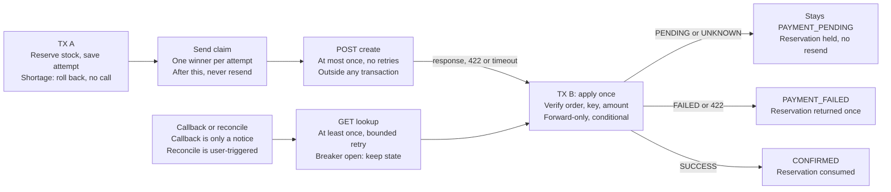

# Week 5 PG integration: mentor questions

Drafted 2026-10-21 from the round 5 Notion pages: the [assignment page (5주차 실습)](https://app.notion.com/p/5-3fb5f76d265480c2864ff1161078265f) and the [learning page (응답을 잃은 결제는 실패가 아니다)](https://app.notion.com/p/5-3fb5f76d2654806a8763d71b5f4a4344). The questions assume nothing about this repository's implementation. A copy lives in the [Claude doc](https://claude.ai/artifact/TfbT5HaH8kiJUeSddKDbVS).

If time is short, ask A1, A6 and C1 first. They decide what happens to an attempt that may or may not have reached the PG.

- **A1.** Where exactly is the "send record"?
- **A6.** Why is the circuit breaker only on the lookup path?
- **C1.** 망취소 (network cancel) versus reconciling by lookup.

## A. Things the spec leaves open

Each answer here changes what gets built.

**A1. Where exactly is the "send record"?**

- Is the commit of TX A itself the point after which create is never sent again?
- Or is there a separate step right before the HTTP call, such as a conditional update from READY to REQUESTED?
- If TX A's commit is the record, a crash between the commit and the HTTP call leaves an attempt that was never sent and can never be sent. Lookups for it return 0 results forever.

**A2. How does an attempt get out of UNKNOWN when lookups keep returning 0?**

- The page rules out both expiry and resending, so the attempt holds its reserved stock forever.
- Is "it stays stuck, and the PR lists that as a known limit" the intended answer? Or is a manual or admin way to resolve it expected?

**A3. What counts as "the same request" for `paymentAttemptKey`?**

- Reusing a key with a different request is a conflict, but the card number can't be stored, so it can't be compared.
- Is comparing orderId + amount + cardType enough? Hashing doesn't help: a 16-digit card number can be brute-forced from its hash.
- Is the key unique across all users, or only per user?

**A4. What happens when an order that already has an attempt receives a new key?**

- Return the existing attempt (200 or 202), or reject with 409?
- The page only says that no second PG attempt is created.

**A5. What should `POST /payments/callback` return?**

- When the lookup fails or the breaker is open, a 2xx tells a real PG to stop redelivering, and the signal is lost. A 5xx asks it to send again.
- Which status for each case: verified and applied, already final, mismatch or conflict, lookup unavailable?
- Should the callback verify synchronously, or store the notification and process it later?

**A6. Why is the circuit breaker only on the lookup path?**

- If a breaker or bulkhead rejects create before sending, we know for certain nothing reached the PG.
- Should create be guarded too?
- If create is rejected that way, does the attempt become FAILED with its stock returned, or stay sendable?

**A7. Does "connection refused" or a connect timeout prove the payment had no effect?**

- No bytes reached the PG, so it's stronger evidence than a read timeout. The exception is a proxy or load balancer in between.
- The page treats every timeout as UNKNOWN. Is that a deliberate simplification or a firm rule?

**A8. What about a conflict found after the attempt is already final?**

- Say the order was confirmed through transaction A, and a later lookup by orderId finds a second successful transaction B. That's a double charge.
- Refunds are out of scope, so what should be recorded and shown?

**A9. Once the transactionKey is known, is a lookup by that key enough to settle the payment?**

- Or must reconcile also list transactions by orderId to prove there is exactly one?
- Create is never resent, so a second transaction means a bug on our side or the PG's. Listing by orderId is the only way to catch it.

**A10. Why does the admin "set stock" now mean available stock rather than stock on hand?**

- Warehouse staff count physical stock. Stock on hand is available plus reserved.
- Should admins also see stock on hand as a calculated figure?

**A11. Users can still add points but can no longer spend them.** Is that intended, or should adding points be hidden too?

## B. Design decisions where a mentor's experience helps

The spec allows more than one answer to each of these.

**B1. Where does the payment attempt belong?**

- Inside the Order aggregate, or in a separate Payment aggregate?
- How do old POINT payments and new PG attempts sit side by side: one table with a payment-method column, or separate tables?

**B2. Should create be sent from the request thread or from a background worker?**

- An outbox-style worker lets confirm return 202 right after TX A.
- But such workers normally deliver at least once, and create must never be sent twice.
- Is sending once, inside the request, the right choice here?

**B3. After a timed-out create, should confirm run a short, limited lookup before returning 202?**

- The alternative is to leave it all to the callback and reconcile.
- The trade-off is faster resolution against a longer request. A 0-result lookup right after a timeout also tells you very little.

**B4. How do you size a circuit breaker for a path with little traffic?**

- Lookups come mostly from callbacks and manual reconciles, so `minimumNumberOfCalls` may never be reached.
- Should the sample window be based on a call count or on time?
- Which results count as failures: a 404 for an unknown key, an empty list, a 429?

**B5. Reconcile and callback both multiply outgoing traffic.**

- Each call triggers a PG lookup. A user hammering reconcile, or a flood of fake callbacks, can open the breaker and block real recovery.
- Is per-order throttling, or merging duplicate lookups, expected?

## C. How it's done in production

The assignment's local PG simplifies on purpose; these ask how real integrations differ.

**C1. 망취소 (network cancel) versus reconciling by lookup.**

- In Korean PG integrations, the usual response to a lost approval reply is a 망취소.
- Why does the assignment use lookup instead, and when do mentors' teams use each?
- A "cancel whatever exists for this orderId" call is also the only clean way to close the stuck attempt from A2.

**C2. When the PG supports idempotency keys (Stripe, Toss), do you retry create while the key is still valid?** Or do you still look up first?

**C3. For webhooks, do you check the signature, do an authoritative lookup, or both?** A lookup adds delay and uses up the PG's rate limit.

**C4. What's the real source of truth: reconciling through the API, or the PG's daily settlement file (정산 대사)?**

- How long can a payment stay UNKNOWN before someone in operations steps in?
- What do you monitor? For example: age of pending payments, number of conflicts, stock held in reservations.

**C5. Should providerOrderId be per order or per attempt?**

- PGs usually require a unique orderId for every payment attempt, so a later retry after failure would need a new one.
- Test environments that share one merchant account and reset their databases will send `LP-ORD-0000000042` again. Is an environment prefix needed?

## D. What the tests are expected to show

The assignment names the test scenes but not how much realism each one needs.

- **D1.** Must breaker state changes come from real failures and real waiting, or is calling `transitionToHalfOpenState()` (Resilience4j's manual switch) acceptable for the HALF_OPEN step?
- **D2.** For the "restart" scene, is a fresh Spring ApplicationContext expected, or are new service and client instances on the same DB enough?
- **D3.** For "internal save fails after the PG succeeded", what's an acceptable way to cause the failure: a spy on the repository, a database constraint, or a failing `TransactionSynchronization` (a hook that runs at commit)?

## Subtleties of building a resilient PG integration

Most of these are ways the "send create at most once" rule breaks by accident.

1. **Our own lookup ID must exist before we send.** providerOrderId has to be saved, or be computable, before the HTTP call. If the response is lost, it's the only way to find the transaction.
2. **0 results only means "not yet".** A create that timed out on our side may still be in progress inside the PG and show up after our lookup returned nothing.
3. **Every status update must be conditional, including the cautious ones.** Writing UNKNOWN in a timeout handler, or PENDING from a late create response, can overwrite a SUCCESS a callback already applied. Give the states an order and only update `WHERE status IN (states earlier than the target)`.
4. **A callback with an unseen transactionKey is how you recover, not noise.** After a lost create response we never learned the key. Filter on "this providerOrderId belongs to an unfinished attempt" instead of dropping unknown keys.
5. **Retries hide in many places.** The only proof is counting real create calls in a test.
    - OkHttp retries on connection failures by default.
    - Apache HttpClient 5 has its own retry strategy.
    - Proxies and service meshes retry 5xx responses and dropped connections.
    - A class-level `@Retry` on an adapter that also sends create retries create too.
6. **Resilience4j's default order wraps the circuit breaker inside the retry.** Every retry attempt counts as a breaker sample. Don't retry `CallNotPermittedException` (thrown when the breaker is open), and don't count business answers (404, empty list, 422) as breaker failures.
7. **A breaker rejection only proves "not sent" if it happens before the send record is saved.** Saved first, then rejected, leaves a "maybe sent" record for a call that never happened.
8. **Reused connections can create false UNKNOWNs.** If the PG already closed an idle kept-alive connection, a POST written to it fails with a reset, and you can't tell whether it arrived. Close idle connections sooner than the server does.
9. **Spring proxy traps.**
    - A class-level `@Transactional` on the method that runs the whole flow puts the HTTP call inside the transaction.
    - A method calling another method on the same object skips both `@Transactional` and `@CircuitBreaker`.
    - With open-in-view enabled, check whether a database connection stays in use during the PG call (Hikari's active-connection count shows it).
10. **Lock rows in the same order in TX A and TX B.** TX A locks product rows, then writes the attempt. A failure-path TX B that locks attempt and order first, then products, can deadlock with TX A and with admin stock edits.
11. **Card numbers leak in indirect ways.** A Kotlin `data class` `toString()` prints every field. Validation errors keep the rejected value and can end up in logs. HTTP client logging and exception messages include bodies.
12. **A timeout isn't a cancellation, and per-call timeouts aren't a total time limit.** Resilience4j's `TimeLimiter` can stop waiting while the socket and the PG keep going. The worst case is attempts × (connect + read timeout) + the waits between attempts, all on the request thread.
13. **By default the breaker doesn't move from OPEN to HALF_OPEN by itself** (`automaticTransitionFromOpenToHalfOpenEnabled=false`). It switches on the first call after the wait, so a test that sleeps and then checks for HALF_OPEN still sees OPEN.

## The core model

The design rests on three guarantees: create is sent at most once, lookups can repeat safely, and each result is applied exactly once.

Callback and reconcile only trigger a lookup; TX B is the one place a result changes the order and the stock. The send claim is drawn as its own step, which is one possible answer to A1.

The accepted cost: an attempt that was claimed but never actually sent stays stuck with its stock held, because nothing can prove it was never sent. A1, A2 and C1 all come back to that cost.
